 

  

 

<h1 align="center">Universidad Peruana de Ciencias Aplicadas</h1>
<h2 align="center">Carrera de Ingenieria de Software</h2>

<h4 align="center">Curso</h4>
<h3 align="center"><strong>Diseño de Experimentos de Ingenieria de Software - 1ASI0732</strong></h3>
<h4 align="center">NRC</h4>
<h3 align="center"><strong>9100</strong></h3>
<h4 align="center">Docente</h4>
<h3 align="center"><strong>Sanchez Ponce, Alex Humberto</strong></h3>
<h3 align="center"><strong>Informe de Trabajo Final</strong></h3>
<h4 align="center">Equipo</h4>
<h3 align="center"><strong>ShiftTech Solutions</strong></h3>
<h4 align="center">Proyecto</h4>
<h3 align="center"><strong>AutoService</strong></h3>

 

  

AutoService es una aplicacion web orientada a mejorar la eficiencia de talleres pequenos y aumentar la transparencia del servicio para el propietario del vehiculo.

<h3 align="center"><strong>Integrantes:</strong></h3>

  <table align="center">
    <thead>
      <tr>
        <th align="center">Codigo</th>
        <th align="center">Nombre</th>
      </tr>
    </thead>
    <tbody>
      <tr>
        <td align="center">U20231B781</td>
        <td align="center">Flores Eusebio, Angel Thyago</td>
      </tr>
      <tr>
        <td align="center">U202217678</td>
        <td align="center">Aquino Solorzano, Daniel Jonatan</td>
      </tr>
      <tr>
        <td align="center">U202315640</td>
        <td align="center">Soto Palacios, Brandon Wilder</td>
      </tr>
      <tr>
        <td align="center">U202319404</td>
        <td align="center">Sanchez Cuadrado, Juan Antonio</td>
      </tr>
      <tr>
        <td align="center">U202317807</td>
        <td align="center">Fernández, Mario Alonso</td>
      </tr>
      <tr>
        <td align="center"></td>
        <td align="center"></td>
      </tr>
    </tbody>
  </table>

<h3 align="center"><strong>Periodo 202620</strong></h3>
<h3 align="center"><strong>Octubre 2026</strong></h3>

# Registro de Versiones del Informe

| Versión | Fecha | Autor | Descripción de la modificación |
|---|---|---|---|
| 1 | 16/09/26 | Sanchez Cuadrado, Juan Antonio | **AV1:** Elaboración y revisión de los capítulos I al V, integración de la aplicación web y móvil, configuración de servicios de despliegue y documentación de evidencias técnicas. |
| 1 | 16/09/26 | Flores Eusebio, Angel Thyago | **AV1:** Documentación del informe, diseño de mockups en Figma, refinamiento de User Stories e implementación de los módulos Workshop y Staff de la aplicación móvil. |
| 1 | 16/09/26 | Soto Palacios, Brandon Wilder | **AV1:** Elaboración de documentación inicial, entrevistas al segmento de mecánicos independientes y desarrollo de componentes móviles de Customer Management y Customer Trust. |
| 1 | 16/09/26 | Aquino Solorzano, Daniel Jonatan | **AV1:** Entrevistas al segmento Vehicle Owners, documentación de GitHub Collaboration Insights, desarrollo del módulo Mechanic y distribución de la aplicación móvil mediante Firebase App Distribution. |
| 1 | 16/09/26 | Fernandez Seer, Mario Alonso | **AV1:** Implementación de Fleet Management e Inventory Management en Android, desarrollo de pruebas unitarias y validación de funcionalidades en modo demostración. |
| 2 | 04/10/26 | Sanchez Cuadrado, Juan Antonio | **TP:** Implementación y documentación de pruebas unitarias, de integración, BDD y de aceptación para Authentication & Access. Configuración de Continuous Integration del Backend mediante GitHub Actions. |
| 2 | 04/10/26 | Flores Eusebio, Angel Thyago | **TP:** Implementación del seguimiento público de órdenes de trabajo en Backend y Frontend, desarrollo de pruebas unitarias, de integración y de sistema con Selenium, y documentación de escenarios BDD. |
| 2 | 04/10/26 | Soto Palacios, Brandon Wilder | **TP:** Sin modificaciones específicas consignadas en el registro original. |
| 2 | 04/10/26 | Aquino Solorzano, Daniel Jonatan | **TP:** Desarrollo de pruebas unitarias, de integración y BDD para Workshop Operations, automatización de pruebas E2E del Frontend con Selenium y configuración de su pipeline de Continuous Integration. |
| 2 | 04/10/26 | Fernandez Seer, Mario Alonso | **TP:** Implementación y validación de Work Orders & Tasks, desarrollo de pruebas unitarias, de integración, BDD y de aceptación, y configuración del pipeline de Continuous Integration de Android. |
| 3 | 09/11/26 | Sanchez Cuadrado, Juan Antonio | **AV2:** Actualización de los capítulos VI y VII. Verificación de las 98 pruebas automatizadas del Backend, revisión de validaciones y controles de seguridad entre talleres, análisis de SonarQube Cloud y documentación de Continuous Integration, Continuous Delivery, Continuous Deployment y Continuous Monitoring. |
| 3 | 09/11/26 | Flores Eusebio, Angel Thyago | **AV2:** Revisión y documentación de pruebas del Frontend, validación del pipeline de Vue, análisis de entrevistas y evaluaciones heurísticas, y revisión de User Stories To-Be y Product Backlog del capítulo VIII. |
| 3 | 09/11/26 | Soto Palacios, Brandon Wilder | **AV2:** Participación en la documentación de entrevistas de validación, evaluación de necesidades de los usuarios y revisión de los hallazgos relacionados con la experiencia de uso de AutoService. |
| 3 | 09/11/26 | Aquino Solorzano, Daniel Jonatan | **AV2:** Revisión de las pruebas unitarias, de integración, BDD y de sistema del capítulo VI; documentación de entrevistas de validación y evaluaciones heurísticas; y estructuración de preguntas, hipótesis y criterios para los experimentos del capítulo VIII. |
| 3 | 09/11/26 | Fernandez Seer, Mario Alonso | **AV2:** Revisión de las pruebas y validaciones de Work Orders & Tasks, evaluación de la consistencia de los procesos operativos y revisión de historias de usuario y funcionalidades propuestas para el capítulo VIII. |

# Project Report Collaboration Insights

El informe del proyecto AutoService se desarrolla de manera colaborativa mediante GitHub, utilizando control de versiones para mantener la trazabilidad de los cambios realizados por los integrantes del equipo.

**Project Report Repository:**

https://github.com/upc-shift-tech-solutions-team-1/report

## AV1

Durante el AV1, el equipo utilizó el repositorio público del Project Report para trabajar de manera colaborativa sobre la documentación de AutoService. El historial de Git permitió mantener trazabilidad sobre las modificaciones realizadas y evidenciar la participación de los integrantes durante la elaboración y actualización de los capítulos del informe.

### Contributors

La siguiente evidencia corresponde a los analíticos de contribución del repositorio del informe durante el desarrollo del AV1.

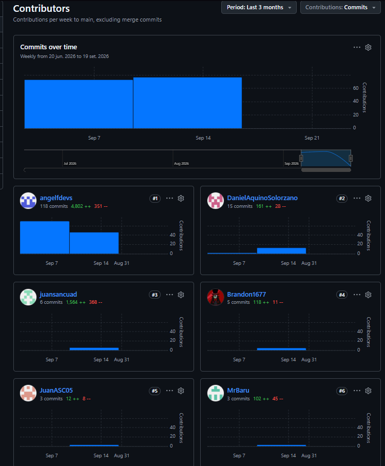

Los analíticos permiten observar la participación de los integrantes mediante contribuciones realizadas al repositorio. Esta evidencia complementa el Registro de Versiones del Informe y permite verificar que la documentación fue desarrollada de manera colaborativa.

### Commit History

La siguiente evidencia muestra parte del historial de commits realizados sobre el repositorio del Project Report durante el AV1.

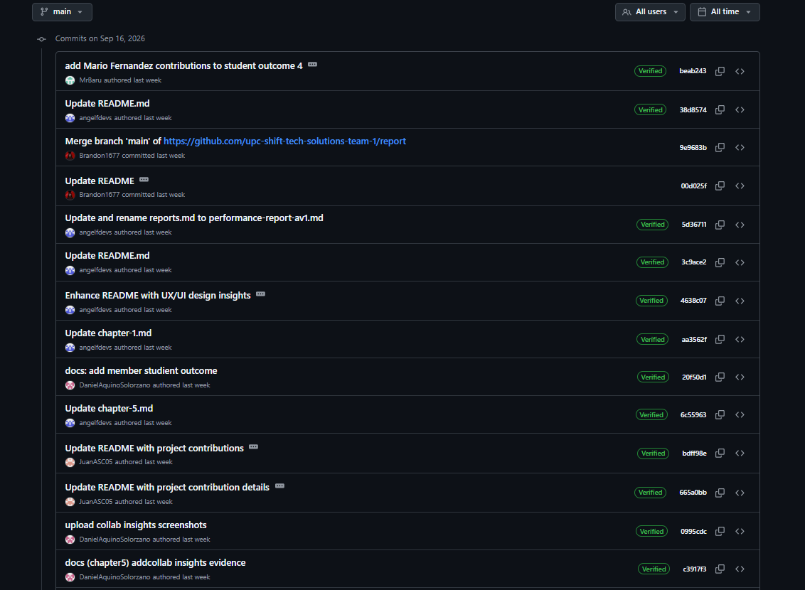

Asimismo, se conserva una segunda evidencia del historial con el objetivo de mostrar una mayor parte de las modificaciones registradas durante la entrega.

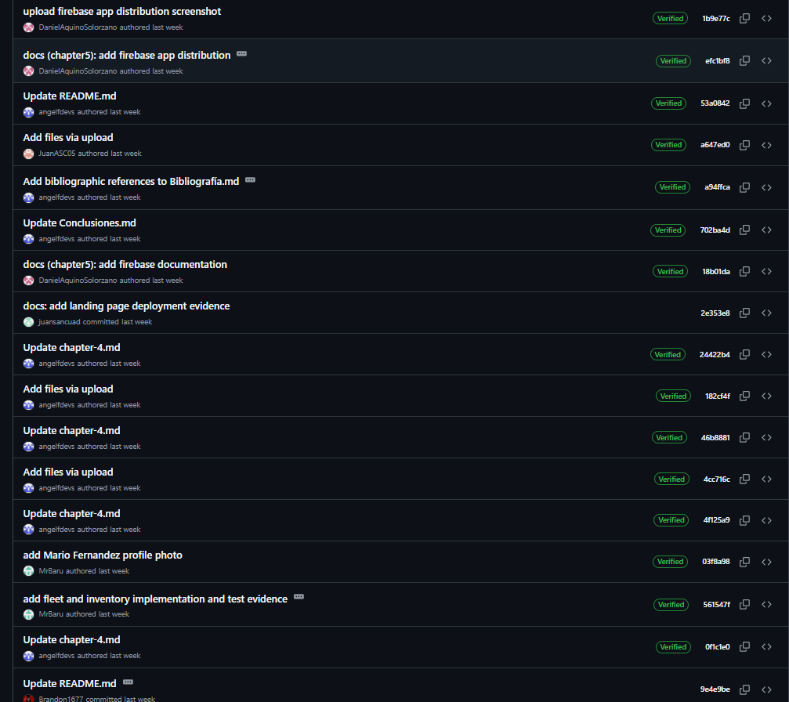

El historial permite identificar los autores, mensajes de commit y modificaciones incorporadas durante el desarrollo del informe. El uso de Git y GitHub permitió mantener trazabilidad de los cambios y conservar evidencia de la colaboración del equipo durante el AV1.

## Trabajo Parcial

Durante el TP, el equipo utilizó el repositorio público del Project Report para trabajar de manera colaborativa en la documentación de AutoService. El historial de Git permitió mantener la trazabilidad de las actualizaciones realizadas y registrar la participación de los integrantes en la elaboración del informe.

### Contributors

La siguiente evidencia corresponde a los analíticos de contribución del repositorio del informe durante el desarrollo del TP.

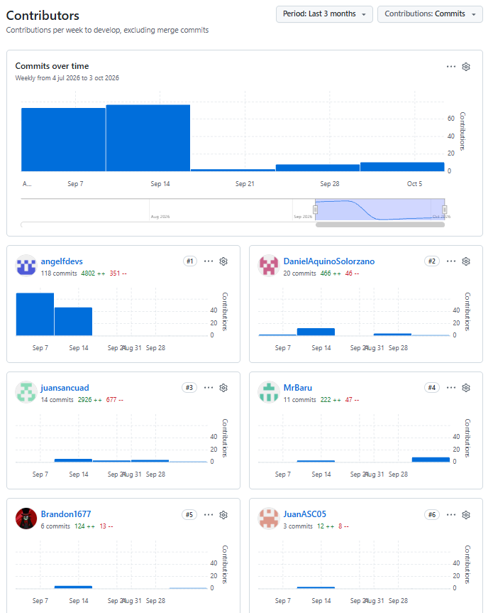

Los analíticos permiten observar las contribuciones registradas en el repositorio durante el desarrollo del informe. Esta evidencia complementa el historial de commits y ayuda a mostrar la participación colaborativa del equipo.

### Commit History

La siguiente evidencia muestra parte del historial de commits realizados en el repositorio del Project Report durante el TP.

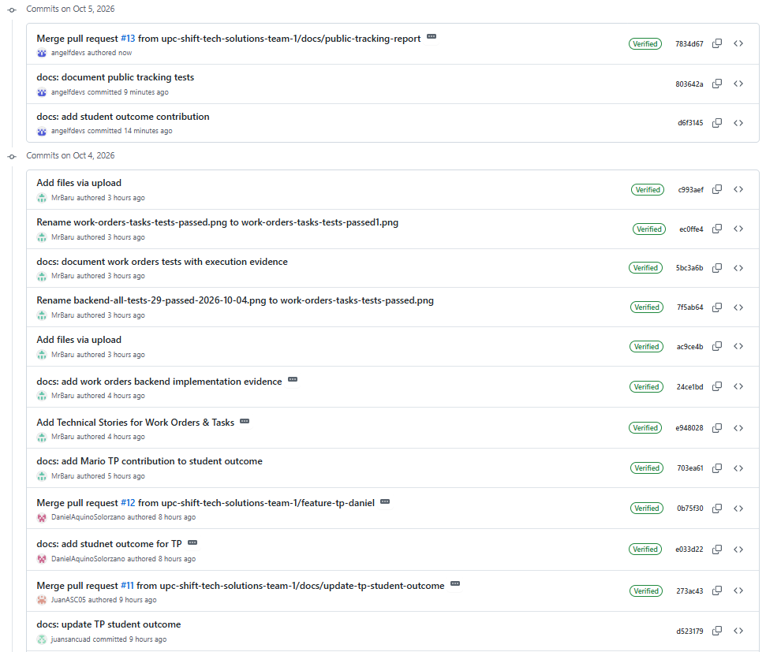

Se incluye una segunda captura para mostrar otras modificaciones registradas durante el trabajo colaborativo.

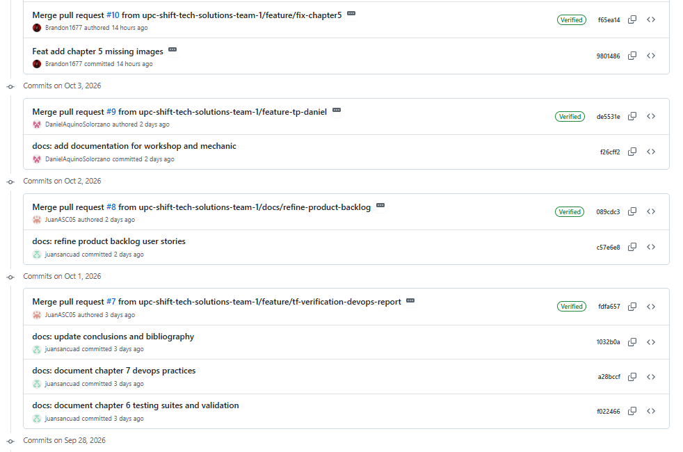

Se incluye una tercera captura para mostrar otras modificaciones registradas durante el trabajo colaborativo.

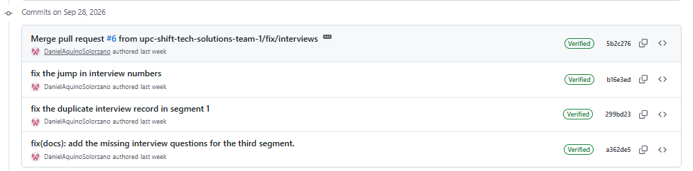

El historial permite identificar los autores, mensajes de commit y modificaciones incorporadas durante el desarrollo del informe. El uso de Git y GitHub permitió mantener trazabilidad de los cambios y conservar evidencia de la colaboración del equipo durante el TP.

## AV2

Durante el AV2, el desarrollo colaborativo de AutoService comprendió la actualización de los repositorios del Project Report, Backend, aplicación móvil y aplicación web.

En el informe se incorporó la documentación de Product Verification & Validation, DevOps Practices y Experiment-Driven Development, correspondiente a los capítulos VI, VII y VIII. Estas actividades incluyeron pruebas automatizadas, análisis estático de código, revisiones, entrevistas de validación, evaluaciones heurísticas, auditorías de experiencia de usuario y documentación de los procesos de integración y despliegue.

La colaboración se gestionó mediante GitHub, utilizando ramas de desarrollo, commits y Pull Requests para registrar las modificaciones e integrar los cambios realizados en los diferentes componentes de AutoService.

### Contributors

Las siguientes evidencias corresponden a los analíticos de contribución de GitHub para los repositorios utilizados durante el desarrollo del AV2.

#### Project Report Contributors

La siguiente captura presenta los registros de contribución del repositorio del informe, utilizado para documentar las actividades de verificación, validación, DevOps y experimentación del producto.

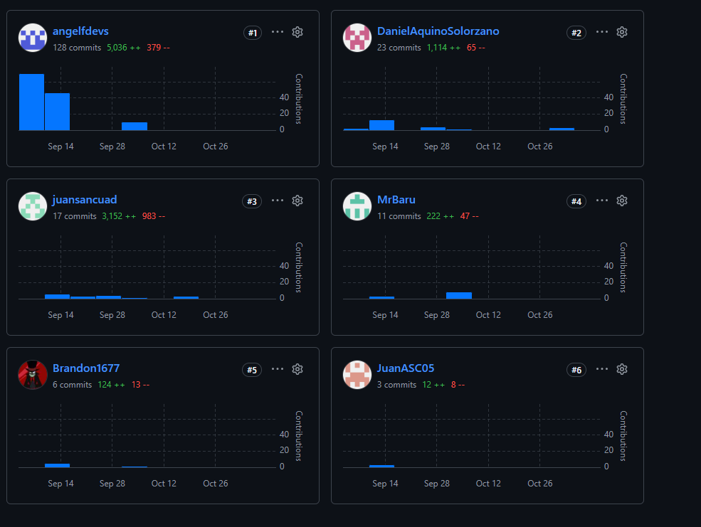

*Figura. Analíticos de contribución del repositorio Project Report durante el AV2.*

#### Backend Contributors

La siguiente evidencia corresponde al repositorio del Backend de AutoService, desarrollado con ASP.NET Core. En este componente se realizaron modificaciones relacionadas con las pruebas automatizadas, la validación de datos, el control de acceso y la configuración de los procesos de integración y despliegue.

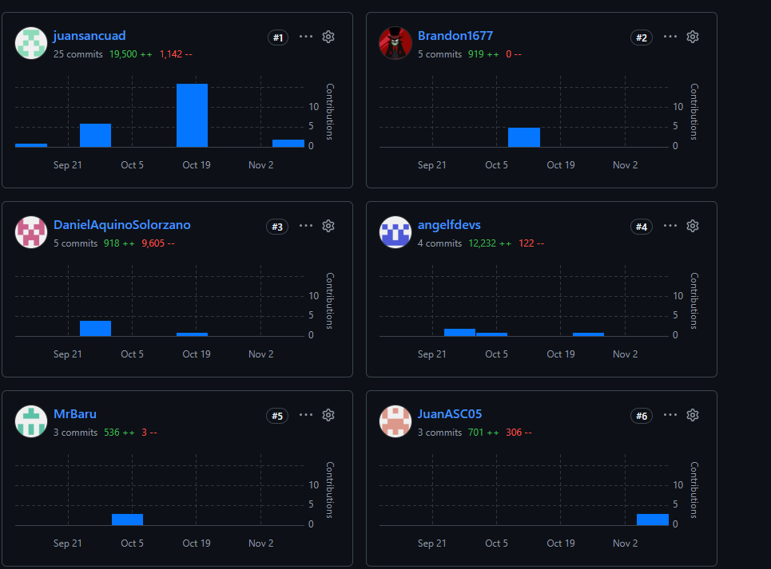

*Figura. Analíticos de contribución del repositorio Backend de AutoService.*

#### Mobile Contributors

La siguiente captura muestra los registros de contribución del repositorio de la aplicación móvil de AutoService.

Este repositorio contiene los componentes correspondientes a las funcionalidades móviles del sistema y permite consultar las modificaciones incorporadas por los desarrolladores durante el proyecto.

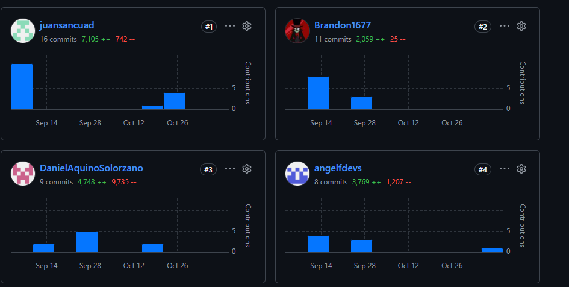

*Figura. Analíticos de contribución del repositorio de la aplicación móvil de AutoService.*

#### Web Contributors

La siguiente evidencia presenta las contribuciones registradas en el repositorio de la aplicación web de AutoService, desarrollado con Vue.

El historial de este repositorio permite consultar los cambios relacionados con los componentes de la interfaz, las funcionalidades web y las verificaciones incorporadas al proceso de desarrollo.

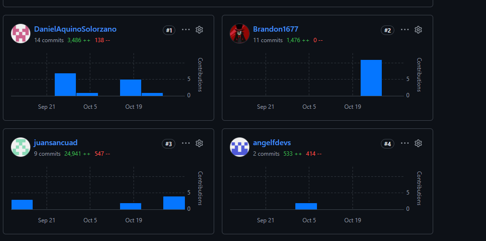

*Figura. Analíticos de contribución del repositorio de la aplicación web de AutoService.*

Los analíticos de contribución permiten identificar a los colaboradores y consultar su actividad registrada en cada repositorio. Esta información complementa los historiales de commits y los Pull Requests utilizados para integrar las modificaciones.

Las estadísticas pueden variar según el período consultado y las ramas consideradas por GitHub, por lo que no representan necesariamente la totalidad del trabajo realizado fuera de los repositorios.

### Commit History

La siguiente evidencia muestra parte del historial de commits correspondiente al repositorio del Project Report durante el AV2.

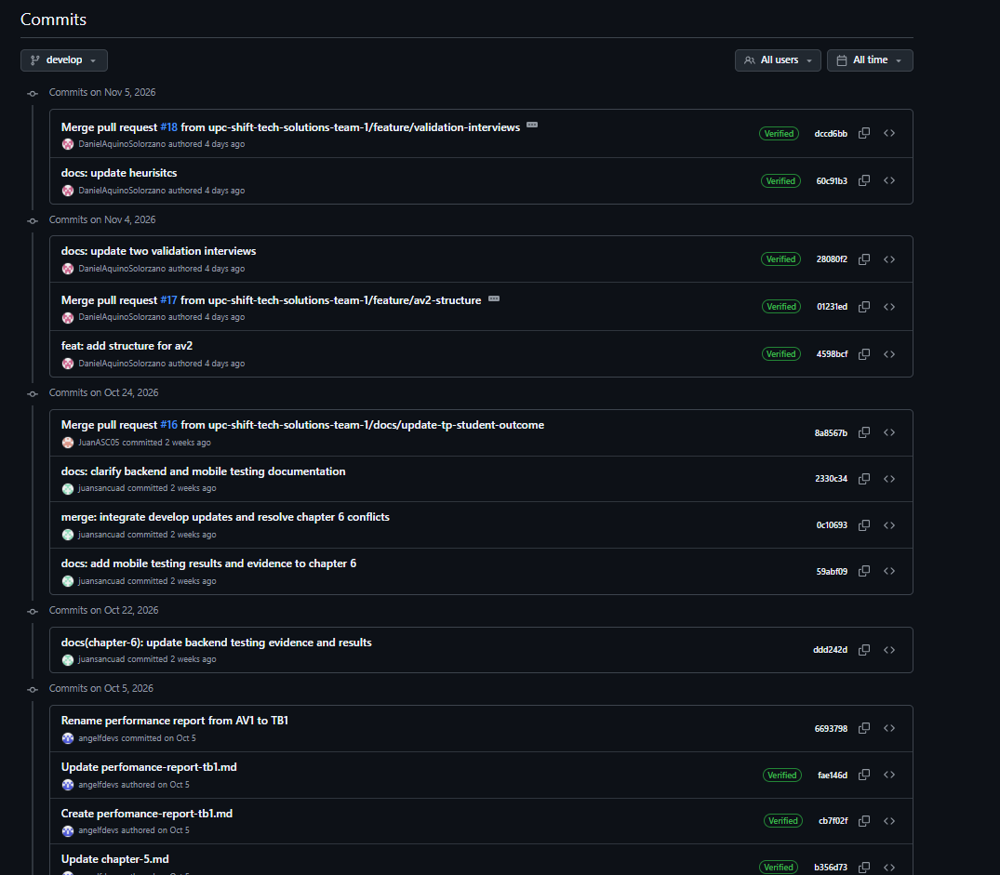

*Figura. Historial de commits del Project Report durante el AV2.*

Durante esta etapa se incorporaron modificaciones relacionadas con la estructura del segundo avance, la documentación de entrevistas de validación, las evaluaciones heurísticas y los apartados correspondientes a los capítulos VI, VII y VIII.

Se incluye una segunda captura del historial para presentar otras modificaciones registradas en el repositorio.

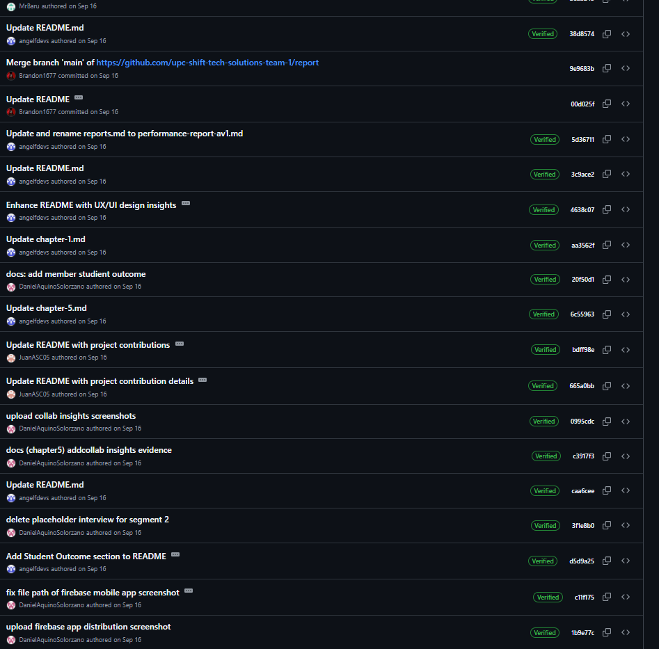

*Figura. Registro adicional de commits realizados en el repositorio Project Report.*

El historial permite identificar los autores, las fechas, los mensajes de commit y las modificaciones incorporadas durante la elaboración del informe.

El uso de GitHub permitió mantener la trazabilidad de los cambios y consultar las versiones anteriores de la documentación. Asimismo, los Pull Requests proporcionan un registro de la integración de las modificaciones en la rama `develop`, complementando la información presentada en los analíticos de contribución.

# Contenido

- [Registro de Versiones del informe](#registro-de-versiones-del-informe)
- [Project Report Collaboration Insights](#project-report-collaboration-insights)
- [Student Outcome](#student-outcome)

- [Part I: As-Is Software Project](./markdown/content/chapter-1.md)

  - [Capítulo I: Introducción](./markdown/content/chapter-1.md)
    - [1.1. Startup Profile](./markdown/content/chapter-1.md#11-startup-profile)
      - [1.1.1. Descripción de la Startup](./markdown/content/chapter-1.md#111-descripción-de-la-startup)
      - [1.1.2. Perfiles de integrantes del equipo](./markdown/content/chapter-1.md#112-perfiles-de-integrantes-del-equipo)
    - [1.2. Solution Profile](./markdown/content/chapter-1.md#12-solution-profile)
      - [1.2.1. Antecedentes y problemática](./markdown/content/chapter-1.md#121-antecedentes-y-problemática)
      - [1.2.2. Lean UX Process](./markdown/content/chapter-1.md#122-lean-ux-process)
        - [1.2.2.1. Lean UX Problem Statements](./markdown/content/chapter-1.md#1221-lean-ux-problem-statements)
        - [1.2.2.2. Lean UX Assumptions](./markdown/content/chapter-1.md#1222-lean-ux-assumptions)
        - [1.2.2.3. Lean UX Hypothesis Statements](./markdown/content/chapter-1.md#1223-lean-ux-hypothesis-statements)
        - [1.2.2.4. Lean UX Canvas](./markdown/content/chapter-1.md#1224-lean-ux-canvas)
    - [1.3. Segmentos objetivo](./markdown/content/chapter-1.md#13-segmentos-objetivo)

  - [Capítulo II: Requirements Elicitation & Analysis](./markdown/content/chapter-2.md)
    - [2.1. Competidores](./markdown/content/chapter-2.md#21-competidores)
      - [2.1.1. Análisis competitivo](./markdown/content/chapter-2.md#211-análisis-competitivo)
      - [2.1.2. Estrategias y tácticas frente a competidores](./markdown/content/chapter-2.md#212-estrategias-y-tácticas-frente-a-competidores)
    - [2.2. Entrevistas](./markdown/content/chapter-2.md#22-entrevistas)
      - [2.2.1. Diseño de entrevistas](./markdown/content/chapter-2.md#221-diseño-de-entrevistas)
      - [2.2.2. Registro de entrevistas](./markdown/content/chapter-2.md#222-registro-de-entrevistas)
      - [2.2.3. Análisis de entrevistas](./markdown/content/chapter-2.md#223-análisis-de-entrevistas)
    - [2.3. Needfinding](./markdown/content/chapter-2.md#23-needfinding)
      - [2.3.1. User Personas](./markdown/content/chapter-2.md#231-user-personas)
      - [2.3.2. User Task Matrix](./markdown/content/chapter-2.md#232-user-task-matrix)
      - [2.3.3. User Journey Mapping](./markdown/content/chapter-2.md#233-user-journey-mapping)
      - [2.3.4. Empathy Mapping](./markdown/content/chapter-2.md#234-empathy-mapping)
      - [2.3.5. As-is Scenario Mapping](./markdown/content/chapter-2.md#235-as-is-scenario-mapping)
    - [2.4. Ubiquitous Language](./markdown/content/chapter-2.md#24-ubiquitous-language)

  - [Capítulo III: Requirements Specification](./markdown/content/chapter-3.md)
    - [3.1. To-Be Scenario Mapping](./markdown/content/chapter-3.md#31-to-be-scenario-mapping)
    - [3.2. User Stories](./markdown/content/chapter-3.md#32-user-stories)
    - [3.3. Product Backlog](./markdown/content/chapter-3.md#33-product-backlog)
    - [3.4. Impact Mapping](./markdown/content/chapter-3.md#34-impact-mapping)

  - [Capítulo IV: Product Design](./markdown/content/chapter-4.md)
    - [4.1. Style Guidelines](./markdown/content/chapter-4.md#41-style-guidelines)
      - [4.1.1. General Style Guidelines](./markdown/content/chapter-4.md#411-general-style-guidelines)
      - [4.1.2. Web Style Guidelines](./markdown/content/chapter-4.md#412-web-style-guidelines)
      - [4.1.3. Mobile Style Guidelines](./markdown/content/chapter-4.md#413-mobile-style-guidelines)
    - [4.2. Information Architecture](./markdown/content/chapter-4.md#42-information-architecture)
    - [4.3. Landing Page UI Design](./markdown/content/chapter-4.md#43-landing-page-ui-design)
    - [4.4. Mobile Applications UX/UI Design](./markdown/content/chapter-4.md#44-mobile-applications-uxui-design)
    - [4.5. Mobile Applications Prototyping](./markdown/content/chapter-4.md#45-mobile-applications-prototyping)
    - [4.6. Web Applications UX/UI Design](./markdown/content/chapter-4.md#46-web-applications-uxui-design)
    - [4.7. Web Applications Prototyping](./markdown/content/chapter-4.md#47-web-applications-prototyping)
    - [4.8. Domain-Driven Software Architecture](./markdown/content/chapter-4.md#48-domain-driven-software-architecture)
    - [4.9. Software Object-Oriented Design](./markdown/content/chapter-4.md#49-software-object-oriented-design)
    - [4.10. Database Design](./markdown/content/chapter-4.md#410-database-design)

  - [Capítulo V: Product Implementation](./markdown/content/chapter-5.md)
    - [5.1. Software Configuration Management](./markdown/content/chapter-5.md#51-software-configuration-management)
      - [5.1.1. Software Development Environment Configuration](./markdown/content/chapter-5.md#511-software-development-environment-configuration)
      - [5.1.2. Source Code Management](./markdown/content/chapter-5.md#512-source-code-management)
      - [5.1.3. Source Code Style Guide & Conventions](./markdown/content/chapter-5.md#513-source-code-style-guide--conventions)
      - [5.1.4. Software Deployment Configuration](./markdown/content/chapter-5.md#514-software-deployment-configuration)
    - [5.2. Product Implementation & Deployment](./markdown/content/chapter-5.md#52-product-implementation--deployment)
      - [5.2.1. Sprint Backlogs](./markdown/content/chapter-5.md#521-sprint-backlogs)
      - [5.2.2. Implemented Landing Page Evidence](./markdown/content/chapter-5.md#522-implemented-landing-page-evidence)
      - [5.2.3. Implemented Frontend-Web Application Evidence](./markdown/content/chapter-5.md#523-implemented-frontend-web-application-evidence)
      - [5.2.4. Acuerdo de Servicio - SaaS](./markdown/content/chapter-5.md#524-acuerdo-de-servicio---saas)
      - [5.2.5. Implemented Native-Mobile Application Evidence](./markdown/content/chapter-5.md#525-implemented-native-mobile-application-evidence)
      - [5.2.6. Implemented RESTful API and/or Serverless Backend Evidence](./markdown/content/chapter-5.md#526-implemented-restful-api-andor-serverless-backend-evidence)
      - [5.2.7. RESTful API Documentation](./markdown/content/chapter-5.md#527-restful-api-documentation)
      - [5.2.8. Team Collaboration Insights](./markdown/content/chapter-5.md#528-team-collaboration-insights)
    - [5.3. Video About-the-Product](./markdown/content/chapter-5.md#53-video-about-the-product)

- [Part II: Verification, Validation & Pipeline](./markdown/content/chapter-6.md)

  - [Capítulo VI: Product Verification & Validation](./markdown/content/chapter-6.md)
    - [6.1. Testing Suites & Validation](./markdown/content/chapter-6.md#61-testing-suites--validation)
      - [6.1.1. Core Entities Unit Tests](./markdown/content/chapter-6.md#611-core-entities-unit-tests)
      - [6.1.2. Core Integration Tests](./markdown/content/chapter-6.md#612-core-integration-tests)
      - [6.1.3. Core Behavior-Driven Development](./markdown/content/chapter-6.md#613-core-behavior-driven-development)
      - [6.1.4. Core System Tests](./markdown/content/chapter-6.md#614-core-system-tests)
    - [6.2. Static testing & Verification](./markdown/content/chapter-6.md#62-static-testing--verification)
      - [6.2.1. Static Code Analysis](./markdown/content/chapter-6.md#621-static-code-analysis)
        - [6.2.1.1. Coding standard & Code conventions.](./markdown/content/chapter-6.md#6211-coding-standard--code-conventions)
        - [6.2.1.2. Code Quality & Code Security.](./markdown/content/chapter-6.md#6212-code-quality--code-security)
      - [6.2.2. Reviews](./markdown/content/chapter-6.md#622-reviews)
    - [6.3. Validation Interviews.](./markdown/content/chapter-6.md#63-validation-interviews)
      - [6.3.1. Diseño de Entrevistas.](./markdown/content/chapter-6.md#631-diseño-de-entrevistas)
      - [6.3.2. Registro de Entrevistas](./markdown/content/chapter-6.md#632-registro-de-entrevistas)
      - [6.3.3. Evaluacionessegún heurísticas.](./markdown/content/chapter-6.md#633-evaluacionessegún-heurísticas)
    - [6.4. Auditoría de Experiencias de Usuario.](./markdown/content/chapter-6.md#64-auditoría-de-experiencias-de-usuario)
      - [6.4.1. Auditoría realizada.](./markdown/content/chapter-6.md#641-auditoría-realizada)
        - [6.4.1.1. Información del grupo auditado.](./markdown/content/chapter-6.md#6411-información-del-grupo-auditado)
        - [6.4.1.2. Cronograma de auditoría realizada](./markdown/content/chapter-6.md#6412-cronograma-de-auditoría-realizada)
        - [6.4.1.3. Contenido de auditoría realizada.](./markdown/content/chapter-6.md#6413-contenido-de-auditoría-realizada)
      - [6.4.2. Auditoría recibida.](./markdown/content/chapter-6.md#642-auditoría-recibida)
        - [6.4.2.1. Información del grupo auditor](./markdown/content/chapter-6.md#6421-información-del-grupo-auditor)
        - [6.4.2.2. Cronograma de auditoría recibida.](./markdown/content/chapter-6.md#6422-cronograma-de-auditoría-recibida)
        - [6.4.2.3. Contenido de auditoría recibida.](./markdown/content/chapter-6.md#6423-contenido-de-auditoría-recibida)
        - [6.4.2.4. Resumen de modificaciones para subsanar hallazgos.](./markdown/content/chapter-6.md#6424-resumen-de-modificaciones-para-subsanar-hallazgos)    
  - [Capítulo VII: DevOps Practices](./markdown/content/chapter-7.md)
    - [7.1. Continuous Integration](./markdown/content/chapter-7.md#71-continuous-integration)
      - [7.1.1. Tools and Practices](./markdown/content/chapter-7.md#711-tools-and-practices)
      - [7.1.2. Build & Test Suite Pipeline Components](./markdown/content/chapter-7.md#712-build--test-suite-pipeline-components)
    - [7.2. Continuous Delivery](./markdown/content/chapter-7.md#72-continuous-delivery)
      - [7.2.1. Tools and Practices](./markdown/content/chapter-7.md#721-tools-and-practices)
      - [7.2.2. Stages Deployment Pipeline Components](./markdown/content/chapter-7.md#722-stages-deployment-pipeline-components)
    - [7.3. Continuous Deployment](./markdown/content/chapter-7.md#73-continuous-deployment)
      - [7.3.1. Tools and Practices](./markdown/content/chapter-7.md#731-tools-and-practices)
      - [7.3.2. Production Deployment Pipeline Components](./markdown/content/chapter-7.md#732-production-deployment-pipeline-components)
    - [7.4. Continuous Monitoring](./markdown/content/chapter-7.md#74-continuous-monitoring)
      - [7.4.1. Tools and Practices](./markdown/content/chapter-7.md#741-tools-and-practices)
      - [7.4.2. Monitoring Pipeline Components](./markdown/content/chapter-7.md#742-monitoring-pipeline-components)
      - [7.4.3. Alerting Pipeline Components](./markdown/content/chapter-7.md#743-alerting-pipeline-components)
      - [7.4.4. Notification Pipeline Components.](./markdown/content/chapter-7.md#744-notification-pipeline-components)
  - [Capítulo VIII: Experiment-Driven Development](./markdown/content/chapter-8.md)
    - [8.1. Experiment Planning](./markdown/content/chapter-8.md#81-experiment-planning)
      - [8.1.1. As-Is Summary.](./markdown/content/chapter-8.md#811-as-is-summary)
      - [8.1.2. Raw Material: Assumptions, Knowledge Gaps, Ideas, Claims](./markdown/content/chapter-8.md#812-raw-material-assumptions-knowledge-gaps-ideas-claims)
      - [8.1.3. Experiment-Ready Questions.](./markdown/content/chapter-8.md#813-experiment-ready-questions)
      - [8.1.4. Question Backlog.](./markdown/content/chapter-8.md#814-question-backlog)
      - [8.1.5. Experiment Cards](./markdown/content/chapter-8.md#815-experiment-cards)
    - [8.2. Experiment Design](./markdown/content/chapter-8.md#82-experiment-design)
      - [8.2.1. Hypotheses.](./markdown/content/chapter-8.md#821-hypotheses)
      - [8.2.2. Domain Business Metrics](./markdown/content/chapter-8.md#822-domain-business-metrics)
      - [8.2.3. Measures.](./markdown/content/chapter-8.md#823-measures)
      - [8.2.4. Conditions.](./markdown/content/chapter-8.md#824-conditions)
      - [8.2.5. Scale Calculations and Decisions.](./markdown/content/chapter-8.md#825-scale-calculations-and-decisions)
      - [8.2.6. Methods Selection.](./markdown/content/chapter-8.md#826-methods-selection)
      - [8.2.7. Data Analytics: Goals, KPIs and Metrics Selection.](./markdown/content/chapter-8.md#827-data-analytics-goals-kpis-and-metrics-selection)
      - [8.2.8. Web and Mobile Tracking Plan.](./markdown/content/chapter-8.md#828-web-and-mobile-tracking-plan)
    - [8.3. Experimentation](./markdown/content/chapter-8.md#83-experimentation)
      - [8.3.1. To-Be User Stories.](./markdown/content/chapter-8.md#831-to-be-user-stories)
      - [8.3.2. To-Be Product Backlog](./markdown/content/chapter-8.md#832-to-be-product-backlog)
- [Conclusiones](./markdown/content/Conclusiones.md)
- [Bibliografía](./markdown/content/Bibliografía.md)
- [Anexos](./markdown/content/Anexos.md)

# Student Outcome

El presente apartado evidencia el cumplimiento del **ABET – EAC – Student Outcome 4**: <b>La capacidad de reconocer responsabilidades éticas y profesionales en situaciones de ingeniería y hacer juicios informados, que deben considerar el impacto de las soluciones de ingeniería en contextos globales, económicos, ambientales y sociales.</b>

- <b>AV1:</b> Documentación de los capítulos I al V, desarrollo y despliegue de las aplicaciones web y móvil.
- <b>TP:</b> Implementación de pruebas de software, validación de funcionalidades y configuración inicial de los procesos de integración continua.
- <b>AV2:</b> Verificación y validación del producto, análisis estático de código, prácticas DevOps, entrevistas de validación, auditoría de experiencias de usuario y planificación de experimentos, correspondientes a los capítulos VI, VII y VIII.

<table>
    <tr>
        <td align="center"><b>Criterio específico</b></td>
        <td align="center"><b>Acciones realizadas</b></td>
        <td align="center"><b>Conclusiones</b></td>
    </tr>
    <tr>
        <td rowspan="5">
            <b>4.c.1. Reconoce responsabilidad ética y profesional en situaciones de ingeniería de software</b>
        </td>
        <td>
            <b>Aquino Solorzano, Daniel Jonatan</b> 
            <i>AV1</i>
            
Durante el ciclo de desarrollo de AutoService, ejercí la responsabilidad ética y el rigor profesional en múltiples etapas críticas: gestioné el consentimiento informado y la privacidad de los participantes al realizar las entrevistas del segmento Vehicle Owners, garantizando una recolección íntegra de requerimientos sin sesgos intencionales; mantuve la transparencia y autoría técnica veraz del equipo al consolidar y subir los GitHub Collaboration Insights; aseguré la integridad en la entrega de software al configurar el despliegue restringido de los artefactos .apk mediante Firebase App Distribution solo a verificadores autorizados, evitando la exposición de versiones inestables; y apliqué estándares de calidad, mantenibilidad y desacoplamiento arquitectónico al modelar e implementar el Bounded Context "Mechanic" en la aplicación móvil, cumpliendo con el compromiso deontológico de entregar una solución técnica robusta, segura y alineada a las necesidades reales del dominio.

            <i>TP</i>
            
Durante el desarrollo del proyecto, demostré responsabilidad ética y profesional al priorizar la entrega de software robusto, confiable y seguro mediante la adopción de rigurosas prácticas de aseguramiento de calidad (QA). Diseñé e implementé pruebas unitarias, de servicio y de integración para el módulo de Workshop Operations, asegurando la consistencia lógica de las operaciones críticas y la integridad de los datos procesados. Asimismo, integré pruebas de sistema automatizadas en el frontend con Selenium para los módulos de Workshop y Mechanic, y formulé pruebas Behavior-Driven Development (BDD) en el backend, lo que garantizó que el sistema cumpla fielmente con los requerimientos y expectativas de negocio pactadas. Complementariamente, configuré un flujo de integración continua (CI) en GitHub Actions para la aplicación web, asumiendo el compromiso ético de prevenir despliegues defectuosos y mitigar riesgos técnicos de forma transparente antes de su puesta en producción.

            <i>AV2</i>
            
En el AV2 participé en la verificación y validación del producto, principalmente en la revisión de pruebas unitarias, de integración, BDD y de sistema correspondientes al capítulo VI. La revisión de estos escenarios permitió contrastar las funcionalidades desarrolladas con las reglas de negocio y los resultados esperados, prestando especial atención a la consistencia de los datos y al comportamiento de los módulos operativos. También colaboré en la organización de la información obtenida mediante entrevistas de validación y evaluaciones heurísticas, considerando la privacidad de los participantes y la necesidad de distinguir las observaciones registradas de las interpretaciones del equipo. En el capítulo VIII contribuí a la estructuración de preguntas, hipótesis y criterios de evaluación para futuros experimentos, evitando presentar supuestos como resultados comprobados.

        </td>
        <td rowspan="5">
            <i>AV1</i>
            
El AV1 permitió al equipo reconocer que desarrollar AutoService exige más que construir interfaces y funcionalidades. La definición del modelo de negocio, el análisis de necesidades, la refinación de requisitos y el diseño de las experiencias web y móvil hicieron necesario considerar la privacidad de la información, los permisos de cada rol y la claridad de los procesos. Asimismo, el equipo identificó su responsabilidad de documentar con transparencia las decisiones tomadas y distinguir los prototipos de las funciones efectivamente implementadas. Estas prácticas constituyen una base para continuar el desarrollo y la validación del producto de manera profesional.

             
            <i>TP</i>
            
El Trabajo Parcial permitió al equipo fortalecer su responsabilidad profesional mediante la incorporación de prácticas de verificación, seguridad y automatización sobre AutoService. La implementación de pruebas unitarias, de integración y de aceptación permitió comprobar comportamientos antes de considerar una funcionalidad como validada, mientras que los mecanismos de autenticación, autorización y protección de credenciales reforzaron el tratamiento responsable de la información. Asimismo, el equipo mantuvo transparencia al diferenciar las pruebas automatizadas de las especificaciones BDD aún pendientes de automatización y utilizó Continuous Integration para verificar los cambios antes de su incorporación, reforzando una cultura de calidad y trazabilidad durante el desarrollo.

             
            <i>AV2</i>
            
El AV2 incorporó actividades de verificación estática, análisis de seguridad, revisión de código, validación con usuarios y automatización de los procesos de integración y despliegue. En el Backend se registraron 98 pruebas automatizadas aprobadas, mientras que SonarQube Cloud reportó un Quality Gate satisfactorio y una cobertura del 91.07 % sobre el código nuevo. El análisis también identificó una cobertura general del 47.7 % y problemas de confiabilidad y mantenibilidad que permanecen registrados. La publicación de versiones mediante GitHub Releases, el despliegue controlado en Render y la comprobación del endpoint de salud aportaron evidencias adicionales del funcionamiento del entorno. Las entrevistas, evaluaciones heurísticas y actividades de planificación experimental permitieron complementar la revisión técnica con criterios relacionados con los usuarios y sus necesidades. Los resultados se documentaron diferenciando las verificaciones realizadas de las limitaciones todavía presentes.

        </td>
    </tr>
    <tr>
        <td>
            <b>Flores Eusebio, Angel Thyago</b> 
            <i>AV1</i>
            
La refinación de los requisitos, el diseño UX/UI en Figma y el desarrollo de Workshop y Staff me permitieron reconocer que una interfaz funcional también debe ser clara y respetar las responsabilidades de cada rol. Durante el trabajo procuré mantener coherencia entre las User Stories, los prototipos y el frontend móvil, diferenciando las funcionalidades implementadas de las que aún dependen del backend. Esto reforzó la importancia de comunicar con transparencia el estado real del producto y de considerar el acceso adecuado a la información del taller.

             
            <i>TP</i>
            
En mi participación en AutoService asumí responsabilidad profesional al documentar y validar el módulo con cuatro pruebas unitarias, una de integración, dos de sistema con Selenium y una especificación BDD, además de revisar la automatización de integración y despliegue. En el seguimiento público reconocí que facilitar la consulta del estado del vehículo debe equilibrarse con la protección de los datos. Por ello, identifiqué como mejora pendiente reforzar el control de acceso ante la posible modificación del identificador de seguimiento.

             
            <i>AV2</i>
            
Durante el AV2 participé en la revisión de funcionalidades del Frontend y en la documentación de las pruebas asociadas a los módulos de Workshop y Mechanic. La ejecución de pruebas automatizadas y la revisión del pipeline de Vue permitieron comprobar los principales flujos de la interfaz antes de incorporar modificaciones. También contribuí al análisis de los resultados de validación de usuarios y de las evaluaciones heurísticas, considerando aspectos como la claridad de la navegación, la presentación de información y el acceso adecuado a los recursos del taller. En la planificación del capítulo VIII participé en la revisión de historias de usuario To-Be y en su relación con las necesidades identificadas, procurando diferenciar las funcionalidades existentes de las propuestas que todavía requieren evaluación.

        </td>
    </tr>
    <tr>
        <td>
            <b>Soto Palacios, Brandon Wilder</b> 
            <i>AV1</i>
            
En este primer avance del proyecto AutoService, contribuí en las bases principales del proyecto, además a travez de valores como respeto, integridad, seguridad y empatía realicé las entrevistas del segmento numero uno, de los mecánicos independientes. Posteriormente elaboré las correctar descripciones acorde al formato establecido, y sus adecuados análisis que recopilan información importante para el proyecto. Asimismo contribuí con la realización de módulos de customer management y customer trust del apartado de aplicación móvil, tod con los lineamientos establecidos por el equipo y el curso presente.

             
            <i>AV2</i>
            
En el AV2 participé en la revisión de información relacionada con la validación del producto y las necesidades de los usuarios. Las entrevistas y evaluaciones de experiencia de usuario permitieron considerar aspectos de privacidad, claridad de las preguntas y tratamiento adecuado de las observaciones. También se revisó la relación entre los hallazgos y las necesidades de los segmentos definidos para AutoService.

        </td>
    </tr>
    <tr>
        <td>
            <b>Sanchez Cuadrado, Juan Antonio</b> 
            <i>AV1</i>
            
Participé en la elaboración y revisión de la documentación técnica del proyecto AutoService desde los capítulos 1 al 5, procurando mantener coherencia entre los requerimientos, el diseño, la implementación y las evidencias presentadas. Asimismo, participé en la integración y configuración de los productos del proyecto, incluyendo la aplicación Web, la aplicación móvil, la RESTful API y los servicios de despliegue. Durante este proceso consideré prácticas profesionales como el uso responsable del control de versiones, la protección de credenciales mediante variables de entorno, la validación de los cambios antes de integrarlos y la documentación transparente de funcionalidades implementadas y pendientes.

             
            <i>TP</i>
            
Durante el Trabajo Parcial reforcé mi responsabilidad profesional mediante el desarrollo y validación del módulo Authentication & Access de AutoService. Implementé y revisé pruebas unitarias sobre Sign Up y Sign In, verificando el hashing seguro de contraseñas con BCrypt y la generación de JWT, además de pruebas de integración y Acceptance/System Tests para comprobar autenticación y autorización según roles. También documenté escenarios BDD en Gherkin, indicando de manera transparente que permanecen como especificaciones no automatizadas. Complementariamente, participé en la configuración de Continuous Integration del backend con GitHub Actions, incorporando build y ejecución automática de pruebas antes de integrar cambios, y manteniendo credenciales y secretos fuera del código fuente mediante Environment Variables.

             
            <i>AV2</i>
            
En el AV2 participé principalmente en las actividades de verificación, seguridad y DevOps del Backend de AutoService. Revisé las validaciones de CustomerId y los controles que restringen el acceso a vehículos según el taller autenticado, incluyendo escenarios donde un usuario intenta consultar o modificar recursos pertenecientes a otro taller. También verifiqué la ejecución de la suite automatizada, que alcanzó 98 pruebas aprobadas sin fallos. En el análisis estático de código revisé los resultados de SonarQube Cloud, diferenciando la cobertura del código nuevo, de 91.07 %, de la cobertura general, de 47.7 %, y registrando los problemas de Reliability y Maintainability identificados. En el capítulo VII trabajé en la documentación y verificación de Continuous Integration con GitHub Actions, Continuous Delivery mediante GitHub Releases, Continuous Deployment con Docker y Render, y Continuous Monitoring mediante registros de ejecución y el endpoint /health. Se comprobó el despliegue automático después de superar los checks de CI y la respuesta Healthy del servicio en producción. Las modificaciones y evidencias se documentaron conservando la trazabilidad de los commits, los Pull Requests y los resultados obtenidos.

        </td>
    </tr>
    <tr>
        <td>
            <b>Fernandez Seer, Mario Alonso</b> 
            <i>AV1</i>
            
Participé en la implementación de los módulos Fleet Management e Inventory Management de la aplicación Android. Incorporé 22 pruebas unitarias y comprobé los flujos de registro y edición de vehículos, creación de productos y recepción de existencias en modo demo. Como parte de mi responsabilidad profesional, distinguí los resultados obtenidos con datos de demostración de la integración real con el servidor, que quedó pendiente de validación. Esto permite presentar evidencias verificables y comunicar las limitaciones del avance sin atribuir resultados a pruebas que todavía no se han realizado.

             
            <i>TP</i>
            
Durante el Trabajo Parcial asumí la revisión e implementación del flujo de Work Orders & Tasks de AutoService. Completé la operación REST faltante para eliminar órdenes de trabajo y desarrollé dos pruebas unitarias con MSTest y Moq, una prueba de integración, una especificación BDD con dos escenarios y una prueba de aceptación del flujo principal. También configuré el pipeline de Continuous Integration de la aplicación móvil para ejecutar automáticamente las pruebas unitarias, compilar la aplicación y generar el APK de depuración. Estas actividades permitieron verificar los cambios antes de integrarlos, mantener trazabilidad mediante Git y comunicar de manera transparente el alcance real de las pruebas realizadas.

             
            <i>AV2</i>
            
En el AV2 continué con la revisión de los procesos de Work Orders & Tasks y su relación con las pruebas de software documentadas en el capítulo VI. Se consideraron las validaciones de las operaciones principales, el manejo de estados y la consistencia de los datos. Asimismo, participé en la revisión de las historias de usuario y funcionalidades propuestas para el capítulo VIII, tomando como referencia los procesos operativos del taller y las necesidades previamente identificadas.

        </td>
    </tr>
    <tr>
        <td rowspan="5">
            <b>4.c.2. Emite juicios informados considerando el impacto de las soluciones de ingeniería de software en contextos globales, económicos, ambientales y sociales</b>
        </td>
        <td>
            <b>Aquino Solorzano, Daniel Jonatan</b> 
            <i>AV1</i>
            
A través del diseño de soluciones centrado en el usuario y la modelación técnica, evalué y sinteticé el impacto integral de AutoService en diversas dimensiones: en el ámbito social y de usabilidad, el mapeo de escenarios As-Is y To-Be junto con la grabación del prototipo interactivo en Figma permitieron mitigar la asimetría de información y la desconfianza habitual entre conductores y talleres mediante interfaces claras y accesibles; a nivel económico, la implementación del Bounded Context "Mechanic" en la app móvil optimiza la productividad operativa de los mecánicos, agiliza la gestión de órdenes de trabajo y previene pérdidas por diagnósticos ineficientes; y en los contextos ambiental y global, promover el mantenimiento preventivo oportuno mediante una plataforma digital ayuda a extender la vida útil de los vehículos, reduciendo las emisiones contaminantes generadas por fallas mecánicas desatendidas y eliminando el consumo innecesario de papel en la administración tradicional de los talleres.

            <i>TP</i>
            
Al tomar decisiones técnicas sobre la arquitectura de pruebas y despliegue, evalué el impacto integral de la solución en múltiples contextos. En el ámbito económico y operativo, la automatización de pruebas con Selenium, el enfoque BDD y el pipeline de CI en GitHub Actions reducen significativamente los costos asociados a fallas imprevistas, mantenimiento correctivo y tiempos de inactividad comercial, optimizando la productividad de los talleres y mecánicos. Desde una perspectiva social y global, contar con un software validado exhaustivamente previene errores en la gestión de servicios mecánicos, lo cual contribuye a la seguridad física de los usuarios finales y conductores. Finalmente, en el contexto ambiental y de sostenibilidad, la detección temprana de defectos y la optimización en los ciclos de compilación y ejecución evitan el consumo redundante de recursos de computación e infraestructura en la nube, promoviendo un ciclo de vida de desarrollo eficiente y responsable.

            <i>AV2</i>
            
Durante el AV2 evalué cómo las pruebas automatizadas y las actividades de validación influyen en la confiabilidad de AutoService. En el aspecto económico, detectar errores antes de integrar cambios puede reducir el tiempo dedicado a correcciones y disminuir el riesgo de interrupciones en las operaciones de los talleres. Desde la perspectiva social, la revisión de flujos, entrevistas y heurísticas permite identificar dificultades de uso y necesidades que no siempre se observan mediante pruebas técnicas. Asimismo, la planificación de experimentos del capítulo VIII permitió relacionar preguntas e hipótesis con medidas verificables, sin asumir que los beneficios esperados ya se encuentran demostrados. Esta distinción es importante para evaluar posteriormente el impacto de las decisiones de diseño con información obtenida de usuarios y resultados medibles.

        </td>
        <td rowspan="5">
            <i>AV1</i>
            
El análisis de los segmentos, las User Stories y los flujos de AutoService permitió valorar el impacto potencial de la solución en administradores, mecánicos y clientes beneficiarios. Una mejor organización de órdenes, tareas y personal podría contribuir a reducir reprocesos, aprovechar mejor los recursos del taller y ofrecer mayor transparencia sobre los servicios. Al mismo tiempo, el equipo reconoció la importancia de diseñar experiencias accesibles para personas con distintos niveles de familiaridad digital y de adaptar la solución a diferentes contextos de uso. Estos beneficios económicos, sociales y ambientales son proyecciones del AV1, no resultados medidos; deberán contrastarse mediante pruebas y validaciones posteriores.

             
            <i>TP</i>
            
Durante el Trabajo Parcial, el equipo amplió la evaluación del impacto de AutoService al considerar no solo las funcionalidades del producto, sino también la confiabilidad y sostenibilidad de su proceso de entrega. La automatización de pruebas y pipelines permite reducir errores manuales y detectar regresiones antes de llegar a producción, mientras que las decisiones sobre servicios cloud, contenedores y despliegue fueron tomadas considerando mantenibilidad, disponibilidad y costo operativo. Estas prácticas contribuyen a construir una solución más confiable para talleres y clientes, con mayor trazabilidad de los cambios y mejores condiciones para evolucionar el producto de manera controlada y sostenible.

             
            <i>AV2</i>
            
El AV2 permitió considerar el impacto de AutoService tanto en el funcionamiento del producto como en su proceso de desarrollo y despliegue. Las pruebas automatizadas, el análisis estático y los controles de acceso contribuyen a reducir riesgos relacionados con errores de software y exposición de información entre talleres. La utilización de GitHub Actions y Render también permitió examinar las dependencias del servicio respecto de plataformas externas y sus costos operativos. Desde la perspectiva social, las entrevistas y evaluaciones de experiencia de usuario aportan información sobre las dificultades y expectativas de los segmentos atendidos. En el capítulo VIII, la formulación de hipótesis, métricas y preguntas de experimentación permitió establecer criterios para evaluar beneficios potenciales en eficiencia, satisfacción y uso de recursos. No se atribuyeron reducciones de costos, emisiones o tiempos de atención sin mediciones que las respalden.

        </td>
    </tr>
    <tr>
        <td>
            <b>Flores Eusebio, Angel Thyago</b> 
            <i>AV1</i>
            
Al diseñar los flujos móviles y desarrollar las funciones de órdenes, tareas y personal técnico, analicé cómo AutoService podría mejorar la coordinación del taller y la visibilidad del trabajo realizado. Una gestión más ordenada tiene el potencial de reducir reprocesos y favorecer la atención al cliente, con posibles beneficios económicos y un uso más eficiente de recursos. También consideré que la solución debe ser comprensible para usuarios con distintos niveles de experiencia digital. Estos impactos son potenciales y deberán comprobarse mediante validaciones con usuarios.

             
            <i>TP</i>
            
Al evaluar la solución, consideré que el seguimiento remoto puede dar mayor transparencia al cliente y reducir consultas repetidas al taller, con posibles beneficios sociales y económicos. La consulta en línea también podría evitar algunos desplazamientos innecesarios, aunque ese impacto ambiental no fue medido. Además, la automatización de pruebas y despliegues ayuda a detectar errores antes de publicar cambios; a la vez, el acceso al servicio depende de la disponibilidad de las plataformas en la nube utilizadas. Estos aspectos permiten valorar beneficios y dependencias sin presentarlos como resultados cuantificados.

             
            <i>AV2</i>
            
En el AV2 consideré el impacto de la calidad de la interfaz y de las pruebas del Frontend sobre los usuarios de AutoService. Las verificaciones automatizadas permiten identificar fallos que podrían afectar la consulta de información o la realización de operaciones del taller. Además, la revisión de experiencias de usuario y evaluaciones heurísticas permite reconocer problemas de navegación, comprensión y accesibilidad que podrían dificultar el uso de la aplicación. En el aspecto económico, una interfaz más clara podría disminuir errores operativos y consultas repetidas; sin embargo, estos efectos requieren mediciones. La revisión de historias To-Be y del Product Backlog permitió relacionar las necesidades identificadas con propuestas de funcionalidades, considerando su utilidad y el esfuerzo de implementación.

        </td>
    </tr>
    <tr>
        <td>
            <b>Soto Palacios, Brandon Wilder</b> 
            <i>AV1</i>
            
Para esta primera entrega del desarrollo de AutoService, se respeto el trabajo con lineamientos adecuados, esto incluye la realización y comunicación asertiva con el equipo de trabajo, con lo que conllevo la realización de los capítulos uno y dos del avance del reporte oficial. Además con las consignas claras se llevó a desarrollar las versiones preliminares de landing page, backend y frontend, posteriormente el desarrollo de la aplicación móvil inspirada en los trabajos previos y los objetivos establecidos. Conluyo este primer avance con satisfactoria realización y adecuada ejecución de labores.

             
            <i>AV2</i>
            
En el AV2 consideré que las entrevistas y las evaluaciones de usabilidad permiten reconocer necesidades de los mecánicos y talleres que pueden influir en la utilidad de AutoService. La claridad de los procesos y la facilidad de uso pueden contribuir a disminuir errores y mejorar la organización del trabajo. Estos beneficios se consideran posibilidades de mejora y no resultados económicos o sociales ya medidos.

        </td>
    </tr>
    <tr>
        <td>
            <b>Sanchez Cuadrado, Juan Antonio</b> 
            <i>AV1</i>
            
Durante el desarrollo de AutoService participé en decisiones relacionadas con la integración y despliegue de la solución, evaluando alternativas para la aplicación Web, la RESTful API, la base de datos y la aplicación móvil. Se consideraron aspectos como disponibilidad, costo de los servicios cloud, facilidad de mantenimiento, seguridad de la información y accesibilidad para los usuarios. También se buscó que la solución permita digitalizar procesos habituales de los talleres automotrices, reduciendo la dependencia de registros manuales y facilitando el acceso centralizado a información de clientes, vehículos, órdenes de trabajo, mecánicos e inventario.

             
            <i>TP</i>
            
Durante el Trabajo Parcial evalué decisiones técnicas relacionadas con testing y DevOps considerando su impacto en la confiabilidad, seguridad, mantenibilidad y costo operativo de AutoService. La automatización de pruebas mediante Continuous Integration permite detectar regresiones antes de incorporar cambios, reduciendo el riesgo de desplegar funcionalidades defectuosas. Asimismo, la utilización de GitHub Actions, GitHub Releases, Docker y Render permitió establecer un flujo reproducible desde el código hasta producción, priorizando que únicamente cambios validados continúen hacia el despliegue. Estas decisiones contribuyen a disminuir errores manuales, proteger la información de los usuarios y mejorar la trazabilidad del desarrollo, aspectos relevantes para la sostenibilidad técnica y económica de la solución.

             
            <i>AV2</i>
            
Durante el AV2 evalué las decisiones de seguridad, calidad y despliegue del Backend considerando sus posibles consecuencias sobre los usuarios y la operación de los talleres. La validación del CustomerId y el aislamiento de información mediante WorkshopId responden a la necesidad de impedir que un taller acceda a datos pertenecientes a otro. Asimismo, la ejecución de 98 pruebas automatizadas y la configuración de Render con After CI Checks Pass permiten disminuir el riesgo de publicar modificaciones que no hayan superado las verificaciones definidas. En cuanto a calidad, el análisis de SonarQube Cloud mostró una cobertura del 91.07 % en el código nuevo, pero también una cobertura general del 47.7 %, por lo que distinguí los resultados satisfactorios de las limitaciones existentes. En el aspecto económico, consideré el consumo de recursos y las condiciones del servicio de Render, así como la dependencia de una infraestructura en la nube. La comprobación del endpoint /health y la revisión del estado de los despliegues aportaron información sobre la disponibilidad observada, sin considerarla una garantía de funcionamiento permanente.

        </td>
    </tr>
    <tr>
        <td>
            <b>Fernandez Seer, Mario Alonso</b> 
            <i>AV1</i>
            
Durante la implementación de Fleet e Inventory consideré la importancia de validar los datos de vehículos y productos, mostrar las existencias disponibles y calcular precios y márgenes de forma consistente. Estas funciones pueden apoyar decisiones de compra y reducir errores en la gestión del taller. Desde una perspectiva social, la claridad de la información puede facilitar el trabajo del personal y la atención al cliente; desde una perspectiva ambiental, un mejor control del inventario podría ayudar a evitar compras innecesarias y desperdicios. Estos beneficios son potenciales y requieren validación con usuarios y datos reales. También incorporé textos en español e inglés para facilitar la adaptación de la interfaz a distintos usuarios.

             
            <i>TP</i>
            
Durante la revisión de Work Orders & Tasks evalué cómo la consistencia de la información sobre el problema reportado, el diagnóstico técnico, la asignación del mecánico, el estado de las tareas y el progreso de la reparación influye en las decisiones del taller. En el ámbito económico, una mejor coordinación puede reducir retrasos, errores y reprocesos; en el ámbito social, proporciona mayor claridad al personal y al cliente; y en el ámbito ambiental, un control más preciso de las tareas y los repuestos puede evitar consumos o reemplazos innecesarios. La automatización de pruebas y del build móvil también permite detectar regresiones con anticipación y reducir el uso innecesario de tiempo y recursos técnicos.

             
            <i>AV2</i>
            
Durante el AV2 consideré la relación entre la verificación de órdenes de trabajo, las necesidades del taller y las funcionalidades propuestas para el producto. La consistencia de los estados y registros puede contribuir a disminuir errores operativos y facilitar el seguimiento de los servicios. Asimismo, la revisión del Product Backlog permite valorar las funcionalidades según su utilidad para los usuarios y su impacto potencial en los recursos disponibles, sin asumir beneficios que todavía no han sido medidos.

        </td>
    </tr>
</table>
