# 6. Product Verification & Validation

## 6.1. Testing Suites & Validation

La estrategia de verificación y validación de AutoService combina pruebas unitarias, pruebas de integración, especificaciones bajo Behavior-Driven Development (BDD) y pruebas de aceptación con el objetivo de evaluar el correcto funcionamiento de la lógica de dominio y de los mecanismos de autenticación y autorización expuestos por la RESTful API.

La suite automatizada del backend se encuentra distribuida principalmente en dos proyectos de pruebas. `AutoServiceAW.Tests` está orientado a la validación de entidades principales, agregados y reglas de negocio, mientras que `AutoServiceAW.API.Tests` concentra las pruebas relacionadas con el bounded context de IAM y la interacción entre los servicios de aplicación y la interfaz REST.

La ejecución completa de la suite automatizada contiene actualmente **31 pruebas**, todas ejecutadas satisfactoriamente, con un resultado de **31 correctas, 0 fallidas y 0 omitidas**.

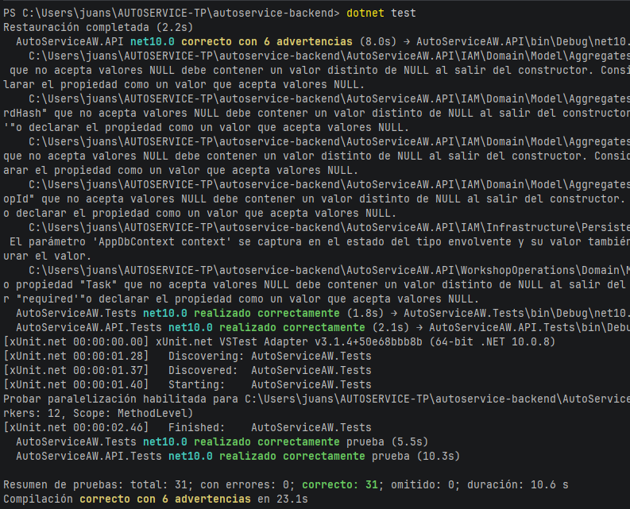

*Figura 6.1. Ejecución satisfactoria de la suite automatizada de pruebas de AutoService.*


**Resultados adicionales de Backend y Mobile**


La estrategia de verificación y validación de AutoService contempla pruebas unitarias, pruebas de integración, pruebas de aceptación y escenarios automatizados mediante Behavior-Driven Development (BDD). Estas pruebas permiten comprobar el funcionamiento de los principales componentes de la aplicación y las reglas de negocio implementadas.

**Backend**

Para la verificación del backend se utilizó el proyecto `AutoServiceAW.API.Tests`, desarrollado con C# y .NET 10. Las pruebas fueron implementadas utilizando MSTest, Moq, ASP.NET Core TestServer y Reqnroll.

La selección de pruebas se realizó considerando la importancia de cada funcionalidad para el negocio, priorizando la gestión de órdenes de trabajo, las tareas de mantenimiento, la autenticación de usuarios y la administración de vehículos. Asimismo, se incorporaron pruebas para los demás Bounded Contexts según los comportamientos que se consideraron relevantes.

En total, se ejecutaron **92 pruebas automatizadas, con 92 aprobadas, 0 fallidas y 0 omitidas**, incluyendo nueve escenarios BDD implementados mediante Reqnroll.

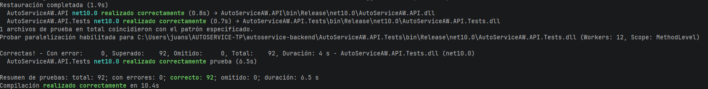

*Figura 6.2. Ejecución satisfactoria de las 92 pruebas automatizadas del Backend de AutoService.*

Las pruebas de integración HTTP se realizaron con componentes reales de la API y dependencias simuladas mediante Moq. Por ello, estos resultados verifican los comportamientos seleccionados, pero no representan una validación completa con una base de datos MySQL real.

Las pruebas del Backend y de la aplicación Mobile se presentan en los siguientes apartados, junto con sus resultados y evidencias correspondientes. Las pruebas de la aplicación Web se documentan en sus respectivas secciones.


**Mobile — AutoService Android**

La aplicación móvil de AutoService se verificó mediante pruebas locales JVM y pruebas instrumentadas ejecutadas en un emulador Android. Para su implementación se emplearon Kotlin, JUnit, Mockito, Kotlin Coroutines Test, Retrofit y MockWebServer, junto con clases de pasos para los escenarios BDD.

La ejecución de la suite local registró **109 pruebas aprobadas, 0 fallidas y 0 omitidas**. Por su parte, la suite instrumentada registró **15 pruebas aprobadas, 0 fallidas y 0 omitidas**. En conjunto, se ejecutaron **124 pruebas automatizadas con resultados satisfactorios**.

Las verificaciones abarcaron Fleet Management, Inventory Management, Customer Tracking, Staff Management, Management, Mechanic y Workshop.

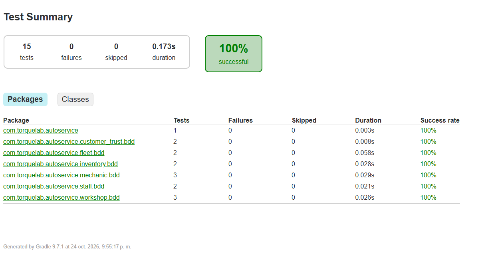

*Figura 6.3. Ejecución satisfactoria de las 15 pruebas instrumentadas de AutoService Mobile.*

Las pruebas de integración HTTP utilizaron MockWebServer para simular las respuestas del servidor, por lo que no representan una validación contra el backend desplegado ni contra una base de datos real.


### 6.1.1. Core Entities Unit Tests

Las pruebas unitarias fueron utilizadas para verificar de manera aislada los comportamientos de las principales entidades, agregados y servicios de aplicación de AutoService. Las pruebas siguen la estructura **Arrange, Act, Assert (AAA)**, separando claramente la preparación de los datos, la ejecución del comportamiento y la comprobación de los resultados esperados.

El proyecto `AutoServiceAW.Tests` contiene **26 pruebas automatizadas**, organizadas en dos grupos principales: 13 pruebas ubicadas bajo el namespace `Unit` y 13 pruebas adicionales orientadas al comportamiento de agregados.

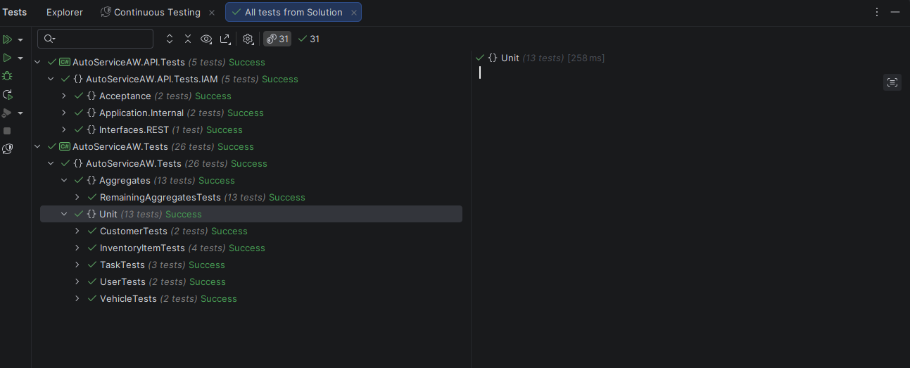

*Figura 6.4. Ejecución satisfactoria de las pruebas de entidades principales y agregados.*

Las pruebas a nivel unitario cubren los principales comportamientos de negocio implementados en AutoService.

| Clase de prueba | Cantidad | Principales comportamientos verificados |
|---|---:|---|
| `CustomerTests` | 2 | Creación de clientes y actualización de su información |
| `InventoryItemTests` | 4 | Precio de compra por defecto, reducción de stock, validación de stock insuficiente y aumento de stock |
| `TaskTests` | 3 | Costo de mano de obra por defecto, actualización del costo de materiales y cálculo de utilidad bruta |
| `UserTests` | 2 | Creación de usuarios y actualización del hash de contraseña |
| `VehicleTests` | 2 | Creación de vehículos y actualización de su información |
| `RemainingAggregatesTests` | 13 | Comportamientos asociados a `TaskPart`, `Mechanic`, `Workshop` y `WorkOrder` |
| **Total** | **26** | **Comportamientos de entidades y agregados del dominio** |

Las pruebas de agregados verifican reglas adicionales de negocio relacionadas con cantidades válidas e inválidas de `TaskPart`, cálculo de costos y utilidad, actualización de información de mecánicos, generación del identificador de tenant del taller, valores iniciales de una orden de trabajo, generación del código de tracking, actualización del checklist y transiciones de estado de las órdenes de trabajo.

El listado completo de las pruebas pertenecientes a este proyecto se muestra en la siguiente evidencia.

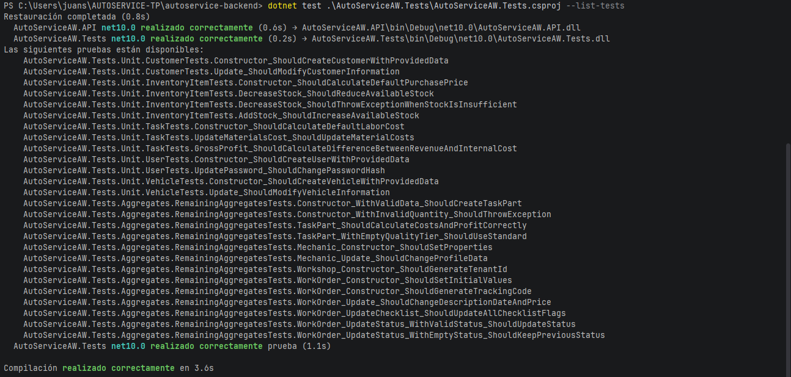

*Figura 6.5. Pruebas de entidades y agregados disponibles en el backend de AutoService.*

Además de las 26 pruebas orientadas al dominio, el proyecto de pruebas de IAM incluye dos pruebas unitarias para `AuthService`. Estas pruebas utilizan **Moq** para sustituir las dependencias `IUserRepository` e `IUnitOfWork`, permitiendo verificar el servicio de autenticación sin depender de infraestructura de persistencia.

| Prueba unitaria | Componente | Comportamiento verificado |
|---|---|---|
| `SignUpAsync_WithValidData_ShouldCreateUserWithHashedPassword` | `AuthService.SignUpAsync()` | Normalización del correo y del rol, asociación del usuario con un taller, generación del hash de contraseña mediante BCrypt, registro del usuario y ejecución del `UnitOfWork` |
| `SignInAsync_WithValidCredentials_ShouldReturnUserAndJwtToken` | `AuthService.SignInAsync()` | Validación de credenciales y generación de un JWT con los valores esperados de issuer, audience, correo, rol e identificador de taller |

La prueba correspondiente al registro verifica adicionalmente que la contraseña original no sea almacenada directamente. El valor contenido en `PasswordHash` debe ser diferente de la contraseña en texto plano y debe poder ser validado correctamente mediante BCrypt.

La prueba correspondiente al inicio de sesión no se limita únicamente a comprobar la existencia del JWT, sino que también analiza su contenido y verifica información relevante como los claims `email`, `role` y `WorkshopId`. Estos valores son posteriormente utilizados por los recursos protegidos de la API para identificar al usuario autenticado y su contexto de taller.

Considerando las pruebas del dominio y las pruebas de `AuthService`, la solución cuenta actualmente con **28 pruebas automatizadas de nivel unitario**.

Para el módulo de Workshop-Operations se realizaron 2 tipos de pruebas, las que se enfocan en probar los aggregates en solitario y las que se enfocan en probar los servicios del modulo para comprar la conexión y guardado exitoso de datos en la base de datos, usando como referencia los respositories.

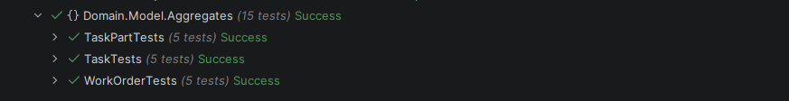

*Figura 6.6. Pruebas unitarias de agregados al modulo de workshop operations*

**Aggregates Tests**

TaskPartTest:

- Verificar que el artículo conserve sus detalles de inventario y que los costos, el precio de venta y la ganancia se calculen a partir de la cantidad y los precios.

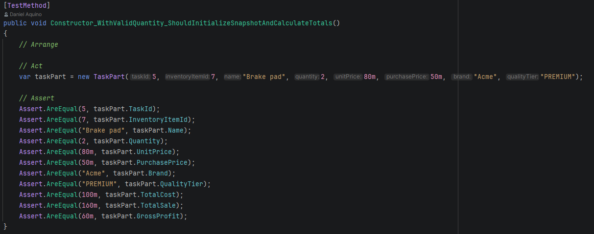

*Figura 6.7. prueba unitaria 1 de task part*

- Verificar los valores predeterminados de los campos opcionales y los totales cuando no se proporciona un precio de compra.

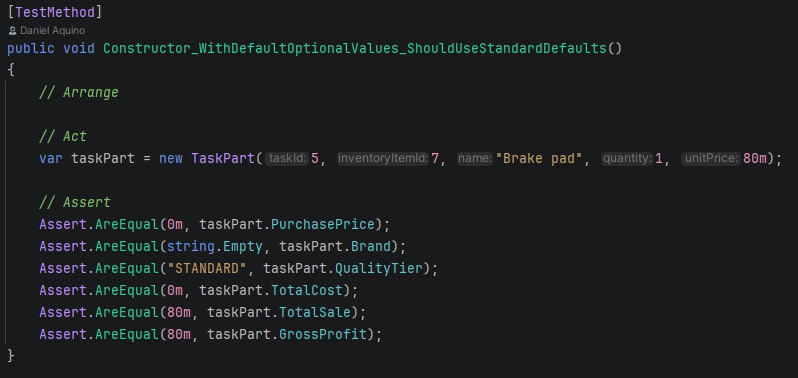

*Figura 6.8 prueba unitaria 2 de task part*

- Verificar que el constructor rechace cantidades cero o negativas, ya que no representan una asignación de piezas válida.

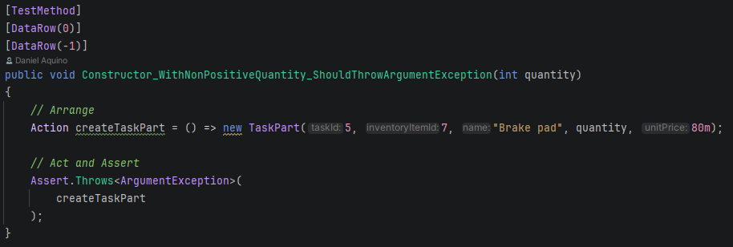

*Figura 6.9 prueba unitaria 3 de task part*

- Verificar que una marca nula se normalice a una cadena vacía y un nivel de calidad en blanco se reemplace por el valor estándar.

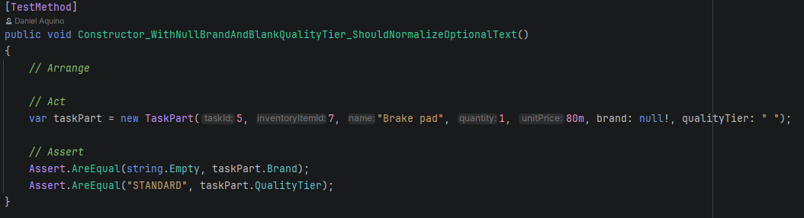

*Figura 6.10 prueba unitaria 4 de task part*

TaskTests:

- Verificar que una tarea se inicialice correctamente y que el costo de mano de obra se establezca por defecto en el 50 % del precio de mano de obra cuando no se proporciona un costo explícito.

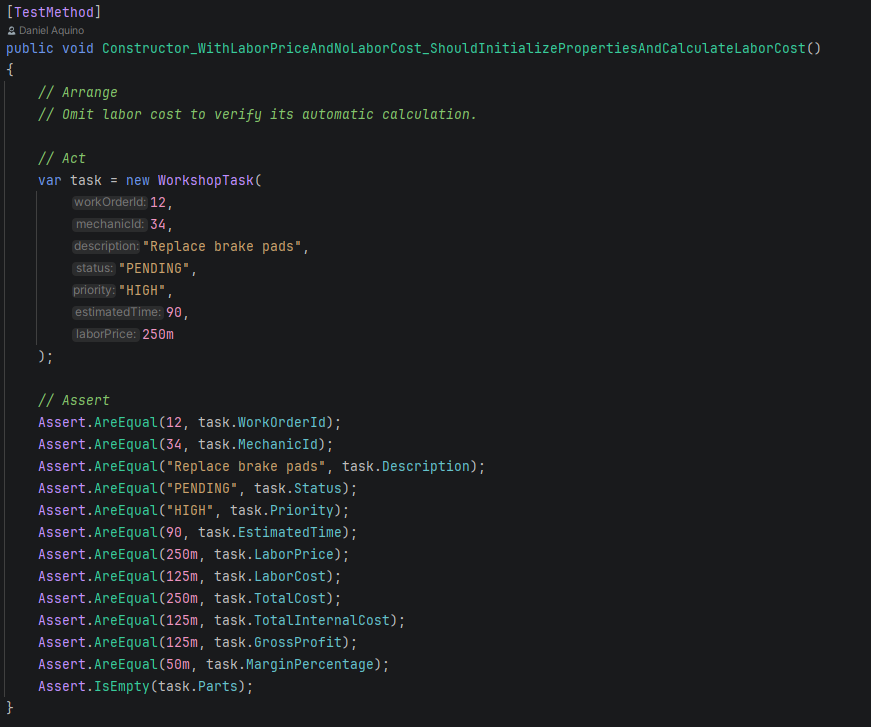

*Figura 6.11 prueba unitaria 1 de task*

- Verificar que se utilice un coste de mano de obra proporcionado explícitamente y que se pueda crear una tarea sin un mecánico asignado.

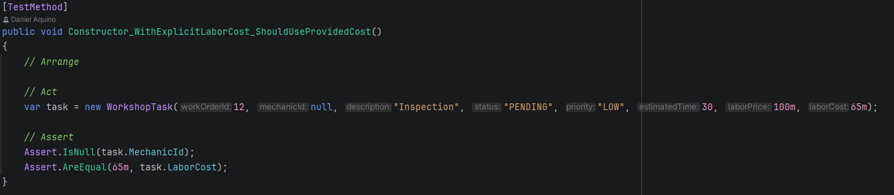

*Figura 6.12 prueba unitaria 2 de task*

- Verificar que Update reemplace los detalles de la tarea y recalcule el coste de mano de obra cuando no se proporciona un coste explícito.

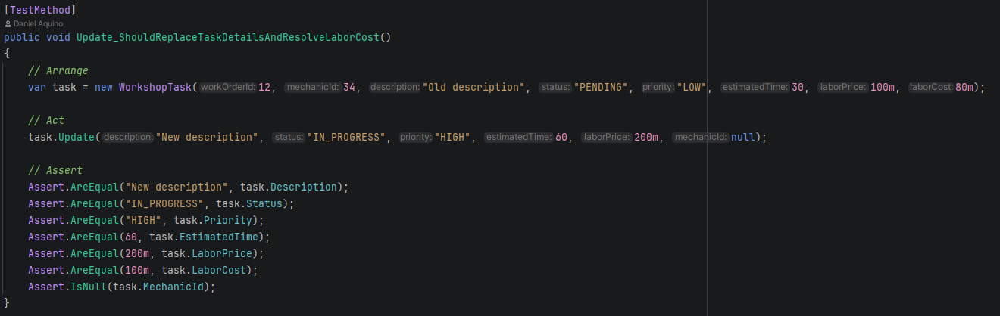

*Figura 6.13 prueba unitaria 3 de task*

- Verificar que un estado vacío preserve el estado actual mientras se actualizan los campos técnicos con la información suministrada.

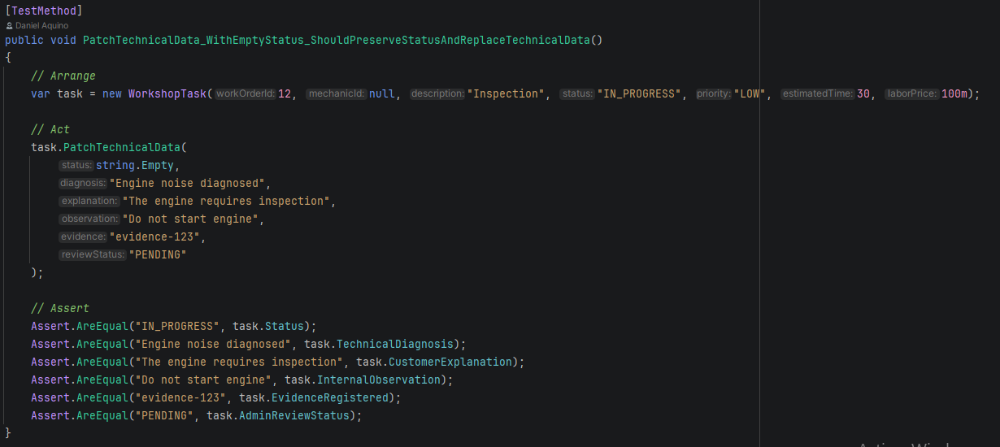

*Figura 6.14 prueba unitaria 4 de task*

- Verificar que los costes de materiales y una pieza añadida se incluyan en los totales de la tarea, el beneficio bruto y el margen.

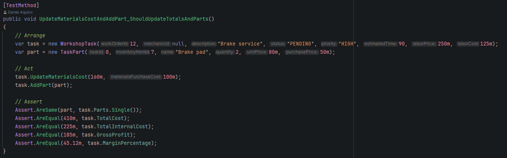

*Figura 6.15 prueba unitaria 5 de task*

WorkOrderTests:

- Verificar que la orden de trabajo inicialice sus datos, genere un código de seguimiento válido y comience con la fecha de hoy y una lista de comprobación incompleta.

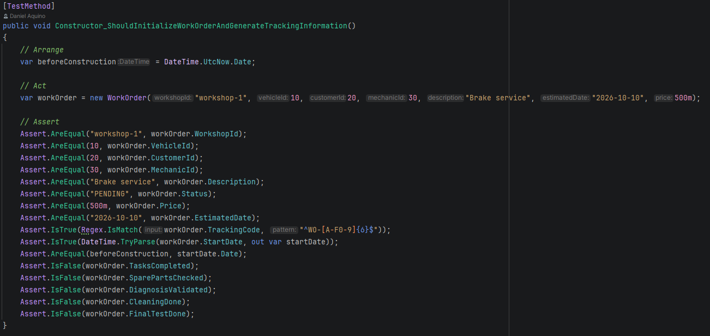

*Figura 6.16 prueba unitaria 1 de work order*

- Verificar que Update modifique la descripción, la fecha estimada y el precio sin cambiar el código de seguimiento ni la fecha de inicio.

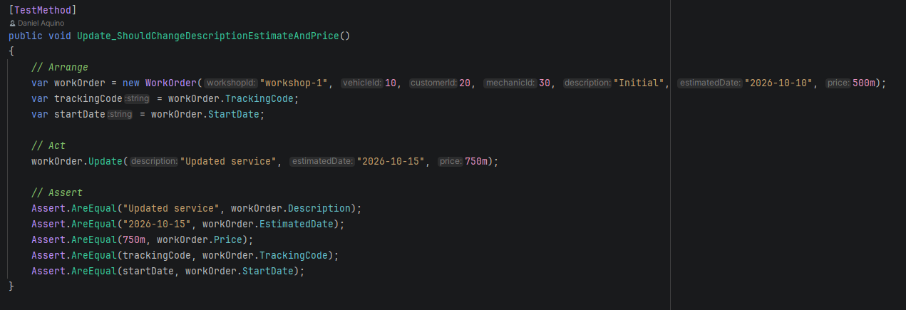

*Figura 6.17 prueba unitaria 2 de work order*

- Verificar que UpdateChecklist actualice cada indicador de la lista de comprobación de la orden de trabajo.

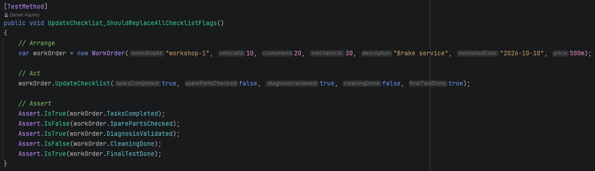

*Figura 6.18 prueba unitaria 3 de work order*

- Verificar que los estados nulos y vacíos se ignoren y no reemplacen el último estado válido de la orden de trabajo.

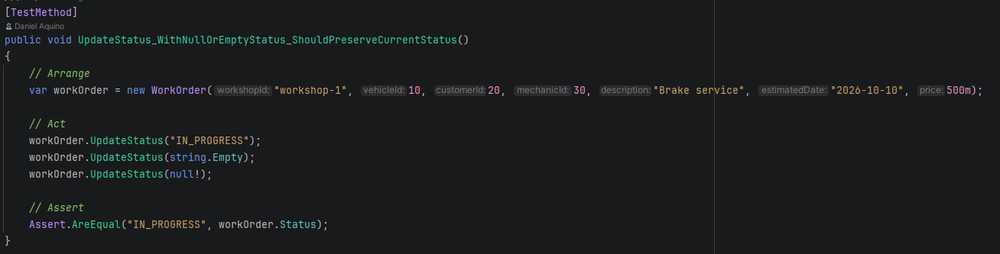

*Figura 6.19 prueba unitaria 4 de work order*

- Verificar que un estado no vacío reemplace el estado actual de la orden de trabajo.

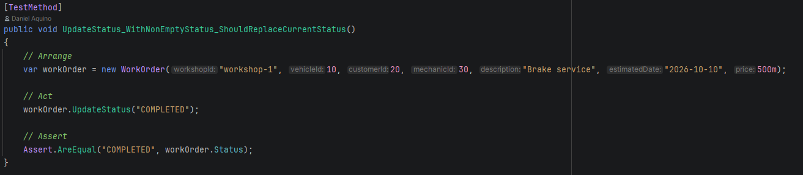

*Figura 6.20 prueba unitaria 5 de work order*

**Service Tests**

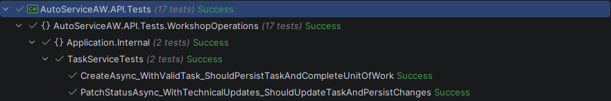

*Figura 6.21 evidencia de prueba de task service exitosa*

TaskServiceTest:

- Verificar que la creación de una tarea la persista a través del repositorio, complete la unidad de trabajo y devuelva la instancia creada.

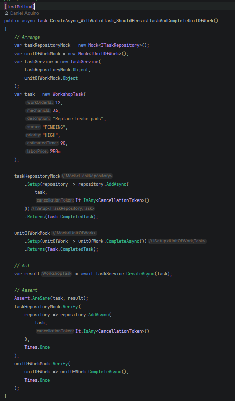

*Figura 6.22 prueba de task service 1*

- Verifica que la aplicación de parches a los datos técnicos de una tarea actualice la tarea, persista los cambios y complete la unidad de trabajo.

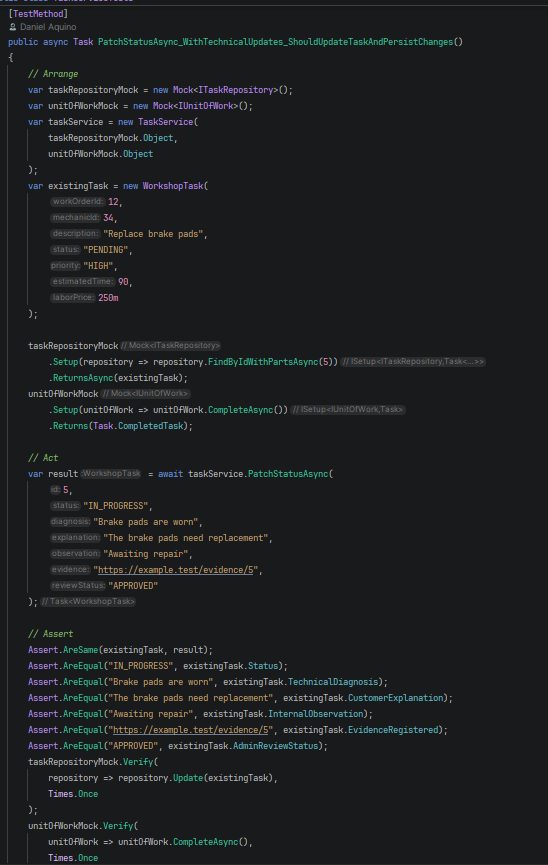

*Figura 6.23 prueba de task service 2*

#### Work Orders & Tasks — Service Unit Tests

Se incorporaron dos pruebas unitarias en `WorkshopOperationsServiceTests`, utilizando MSTest y Moq. Los repositorios y la unidad de trabajo se sustituyen mediante mocks para evaluar los servicios sin depender de una base de datos.

| Prueba | Comportamiento verificado |
|---|---|
| `PatchTaskStatus_WithDiagnosisAndEvidence_ShouldPersistTechnicalProgress` | Actualización del estado, diagnóstico técnico, evidencia y aprobación de una tarea, junto con las llamadas de actualización al repositorio y confirmación de la unidad de trabajo. |
| `UpdateWorkOrder_WithValidatedChecklist_ShouldPersistClosedOrder` | Actualización de una orden con estado `COMPLETED`, precio y cinco indicadores del checklist, junto con las llamadas al repositorio y a la unidad de trabajo. |

El alcance de estas pruebas comprende la actualización de datos y las llamadas a las dependencias simuladas. No incluye persistencia en una base de datos real ni demuestra que se impida cerrar una orden con un checklist incompleto.

**Archivo:** `AutoServiceAW.API.Tests/WorkshopOperations/Application/Internal/WorkshopOperationsServiceTests.cs`.

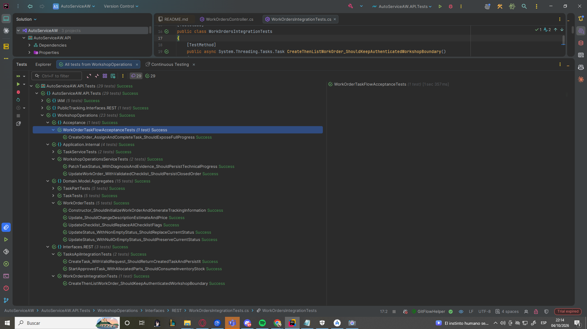

*Evidencia de ejecución: las dos pruebas de WorkshopOperationsServiceTests aparecen con resultado Success.*

#### Public Tracking — Summary Unit Tests

Se incorporaron cuatro métodos de prueba unitaria en `TrackingSummaryFactoryTests`, utilizando MSTest. Estos verifican el cálculo del progreso de la orden, los costos que se muestran al cliente, el registro de cambios de estado y la selección de los datos públicos de las tareas.

| Prueba Unitaria | Comportamiento verificado |
| --- | --- |
| `CalculateProgress_ShouldUseCompletedTasksAndHandleEmptyOrders` | Calcula el progreso según la proporción de tareas completadas y contempla órdenes sin tareas. |
| `Create_ShouldCalculateCustomerCostsWithoutInternalCosts` | Calcula los subtotales de mano de obra y materiales, y el total del cliente, sin incorporar los costos internos de compra. |
| `UpdateStatus_ShouldRecordOnlyActualStatusChangesWithUtcTimestamps` | Registra los cambios reales de estado con marcas de tiempo UTC y evita registrar como cambio la repetición del mismo estado. |
| `Create_ShouldExposeCustomerTaskDetailsAndOmitInternalFields` | Incluye información útil para el cliente —como diagnóstico, explicación, evidencia y piezas— y excluye campos internos del taller. |

Estas pruebas son relevantes para que el cliente reciba información clara sobre el avance, los costos y el trabajo realizado, mientras se preserva la información operativa interna del taller. Evalúan lógica unitaria; no comprueban la comunicación HTTP ni la persistencia en una base de datos real.

**Archivo:** `AutoServiceAW.API.Tests/PublicTracking/Application/Internal/TrackingSummaryFactoryTests.cs`.

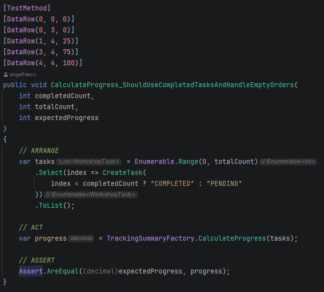

*Figura 6.24 prueba unitaria 1 de public tracking service*

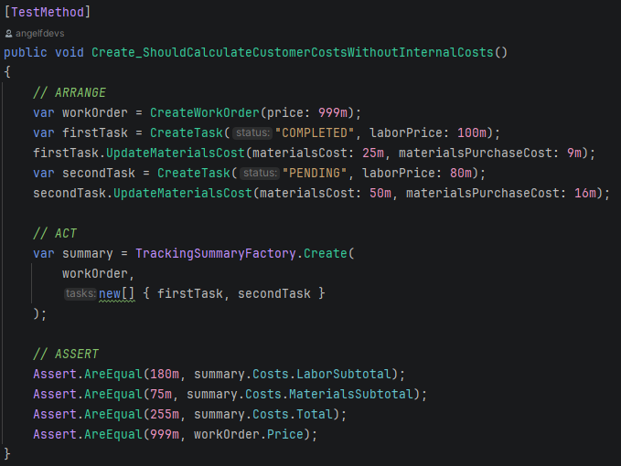

*Figura 6.25 prueba unitaria 2 de public tracking service*

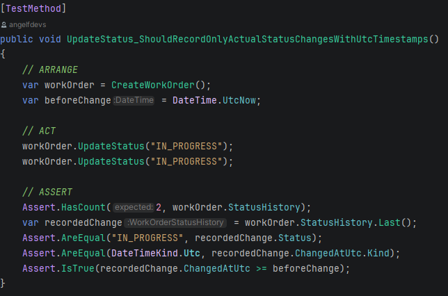

*Figura 6.26 prueba unitaria 3 de public tracking service*

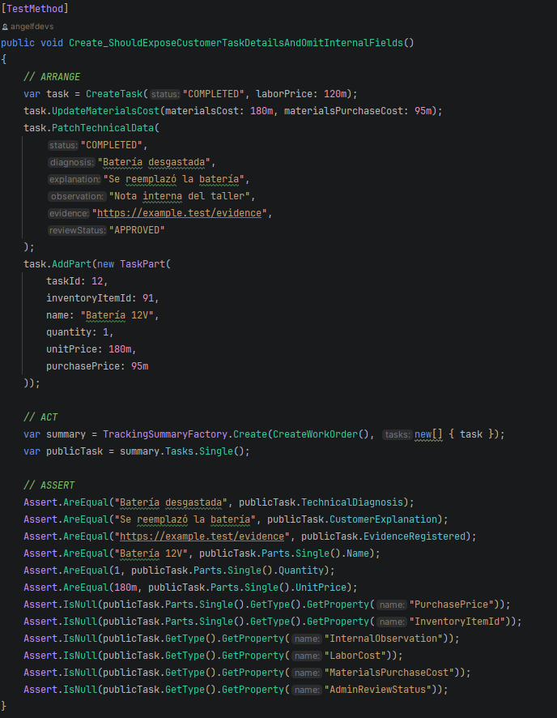

*Figura 6.27 prueba unitaria 4 de public tracking service*


**Resultados adicionales de Backend y Mobile**


**Backend**

Las pruebas unitarias del backend se desarrollaron para verificar el comportamiento de las entidades, agregados y servicios de aplicación de AutoService. Se utilizó el patrón **Arrange, Act, Assert (AAA)**, que permite organizar cada prueba en tres etapas: preparación de los datos, ejecución de la funcionalidad y verificación del resultado esperado.

Para las pruebas de dominio se evaluaron reglas de negocio relacionadas con la creación y actualización de entidades, el cálculo de costos, la gestión del inventario y los cambios de estado de las órdenes de trabajo.

Se ejecutaron **28 pruebas unitarias correspondientes a entidades y agregados**, distribuidas entre los diferentes Bounded Contexts. Todas finalizaron satisfactoriamente.

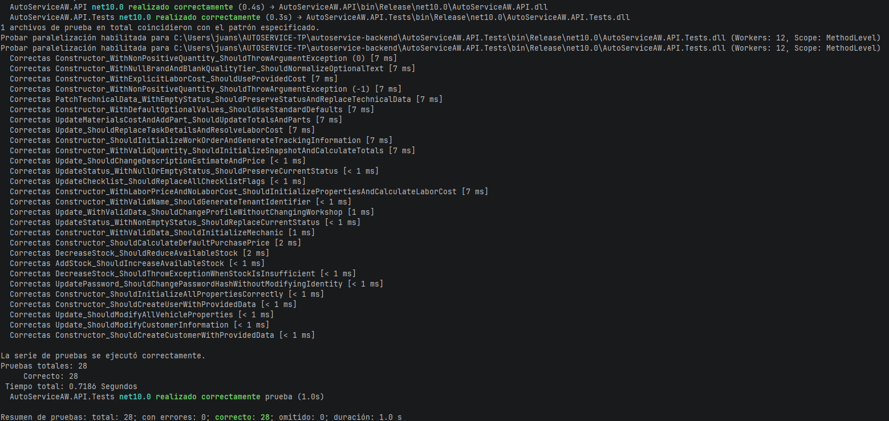

*Figura 6.28. Ejecución satisfactoria de 28 pruebas unitarias de entidades y agregados del Backend de AutoService.*

Adicionalmente, se implementaron pruebas de servicios de aplicación para verificar operaciones relacionadas con autenticación, gestión de vehículos y mantenimiento. Estas pruebas utilizan Moq para simular las dependencias externas y comprobar los resultados de los servicios de manera controlada.


Las pruebas unitarias de dominio se distribuyeron de la siguiente manera:

| Clase de prueba | Bounded Context | Cantidad | Comportamientos verificados |
|---|---|---:|---|
| `CustomerTests` | Customer Management | 2 | Creación y actualización de clientes. |
| `VehicleTests` | Fleet Management | 2 | Inicialización y actualización de vehículos. |
| `UserTests` | IAM | 2 | Creación de usuarios y actualización de contraseñas. |
| `InventoryItemTests` | Inventory Management | 4 | Cálculo del precio de compra, ingreso y consumo de stock, y validación de existencias insuficientes. |
| `MechanicTests` | Staff Coordination | 2 | Inicialización y actualización de información del mecánico. |
| `WorkshopTests` | Tenant Management | 1 | Creación del taller y generación de su identificador. |
| `TaskPartTests` | Workshop Operations | 5 | Validación de cantidades, normalización de información y cálculo de costos de materiales. |
| `TaskTests` | Workshop Operations | 5 | Inicialización de tareas, actualización de datos técnicos y cálculo de costos y márgenes. |
| `WorkOrderTests` | Workshop Operations | 5 | Creación de órdenes, actualización del checklist y control de cambios de estado. |
| **Total** | | **28** | **Pruebas unitarias de entidades y agregados.** |

En Workshop Operations se concentraron las pruebas de dominio relacionadas con órdenes de trabajo y tareas de mantenimiento. Se verificaron los cálculos de costos, la asignación de materiales, las actualizaciones de información técnica y los cambios de estado de las órdenes.

En Inventory Management se evaluó el aumento y disminución de existencias, incluyendo el rechazo de operaciones cuando la cantidad solicitada supera el stock disponible.

**Pruebas de servicios de aplicación**

Adicionalmente, se implementaron pruebas para servicios de aplicación de IAM, Fleet Management y Workshop Operations, así como para la construcción de resúmenes de Public Tracking.

Estas pruebas utilizan Moq cuando es necesario reemplazar las dependencias externas y verificar el comportamiento de los componentes sin establecer una conexión real con MySQL.

| Bounded Context | Clases de prueba | Cantidad |
|---|---|---:|
| IAM | `AuthServiceTests` | 2 |
| Fleet Management | `VehicleServiceTests` | 4 |
| Workshop Operations | `TaskServiceTests`, `WorkshopOperationsServiceTests` | 9 |
| Public Tracking | `TrackingSummaryFactoryTests` | 8 |
| **Total** | | **23** |

En IAM se verificó el registro e inicio de sesión de usuarios, incluyendo la gestión de contraseñas y la generación de tokens JWT.

En Fleet Management se evaluaron operaciones de gestión de vehículos realizadas a través del servicio de aplicación.

En Workshop Operations se verificaron procesos de creación y actualización de tareas y órdenes de trabajo, utilizando repositorios simulados.

Finalmente, en Public Tracking se evaluó la construcción de la información de seguimiento que se presenta al cliente durante el mantenimiento de su vehículo.

Estas pruebas complementan las verificaciones de dominio y permiten comprobar el comportamiento de los servicios y componentes de aplicación de manera controlada.


**Mobile — AutoService Android**

Las pruebas locales de la aplicación móvil se desarrollaron con Kotlin y JUnit. Para verificar componentes con dependencias externas se utilizaron Mockito y Kotlin Coroutines Test, siguiendo una organización basada en Arrange, Act, Assert (AAA).

Se evaluaron las reglas de negocio relacionadas con el registro de vehículos, el control de existencias, el cálculo del progreso de mantenimiento y la disponibilidad de los mecánicos. Asimismo, se verificaron los estados y las respuestas de los ViewModels ante operaciones satisfactorias y errores.

Entre los comportamientos evaluados destacan la prevención de placas duplicadas en Fleet Management, el rechazo de salidas con stock insuficiente en Inventory Management, el tratamiento de códigos de seguimiento inexistentes en Customer Tracking y la disponibilidad de mecánicos según sus tareas activas en Staff Management.

La tarea `:app:testDebugUnitTest` ejecutó **109 pruebas locales**, incluyendo pruebas unitarias y pruebas de integración basadas en JVM. Todas finalizaron satisfactoriamente.

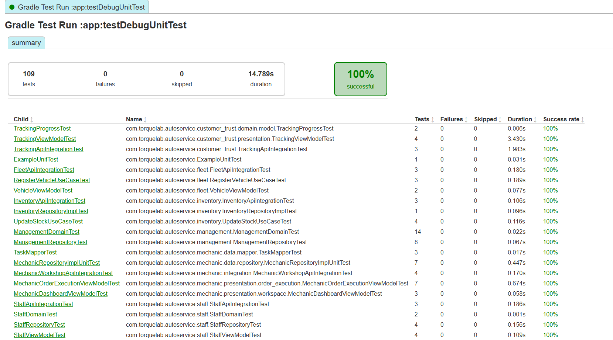

*Figura 6.29. Ejecución de 109 pruebas locales de AutoService Mobile, con 0 fallidas y 0 omitidas.*


### 6.1.2. Core Integration Tests

Las pruebas de integración fueron utilizadas para verificar la interacción entre la interfaz HTTP y el servicio de autenticación de la aplicación.

La clase `AuthIntegrationTests` utiliza la infraestructura `TestServer` de ASP.NET Core para crear una aplicación web en memoria. Durante la prueba se registran los controllers reales de AutoService y la implementación de `AuthService` dentro del contenedor de dependency injection, mientras que las dependencias externas relacionadas con repositorios y servicios de taller son sustituidas mediante mocks controlados.

Este enfoque permite validar el procesamiento de una solicitud HTTP a través de los principales componentes involucrados sin requerir un servidor externo ni una base de datos de producción.

La prueba de integración implementada se resume a continuación.

| Prueba de integración | Endpoint | Resultado esperado | Verificación principal |
|---|---|---|---|
| `SignIn_WithValidCredentials_ShouldReturnOkAndAuthenticationData` | `POST /api/v1/auth/sign-in` | `200 OK` | Retorno del correo, rol, identificador del taller y un JWT no vacío |

La prueba envía una solicitud HTTP utilizando el cliente proporcionado por ASP.NET Core `TestServer`:

```csharp
var response = await client.PostAsJsonAsync(
    "/api/v1/auth/sign-in",
    request
);
```

La solicitud es procesada por el controller REST y posteriormente por el servicio de autenticación. La respuesta resultante es deserializada y evaluada para comprobar que contenga la información de autenticación esperada.

El flujo de integración validado puede representarse de la siguiente manera:

```text
HTTP Request
    |
    v
AuthController
    |
    v
AuthService
    |
    v
Authentication and JWT generation
    |
    v
HTTP 200 response
```

Aunque las dependencias orientadas a persistencia son sustituidas mediante mocks, dentro de la misma prueba participan el routing HTTP, el descubrimiento de controllers, dependency injection, la ejecución del servicio de aplicación, la generación del JWT y la serialización de la respuesta REST.

Las pruebas automatizadas correspondientes al módulo IAM, incluyendo los niveles unitario, de integración y de aceptación, se muestran en la siguiente evidencia.

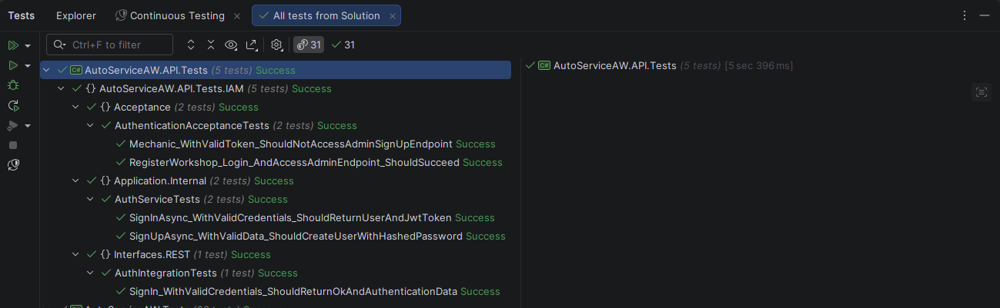

*Figura 6.30. Pruebas unitarias, de integración y de aceptación del módulo IAM ejecutadas satisfactoriamente.*


Por el lado del modulo de Workshop Operations, se contó con 2 pruebas de integración, una sobre el funcionamineto de la api y la segunda sobre la comunicación con el modulo de inventory.

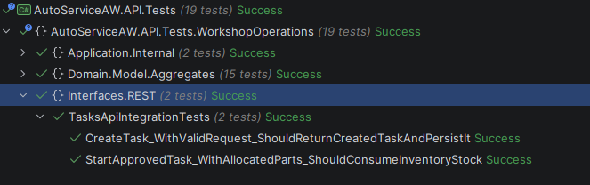

*Figura 6.31. evidencia de pruebas de integracion exitosas*

**TaskApiIntegrationTests:**

- Verificar que la publicación de una solicitud de tarea válida devuelva HTTP 201, persiste la tarea con los valores esperados y completa la unidad de trabajo.

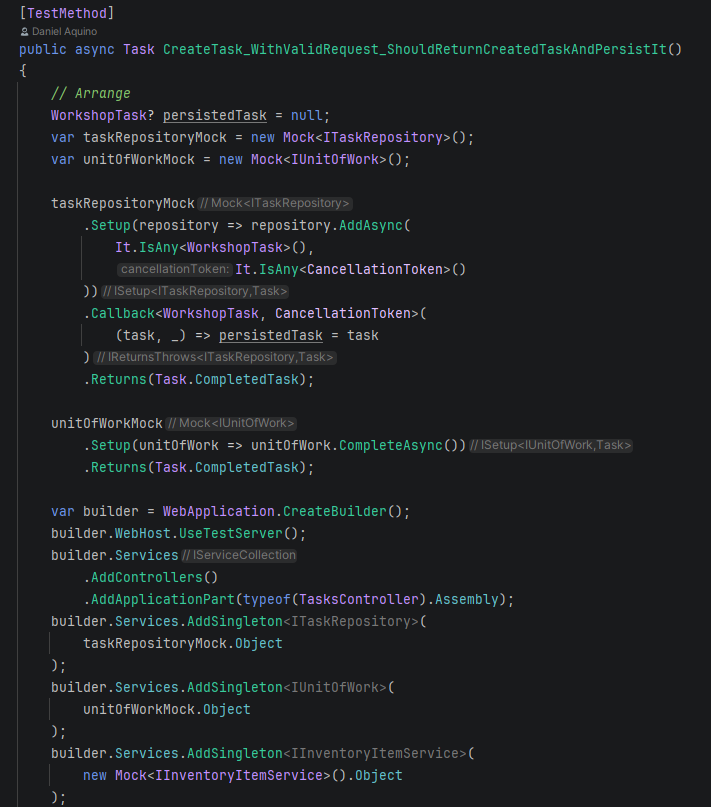
*Figura 6.32. prueba de integración 1a*

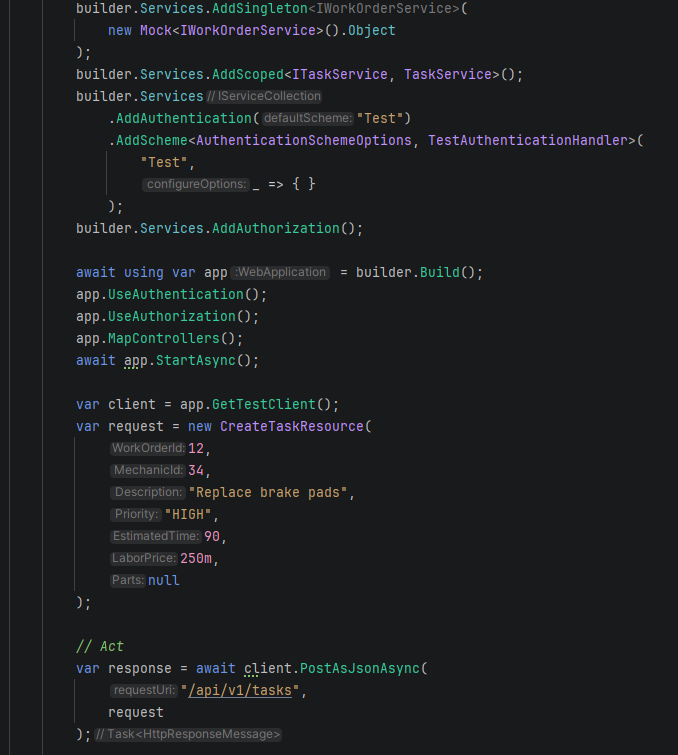
*Figura 6.33. prueba de integración 1b*

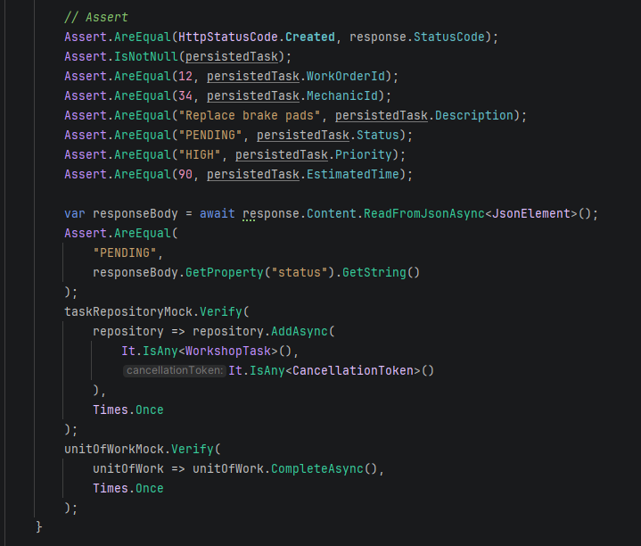
*Figura 6.34. prueba de integración 1c*

- Verifica que el inicio de una tarea aprobada consuma las existencias asignadas a través del servicio de aplicación de gestión de inventario.

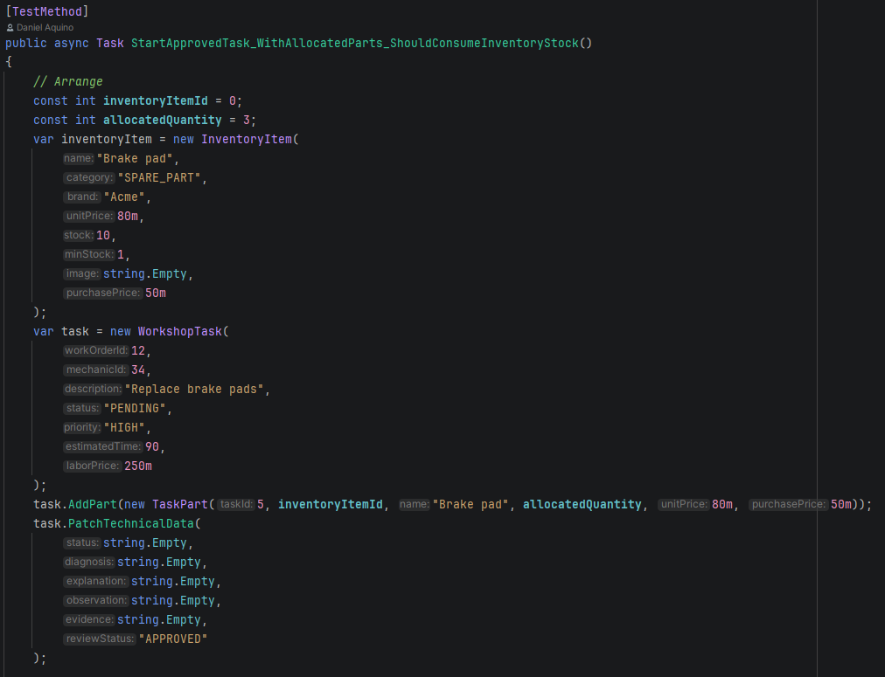
*Figura 6.35. prueba de integración 2a*

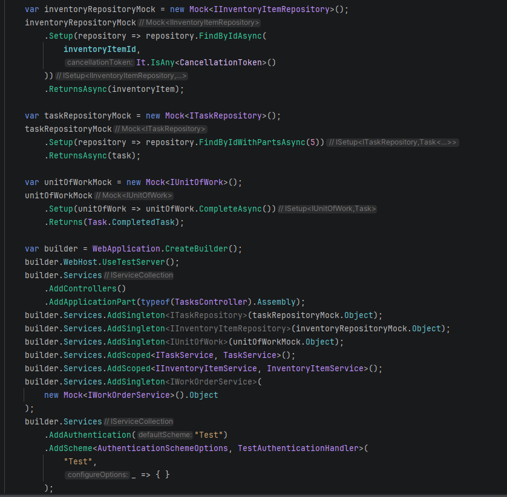
*Figura 6.36. prueba de integración 2b*

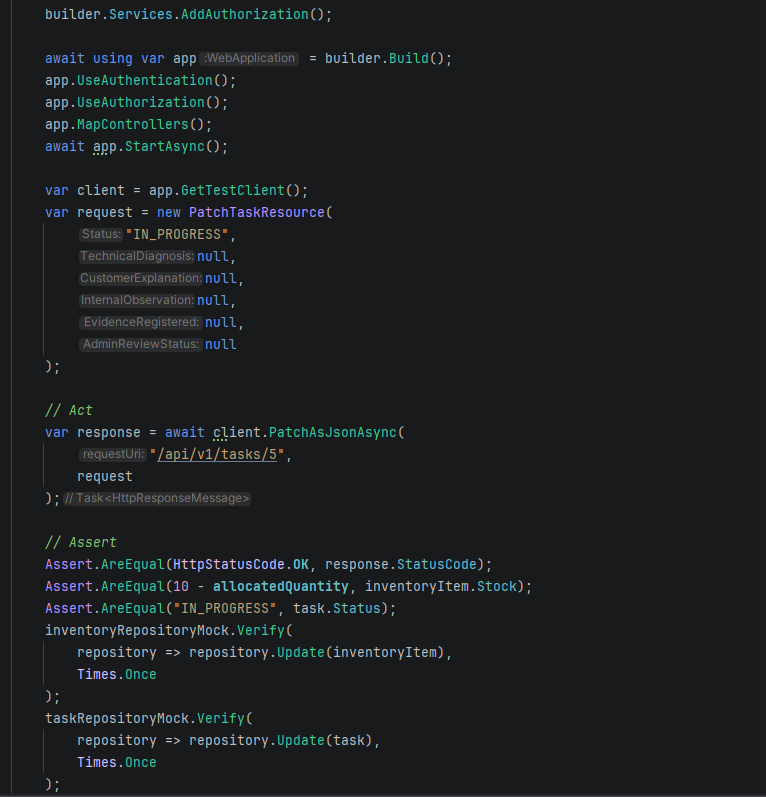
*Figura 6.37. prueba de integración 2c*

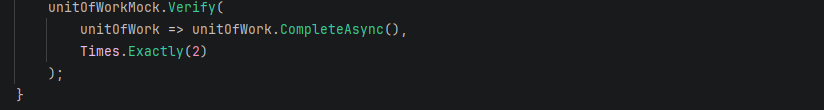
*Figura 6.38. prueba de integración 2d*

#### Work Orders — HTTP Integration Test

La clase `WorkOrdersIntegrationTests` incorpora la prueba `CreateThenListWorkOrder_ShouldKeepAuthenticatedWorkshopBoundary`.

La prueba utiliza ASP.NET Core `TestServer`, el controller real, una identidad de prueba y un mock de `IWorkOrderService`. Crea una orden mediante `POST /api/v1/workorders` y consulta el listado mediante `GET /api/v1/workorders`.

Se comprueban las respuestas `201 Created` y `200 OK`, la asociación de la orden con el taller autenticado `WS-01` y la descripción registrada en la respuesta. También se verifica que el servicio consulte las órdenes del taller esperado.

La prueba evalúa routing, autenticación de prueba, controller y serialización HTTP con el servicio sustituido. No incluye persistencia real ni demuestra por sí sola el aislamiento completo entre distintos talleres.

**Archivo:** `AutoServiceAW.API.Tests/WorkshopOperations/Interfaces/REST/WorkOrdersIntegrationTests.cs`.


*Evidencia de ejecución: CreateThenListWorkOrder_ShouldKeepAuthenticatedWorkshopBoundary aparece con resultado Success.*

#### Public Tracking — Integration Test

Se implementó una prueba de integración para el endpoint de seguimiento público mediante ASP.NET Core `TestServer`. Las dependencias se sustituyen con mocks para validar las respuestas HTTP y la estructura de los datos sin conectarse a una base de datos real.

| Prueba de Integracion | Comportamiento verificado |
| --- | --- |
| `GetSummaryByTrackingCodeShouldReturnSafeOrderDataAndRejectIdOnlyTaskAccess` | Comprueba que un código válido permita consultar el resumen, que un código desconocido devuelva `404 Not Found` y que no se puedan consultar tareas usando únicamente el identificador interno de la orden. También verifica que las respuestas omitan datos internos, como costos de compra e identificadores internos. |

Esta prueba es relevante porque verifica que el cliente pueda consultar el estado de su servicio mediante el código de seguimiento y reciba únicamente la información prevista para la vista pública.

Archivo: `AutoServiceAW.API.Tests/PublicTracking/Interfaces/REST/TrackingIntegrationTests.cs`

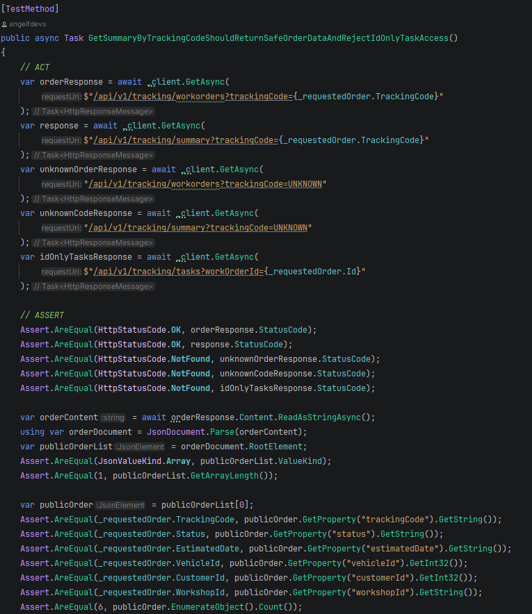
*Figura 6.39. prueba de integración de public tracking service*

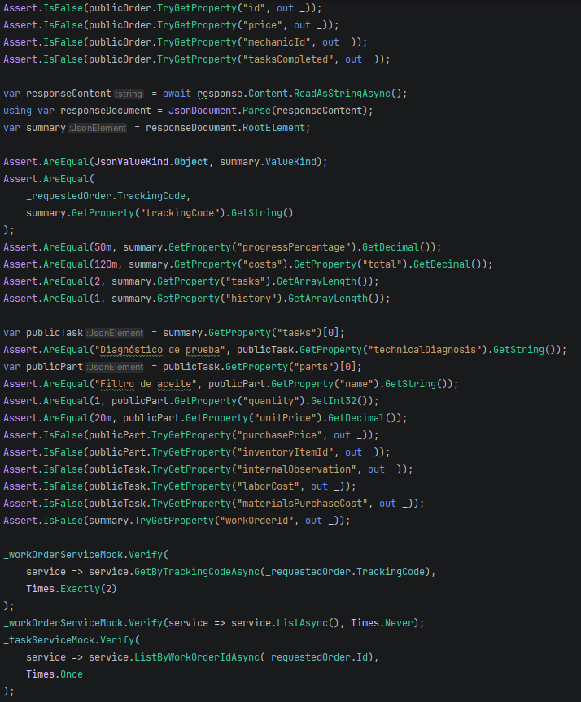
*Figura 6.40. prueba de integración de public tracking service*


**Resultados adicionales de Backend y Mobile**


**Backend**

Las pruebas de integración del backend se implementaron para verificar la comunicación entre los controladores REST y los servicios de aplicación de AutoService.

Para estas pruebas se utilizó `TestServer` de ASP.NET Core, que permite ejecutar solicitudes HTTP contra una aplicación configurada en memoria. Asimismo, se utilizó Moq para simular repositorios y otras dependencias externas, sin requerir una conexión a la base de datos MySQL.

Se ejecutaron **15 pruebas seleccionadas mediante el filtro `IntegrationTests`**, todas aprobadas, con 0 fallidas y 0 omitidas.

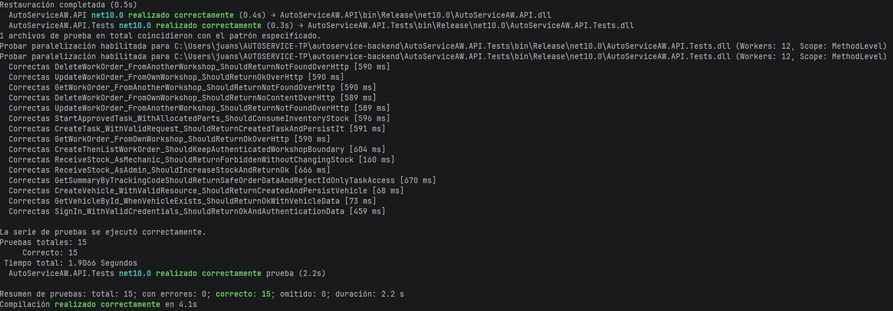

*Figura 6.41. Ejecución satisfactoria de 15 pruebas de integración HTTP del Backend de AutoService.*

Las pruebas realizadas abarcaron principalmente los siguientes Bounded Contexts:

| Bounded Context | Funcionalidades verificadas |
|---|---|
| IAM | Inicio de sesión mediante la API REST y devolución de los datos de autenticación. |
| Fleet Management | Operaciones de gestión de vehículos mediante solicitudes HTTP. |
| Workshop Operations | Creación y actualización de tareas, operaciones sobre órdenes de trabajo y comunicación con los servicios correspondientes. |
| Inventory Management | Recepción de materiales y validación de permisos para modificar el inventario. |
| Public Tracking | Consulta de información de seguimiento mediante la API REST. |

En Workshop Operations se verificaron operaciones relacionadas con el registro de tareas, la gestión de órdenes de trabajo y el consumo de materiales asociado al mantenimiento de vehículos.

En Inventory Management se implementaron dos pruebas adicionales para validar la recepción de materiales. La primera comprueba que un administrador pueda registrar una entrada de cinco unidades, aumentando el stock de 10 a 15. La segunda verifica que un usuario con rol de mecánico reciba una respuesta `403 Forbidden` cuando intenta registrar una recepción, sin realizar modificaciones en el inventario.

Las pruebas también permiten verificar respuestas HTTP, como `200 OK`, `201 Created`, `403 Forbidden` y `404 Not Found`, según la operación y las condiciones evaluadas.

Este enfoque permitió comprobar la integración de los componentes HTTP y la lógica de aplicación para los casos seleccionados. Sin embargo, al utilizar dependencias simuladas, no constituye una prueba de integración completa con la persistencia real en MySQL.


**Mobile — AutoService Android**

Para las pruebas de integración HTTP de la aplicación móvil se utilizaron Retrofit, Gson y MockWebServer. Esta configuración permitió ejecutar los repositorios reales y comprobar las solicitudes HTTP y el procesamiento de sus respuestas, sin depender de un servidor externo.

Se implementaron pruebas de integración para cuatro Bounded Contexts, con tres casos por cada uno:

| Bounded Context | Pruebas | Comportamientos verificados |
|---|---:|---|
| Fleet Management | 3 | Consulta de vehículos, normalización de datos durante el registro y propagación de errores del servidor. |
| Inventory Management | 3 | Consulta del catálogo, registro de recepciones de materiales y manejo de respuestas HTTP de error. |
| Customer Tracking | 3 | Consulta completa de órdenes, tratamiento de códigos inexistentes y recuperación ante fallas de servicios complementarios. |
| Staff Management | 3 | Consulta de tareas y disponibilidad de mecánicos, identificación de capacidad máxima y registro de mecánicos. |
| **Total** | **12** | **Pruebas de integración HTTP con API simulada.** |

**Fleet Management**

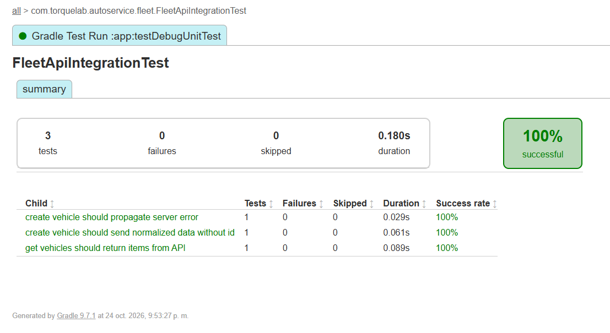

*Figura 6.42. Ejecución satisfactoria de tres pruebas de integración HTTP de Fleet Management.*

**Inventory Management**

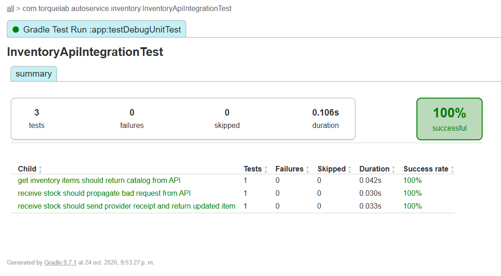

*Figura 6.43. Ejecución satisfactoria de tres pruebas de integración HTTP de Inventory Management.*

**Customer Tracking**

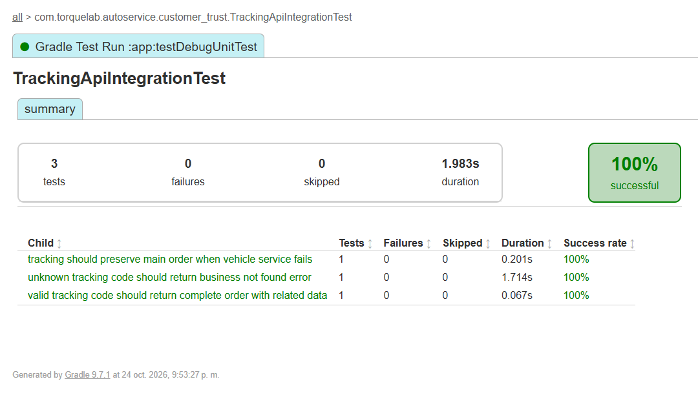

*Figura 6.44. Ejecución satisfactoria de tres pruebas de integración HTTP de Customer Tracking.*

**Staff Management**

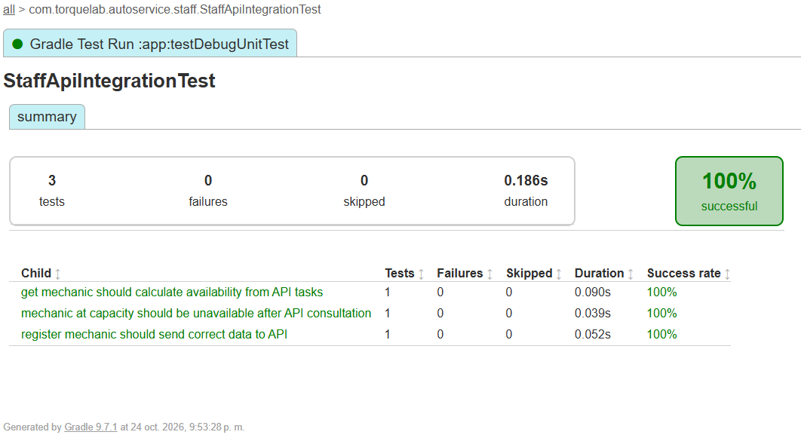

*Figura 6.45. Ejecución satisfactoria de tres pruebas de integración HTTP de Staff Management.*

Las doce pruebas finalizaron satisfactoriamente. Estas verificaciones forman parte de las 109 pruebas locales y permiten comprobar la integración del código Android con las interfaces HTTP simuladas.


### 6.1.3. Core Behavior-Driven Development

Behavior-Driven Development (BDD) fue utilizado para representar los requisitos de autenticación desde la perspectiva del usuario mediante escenarios escritos en lenguaje Gherkin.

La especificación BDD se encuentra ubicada en:

```text
AutoServiceAW.API.Tests/IAM/BDD/Features/Authentication.feature
```

La feature describe el comportamiento esperado para la autenticación y el acceso según roles:

```gherkin
Feature: Authentication and role-based access

  As an AutoService user
  I want to authenticate with my registered credentials
  So that I can access the application according to my assigned role
```

Actualmente se han definido dos escenarios.

| Scenario | Propósito |
|---|---|
| `Administrator signs in with valid credentials` | Validar la autenticación satisfactoria de un administrador, su rol, la generación del JWT y su acceso al área administrativa |
| `User signs in with invalid credentials` | Validar el rechazo de credenciales incorrectas y comprobar que no se genere un JWT |

El escenario positivo de autenticación se encuentra especificado de la siguiente manera:

```gherkin
Scenario: Administrator signs in with valid credentials
  Given an administrator with email "admin@autoservice.com" is registered
  And the administrator has password "SecurePassword123"
  When the administrator signs in with valid credentials
  Then the authentication request should be successful
  And the response should contain the role "admin"
  And the response should contain a JWT access token
  And the administrator should have access to the administration area
```

Por otro lado, el escenario negativo verifica el comportamiento esperado cuando el usuario proporciona una contraseña incorrecta:

```gherkin
Scenario: User signs in with invalid credentials
  Given a user with email "admin@autoservice.com" is registered
  When the user signs in with an incorrect password
  Then the authentication request should be rejected
  And the response should not contain a JWT access token
```

Estos escenarios representan los comportamientos esperados de autenticación y control de acceso utilizados posteriormente por las aplicaciones Web y Native Mobile de AutoService.

En el estado actual del repositorio, el archivo `.feature` se encuentra implementado como una especificación de comportamiento. Sin embargo, todavía no se han incorporado Step Definitions mediante SpecFlow, Reqnroll o bindings asociados a `[Given]`, `[When]` y `[Then]`.

Por esta razón, los dos escenarios son documentados actualmente como **especificaciones BDD**, pero **no forman parte de las 31 pruebas automatizadas reportadas en la ejecución de la suite de pruebas**.

Para el modulo de Workshop Operations se tiene la siguiente ruta donde está el archivo .feature que le corresponse

```text
AutoServiceAW.API.Tests/WorkshopOperations/BDD/Features/WorkshopOperations.feature
```

```gherkin
Scenario: Register a maintenance task for an active work order
    Given an active work order exists
    When an administrator registers a task with its description, mechanic, status, and estimated time
    Then the task is associated with the work order
    And the task is saved with its assigned mechanic and estimated time
```

```gherkin
Scenario: Update a task's status and estimated time
    Given a maintenance task belongs to an active work order
    When an administrator or mechanic updates the task status and estimated time
    Then the task reflects the new status and estimated time
    And the task remains associated with the same work order
```

#### Work Orders & Tasks — Lifecycle Specification

El archivo `AutoServiceAW.API.Tests/WorkshopOperations/BDD/Features/WorkOrderTaskLifecycle.feature` especifica dos escenarios del ciclo de vida de órdenes y tareas:

```gherkin
Feature: Work order and task lifecycle

  As a workshop administrator or mechanic
  I want to coordinate work orders and their assigned tasks
  So that the customer can see reliable repair progress

  Scenario: Approved task advances the work order progress
    Given a work order exists for a customer reported vehicle problem
    And an approved task is assigned to a mechanic
    When the mechanic starts and completes the assigned task
    Then the task status should be "COMPLETED"
    And the work order progress should show 100 percent

  Scenario: Unapproved task cannot be started
    Given a work order exists for a customer reported vehicle problem
    And a pending task has not been approved by an administrator
    When the mechanic attempts to start the task
    Then the request should be rejected
    And no inventory material should be consumed
```

Estos escenarios describen el comportamiento esperado. No disponen de Step Definitions y no se contabilizan como pruebas automatizadas ejecutadas. El escenario de rechazo de una tarea no aprobada requiere validación adicional.

####  Public Tracking — Behavior-Driven Development

La especificación BDD del módulo de seguimiento público se encuentra en:

```text
tests/bdd/features/customer-tracking.feature
```

La feature describe el comportamiento esperado cuando un cliente consulta una orden mediante su código público de seguimiento:

```gherkin
Feature: Customer tracks a work order using its public tracking code
  As a customer
  I want to search for my service using its tracking code
  So that I can see its progress without seeing another customer's order
```

Se establece dos escenarios:

| Escenario | Propósito |
| --- | --- |
| `Customer views the public tracking summary for a valid code` | Especificar que un código válido muestre el estado, el progreso calculado por el backend, la fecha estimada, el historial, los detalles de las tareas y el desglose de costos para el cliente. También contempla que no se ofrezcan acciones de pago ni se muestren datos de otras órdenes. |
| `Customer receives clear feedback for an unknown code`| Especificar que un código inexistente genere un mensaje claro y que no se muestren datos de una orden. |

El escenario positivo de consulta se encuentra especificado de la siguiente manera:

```gherkin
Scenario: Customer views the public tracking summary for a valid code
  Given the customer opens the public tracking page
  When the customer submits a valid tracking code
  Then the associated order status and backend-calculated service progress are displayed
  And the estimated delivery date and service history are displayed
  And the task details and customer-facing cost breakdown are displayed
  And no payment action or payment receipt is offered
  And details from unrelated orders are not displayed
```

Por otro lado, el escenario negativo verifica el comportamiento cuando el cliente ingresa un código que no corresponde a una orden:

```gherkin
Scenario: Customer receives clear feedback for an unknown code
  Given the customer opens the public tracking page
  When the customer submits a code that does not exist
  Then the page displays the tracking code not found message
  And no order details are displayed
```

Estos escenarios describen cómo el cliente consulta el avance y los detalles públicos de su servicio, y qué respuesta recibe cuando el código no existe.


**Resultados adicionales de Backend y Mobile**


**Backend**

Para verificar los principales comportamientos del negocio de AutoService se utilizó el enfoque Behavior-Driven Development (BDD), que permite describir las funcionalidades del sistema mediante escenarios escritos en lenguaje Gherkin.

Los escenarios fueron implementados utilizando Reqnroll, integrado con MSTest, permitiendo automatizar su ejecución dentro del proyecto `AutoServiceAW.API.Tests`.

Se desarrollaron **9 escenarios BDD automatizados**, distribuidos entre tres Bounded Contexts: Workshop Operations, Fleet Management e IAM.

| Bounded Context | Escenarios BDD | Funcionalidades verificadas |
|---|---:|---|
| Workshop Operations | 4 | Registro y actualización de tareas, avance de órdenes de trabajo y validación de tareas no aprobadas. |
| Fleet Management | 3 | Registro, actualización y consulta de vehículos. |
| IAM | 2 | Inicio de sesión con credenciales válidas e inválidas. |
| **Total** | **9** | **Escenarios automatizados mediante Reqnroll.** |

Los escenarios fueron organizados mediante archivos `.feature` y sus correspondientes clases de Step Definitions, donde se implementaron los pasos `Given`, `When` y `Then`.

**Workshop Operations**

En este Bounded Context se implementaron cuatro escenarios relacionados con la gestión de tareas de mantenimiento y el ciclo de vida de las órdenes de trabajo.

Los escenarios verifican el registro de tareas, la actualización de su estado y tiempo estimado, el avance de una orden cuando se completa una tarea aprobada y la restricción que impide iniciar tareas sin aprobación.

**Fleet Management**

Se implementaron tres escenarios para verificar las principales operaciones de gestión de vehículos.

Estos escenarios comprueban el registro de un vehículo asociado a un cliente, la actualización de su información operativa y técnica, y la consulta de vehículos mediante su identificador.

**IAM**

En IAM se implementaron dos escenarios relacionados con el inicio de sesión y la validación de credenciales.

El primero verifica que un administrador pueda iniciar sesión correctamente y obtener un token JWT con su rol correspondiente. El segundo comprueba que una contraseña incorrecta sea rechazada y que no se entregue un token de acceso.


**Estructura de los escenarios BDD**

Los archivos Gherkin y sus implementaciones se encuentran organizados dentro de las carpetas BDD de cada Bounded Context.

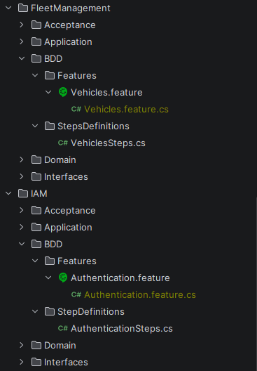

*Figura 6.46. Organización de los archivos Gherkin y Step Definitions de Fleet Management e IAM.*

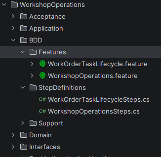

*Figura 6.47. Organización de los archivos Gherkin y Step Definitions de Workshop Operations.*

**Resultados de ejecución**

Los nueve escenarios fueron ejecutados mediante MSTest y Reqnroll, obteniendo resultados satisfactorios en todos los casos.

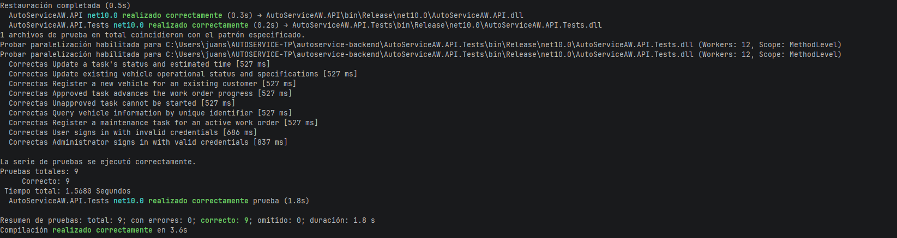

*Figura 6.48. Ejecución satisfactoria de los nueve escenarios BDD automatizados del Backend de AutoService.*

La ejecución registró **9 escenarios aprobados, 0 fallidos y 0 omitidos**.

Estas pruebas forman parte de las 92 pruebas automatizadas de la suite del Backend. Su implementación permite verificar los comportamientos seleccionados desde una perspectiva funcional, utilizando los controladores y servicios correspondientes con dependencias simuladas cuando resulta necesario.


**Mobile — AutoService Android**

En la aplicación móvil se organizaron escenarios de comportamiento mediante archivos `.feature`, redactados con la estructura Given, When y Then. La ejecución automatizada se realizó utilizando JUnit y clases Steps desarrolladas en Kotlin, que invocan los componentes reales de la aplicación con dependencias simuladas.

A diferencia del Backend, donde se utilizó Reqnroll, los archivos Gherkin de Mobile cumplen una función descriptiva y no son interpretados directamente por un motor BDD.

Los escenarios automatizados se distribuyeron de la siguiente manera:

| Bounded Context | Escenarios | Funcionalidades verificadas |
|---|---:|---|
| Fleet Management | 2 | Registro de vehículos válidos y rechazo de placas duplicadas. |
| Inventory Management | 2 | Recepción de materiales y rechazo de consumos con stock insuficiente. |
| Customer Tracking | 2 | Consulta exitosa del seguimiento y tratamiento de códigos inexistentes. |
| Staff Management | 2 | Disponibilidad de mecánicos con capacidad libre o completa. |
| Mechanic | 3 | Escenarios de ejecución de órdenes desarrollados para el módulo de mecánicos. |
| Workshop | 3 | Escenarios de operaciones del taller desarrollados para el módulo Workshop. |
| **Total** | **14** | **Escenarios de comportamiento automatizados.** |

Los escenarios se ejecutaron como pruebas instrumentadas en un emulador Android mediante la tarea `:app:connectedDebugAndroidTest`.

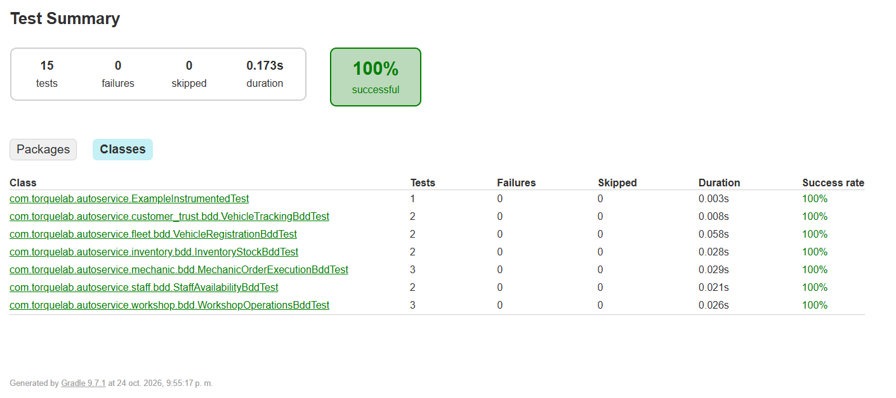

*Figura 6.49. Ejecución satisfactoria de los escenarios BDD automatizados de AutoService Mobile.*

El reporte general registró **15 pruebas instrumentadas aprobadas, 0 fallidas y 0 omitidas**. De estas, 14 corresponden a los escenarios BDD y una a la prueba instrumentada de ejemplo incluida en el proyecto.

Estas verificaciones complementan las pruebas locales y permiten comprobar los comportamientos seleccionados en el entorno de ejecución Android. No constituyen pruebas de navegación de interfaz de usuario de extremo a extremo.


### 6.1.4. Core System Tests

La validación actual a nivel de sistema se concentra en los flujos de autenticación y autorización expuestos por la RESTful API de AutoService.

Se implementaron dos Acceptance Tests que ejecutan flujos compuestos por múltiples pasos utilizando ASP.NET Core `TestServer`, autenticación JWT, middleware de autorización, REST controllers y el servicio de aplicación correspondiente al módulo IAM.

Las dependencias asociadas a repositorios y persistencia son controladas mediante mocks, lo que permite validar de manera determinística el comportamiento de autenticación y autorización.

Las pruebas implementadas se resumen a continuación.

| Acceptance Test | Flujo validado | Resultado esperado |
|---|---|---|
| `RegisterWorkshop_Login_AndAccessAdminEndpoint_ShouldSucceed` | Registro de taller → Inicio de sesión → Obtención de JWT → Acceso a endpoint de administrador | `201 Created` → `200 OK` → JWT generado → `201 Created` |
| `Mechanic_WithValidToken_ShouldNotAccessAdminSignUpEndpoint` | Inicio de sesión de mecánico → Obtención de JWT → Intento de acceso a operación exclusiva de administrador | `200 OK` → JWT generado → `403 Forbidden` |

La primera prueba de aceptación valida el recorrido satisfactorio correspondiente al administrador del taller.

Inicialmente se ejecuta:

```text
POST /api/v1/auth/register-workshop
```

y se verifica que la operación de registro retorne `201 Created`, genere una cuenta con rol `admin` y asocie al administrador con el identificador correspondiente al taller creado.

Posteriormente, el administrador realiza el inicio de sesión mediante:

```text
POST /api/v1/auth/sign-in
```

La respuesta debe retornar `200 OK`, el rol `admin`, el `workshopId` correspondiente y un JWT válido.

El token obtenido es utilizado posteriormente como Bearer Token para acceder al endpoint encargado de crear usuarios desde una cuenta administrativa.

Durante esta operación, la prueba envía intencionalmente un identificador de taller inválido (`WS-INVALID`) dentro del request y verifica que dicho valor sea ignorado. El mecánico creado debe utilizar el identificador del taller perteneciente al administrador autenticado, obtenido desde el contexto proporcionado por el JWT.

Este comportamiento permite verificar una medida de aislamiento entre tenants, ya que el cliente no puede asignar arbitrariamente un usuario a otro taller mediante el contenido del request.

La segunda prueba de aceptación evalúa las restricciones de autorización aplicadas al rol `mechanic`.

El mecánico realiza correctamente el inicio de sesión y obtiene un JWT válido. Sin embargo, cuando dicho token es utilizado para acceder al endpoint exclusivo de administradores encargado de crear nuevos usuarios, la aplicación debe responder con:

```text
403 Forbidden
```

La prueba también verifica que el método `AddAsync()` del repositorio no sea ejecutado después del rechazo de autorización. De esta manera se comprueba que una solicitud prohibida no genere efectos secundarios sobre la persistencia.

Para el módulo de Workshop-Operations y Mechanic se utilizó Selenium para realizar las pruebas a nivel de sistema.

**Instalar dependencias de Selenium**


*Figura 6.50 instalacion de dependencias de Selenium*

**Instalar configuraciones de web driver**


*Figura 6.51 instalar config web driver*

**Instalar Vitest**


*Figura 6.52 instalar vitest*

Contemplando el escenario en donde un Administrador del taller se dirige a la pestada de work orders,según el fujo debería poer acceder al forumlario para crear una nueva order de trabajo dado el vehiculo asignado y el mecánico responsable de esta ordén.

Por otro lado, para el modulo de mechanic se comporbó el flujo de un mecanico desde que inicia sesión en la app web, se dirige a ver las tareas de su orden de trabajo asignada y finalmente accede al formulario para crear una nuea tarea para esa orden de trabajo.

**Captura de la prueba realizada para estos dos contextos**

*Figura 6.53 prueba de uso de selenium para workshop y mechanic*

#### Work Orders & Tasks — API Acceptance Test

La clase `WorkOrderTaskFlowAcceptanceTests` incorpora la prueba `CreateOrder_AssignAndCompleteTask_ShouldExposeFullProgress`, que ejecuta el siguiente recorrido mediante solicitudes HTTP:

1. Crear una orden con el problema reportado por el cliente.
2. Crear una tarea aprobada y asignarla a un mecánico.
3. Actualizar la tarea a `IN_PROGRESS`.
4. Actualizar la tarea a `COMPLETED`.
5. Consultar las tareas asociadas a la orden.

La prueba utiliza ASP.NET Core `TestServer`, controllers y servicios de aplicación reales, autenticación de prueba y repositorios sustituidos mediante Moq. Comprueba los códigos HTTP esperados, el mecánico asignado y el estado final de la tarea.

A partir de la respuesta de consulta, la propia prueba calcula el porcentaje de tareas completadas y verifica un resultado del 100 % para el caso preparado.

Su alcance corresponde a una prueba de aceptación del flujo de la API con persistencia simulada. No ejecuta la interfaz Web o Mobile ni comprueba visualmente el progreso mostrado al usuario.

**Archivo:** `AutoServiceAW.API.Tests/WorkshopOperations/Acceptance/WorkOrderTaskFlowAcceptanceTests.cs`.


*Evidencia de ejecución: CreateOrder_AssignAndCompleteTask_ShouldExposeFullProgress aparece con resultado Success.*

#### Public Tracking — System Tests with Selenium

Para el módulo de seguimiento público se implementaron dos pruebas de sistema con Selenium y TestNG. Estas pruebas recorren la página `/tracking` en un navegador y verifican la respuesta de la interfaz ante un código de seguimiento válido y otro inexistente.

**Prueba: `customerCanViewProgressForTheirTrackingCode`**

Esta prueba ingresa un código de seguimiento válido y verifica que se muestren el estado de la orden, el progreso calculado por el backend, la fecha estimada, el historial, las tareas y el desglose de costos. También comprueba que no se ofrezcan acciones de pago ni se muestre el formulario de búsqueda junto con el resumen.

Es relevante para el negocio porque permite comprobar que el cliente pueda consultar el avance y los detalles de su servicio desde la aplicación web.


*Figura 6.54. Prueba Selenium para consultar una orden con un código válido.*

**Prueba: `customerReceivesNotFoundMessageForUnknownTrackingCode`**

Esta prueba ingresa un código que no corresponde a una orden y verifica que aparezca el mensaje de no encontrado, que el formulario de búsqueda permanezca disponible y que no se muestren los detalles de una orden.

Es relevante para el negocio porque entrega una respuesta clara cuando el cliente ingresa un código incorrecto y evita mostrar información de una orden no encontrada.


*Figura 6.55. Prueba Selenium para un código de seguimiento inexistente.*

**Archivo:** `tests/system/src/test/java/system/CustomerTrackingSystemTest.java`


La distribución actual de las pruebas automatizadas es la siguiente:

| Nivel de prueba | Pruebas automatizadas |
|---|---:|
| Entidades y agregados principales | 29 |
| Pruebas unitarias del servicio IAM | 2 |
| Pruebas unitarias del servicio Workshop-Operations | 1 |
| Pruebas de integración REST | 2 |
| Acceptance Tests / pruebas de sistema | 3 |
| **Total de pruebas automatizadas** | **49** |
| Escenarios BDD especificados en Gherkin | **4** *(aún no automatizados)* |

El resultado de ejecución de **49 pruebas correctas, 0 fallidas y 0 omitidas** establece la línea base actual de verificación automatizada del backend de AutoService.

Los escenarios BDD permanecen como especificaciones de comportamiento y podrán incorporarse posteriormente a la suite de ejecución automatizada una vez que se implementen sus respectivas Step Definitions.


**Resultados adicionales de Backend**


**Backend**

Para complementar las pruebas unitarias y de integración, se implementaron pruebas de aceptación orientadas a verificar flujos funcionales de AutoService.

Estas pruebas permiten comprobar el comportamiento de diferentes componentes del backend durante la ejecución de operaciones relacionadas con el registro de usuarios, la autenticación, la gestión de vehículos y las tareas de mantenimiento.

Se ejecutaron **5 pruebas de aceptación automatizadas**, distribuidas entre IAM, Fleet Management y Workshop Operations.

| Bounded Context | Pruebas de aceptación | Funcionalidades verificadas |
|---|---:|---|
| IAM | 2 | Registro de taller, autenticación mediante JWT y restricciones de acceso según el rol del usuario. |
| Fleet Management | 2 | Operaciones funcionales relacionadas con el registro y la gestión de vehículos. |
| Workshop Operations | 1 | Flujo de tareas de mantenimiento asociado a órdenes de trabajo. |
| **Total** | **5** | **Pruebas de aceptación automatizadas.** |

**Pruebas de aceptación de IAM**

En IAM se verificaron dos flujos relacionados con la autenticación y autorización de usuarios.

El primero comprueba el registro de un taller, el inicio de sesión de su administrador y el acceso a una operación protegida mediante un token JWT.

El segundo verifica que un usuario con rol de mecánico, aunque cuente con un token de autenticación válido, no pueda acceder a una operación reservada para administradores. En este caso, el sistema debe responder con el código HTTP `403 Forbidden`.

**Pruebas de aceptación de Fleet Management**

Las pruebas de aceptación de Fleet Management se enfocaron en verificar operaciones relacionadas con la administración de vehículos, utilizando solicitudes HTTP y comprobando las respuestas del sistema.

**Pruebas de aceptación de Workshop Operations**

En Workshop Operations se verificó un flujo funcional relacionado con la gestión de tareas de mantenimiento y su asociación con las órdenes de trabajo.

**Resultados de ejecución**

Las cinco pruebas fueron ejecutadas mediante MSTest, utilizando los componentes correspondientes del backend y dependencias simuladas cuando fue necesario.


*Figura 6.56. Ejecución satisfactoria de cinco pruebas de aceptación del Backend de AutoService.*

La ejecución obtuvo **5 pruebas aprobadas, 0 fallidas y 0 omitidas**.

Estas pruebas forman parte de la suite general de 92 pruebas automatizadas del backend. Debido al uso de dependencias simuladas, los resultados no representan una validación completa del sistema desplegado con una base de datos real.

Las pruebas de interfaz de usuario y navegación de la aplicación Web, incluyendo las realizadas con Selenium, se documentarán posteriormente en este mismo apartado, de forma independiente de las pruebas del Backend.


## 6.2. Static Testing & Verification

Las pruebas estáticas y la verificación de software permiten evaluar la calidad del código fuente sin necesidad de ejecutar la aplicación. Su propósito es identificar posibles errores de programación, problemas de seguridad, incumplimientos de convenciones y dificultades de mantenimiento durante el desarrollo.

En AutoService, este proceso se relaciona con la revisión del código fuente, la aplicación de estándares de programación y el análisis estático mediante SonarQube Cloud.

A diferencia de las pruebas dinámicas, que comprueban el comportamiento del sistema durante su ejecución, la verificación estática examina aspectos relacionados con la estructura, organización y calidad del código.

El análisis estático complementa las pruebas unitarias, de integración y de aceptación, ya que permite detectar problemas que no necesariamente producen fallos visibles durante la ejecución de los casos de prueba.

### 6.2.1. Static Code Analysis

El análisis estático de código consiste en examinar el código fuente para detectar posibles defectos, vulnerabilidades, duplicaciones y problemas de mantenibilidad sin ejecutar la aplicación.

En el Backend de AutoService, desarrollado con C# y ASP.NET Core 10, este análisis se realiza mediante SonarQube Cloud, integrado con GitHub para evaluar los cambios incorporados al repositorio.

Los principales aspectos considerados son:

- **Code Quality:** evaluación de posibles errores y problemas que afectan la calidad del código.
- **Code Security:** identificación de vulnerabilidades y prácticas de programación inseguras.
- **Maintainability:** detección de estructuras complejas, duplicaciones y otros elementos que dificultan el mantenimiento.
- **Reliability:** identificación de defectos que podrían provocar un comportamiento incorrecto de la aplicación.
- **Code Coverage:** medición del código ejecutado durante las pruebas automatizadas.
- **Code Duplication:** identificación de fragmentos de código repetidos que pueden dificultar futuras modificaciones.

Los resultados del análisis permiten evaluar el estado del código y comprobar el cumplimiento de los criterios establecidos en el Quality Gate.

#### 6.2.1.1. Coding Standard & Code Conventions

Los estándares y convenciones de programación establecen criterios para escribir, organizar y mantener el código fuente de manera consistente. Su aplicación facilita la lectura, revisión y modificación de los componentes de software, especialmente cuando participan varios desarrolladores en un mismo proyecto.

En AutoService se consideran las convenciones propias del lenguaje C# y las prácticas habituales de desarrollo con ASP.NET Core, junto con principios de organización del código que favorecen la separación de responsabilidades.

##### Convenciones de nomenclatura

En C#, los nombres de los elementos del programa siguen convenciones que permiten identificar su propósito y distinguir los diferentes tipos de componentes.

| Elemento | Convención | Ejemplo |
|---|---|---|
| Clases | PascalCase | `VehicleService` |
| Interfaces | Prefijo `I` y PascalCase | `IVehicleRepository` |
| Métodos | PascalCase | `GetVehicleById()` |
| Propiedades públicas | PascalCase | `CustomerId` |
| Variables locales | camelCase | `vehicleId` |
| Parámetros | camelCase | `customerId` |
| Métodos asíncronos | Sufijo `Async` | `GetVehiclesAsync()` |
| Constantes | PascalCase | `MaximumAttempts` |

El uso de nombres descriptivos permite reconocer la función de cada componente sin necesidad de revisar toda su implementación.

Asimismo, se recomienda evitar abreviaturas ambiguas y mantener una nomenclatura uniforme para conceptos utilizados en diferentes capas de la aplicación.

##### Organización del código

El Backend de AutoService utiliza una arquitectura basada en componentes que separan la recepción de solicitudes HTTP, la implementación de reglas de negocio y el acceso a los datos.

Esta separación permite organizar las responsabilidades y reducir el acoplamiento entre los componentes de la aplicación.

Entre las prácticas consideradas se encuentran:

- **Separación de responsabilidades:** cada componente debe concentrarse en una función definida.
- **Encapsulamiento:** los detalles internos de implementación deben mantenerse separados de las interfaces públicas.
- **Reutilización de código:** las operaciones comunes deben centralizarse cuando corresponda, evitando implementaciones duplicadas.
- **Control de dependencias:** los componentes deben utilizar interfaces o abstracciones cuando resulte adecuado.
- **Validación de entradas:** los datos recibidos desde solicitudes externas deben comprobarse antes de procesarse.

Estas prácticas se relacionan con principios como **SOLID** y **DRY (Don't Repeat Yourself)**, utilizados como referencias para mejorar la organización y mantenibilidad del software.

##### Formato y legibilidad

La legibilidad del código constituye un aspecto importante de la revisión estática. En C#, las convenciones habituales incluyen el uso consistente de indentación, llaves, espacios y separación de bloques.

Por ejemplo, una estructura condicional puede expresarse de la siguiente manera:

```csharp
if (customerId <= 0)
{
    throw new ArgumentException("Invalid customer identifier.");
}
```

La organización visual del código facilita la identificación de condiciones, operaciones y bloques de ejecución.

También se consideran las siguientes prácticas:

- Mantener una indentación uniforme.
- Utilizar llaves para delimitar claramente los bloques de código.
- Evitar métodos excesivamente extensos.
- Reducir la complejidad de las estructuras condicionales.
- Eliminar código innecesario y comentarios obsoletos.
- Utilizar nombres que describan el propósito de las variables y operaciones.

##### Manejo de errores y validaciones

El manejo de errores debe permitir identificar condiciones inválidas y generar respuestas apropiadas sin exponer información sensible.

En AutoService, las validaciones del Backend incluyen la comprobación de identificadores y la verificación del acceso a recursos asociados a un taller.

Por ejemplo, el campo `CustomerId` debe contener un identificador válido, mientras que las operaciones sobre vehículos deben respetar las restricciones relacionadas con el `WorkshopId` del usuario autenticado.

Estas comprobaciones permiten controlar las solicitudes recibidas y evitar operaciones sobre recursos que no corresponden al contexto autorizado.

El uso adecuado de respuestas HTTP también facilita la interpretación de los resultados de las operaciones de la RESTful API.

##### Convenciones de seguridad

Las prácticas de programación segura consideran tanto el tratamiento de los datos recibidos como la protección de la configuración utilizada por la aplicación.

Entre los criterios relevantes se encuentran:

- Evitar incorporar contraseñas, tokens o claves secretas directamente en el código fuente.
- Utilizar Environment Variables para las configuraciones sensibles.
- Validar los datos recibidos desde solicitudes HTTP.
- Aplicar controles de autenticación y autorización.
- Restringir el acceso a recursos según el usuario o taller correspondiente.
- Mantener actualizadas las dependencias utilizadas por la aplicación.

Estas prácticas permiten reducir riesgos asociados al acceso no autorizado, la exposición de información y el uso de configuraciones inseguras.

##### Revisión del código fuente

La revisión mediante Pull Requests permite examinar los cambios propuestos antes de integrarlos en las ramas `develop` y `main`.

Durante esta revisión pueden evaluarse aspectos como la organización de los métodos, la claridad de los nombres, la reutilización de componentes y el cumplimiento de las validaciones necesarias.

El análisis automático de SonarQube Cloud complementa esta revisión mediante reglas que permiten identificar problemas potenciales de calidad, seguridad y mantenibilidad.

La aplicación de convenciones de programación y herramientas de análisis estático proporciona criterios para evaluar la estructura del código del Backend. Los resultados específicos obtenidos mediante SonarQube Cloud se presentan en el apartado **6.2.1.2. Code Quality & Code Security**.

#### 6.2.1.2. Code Quality & Code Security

La calidad y seguridad del código del Backend de AutoService se evaluaron mediante **SonarQube Cloud**, una herramienta de análisis estático que permite identificar errores potenciales, vulnerabilidades de seguridad, problemas de mantenibilidad, duplicación de código y cobertura insuficiente de pruebas.

La herramienta se integró con GitHub Actions para ejecutar análisis automáticos sobre los cambios realizados en el repositorio. De esta forma, los Pull Requests pueden ser evaluados antes de su integración en las ramas principales, considerando los criterios definidos en el Quality Gate.

##### Análisis del código nuevo

Para el análisis del código nuevo se estableció un requisito mínimo de cobertura del **80 %**, utilizado como uno de los criterios de aceptación del Quality Gate.

Después de incorporar las modificaciones de seguridad en la rama `main`, SonarQube Cloud presentó los siguientes resultados:

| Indicador | Resultado |
|---|---|
| Quality Gate | Passed |
| Cobertura del código nuevo | 91.07 % |
| Cobertura mínima requerida | 80 % |
| Problemas nuevos | 0 |
| Nuevos Security Hotspots | 0 |
| Nuevos riesgos de dependencias | 0 |
| Duplicación del código nuevo | 0.0 % |

La cobertura obtenida fue de **91.07 %**, superando en 11.07 puntos porcentuales el mínimo establecido. Asimismo, el análisis no registró problemas nuevos, Security Hotspots ni riesgos de dependencias asociados al código incorporado.

El resultado del Quality Gate fue **Passed**, indicando que los cambios evaluados cumplieron con las condiciones de calidad configuradas para el proyecto.


*Figura: Resultados del análisis de código nuevo y estado del Quality Gate del Backend de AutoService en SonarQube Cloud.*

##### Análisis general del código

También se revisó la sección **Overall Code**, que presenta los indicadores correspondientes al código completo del Backend, incluyendo los componentes desarrollados previamente.

Los resultados fueron los siguientes:

| Indicador | Resultado |
|---|---|
| Quality Gate | Passed |
| Security | 0 problemas abiertos — Calificación A |
| Reliability | 24 problemas abiertos — Calificación C |
| Maintainability | 85 problemas abiertos — Calificación A |
| Cobertura general del código | 47.7 % |
| Duplicación general del código | 2.0 % |
| Riesgos de dependencias | 0 |


*Figura: Indicadores generales de seguridad, confiabilidad, mantenibilidad, cobertura y duplicación del Backend de AutoService.*

En cuanto a seguridad, el análisis reportó **0 problemas abiertos**, con una calificación A. Sin embargo, se identificaron 24 problemas de Reliability y 85 de Maintainability. Estos hallazgos corresponden principalmente a aspectos de confiabilidad y estructura del código que requieren revisión.

La cobertura general fue de **47.7 %**, mientras que la duplicación alcanzó el 2.0 %.

La diferencia entre la cobertura del código nuevo y la cobertura general se debe al alcance de cada indicador:

- **Cobertura del código nuevo (91.07 %):** corresponde al porcentaje de código reciente ejecutado durante las pruebas automatizadas. Este valor cumple con el requisito mínimo del 80 %.
- **Cobertura general (47.7 %):** considera el código del Backend en su conjunto, incluyendo componentes implementados en etapas anteriores que presentan una menor cobertura de pruebas.

Por lo tanto, la aprobación del Quality Gate corresponde al cumplimiento de los criterios configurados y no implica que todo el código del proyecto alcance una cobertura del 80 %.

##### Seguridad del código

Durante la revisión del Backend se realizaron modificaciones relacionadas con la validación de datos, el control de acceso, la configuración de seguridad y las dependencias utilizadas por la aplicación.

Las principales modificaciones fueron las siguientes:

- **Validación de identificadores:** se incorporó la validación del campo `CustomerId` en las operaciones de creación y actualización de vehículos, rechazando valores menores o iguales a cero y solicitudes donde no se proporciona el identificador requerido.
- **Aislamiento entre talleres:** se añadieron verificaciones del `WorkshopId` asociado al usuario autenticado para restringir el acceso a vehículos de otros talleres.
- **Control de operaciones:** los endpoints de creación, consulta, actualización y eliminación de vehículos verifican la relación entre el cliente y el taller antes de realizar la operación solicitada.
- **Configuración de autenticación:** se revisó el manejo de la clave JWT para utilizar valores de configuración externos en lugar de incorporar credenciales directamente en el código fuente.
- **Configuración de CORS:** se restringieron los orígenes autorizados mediante la propiedad `Cors:AllowedOrigins`, evitando una política de acceso abierta a cualquier origen.
- **Actualización de dependencias:** se actualizó `MySqlConnector` a la versión 2.6.1 para corregir vulnerabilidades conocidas en la versión utilizada anteriormente.
- **Seguridad del contenedor:** se configuró la ejecución de la aplicación dentro de Docker mediante un usuario sin privilegios de administrador.

En el módulo de vehículos, las verificaciones de pertenencia al taller permiten rechazar solicitudes realizadas sobre recursos asociados a otro `WorkshopId`. En estos casos, se utiliza la respuesta HTTP `404 Not Found` para evitar revelar la existencia de recursos ajenos al usuario autenticado.

Estas modificaciones se complementaron con pruebas de integración, BDD y aceptación. Entre los escenarios evaluados se incluyó el intento de acceso de un usuario del taller `WS-02` a un vehículo asociado al taller `WS-01`, comprobando el rechazo de las solicitudes de creación, consulta, actualización y eliminación.

La ejecución del conjunto de pruebas del Backend registró **98 pruebas aprobadas y 0 fallidas**.

##### Resultados del análisis

Los resultados de SonarQube Cloud muestran un Quality Gate aprobado, una cobertura del código nuevo superior al mínimo establecido y ausencia de problemas nuevos en el análisis presentado.

En el código general se mantienen 24 problemas de Reliability, 85 de Maintainability y una cobertura del 47.7 %. Estos valores permiten identificar las principales limitaciones de calidad presentes en los componentes existentes.

El análisis estático y las pruebas automatizadas proporcionan evidencias complementarias sobre el estado del código. No obstante, sus resultados se encuentran limitados a las reglas configuradas en SonarQube Cloud y a los escenarios contemplados por las pruebas ejecutadas.


### 6.2.2. Reviews

Las revisiones de software son actividades de verificación estática que permiten examinar el código fuente y otros elementos del desarrollo para identificar errores, inconsistencias y posibles problemas antes de su integración. A diferencia de las pruebas dinámicas, estas actividades pueden realizarse sin ejecutar directamente las funcionalidades de la aplicación.

En AutoService, las revisiones del Backend se relacionan con el uso de Pull Requests en GitHub, el análisis de los cambios incorporados al repositorio y las verificaciones automáticas mediante GitHub Actions y SonarQube Cloud.

#### Tipos de revisión de software

Las revisiones pueden clasificarse según el nivel de formalidad y la participación de los desarrolladores.

| Tipo de revisión | Descripción |
|---|---|
| Code Review | Evaluación del código fuente para identificar errores, problemas de seguridad y dificultades de mantenimiento |
| Peer Review | Revisión realizada por otro desarrollador para evaluar los cambios propuestos |
| Walkthrough | Explicación del funcionamiento de un componente o solución para facilitar su comprensión y detectar posibles problemas |
| Inspection | Revisión formal basada en criterios previamente establecidos y en el registro de los defectos encontrados |
| Automated Code Review | Análisis mediante herramientas que detectan problemas de calidad, seguridad y cumplimiento de reglas de programación |

Estos mecanismos pueden complementarse entre sí. Las revisiones manuales permiten evaluar aspectos relacionados con la lógica y la organización del software, mientras que las herramientas automáticas facilitan la detección de problemas recurrentes y la verificación de criterios técnicos.

#### Revisión de cambios mediante Pull Requests

El control de versiones de AutoService se realiza mediante GitHub, utilizando ramas de desarrollo para organizar las modificaciones antes de integrarlas en `develop` y `main`.

Los Pull Requests permiten comparar los archivos modificados con la rama de destino, consultar el historial de commits y revisar los resultados de las verificaciones asociadas a cada cambio.

Durante este proceso pueden evaluarse los siguientes aspectos:

- **Correctitud:** correspondencia entre las modificaciones y el comportamiento esperado de la funcionalidad.
- **Legibilidad:** claridad de los nombres, métodos y estructuras utilizadas.
- **Mantenibilidad:** organización del código y reducción de duplicaciones innecesarias.
- **Seguridad:** validación de entradas, controles de acceso y protección de información sensible.
- **Integración:** compatibilidad de las modificaciones con los componentes existentes.
- **Pruebas:** resultados de las verificaciones automatizadas relacionadas con los cambios.

En el Backend se utilizaron Pull Requests para integrar modificaciones relacionadas con las pruebas automatizadas y la seguridad de las operaciones sobre vehículos.

Entre los cambios documentados se encuentran:

| Pull Request | Modificaciones principales |
|---|---|
| PR #25 | Incorporación de verificaciones relacionadas con el aislamiento de datos entre talleres y ampliación de pruebas automatizadas en `develop` |
| PR #27 | Integración en `main` de las validaciones de seguridad para restringir operaciones sobre vehículos pertenecientes a otros talleres |

Los cambios incorporados mediante estos Pull Requests permiten identificar las modificaciones realizadas y relacionarlas con las verificaciones ejecutadas durante la integración.

#### Revisión automatizada del código

Las revisiones del Backend también incluyen verificaciones automáticas mediante GitHub Actions y SonarQube Cloud.

GitHub Actions ejecuta el proceso de Continuous Integration, que comprende la restauración de dependencias, compilación de la solución y ejecución de pruebas automatizadas.

En la ejecución correspondiente a las modificaciones recientes del Backend se registraron los siguientes resultados:

| Indicador | Resultado |
|---|---|
| Pruebas automatizadas | 98 |
| Pruebas aprobadas | 98 |
| Pruebas fallidas | 0 |
| Estado del workflow | Success |

Estos resultados permiten comprobar que la solución compiló correctamente y que los escenarios incluidos en la suite de pruebas finalizaron sin errores.

Por su parte, SonarQube Cloud analiza el código fuente mediante reglas orientadas a identificar problemas de confiabilidad, mantenibilidad y seguridad.

El análisis del código nuevo de la rama `main` presentó un Quality Gate aprobado, con una cobertura del 91.07 % y sin problemas nuevos reportados.

Los indicadores específicos de SonarQube Cloud se presentan en el apartado 6.2.1.2. Code Quality & Code Security.

#### Revisión de validaciones y seguridad

Las modificaciones de seguridad del Backend incluyeron la revisión de las operaciones relacionadas con el registro y la administración de vehículos.

Uno de los aspectos evaluados fue la validación del identificador `CustomerId`, utilizado para establecer la relación entre un vehículo y su cliente.

También se revisaron las restricciones de acceso basadas en el `WorkshopId`, con el propósito de impedir operaciones sobre recursos pertenecientes a otros talleres.

Las comprobaciones incluyeron los siguientes escenarios:

- Rechazo de solicitudes con identificadores de cliente inválidos.
- Restricción del registro de vehículos asociados a clientes de otro taller.
- Restricción de consultas sobre vehículos que no pertenecen al taller autenticado.
- Rechazo de operaciones de actualización y eliminación sobre vehículos de otros talleres.
- Verificación de la conservación de los datos después de solicitudes rechazadas.

Estas condiciones fueron incorporadas en los escenarios automatizados del Backend. Entre ellos se evaluó el acceso de un usuario del taller `WS-02` a recursos asociados al taller `WS-01`.

Las pruebas permitieron comprobar el cumplimiento de las restricciones implementadas para los escenarios evaluados.

#### Registro de resultados

GitHub conserva el historial de los Pull Requests y los commits utilizados para integrar las modificaciones. Además, GitHub Actions registra los resultados de los workflows, mientras que SonarQube Cloud presenta los indicadores obtenidos durante el análisis estático.

Estas herramientas proporcionan información para consultar los cambios realizados, identificar ejecuciones fallidas y comprobar el estado de las verificaciones asociadas al código.

Las evidencias disponibles corresponden principalmente a revisiones de cambios mediante Pull Requests y verificaciones técnicas automatizadas. No se cuenta con registros específicos de sesiones formales de Inspection o Walkthrough, ni con actas individuales de revisión por pares.


## 6.3. Validation Interviews.

### 6.3.1. Diseño de Entrevistas.

<strong>SEGMENTO 1: Mecánicoos Independientes</strong>
<ol>
  <li>Después de ver la página de AutoService, ¿cuál seria tu comemtatio principal sobre el problema que resolvemos para talleres como el tuyo? ¿Qué elemento o frase de la página te llamó más la atención y por qué? 
</li>
  <li>Para crear una tarea de trabajo asignado por tu administrador, ¿Cómo empezarías, que necesitarías añadir o modificar de la plataforma?
</li>
  <li>Al añadir una tarea y elegir materiales del inventario, ¿es fácil? ¿Qué información del material necesitas ver sí o sí?</li>
  <li>Qué 3 indicadores del dashboard revisarías cada mañana? ¿Falta alguno?</li>
  <li>Si te falta una pieza en medio de una reparación, ¿qué funcionalidad del inventario te ayudaría más?</li>
  <li>¿Estarias dispuesto a pagar por un plan que ofrece el sistema? ¿Qué plan de precios (Gratis, Pro, Business) elegirías para tu taller?</li>
  <li>¿Qué fue lo más confuso y lo más útil? Si cambiaras una cosa, ¿qué sería?</li>

</ol>


<p><strong>SEGMENTO 2: Dueños de Talleres</strong></p>
<p><em>Este segmento evalúa el contexto del negocio, la percepción del Landing Page, la usabilidad de los flujos principales y la retroalimentación general sobre la solución propuesta.</em></p>
<ol>
  <li><strong>¿Podrías contarme brevemente cómo está organizado tu taller o empresa y qué tamaño tiene el equipo?</strong>
    <br><em>Evalúa:</em> Contexto organizacional y tamaño del negocio para validar los segmentos de mercado objetivo.</li>
  <li><strong>¿Qué herramienta(s) usan actualmente para gestionar clientes, vehículos y órdenes de trabajo?</strong>
    <br><em>Evalúa:</em> Competencia actual y hábitos de trabajo para identificar oportunidades de diferenciación.</li>
  <li><strong>¿Qué problema principal enfrentan al coordinar trabajos y comunicar el avance a los clientes?</strong>
    <br><em>Evalúa:</em> Validación del problema central que AutoService busca resolver.</li>
  <li><strong>¿Cuál crees que es el propósito principal del Landing Page de AutoService?</strong>
    <br><em>Evalúa:</em> Claridad del mensaje y propuesta de valor transmitida en el Landing Page.</li>
  <li><strong>¿Qué entendiste que ofrece AutoService?</strong>
    <br><em>Evalúa:</em> Comprensión de las funcionalidades y beneficios clave de la plataforma.</li>
  <li><strong>¿Te pareció claro cuál es el siguiente paso después de ver el Landing Page?</strong>
    <br><em>Evalúa:</em> Efectividad del Call to Action y claridad del funnel de conversión.</li>
  <li><strong>¿Qué parte del Landing Page te resultó más útil?</strong>
    <br><em>Evalúa:</em> Identificación de los elementos más valiosos para el usuario.</li>
  <li><strong>¿Qué parte del Landing Page te pareció confusa o difícil de entender?</strong>
    <br><em>Evalúa:</em> Detección de áreas de mejora en la comunicación y diseño del Landing Page.</li>
  <li><strong>¿Cómo describirías el proceso de registro o acceso a la aplicación?</strong>
    <br><em>Evalúa:</em> Intuición y facilidad del flujo de onboarding.</li>
  <li><strong>¿Te parece claro qué datos debes ingresar para iniciar sesión o registrarte?</strong>
    <br><em>Evalúa:</em> Claridad de los campos requeridos en el formulario de autenticación.</li>
  <li><strong>Si quisieras crear una orden de trabajo, ¿sabes qué información debes ingresar?</strong>
    <br><em>Evalúa:</em> Comprensión de los datos mínimos necesarios para crear una orden de trabajo.</li>
  <li><strong>¿Te resulta fácil identificar dónde agregar cliente, vehículo y servicio?</strong>
    <br><em>Evalúa:</em> Usabilidad de la navegación y jerarquía de información en la interfaz.</li>
  <li><strong>¿Puedes ver con claridad el estado actual de una orden de trabajo?</strong>
    <br><em>Evalúa:</em> Visibilidad y claridad del seguimiento de estados de las órdenes.</li>
  <li><strong>¿Quedó claro cómo se actualiza el progreso de un trabajo?</strong>
    <br><em>Evalúa:</em> Comprensión del flujo de actualización de tareas y su reflejo en el progreso.</li>
  <li><strong>¿Entendiste cómo se notifica al cliente sobre el avance del servicio?</strong>
    <br><em>Evalúa:</em> Claridad del sistema de notificaciones y comunicación con el cliente.</li>
  <li><strong>¿Qué aspecto cambiarías primero para que la aplicación sea más útil?</strong>
    <br><em>Evalúa:</em> Identificación de prioridades de mejora desde la perspectiva del dueño de taller.</li>
  <li><strong>¿Usarías AutoService si estuviera disponible hoy? ¿Por qué?</strong>
    <br><em>Evalúa:</em> Intención de uso y percepción general de valor de la solución.</li>
</ol>

### 6.3.2. Registro de Entrevistas.

#### Entrevista 1: Técnico Independiente

- **Nombre:** David Klisman Paredes
- **Edad:** 24
- **Residencia:** Lima, Surco 
- **Ocupación:** Técnico Mecánico Automotriz  
- **Fecha:** 18 de junio de 2026  
- **Inicio:** 0:34 
- **Duración:** 

**Link:**  
[Ver video](https://upcedupe-my.sharepoint.com/:v:/g/personal/u202217678_upc_edu_pe/IQA7Z4MwyJCQT5U_-UuRw-qFAdzxxU4kuwUxGcH8PyyYGmQ?e=GvBrhr&nav=eyJyZWZlcnJhbEluZm8iOnsicmVmZXJyYWxBcHAiOiJTdHJlYW1XZWJBcHAiLCJyZWZlcnJhbFZpZXciOiJTaGFyZURpYWxvZy1MaW5rIiwicmVmZXJyYWxBcHBQbGF0Zm9ybSI6IldlYiIsInJlZmVycmFsTW9kZSI6InZpZXcifX0%3D)

**Resumen:**
<p style="text-align: justify;">
Durante la entrevista, el participante identificó que la plataforma AutoService resuelve principalmente el desorden operativo y la pérdida de tiempo en los talleres, destacando la gestión centralizada de tareas, órdenes de trabajo e inventario. Valoró positivamente la propuesta de control y confianza transmitida en la landing page, así como la estructura visual de la plataforma. Sugirió hacer más visible la creación de órdenes de trabajo mediante accesos directos o favoritos, incorporar autocompletado para tareas repetitivas y facilitar la consulta rápida del stock de repuestos. Los indicadores más relevantes para él son la cantidad de vehículos en el taller, las entradas programadas y los ingresos generados. Respecto a los planes, optaría inicialmente por el plan gratuito para evaluar la herramienta antes de migrar a una opción superior según sus necesidades. Como mejora, recomendó implementar un modo oscuro y reforzar algunas funcionalidades relacionadas con la gestión de inventario y compras.
</p>

**Evidencia:**


---
#### Entrevista 2: Técnico Independiente

- **Nombre:** Antenor Ayala
- **Edad:** 32
- **Residencia:** Ayacucho, Huamanga
- **Ocupación:** Técnico Mecánico Automotriz  
- **Fecha:** 18 de junio de 2026  
- **Inicio:** 0:24 
- **Duración:** 8:40

**Link:**  
[Ver video](https://upcedupe-my.sharepoint.com/:v:/g/personal/u202217678_upc_edu_pe/IQBdFgL87OsURr3S0HD4V5dfAX_VfvxvHK8-jDIs5s20rhI?e=hY636B&nav=eyJyZWZlcnJhbEluZm8iOnsicmVmZXJyYWxBcHAiOiJTdHJlYW1XZWJBcHAiLCJyZWZlcnJhbFZpZXciOiJTaGFyZURpYWxvZy1MaW5rIiwicmVmZXJyYWxBcHBQbGF0Zm9ybSI6IldlYiIsInJlZmVycmFsTW9kZSI6InZpZXcifX0%3D)

**Resumen:**
<p style="text-align: justify;">
El entrevistado mostró una percepción muy positiva de AutoService, destacando que la plataforma puede ayudar a organizar mejor las tareas, el inventario y la gestión diaria del taller. Consideró que el sistema sería útil para complementar el trabajo manual y facilitar el control de repuestos y procesos. Como sugerencia principal, indicó que la plataforma debería ser más accesible y fácil de conocer para usuarios con poca experiencia en herramientas digitales, además de mejorar su difusión. Valoró especialmente la posibilidad de consultar inventarios y propuso funciones como la ubicación exacta de piezas dentro del taller y acceso rápido a proveedores cuando no haya stock disponible. Respecto a los planes, manifestó que inicialmente probaría una versión gratuita, pero estaría dispuesto a migrar al plan Pro si percibe beneficios claros y genera confianza. Finalmente, resaltó que la interfaz es atractiva, organizada e innovadora, aunque considera importante simplificar el acceso para usuarios menos familiarizados con la tecnología y ampliar las funcionalidades del plan básico.
</p>

**Evidencia:**


#### Entrevista 3: Técnico Independiente

- **Nombre:** Robinson Quispe
- **Edad:** 34
- **Residencia:** Ayacucho, Huamanga
- **Ocupación:** Técnico Mecánico Automotriz
- **Fecha:** 18 de junio de 2026  
- **Inicio:** 0:27
- **Duración:** 8:43

**Link:**  
[Ver video](https://upcedupe-my.sharepoint.com/:v:/g/personal/u202217678_upc_edu_pe/IQB_DlrBnlW_QKJTvMc4jaClAQOsXn6-eOK5YW0-fzrZx8A?e=hTHBg9&nav=eyJyZWZlcnJhbEluZm8iOnsicmVmZXJyYWxBcHAiOiJTdHJlYW1XZWJBcHAiLCJyZWZlcnJhbFZpZXciOiJTaGFyZURpYWxvZy1MaW5rIiwicmVmZXJyYWxBcHBQbGF0Zm9ybSI6IldlYiIsInJlZmVycmFsTW9kZSI6InZpZXcifX0%3D)

**Resumen:**
<p style="text-align: justify;">
El entrevistado Robinson destacó que la plataforma resuelve problemas relacionados con la organización de tareas, el control de inventario y la optimización del tiempo dentro del taller. Consideró que la plataforma es intuitiva, amigable y fácil de utilizar, especialmente para asignar tareas y gestionar el trabajo de los mecánicos. Valoró la posibilidad de visualizar el stock disponible, la compatibilidad de los repuestos con los vehículos y el seguimiento del avance de las órdenes de trabajo. Entre los indicadores más importantes mencionó el estado de los vehículos en reparación, el control de inventario y las tareas pendientes, sugiriendo además incluir métricas de ingresos y facturación. También resaltó la utilidad de las alertas automáticas de stock para evitar faltantes de piezas. Respecto a los planes, indicó que elegiría el plan Pro debido al volumen de trabajo de su taller, aunque le gustaría entender mejor el valor diferencial del plan Business. Como observación final, señaló que la plataforma le parece bien estructurada y útil, aunque considera importante comprender mejor el flujo operativo cuando se maneje un volumen elevado de órdenes y vehículos.

</p>

**Evidencia:**


---
#### Entrevista 4: Administrador

- **Nombre y Apellido:** Juan Calisaya
- **Edad:** 30 años
- **Distrito de Residencia:** Santa Anita, Lima
- **Ocupación:** Propietario y Administrador de Taller Automotriz
- **Fecha:** 18 de junio de 2026
- **Inicio de la Entrevista:** 00:01
- **Duración:** 12:49

**URL del Video (Microsoft Stream):**  
[Ver video](https://upcedupe-my.sharepoint.com/:v:/g/personal/u20241e299_upc_edu_pe/IQAKH0LwbS9hR6iCQO9yvjKpAQVicbqjpS3d1hd_KQnQm9o?e=3eALzP&nav=eyJyZWZlcnJhbEluZm8iOnsicmVmZXJyYWxBcHAiOiJTdHJlYW1XZWJBcHAiLCJyZWZlcnJhbFZpZXciOiJTaGFyZURpYWxvZy1MaW5rIiwicmVmZXJyYWxBcHBQbGF0Zm9ybSI6IldlYiIsInJlZmVycmFsTW9kZSI6InZpZXcifX0%3D)


<p style="text-align: justify;">
Juan Calisaya es propietario y administrador de un taller automotriz que cuenta con cuatro colaboradores y atiende entre 15 y 20 vehículos por semana. Actualmente gestiona la información mediante registros manuales, hojas de cálculo en Excel y comunicación con clientes a través de WhatsApp.

Durante la validación, comprendió correctamente que AutoService es una solución orientada a la gestión digital de talleres automotrices, permitiendo centralizar la información de clientes, vehículos y órdenes de trabajo. Consideró que el Landing Page comunica adecuadamente la propuesta de valor y facilita la comprensión de los beneficios ofrecidos por la plataforma.

Respecto a la aplicación, destacó la facilidad del proceso de registro y la organización intuitiva de los módulos. Logró identificar sin dificultad los procesos de registro de clientes, vehículos y órdenes de trabajo, así como los mecanismos de asignación de tareas y seguimiento de servicios. Asimismo, comprendió claramente los estados de avance de las órdenes de trabajo y el funcionamiento del sistema de notificaciones para mantener informados a los clientes.

Como sugerencia de mejora, propuso incorporar reportes de productividad y estadísticas operativas para apoyar la toma de decisiones dentro del taller. Finalmente, manifestó que utilizaría AutoService debido a los beneficios relacionados con la centralización de la información, la mejora de la comunicación con los clientes y la optimización de los procesos administrativos.
</p>

**Evidencia:** 


---
#### Entrevista 5: Administrador

- **Nombre y Apellido:** Sebastián Rojas
- **Edad:** 24 años
- **Distrito de Residencia:** Villa El Salvador, Lima
- **Ocupación:** Administrador y Encargado de Logística de Taller Automotriz
- **Fecha:** 18 de junio de 2026
- **Inicio de la Entrevista:** 00:04
- **Duración:** 10:55

**URL del Video (Microsoft Stream):** 
[Ver video](https://upcedupe-my.sharepoint.com/:v:/g/personal/u20241e299_upc_edu_pe/IQDAeIojk9-qRp0t-QPDNmzpAb58CmafSrSigXD0jIsM48U?e=nucE9d&nav=eyJyZWZlcnJhbEluZm8iOnsicmVmZXJyYWxBcHAiOiJTdHJlYW1XZWJBcHAiLCJyZWZlcnJhbFZpZXciOiJTaGFyZURpYWxvZy1MaW5rIiwicmVmZXJyYWxBcHBQbGF0Zm9ybSI6IldlYiIsInJlZmVycmFsTW9kZSI6InZpZXcifX0%3D)


<p style="text-align: justify;">
Sebastián Rojas se desempeña como administrador y encargado de logística de un taller automotriz que atiende aproximadamente entre 15 y 20 vehículos por semana. Actualmente la gestión de información se realiza principalmente mediante hojas de cálculo en Excel, registros en WhatsApp y documentación física para respaldar procesos administrativos y operativos.

Durante la evaluación del Landing Page, identificó correctamente que AutoService busca digitalizar y optimizar la gestión de talleres automotrices mediante herramientas que permiten organizar clientes, vehículos, órdenes de trabajo y procesos internos. Consideró que la propuesta de valor es clara y que la plataforma puede contribuir a reducir errores relacionados con el manejo de información y la coordinación de actividades.

En la validación de la aplicación, destacó la simplicidad del proceso de registro y la facilidad para comprender el flujo de trabajo propuesto por el sistema. Logró identificar correctamente las etapas necesarias para registrar clientes, asociar vehículos y crear órdenes de trabajo. Asimismo, valoró positivamente la posibilidad de asignar tareas a los mecánicos, realizar seguimiento al avance de los servicios y mantener una visión centralizada de la operación del taller.

Respecto al monitoreo de servicios, comprendió cómo se actualizan los estados de las órdenes de trabajo y cómo los avances registrados por los colaboradores pueden utilizarse para informar a los clientes sobre el progreso de sus vehículos. Consideró que esta funcionalidad mejora la transparencia y facilita la comunicación entre el taller y sus clientes.

Como principal sugerencia de mejora, recomendó incorporar reportes avanzados relacionados con ingresos, productividad de colaboradores, rendimiento operativo y estadísticas para la toma de decisiones estratégicas. Finalmente, indicó que utilizaría AutoService debido a que ofrece una gestión más colaborativa, organizada y eficiente que las herramientas que emplea actualmente.
</p>

**Evidencia:** 


---
#### Entrevista 6: Administrador

- **Nombre y Apellido:** Jaime Ruiz
- **Edad:** 30 años
- **Distrito de Residencia:** Puno, Puno
- **Ocupación:** Dueño y Administrador de Taller Automotriz
- **Fecha:** 18 de junio de 2026
- **Inicio de la Entrevista:** 00:14
- **Duración:** 15:18

**URL del Video (Microsoft Stream):** 
[Ver video](https://upcedupe-my.sharepoint.com/:v:/g/personal/u20241e299_upc_edu_pe/IQASv_VScko6S7Lj2qfoNu1NASDn0X3oJZCkGj95LjlQ0j8?nav=eyJyZWZlcnJhbEluZm8iOnsicmVmZXJyYWxBcHAiOiJTdHJlYW1XZWJBcHAiLCJyZWZlcnJhbFZpZXciOiJTaGFyZURpYWxvZy1MaW5rIiwicmVmZXJyYWxBcHBQbGF0Zm9ybSI6IldlYiIsInJlZmVycmFsTW9kZSI6InZpZXcifX0%3D&e=FNLJy0)


<p style="text-align: justify;">
Jaime Ruiz es dueño y administrador de un taller automotriz ubicado en la ciudad de Puno. Su negocio atiende aproximadamente entre 15 y 20 vehículos por semana y cuenta con personal encargado de atención al cliente y actividades operativas relacionadas con el mantenimiento y reparación de vehículos. Actualmente, la gestión de la información se realiza principalmente mediante hojas de cálculo en Excel, comunicación por WhatsApp y registros manuales para el seguimiento de clientes y servicios.

Durante la validación del Landing Page, el entrevistado identificó correctamente que AutoService es una plataforma orientada a mejorar la gestión y organización de talleres automotrices. Comprendió que la solución permite realizar un seguimiento más eficiente de los vehículos, mejorar la comunicación con los clientes y optimizar el control de los procesos internos del negocio. Asimismo, destacó especialmente la funcionalidad relacionada con el seguimiento de órdenes de trabajo y el monitoreo del estado de los vehículos, ya que considera que los clientes valoran conocer el progreso de los servicios realizados.

Respecto a la aplicación web, indicó que el proceso de registro e inicio de sesión es sencillo, intuitivo y accesible para usuarios con conocimientos tecnológicos básicos. Señaló que los formularios presentan claramente la información requerida y permiten comprender fácilmente el flujo general de la plataforma.

Durante la evaluación de los módulos principales, Jaime logró identificar correctamente el proceso para registrar clientes, asociar vehículos y generar órdenes de trabajo. Comprendió que la plataforma permite almacenar información relevante del cliente, incluyendo datos de contacto, información del vehículo y detalles relacionados con las fallas o servicios solicitados. Asimismo, destacó la posibilidad de asignar mecánicos responsables y realizar un seguimiento detallado de cada trabajo realizado.

El entrevistado también valoró positivamente la organización de la información dentro de la plataforma, indicando que facilita el acceso a los datos de clientes recurrentes y contribuye a fortalecer la relación con ellos mediante un mejor control de los servicios realizados. Consideró que esta funcionalidad puede favorecer la fidelización de clientes y mejorar la calidad del servicio brindado por el taller.

En relación con el monitoreo de órdenes de trabajo, manifestó que los estados de avance son claros y permiten identificar rápidamente si un servicio se encuentra pendiente, en proceso o finalizado. Además, destacó que esta información facilita la supervisión del trabajo realizado por los colaboradores y mejora la coordinación interna del taller.

Respecto al flujo general de la aplicación, indicó que la estructura basada en clientes, vehículos y órdenes de trabajo resulta lógica y fácil de comprender. Consideró que la secuencia de operaciones refleja adecuadamente el proceso real que se sigue dentro de un taller automotriz y permite mantener un mejor control sobre cada servicio realizado.

Como sugerencia de mejora, propuso incorporar reportes de productividad y estadísticas relacionadas con los servicios ejecutados, con el objetivo de apoyar la toma de decisiones y proporcionar una visión más completa del desempeño del negocio. Consideró que este tipo de información sería valiosa para optimizar la gestión operativa y administrativa del taller.

Finalmente, Jaime Ruiz manifestó que utilizaría AutoService si estuviera disponible comercialmente, ya que considera que la plataforma le permitiría centralizar la información de clientes, colaboradores, vehículos y repuestos en un único sistema. Asimismo, destacó que la solución contribuiría a mejorar la comunicación con los clientes, reducir el tiempo destinado a tareas administrativas y aumentar la eficiencia de las operaciones diarias del taller.
</p>

**Evidencia:** 


### 6.3.3. Evaluacionessegún heurísticas.

## SITE o APP A EVALUAR
 
**AutoService** — Aplicación Web SaaS  
Plataforma de gestión operativa para talleres automotrices: administración de clientes, vehículos, órdenes de trabajo, tareas, inventario y seguimiento de ganancias, desarrollada por Inovatech.
 
---
 
## TAREAS A EVALUAR
 
El alcance de esta evaluación incluye la revisión de la usabilidad de las siguientes tareas:
 
**Landing Page - Aplicación Web**
1. Navegación entre secciones mediante la barra superior (Inicio, Funciones, Cómo funciona, Precios, Contacto)
2. Cambio de idioma de la landing page (español ↔ inglés)
3. Envío del formulario de contacto ("Comencemos con tu taller")
4. Acceso: Registro de un nuevo taller (pantalla "Registrar Taller")
5. Acceso: Inicio de sesión con cuenta existente
6. Dashborad: Consulta del resumen operativo (vehículos activos, pedidos, ingresos proyectados, ganancias semanales)
7. Gestión de Clientes: Registro de un nuevo cliente
8. Gestión de Clientes: Edición de un cliente existente
9. Gestión de Clientes: Eliminación de un cliente existente
10. Gestion de vehículso: Registro de un vehículo nuevo con asignación de propietario
 
**No están incluidas en esta versión de la evaluación las siguientes tareas:**
1. Gestión de órdenes de trabajo y asignación a mecánicos
2. Administración de inventario y piezas
3. Gestión de tareas internas del taller
4. Consulta y exportación de reportes de rendimiento
5. Configuración de perfil de taller y datos de facturación
---
 
## ESCALA DE SEVERIDAD
 
Los errores serán puntuados tomando en cuenta la siguiente escala de severidad:
 
| Nivel | Descripción |
|---|---|
| **1** | Problema superficial: puede ser fácilmente superado por el usuario o ocurre con muy poca frecuencia. No necesita ser arreglado a no ser que exista disponibilidad de tiempo. |
| **2** | Problema menor: puede ocurrir un poco más frecuentemente o es un poco más difícil de superar para el usuario. Se le debería asignar una prioridad baja resolverlo de cara al siguiente release. |
| **3** | Problema mayor: ocurre frecuentemente o los usuarios no son capaces de resolverlos. Es importante que sean corregidos y se les debe asignar una prioridad alta. |
| **4** | Problema muy grave: un error de gran impacto que impide al usuario continuar con el uso de la herramienta. Es imperativo que sea corregido antes del lanzamiento. |
 
---
 
## TABLA RESUMEN
 
| # | Problema | Escala de Severidad | Heurística / Principio Violado |
|---|---|---|---|
| 1 | Los modales de edición y eliminación de clientes muestran claves i18n sin traducir como texto visible, y los errores del sistema se exponen en inglés mediante alertas nativas del navegador | 4 | Usability: Ayuda a reconocer, diagnosticar y recuperarse de errores |
| 2 | La función de cambio de idioma (ES/EN) en la aplicación web está completamente no operativa: al seleccionar inglés, toda la interfaz permanece en español | 4 | Usability: Consistencia y estándares |
| 3 | El formulario de contacto de la landing page no valida el formato del correo electrónico y permite el envío exitoso con datos inválidos | 3 | Usability: Prevención de errores |
| 4 | El formulario de registro de clientes no valida campos obligatorios y permite crear registros completamente vacíos en el sistema | 3 | Usability: Prevención de errores |
| 5 | El campo "Propietario Cliente" en el formulario de vehículo nuevo no refleja visualmente el cliente seleccionado, permaneciendo en su estado placeholder | 3 | Usability: Visibilidad del estado del sistema |
| 6 | La pantalla de acceso a la plataforma no ofrece la función "Olvidé mi contraseña", bloqueando al usuario que pierde sus credenciales | 2 | Usability: Control y libertad del usuario |
| 7 | Las imágenes de producto embebidas en la landing page no se traducen al cambiar el idioma a inglés, mostrando contenido en español dentro de una interfaz en inglés | 2 | Usability: Consistencia y estándares |
| 8 | El dashboard mezcla formatos de moneda ($ y S/.) para el mismo contexto y muestra los días del eje X del gráfico de ganancias en inglés cuando la interfaz está en español | 2 | Usability: Coincidencia entre el sistema y el mundo real |
| 9 | El texto del panel izquierdo de la pantalla de registro se superpone sobre la imagen de fondo del vehículo, generando ilegibilidad en el contenido principal | 2 | Usability: Diseño estético y minimalista |
| 10 | La barra de navegación de la landing page no actualiza el ítem activo al hacer scroll entre secciones, solo "Inicio" mantiene el indicador de sección activa | 1 | Usability: Visibilidad del estado del sistema |
 
---
 
## DESCRIPCIÓN DE PROBLEMAS
 
---
 
### PROBLEMA #1: Modales con claves i18n sin traducir y errores técnicos expuestos al usuario
 
**Severidad:** 4
 
**Heurística violada:** Usabilidad — Ayuda a reconocer, diagnosticar y recuperarse de errores
 
**Problema:**
 
Al intentar **editar un cliente** desde la vista "Clientes registrados", el sistema despliega un modal cuyo título muestra la cadena sin traducir **`clientes.formulario.editarTítulo`** en lugar del texto legible correspondiente. El botón de confirmación también muestra la clave cruda **`clientes.formulario.actualizar`**. Simultáneamente, una alerta nativa del navegador proveniente de la URL interna de Azure (`witty-meadow-063b9d310.7.azurestaticapps.net dice: Error creating customer`) expone tanto la infraestructura técnica del sistema como un mensaje de error en inglés cuando la interfaz opera en español.
 
El mismo patrón se reproduce al intentar **eliminar un cliente**: el modal de confirmación muestra `clientes.eliminar.título`, `clientes.eliminar.descripción`, `clientes.eliminar.cancelar` y `clientes.eliminar.confirma` como texto literal, y la alerta del navegador muestra `Error deleting customer`. Ante este escenario, el usuario no puede comprender qué acción está a punto de confirmar, no sabe si la operación falló o tuvo éxito, y recibe información técnica irrelevante e incomprensible. La combinación de claves de traducción sin resolver y errores en idioma incorrecto impide completamente que el usuario lleve a cabo las operaciones de edición y eliminación.

<p align="center">
  
  <br/><i>Evidencia de heurística 1 </i>
</p>
 
**Recomendación:**
 
Resolver de forma inmediata las claves de i18n faltantes en los archivos de traducción para todos los modales de la sección de clientes. Los mensajes de error deben reemplazarse por mensajes orientados al usuario en el idioma activo de la interfaz: por ejemplo, *"No se pudo actualizar el cliente. Intenta nuevamente."* Las alertas nativas del navegador (`window.alert`) deben eliminarse y reemplazarse por notificaciones visuales integradas en la interfaz (toasts o banners de error). La URL de Azure y cualquier detalle de infraestructura nunca deben ser visibles al usuario final.
 
---
 
### PROBLEMA #2: Función de cambio de idioma no operativa en la aplicación web
 
**Severidad:** 4
 
**Heurística violada:** Usabilidad — Consistencia y estándares
 
**Problema:**
 
La aplicación web ofrece un selector de idioma en la barra superior con las opciones **"ES ES"** y **"US EN"**. Al seleccionar la opción en inglés, el indicador visual cambia ("US EN" queda activo), generando en el usuario la expectativa de que la interfaz cambiará de idioma. Sin embargo, **toda la interfaz permanece completamente en español**: el sidebar muestra "Panel de control principal", "Clientes", "Vehículos", "Órdenes de trabajo", "Tareas", "Mecánica", "Inventario y piezas"; el panel principal muestra "Panel de control del taller", "Vehículos activos", "Pedidos activos", "Completado", "Ingresos proyectados". La función está presente en la interfaz pero no ejecuta ningún cambio real, lo que constituye una promesa rota al usuario. Un usuario angloparlante que acceda al sistema quedará sin ninguna opción funcional para comprender la plataforma. Adicionalmente, la etiqueta del selector en español aparece como "ES ES" en lugar de simplemente "ES", lo que sugiere un error de configuración en el propio componente.

 <p align="center">
  
  <br/><i>Evidencia de heurística 2 </i>
</p>
 
**Recomendación:**
 
Implementar correctamente la integración del servicio de i18n en la aplicación web, asegurando que el cambio de idioma en el selector actualice reactivamente todos los textos de la interfaz. Mientras la función no esté operativa, retirar temporalmente el selector de idioma del panel de la aplicación para no generar expectativas falsas. Corregir la etiqueta duplicada "ES ES" a simplemente "ES". Validar que los archivos de traducción para inglés estén completos para todas las vistas del panel.
 
---
 
### PROBLEMA #3: El formulario de contacto de la landing page no valida el correo electrónico ni los campos requeridos
 
**Severidad:** 3
 
**Heurística violada:** Usabilidad — Prevención de errores
 
**Problema:**
 
El formulario de contacto de la landing page ("Comencemos con tu taller") presenta dos fallos críticos de validación que permiten el envío de datos inútiles para el equipo comercial. Primero, el campo **"Correo de trabajo"** acepta valores que no constituyen una dirección de correo válida: se comprobó que el valor `juanitoperez` (sin símbolo @ ni dominio) es aceptado sin ningún mensaje de error. Segundo, el formulario acepta el envío aunque existan campos marcados como requeridos sin completar, desplegando el mensaje **"¡Mensaje enviado! Nos pondremos en contacto pronto."** ante datos incompletos. El resultado es que el equipo de ventas puede recibir solicitudes sin correo de contacto válido, haciendo imposible el seguimiento del prospecto, que es el objetivo principal del formulario.

  <p align="center">
  
</p>

<p align="center">
  
  <br/><i>Evidencia de heurística 3 </i>
</p>
 
**Recomendación:**
 
Implementar validación de formato de correo electrónico con expresión regular estándar en el campo "Correo de trabajo", mostrando un mensaje inline claro antes del envío: *"Ingresa una dirección de correo válida (ej: nombre@empresa.com)."* Agregar validación de campos requeridos que bloquee el envío y resalte visualmente los campos faltantes con borde rojo y etiqueta de error. La validación debe ejecutarse tanto al salir de cada campo (on blur) como al hacer clic en "Enviar Mensaje".
 
---
 
### PROBLEMA #4: El formulario de registro de clientes permite crear entradas completamente vacías
 
**Severidad:** 3
 
**Heurística violada:** Usabilidad — Prevención de errores
 
**Problema:**
 
En la vista "Clientes registrados" de la aplicación web, el flujo de registro de un nuevo cliente no implementa validación de campos obligatorios. Al omitir todos los datos del formulario y confirmar el registro, el sistema crea un registro visible en la tabla con todas las columnas vacías (Nombre completo, ID/DNI, Correo electrónico, Teléfono) pero con los íconos de acción (editar y eliminar) activos. Esto genera entradas fantasma en la base de datos del taller que contaminan el listado de clientes, dificultan la búsqueda y pueden provocar errores en flujos subsecuentes como la asignación de vehículos o la creación de órdenes de trabajo vinculadas a ese cliente vacío.


 <p align="center">
  
  <br/><i>Evidencia de heurística 4 </i>
</p>
 
**Recomendación:**
 
Marcar como obligatorios al menos los campos "Nombre completo" e "ID / DNI" en el formulario de nuevo cliente, e implementar validación que bloquee el envío si están vacíos, indicando visualmente los campos faltantes. Complementariamente, agregar validación de formato para el DNI (solo numérico, longitud específica según país) y para el correo electrónico si se ingresa. En el backend, agregar restricciones de integridad que rechacen registros sin nombre e identificación.
 
---
 
### PROBLEMA #5: El campo "Propietario Cliente" no refleja la selección realizada en el formulario de vehículo nuevo
 
**Severidad:** 3
 
**Heurística violada:** Usabilidad — Visibilidad del estado del sistema
 
**Problema:**
 
En el modal "Vehículo nuevo", el campo obligatorio **"Propietario Cliente \*"** se presenta como un dropdown con el placeholder "Seleccione un cliente". Tras seleccionar un cliente del listado, el campo debería actualizar su texto para mostrar el nombre del cliente seleccionado, confirmando visualmente al usuario que la asignación fue realizada. Sin embargo, el campo continúa mostrando el texto placeholder **"Seleccione un cliente"** incluso después de haber realizado la selección, sin ninguna retroalimentación visual que indique qué propietario quedó asignado. El usuario queda en un estado de incertidumbre sobre si la selección fue registrada, lo que puede llevar a intentar seleccionar nuevamente o a guardar el vehículo creyendo que el propietario está asignado cuando en realidad puede no estarlo.

  <p align="center">
  
  <br/><i>Evidencia de heurística 5 </i>
</p>
 
**Recomendación:**
 
Corregir el binding reactivo del componente dropdown para que actualice el valor mostrado inmediatamente tras la selección del usuario. El campo debe reflejar el nombre completo del cliente elegido (ej.: "Carlos Ruiz") de forma instantánea. Adicionalmente, considerar agregar un ícono de verificación (✓) o resaltado visual al campo para confirmar que el valor fue capturado correctamente, dado que es un campo marcado como requerido.
 
---
 
### PROBLEMA #6: Ausencia de la función "Olvidé mi contraseña" en la pantalla de acceso
 
**Severidad:** 2
 
**Heurística violada:** Usabilidad — Control y libertad del usuario
 
**Problema:**
 
La pantalla de acceso a la plataforma ("Registrar Taller" / inicio de sesión) no ofrece ninguna opción de recuperación de contraseña. Un usuario que haya olvidado sus credenciales no tiene ningún camino disponible dentro de la aplicación para recuperar el acceso a su cuenta, quedando completamente bloqueado sin una salida de emergencia. En aplicaciones SaaS de gestión empresarial, donde el acceso puede ser crítico para la operación diaria de un taller, la ausencia de este mecanismo puede resultar en pérdida permanente de acceso a datos y en la necesidad de contactar soporte técnico para una acción que debería ser autoservicio.

   <p align="center">
  
  <br/><i>Evidencia de heurística 6 </i>
</p>

**Recomendación:**
 
Implementar un flujo estándar de recuperación de contraseña: agregar un enlace "¿Olvidaste tu contraseña?" debajo del campo de contraseña en la pantalla de inicio de sesión, que redirija a una vista donde el usuario ingrese su correo registrado y reciba un enlace de restablecimiento por correo electrónico. La implementación debe incluir validación del correo ingresado y un mensaje de confirmación genérico por seguridad: *"Si ese correo está registrado, recibirás un enlace de recuperación en los próximos minutos."*
 
---
 
### PROBLEMA #7: Las imágenes de producto en la landing page no se traducen al cambiar el idioma
 
**Severidad:** 2
 
**Heurística violada:** Usabilidad — Consistencia y estándares
 
**Problema:**
 
Al cambiar el idioma de la landing page a inglés, los textos del navbar y secciones de la página se traducen correctamente ("Home", "Features", "How it Works", "Pricing", "Contact", "Start Free Trial"). Sin embargo, las **capturas de pantalla del producto** embebidas en la sección "Designed for simplicity and real workshop needs" siguen mostrando la interfaz en español: se puede leer claramente **"Gestión de Tareas"** en el screenshot del panel de administración de la aplicación. Esto rompe la coherencia de la experiencia en inglés y genera una disonancia visual que puede hacer dudar al visitante angloparlante sobre si el producto realmente soporta su idioma, afectando directamente la credibilidad de la propuesta de valor internacional del producto.

<p align="center">
  
  <br/><i>Evidencia de heurística 7 </i>
</p>

 
**Recomendación:**
 
Preparar versiones alternativas de las capturas de pantalla del producto con la interfaz en inglés y cargarlas condicionalmente según el idioma activo de la landing. Dado que mantener múltiples sets de imágenes puede ser costoso, una alternativa es usar capturas con la interfaz ya en inglés (una vez que el Problema #2 sea resuelto) como versión única, ya que el producto debería operar correctamente en ambos idiomas.
 
---
 
### PROBLEMA #8: El dashboard mezcla formatos de moneda y muestra días del gráfico en inglés
 
**Severidad:** 2
 
**Heurística violada:** Usabilidad — Coincidencia entre el sistema y el mundo real
 
**Problema:**
 
El panel de control del taller presenta dos inconsistencias relacionadas con la localización de datos monetarios y temporales. Primero, la tarjeta de **"Ingresos proyectados"** muestra el valor en formato `$ 0,00` (usando el símbolo de dólar), mientras que la sección de **"Ganancias semanales"** muestra `S/. 0` (usando el símbolo de sol peruano). Al tratarse del mismo contexto financiero de un solo taller, la mezcla de dos monedas distintas genera confusión sobre en qué divisa opera el sistema. Segundo, el eje X del gráfico de ganancias semanales muestra los días de la semana en inglés: **FRI, SAT, SUN, MON, TUE, WED**, cuando toda la interfaz del dashboard está en español. Esta inconsistencia de idioma en un componente de datos afecta la credibilidad y profesionalidad de la herramienta ante el usuario final.

 <p align="center">
  
  <br/><i>Evidencia de heurística 8 </i>
</p>
 
**Recomendación:**
 
Definir un único formato de moneda a nivel de configuración global de la aplicación, idealmente configurable por cada taller según su país (PEN para Perú, por defecto). Aplicar ese formato de manera consistente en todas las vistas monetarias. Para el gráfico de ganancias, configurar el componente de charting con la localización en español (o en el idioma activo de la app), de modo que los días se muestren como "VIE, SÁB, DOM, LUN, MAR, MIÉ" cuando el sistema opera en español.
 
---
 
### PROBLEMA #9: El texto del panel izquierdo de la pantalla de registro se superpone sobre la imagen de fondo
 
**Severidad:** 2
 
**Heurística violada:** Usabilidad — Diseño estético y minimalista
 
**Problema:**
 
La pantalla de acceso a la plataforma está dividida en dos paneles: el izquierdo contiene una imagen de fondo de vehículos con texto superpuesto ("Comience a gestionar su Taller" y el subtítulo explicativo), y el derecho contiene el formulario de registro o inicio de sesión. El texto del panel izquierdo se superpone visualmente con las partes más detalladas de la imagen de vehículos (capós, ventanas, carrocería de colores), generando bajo contraste y haciendo que el mensaje principal sea difícil de leer. La tipografía blanca sobre un fondo con múltiples tonos claros y oscuros no garantiza legibilidad consistente en todo el ancho del panel. Además, los bloques de texto parecen desalineados respecto al centro visual del panel, creando una composición desequilibrada.

  <p align="center">
  
  <br/><i>Evidencia de heurística 9 </i>
</p>

 
**Recomendación:**
 
Aplicar una capa de superposición semitransparente oscura (`overlay`) sobre la imagen de fondo del panel izquierdo para garantizar contraste suficiente con el texto blanco (ratio mínimo WCAG 2.1 AA: 4.5:1). Alternativamente, añadir una sombra de texto (`text-shadow`) robusta sobre los títulos. Revisar también el alineamiento vertical y horizontal del texto para que quede centrado en el panel y no compita visualmente con los elementos más complejos de la fotografía de fondo.
 
---
 
### PROBLEMA #10: La barra de navegación de la landing page no actualiza el ítem activo al hacer scroll
 
**Severidad:** 1
 
**Heurística violada:** Usabilidad — Visibilidad del estado del sistema
 
**Problema:**
 
La barra de navegación superior de la landing page ("Inicio", "Funciones", "Cómo funciona", "Precios", "Contacto") mantiene el indicador de sección activa (subrayado azul) únicamente sobre el ítem **"Inicio"** independientemente de la sección de la página en la que se encuentre el usuario. Al hacer scroll hacia las secciones "Funciones", "Cómo funciona", "Precios" o "Contacto", el indicador no se desplaza para reflejar la posición actual de lectura del usuario. Esto priva al visitante de retroalimentación visual sobre su posición dentro de la página, lo cual es especialmente relevante en una landing page de una sola página (one-page) donde la navegación interna por anclas es el mecanismo principal de orientación.

<p align="center">
  
  <br/><i>Evidencia de heurística 10 </i>
</p>
 
**Recomendación:**
 
Implementar detección de sección activa basada en la posición del scroll usando la API `IntersectionObserver`, que aplica la clase CSS activa al ítem del navbar cuya sección ancla esté actualmente en el viewport del usuario. Esta es la técnica estándar para este tipo de navegación y no requiere librerías externas. El indicador visual (subrayado o color) debe actualizarse de forma fluida conforme el usuario hace scroll entre secciones.


## 6.4. Auditoría de Experiencias de Usuario.

### 6.4.1. Auditoría realizada.

#### 6.4.1.1. Información del grupo auditado.

#### 6.4.1.2. Cronograma de auditoría realizada.

#### 6.4.1.3. Contenido de auditoría realizada.

### 6.4.2. Auditoría recibida.

#### 6.4.2.1. Información del grupo auditor.

#### 6.4.2.2. Cronograma de auditoría recibida.

#### 6.4.2.3. Contenido de auditoría recibida.

#### 6.4.2.4. Resumen de modificaciones para subsanar hallazgos. 