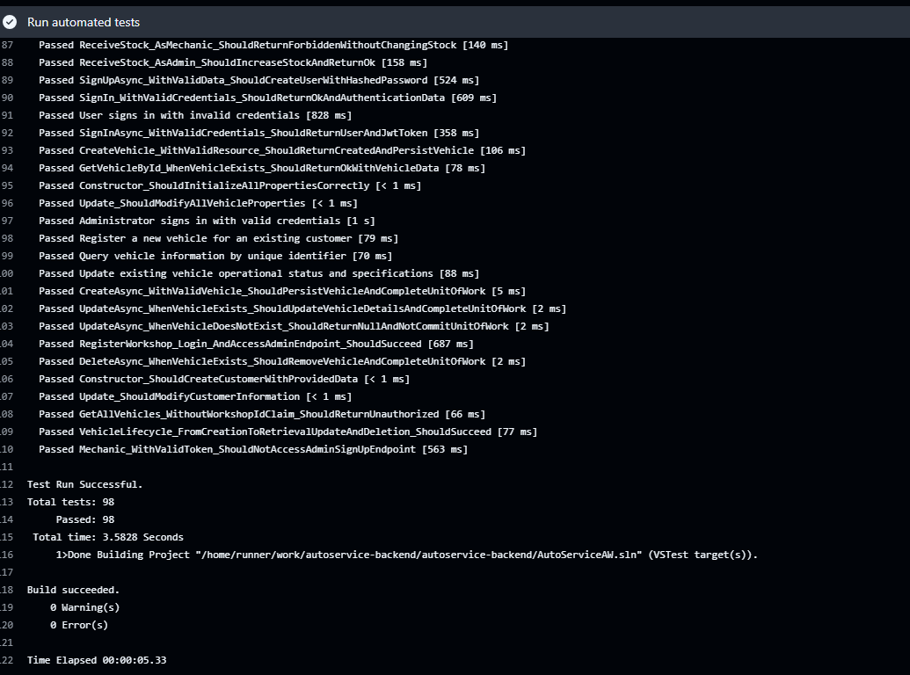
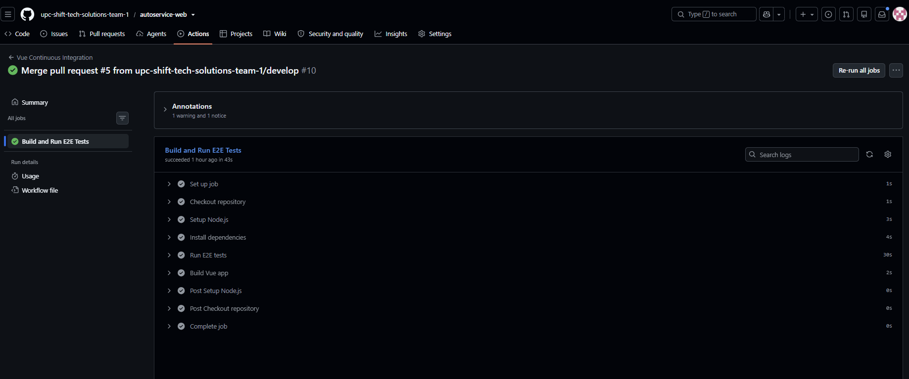
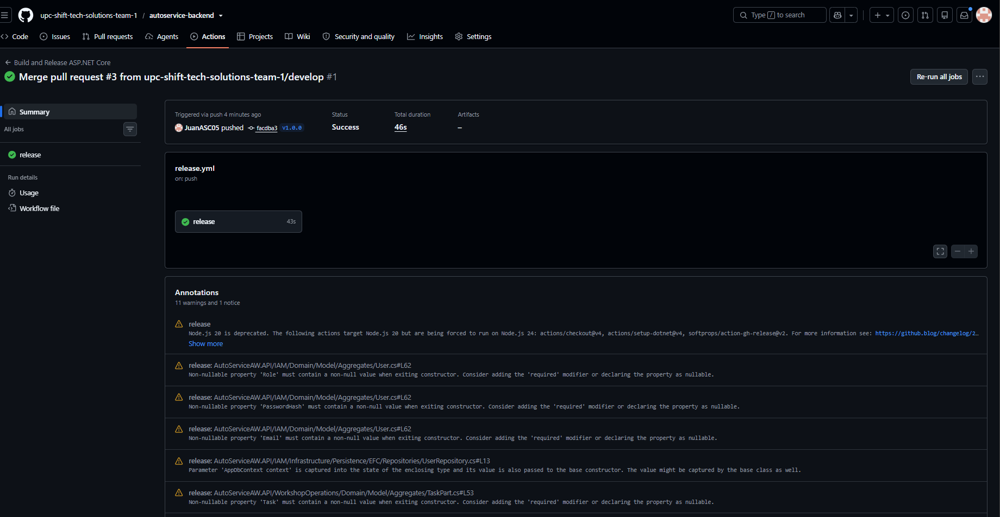
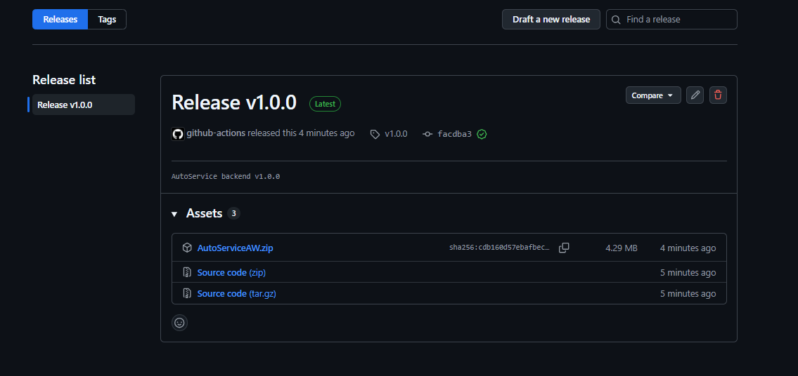
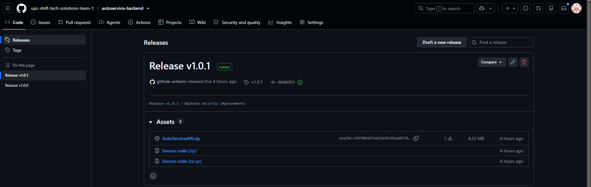
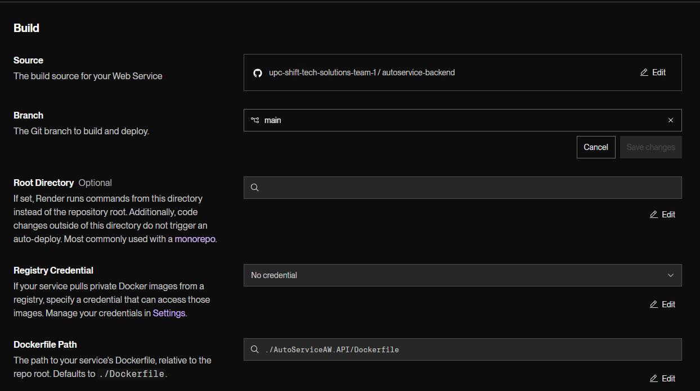
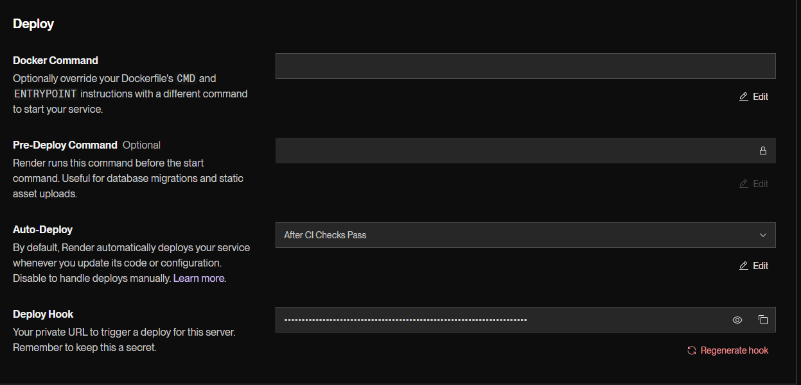
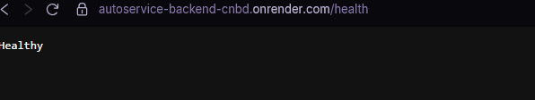

# 7. DevOps Practices


## 7.1. Continuous Integration

La integración continua de AutoService se implementó mediante **GitHub Actions**, utilizando workflows independientes para el Backend y el Frontend. Su finalidad es verificar automáticamente que los cambios incorporados al código fuente puedan restaurar sus dependencias, compilarse correctamente y superar las pruebas automatizadas antes de integrarse en las ramas principales del proyecto.

Los workflows se encuentran definidos en los siguientes archivos:

**Backend:**
```text
.github/workflows/ci.yml
```

Nombre del workflow:
```text
Backend Continuous Integration
```

**Frontend:**
```text
.github/workflows/vue-ci.yml
```

Nombre del workflow:
```text
Vue Continuous Integration
```

Los procesos de integración se ejecutan mediante eventos `push` y `pull_request`, considerando las ramas `main`, `develop` y las ramas de desarrollo configuradas en cada workflow.

Las verificaciones automáticas permiten identificar errores de compilación, dependencias incompatibles y fallos en las pruebas antes de que los cambios sean incorporados al código principal.

En el Backend, la ejecución más reciente de GitHub Actions registró **98 pruebas automatizadas aprobadas y ninguna prueba fallida**. Por su parte, el Frontend dispone de un pipeline orientado a la instalación de dependencias, ejecución de pruebas End-to-End y compilación de la aplicación Vue.

### 7.1.1. Tools and Practices

La principal herramienta utilizada para Continuous Integration es **GitHub Actions**, que permite definir y ejecutar procesos automatizados mediante archivos YAML almacenados en los repositorios de AutoService.

Los workflows utilizan runners de GitHub basados en `ubuntu-latest`, donde se configuran los entornos necesarios para compilar y ejecutar las pruebas de cada aplicación.

Las herramientas y prácticas empleadas se presentan a continuación:

| Herramienta o práctica | Aplicación en AutoService |
|---|---|
| GitHub Actions | Automatización de los procesos de compilación y pruebas mediante workflows |
| GitHub | Almacenamiento del código fuente y gestión de eventos que activan los pipelines |
| .NET 10 | Entorno de ejecución utilizado para compilar y probar el Backend |
| Node.js 22 | Entorno utilizado para instalar dependencias y ejecutar el pipeline del Frontend |
| Vue y Vite | Framework y herramienta de compilación utilizados en el Frontend |
| `ubuntu-latest` | Runner empleado para ejecutar los jobs de integración continua |
| GitFlow | Organización del desarrollo mediante ramas `feature/**`, `develop` y `main` |
| Pull Requests | Revisión e integración de cambios después de las verificaciones automáticas |
| Automated Testing | Ejecución de pruebas para comprobar el funcionamiento de los componentes |
| Least-Privilege Permissions | Restricción de permisos de los workflows según las operaciones necesarias |

**Configuración de los eventos del Backend**

El workflow del Backend contempla la ejecución automática sobre las ramas principales y las ramas de funcionalidades configuradas:

```yaml
on:
  push:
    branches:
      - main
      - develop
      - 'feature/**'

  pull_request:
    branches:
      - main
      - develop
```

Esta configuración permite ejecutar verificaciones tanto durante el desarrollo como en los Pull Requests dirigidos a las ramas principales.

**Permisos del workflow**

El pipeline del Backend utiliza permisos limitados para acceder al contenido del repositorio:

```yaml
permissions:
  contents: read
```

Con esta configuración, GitHub Actions puede descargar el código fuente necesario para ejecutar las verificaciones sin disponer de permisos de escritura innecesarios.

Los workflows también permiten consultar los registros de ejecución, identificar pasos fallidos y verificar el resultado de las pruebas asociadas a cada cambio.

### 7.1.2. Build & Test Suite Pipeline Components

El proceso de Continuous Integration comprende distintas etapas para el Backend y el Frontend, de acuerdo con las tecnologías y pruebas utilizadas en cada aplicación.

#### Pipeline del Backend

El workflow del Backend contiene un job denominado `build-and-test`, identificado en GitHub Actions como **Build and Test**.

Su ejecución utiliza el siguiente runner:

```yaml
runs-on: ubuntu-latest
```

Las etapas principales del pipeline son las siguientes:

| Orden | Componente | Herramienta o comando | Propósito |
|---:|---|---|---|
| 1 | Checkout source code | `actions/checkout@v4` | Descargar el código fuente correspondiente al commit |
| 2 | Setup .NET 10 | `actions/setup-dotnet@v4` | Configurar el SDK de .NET 10 |
| 3 | Restore dependencies | `dotnet restore AutoServiceAW.sln` | Restaurar las dependencias NuGet |
| 4 | Build solution | `dotnet build AutoServiceAW.sln --configuration Release --no-restore` | Compilar la solución en configuración Release |
| 5 | Run automated tests | `dotnet test AutoServiceAW.sln --configuration Release --no-build --verbosity normal` | Ejecutar las pruebas automatizadas |

Adicionalmente, el pipeline incluye una verificación de seguridad para detectar archivos no permitidos o ajenos al contenido esperado del repositorio.

El proceso general puede representarse de la siguiente manera:

```text
Push / Pull Request
        |
        v
Checkout source code
        |
        v
Security file validation
        |
        v
Setup .NET 10
        |
        v
Restore dependencies
        |
        v
Build solution (Release)
        |
        v
Run automated tests
        |
        v
Continuous Integration validation
```

La restauración de dependencias se realiza mediante:

```bash
dotnet restore AutoServiceAW.sln
```

Posteriormente, se ejecuta la compilación utilizando la opción `--no-restore`:

```bash
dotnet build AutoServiceAW.sln --configuration Release --no-restore
```

Esta opción evita repetir la restauración de paquetes durante la compilación.

Una vez generado el proyecto, se ejecutan las pruebas con `--no-build`:

```bash
dotnet test AutoServiceAW.sln --configuration Release --no-build --verbosity normal
```

De esta manera, las pruebas utilizan los componentes compilados previamente y permiten verificar su funcionamiento antes de completar el pipeline.

**Resultados de las pruebas automatizadas del Backend**

La solución `AutoServiceAW.sln` comprende el proyecto principal del Backend y el proyecto de pruebas `AutoServiceAW.API.Tests`.

Las pruebas incluyen verificaciones unitarias, de integración, BDD y de aceptación, correspondientes a las funcionalidades documentadas en el Capítulo VI.

La documentación anterior registraba una línea base de 31 pruebas automatizadas. Después de las actualizaciones realizadas en el Backend, la ejecución registrada en GitHub Actions presentó los siguientes resultados:

| Indicador | Resultado |
|---|---|
| Pruebas ejecutadas | 98 |
| Pruebas aprobadas | 98 |
| Pruebas fallidas | 0 |
| Pruebas omitidas | 0 |
| Estado del pipeline | Success |

Entre las verificaciones incorporadas se encuentran las pruebas relacionadas con la validación de identificadores y el control de acceso a vehículos según el taller autenticado.

La ejecución automatizada permitió comprobar que los cambios de seguridad no afectaron los escenarios existentes y que la solución continuaba compilando correctamente.



*Figura 7.1. Ejecución del pipeline Backend Continuous Integration y resultado satisfactorio de las 98 pruebas automatizadas en GitHub Actions.*

El resultado `Success` confirma que las etapas de compilación y pruebas finalizaron correctamente para la ejecución presentada. Estas verificaciones forman parte del proceso utilizado antes de integrar cambios en el Backend.

#### Pipeline del Frontend

El Frontend dispone de un workflow independiente denominado **Vue Continuous Integration**, definido en el archivo `.github/workflows/vue-ci.yml`.

Este pipeline utiliza Node.js 22, Vue y Vite, además de herramientas para la ejecución de pruebas automatizadas End-to-End.

Las principales etapas del proceso son las siguientes:

| Orden | Componente | Herramienta o comando | Propósito |
|---:|---|---|---|
| 1 | Checkout repository | `actions/checkout@v4` | Obtener el código fuente del commit o Pull Request |
| 2 | Setup Node.js | `actions/setup-node@v4` | Configurar Node.js 22 y la caché de dependencias |
| 3 | Install dependencies | `npm ci` | Instalar las dependencias definidas en `package-lock.json` |
| 4 | Run E2E tests | `npm run dev`, `npx wait-on` y `npm run test:e2e` | Ejecutar pruebas automatizadas sobre la aplicación |
| 5 | Build Vue app | `npx vite build` | Generar los archivos optimizados para producción |

El proceso general del Frontend se organiza de la siguiente manera:

```text
Push / Pull Request
        |
        v
Checkout repository
        |
        v
Setup Node.js 22
        |
        v
Install dependencies
        |
        v
Run E2E tests
        |
        v
Build Vue app (Vite)
        |
        v
Continuous Integration validation
```

**Instalación de dependencias**

La instalación de dependencias se realiza mediante:

```bash
npm ci
```

Este comando utiliza las versiones registradas en `package-lock.json`, permitiendo reproducir el entorno utilizado durante la ejecución del pipeline.

**Ejecución de pruebas End-to-End**

La etapa de pruebas inicia el servidor de desarrollo y espera a que la aplicación se encuentre disponible antes de ejecutar los escenarios automatizados:

```bash
npm run dev &
npx wait-on http://localhost:5173
npm run test:e2e
```

Las pruebas End-to-End permiten verificar el comportamiento de la interfaz y la interacción con sus componentes mediante un navegador ejecutado en modo Headless.

De acuerdo con la suite documentada para el Frontend, se contemplan **5 pruebas automatizadas End-to-End**, relacionadas con los módulos de Mechanic y Workshop Operations.

**Compilación del Frontend**

Finalmente, la aplicación se compila mediante Vite:

```bash
npx vite build
```

Este proceso genera los archivos estáticos optimizados en el directorio `dist`, utilizados posteriormente durante el despliegue de la aplicación.



*Figura 7.2. Ejecución satisfactoria del workflow Vue Continuous Integration mediante GitHub Actions.*

La ejecución de los workflows de Backend y Frontend permite verificar de manera independiente los componentes principales de AutoService, identificando errores de compilación y fallos en las pruebas automatizadas antes de su integración en las ramas principales.


## 7.2. Continuous Delivery

La estrategia de Continuous Delivery de AutoService se implementó mediante un workflow de GitHub Actions encargado de compilar, publicar y empaquetar una versión distribuible del Backend. Las versiones se identifican mediante Git Tags, siguiendo el esquema de Semantic Versioning.

El workflow se encuentra definido en el archivo:

```text
.github/workflows/release.yml
```

Y recibe el nombre:

```text
Build and Release ASP.NET Core
```

A diferencia del pipeline de Continuous Integration, este workflow no se ejecuta ante cada cambio del repositorio. Su activación ocurre cuando se publica un tag que cumple con el siguiente patrón:

```text
v*.*.*
```

Esta configuración permite identificar versiones específicas del código fuente y generar los archivos necesarios para su distribución.

### Versiones publicadas

La primera versión estable documentada del Backend corresponde al tag `v1.0.0`, creado a partir de un estado validado de la rama `main`.

La publicación del tag activó el workflow `Build and Release ASP.NET Core`, cuya ejecución finalizó satisfactoriamente.



*Figura 7.3. Ejecución satisfactoria del workflow Build and Release ASP.NET Core para la versión v1.0.0.*

Como resultado, GitHub Actions generó el GitHub Release `v1.0.0`, que incluyó el archivo comprimido `AutoServiceAW.zip` con los componentes necesarios para distribuir el Backend.



*Figura 7.4. Publicación del GitHub Release v1.0.0 con el artefacto AutoServiceAW.zip.*

Posteriormente, se publicó la versión `v1.0.1`, utilizando el mismo mecanismo automatizado de generación de releases. El workflow se ejecutó correctamente y produjo un nuevo artefacto `AutoServiceAW.zip`, de aproximadamente 4.32 MB.

| Versión | Mecanismo de publicación | Artefacto generado |
|---|---|---|
| `v1.0.0` | Git Tag y GitHub Actions | `AutoServiceAW.zip` |
| `v1.0.1` | Git Tag y GitHub Actions | `AutoServiceAW.zip` |



*Figura 7.5. GitHub Release v1.0.1 con el archivo AutoServiceAW.zip generado mediante GitHub Actions.*

Cada release queda asociado al commit identificado por su tag. Por esta razón, el artefacto de `v1.0.1` representa el estado del código correspondiente a esa versión y no necesariamente los cambios incorporados posteriormente en la rama `main`.

### 7.2.1. Tools and Practices

La implementación de Continuous Delivery utiliza GitHub Actions para automatizar la generación de versiones distribuibles y GitHub Releases para almacenar los artefactos publicados.

Las herramientas y prácticas empleadas se presentan a continuación:

| Herramienta o práctica | Aplicación en AutoService |
|---|---|
| GitHub Actions | Automatización de la compilación, publicación, empaquetado y generación de releases |
| Git Tags | Identificación de versiones específicas del código fuente |
| Semantic Versioning | Organización de versiones mediante el formato `vMAJOR.MINOR.PATCH` |
| GitHub Releases | Publicación y almacenamiento de las versiones generadas |
| .NET 10 | Entorno utilizado para compilar y publicar el Backend |
| `dotnet publish` | Generación de los archivos distribuibles de la aplicación |
| ZIP artifact | Empaquetado de la aplicación mediante `AutoServiceAW.zip` |
| `softprops/action-gh-release` | Creación automática del GitHub Release y carga del artefacto |
| `ubuntu-latest` | Runner utilizado para ejecutar el workflow |

#### Activación mediante Git Tags

El workflow utiliza la siguiente configuración:

```yaml
on:
  push:
    tags:
      - 'v*.*.*'
```

De esta forma, la publicación de un tag como `v1.0.0` o `v1.0.1` activa el proceso de generación de una versión distribuible.

La nomenclatura utilizada sigue el formato:

```text
vMAJOR.MINOR.PATCH
```

En este esquema, `MAJOR` identifica cambios mayores, `MINOR` corresponde a cambios funcionales compatibles y `PATCH` identifica modificaciones correctivas compatibles con la versión anterior.

La relación entre el código fuente y las versiones publicadas se representa mediante el siguiente flujo:

```text
Código fuente del Backend
          |
          v
Commit seleccionado en main
          |
          v
Git Tag (v1.0.0 / v1.0.1)
          |
          v
GitHub Actions
          |
          v
Build and Release ASP.NET Core
          |
          v
GitHub Release
          |
          v
AutoServiceAW.zip
```

Cada versión conserva una referencia al estado del repositorio utilizado para su construcción.

#### Permisos y publicación del release

Para crear un GitHub Release, el workflow requiere permisos de escritura sobre el contenido del repositorio:

```yaml
permissions:
  contents: write
```

Este permiso permite publicar una versión y adjuntar el archivo ZIP generado.

La creación del release utiliza la acción `softprops/action-gh-release`. En la configuración de seguridad del workflow se emplea una referencia fija por SHA para identificar la versión de la acción utilizada y evitar modificaciones inesperadas de la dependencia.

La publicación contiene el nombre de la versión, el Git Tag correspondiente y el artefacto generado durante el pipeline.

### 7.2.2. Stages Deployment Pipeline Components

El pipeline de Continuous Delivery contiene un job denominado `release`, ejecutado mediante un runner `ubuntu-latest`.

El proceso comprende las siguientes etapas:

| Orden | Etapa | Herramienta o comando | Propósito |
|---:|---|---|---|
| 1 | Checkout source code | `actions/checkout@v4` | Obtener el código fuente asociado al tag |
| 2 | Setup .NET 10 | `actions/setup-dotnet@v4` | Configurar el SDK de .NET 10 |
| 3 | Restore dependencies | `dotnet restore` | Restaurar las dependencias del proyecto |
| 4 | Build solution | `dotnet build --configuration Release --no-restore` | Compilar el Backend en modo Release |
| 5 | Publish application | `dotnet publish --configuration Release --no-build --output publish` | Generar los archivos distribuibles |
| 6 | Package artifact | `zip -r ../AutoServiceAW.zip .` | Comprimir los archivos publicados |
| 7 | Create GitHub Release | `softprops/action-gh-release` | Crear el release correspondiente al tag |
| 8 | Upload artifact | `files: AutoServiceAW.zip` | Adjuntar el archivo ZIP al release |

#### Restauración de dependencias

La restauración de dependencias se realiza sobre el proyecto principal del Backend:

```bash
dotnet restore AutoServiceAW.API/AutoServiceAW.API.csproj
```

Esta operación descarga y prepara los paquetes NuGet necesarios para compilar la aplicación.

#### Compilación del Backend

Posteriormente, se ejecuta la compilación en configuración `Release`:

```bash
dotnet build AutoServiceAW.API/AutoServiceAW.API.csproj \
  --configuration Release \
  --no-restore
```

La opción `--no-restore` evita repetir la restauración de dependencias ejecutada en la etapa anterior.

#### Publicación de la aplicación

Después de la compilación, el comando `dotnet publish` genera los archivos necesarios para distribuir y ejecutar la aplicación:

```bash
dotnet publish AutoServiceAW.API/AutoServiceAW.API.csproj \
  --configuration Release \
  --no-build \
  --output publish
```

La opción `--no-build` permite utilizar los resultados de la compilación anterior, mientras que `--output publish` establece el directorio donde se almacenarán los archivos publicados.

#### Generación del artefacto ZIP

Los archivos generados se comprimen en un único artefacto:

```text
AutoServiceAW.zip
```

Para ello, el workflow utiliza el siguiente comando desde el directorio de publicación:

```bash
zip -r ../AutoServiceAW.zip .
```

El archivo resultante contiene los componentes necesarios para distribuir la aplicación ASP.NET Core.

#### Creación del GitHub Release

La etapa final utiliza `softprops/action-gh-release` para crear una publicación asociada al Git Tag que activó el workflow.

La configuración de los datos del release es la siguiente:

```yaml
with:
  tag_name: ${{ github.ref_name }}
  name: Release ${{ github.ref_name }}
  files: AutoServiceAW.zip
```

La expresión `${{ github.ref_name }}` permite obtener el nombre del tag correspondiente a la ejecución, mientras que `files` identifica el artefacto que será adjuntado al release.

De esta forma, el mismo workflow puede generar publicaciones para diferentes versiones sin modificar manualmente el nombre del archivo ni el identificador de la versión.

#### Flujo del pipeline

El proceso de Continuous Delivery se representa de la siguiente manera:

```text
Commit seleccionado en main
           |
           v
Crear Git Tag
           |
           v
Push del tag a GitHub
           |
           v
Checkout source code
           |
           v
Setup .NET 10
           |
           v
Restore dependencies
           |
           v
Build Release
           |
           v
dotnet publish
           |
           v
Generar AutoServiceAW.zip
           |
           v
Crear GitHub Release
           |
           v
Adjuntar artefacto ZIP
```

Las ejecuciones documentadas para `v1.0.0` y `v1.0.1` permitieron generar correctamente los archivos distribuibles del Backend y publicarlos mediante GitHub Releases.

Este proceso corresponde a **Continuous Delivery**, ya que automatiza la preparación y publicación de una versión distribuible de la aplicación.

El workflow `release.yml` no realiza directamente el despliegue del Backend en Render. La actualización del entorno de producción utiliza un proceso independiente, descrito en el apartado 7.3. Continuous Deployment.


## 7.3. Continuous Deployment

El proceso de Continuous Deployment de AutoService se implementó mediante la integración de GitHub, GitHub Actions y Render. Esta configuración permite desplegar automáticamente las actualizaciones del Backend en el entorno de producción después de que los controles de Continuous Integration asociados al commit hayan finalizado correctamente.

El Backend se encuentra desplegado como un Web Service basado en Docker dentro de Render. El servicio utiliza como fuente el repositorio:

```text
upc-shift-tech-solutions-team-1/autoservice-backend
```

La rama configurada para producción es:

```text
main
```

Render utiliza el siguiente archivo para construir la imagen de la aplicación:

```text
./AutoServiceAW.API/Dockerfile
```

La configuración del servicio permite construir y ejecutar el Backend de ASP.NET Core 10 utilizando el código disponible en la rama `main`.



*Figura 7.6. Configuración del servicio de producción en Render utilizando la rama main y el Dockerfile del Backend.*

### Configuración del despliegue automático

El servicio de Render tiene habilitada la opción de Auto-Deploy con la siguiente configuración:

```text
After CI Checks Pass
```

Esta opción establece que Render debe esperar a que los checks de Continuous Integration asociados al commit finalicen satisfactoriamente antes de iniciar el despliegue.

En el Backend, las verificaciones se realizan mediante GitHub Actions e incluyen la restauración de dependencias, compilación de la solución y ejecución de pruebas automatizadas.

La ejecución correspondiente a los cambios recientes registró **98 pruebas aprobadas y 0 fallidas**, con el workflow de Continuous Integration finalizado correctamente.



*Figura 7.7. Configuración de Auto-Deploy en Render mediante la opción After CI Checks Pass.*

Esta configuración relaciona el proceso de integración continua con el despliegue de producción. Los cambios enviados a `main` son evaluados por GitHub Actions antes de que Render inicie la construcción de la nueva versión, siempre que los checks requeridos se encuentren configurados y se ejecuten para el commit correspondiente.

### 7.3.1. Tools and Practices

El proceso de Continuous Deployment utiliza herramientas de control de versiones, automatización, contenedores y servicios en la nube.

| Herramienta o práctica | Aplicación en AutoService |
|---|---|
| GitHub | Almacena el código fuente y mantiene la rama `main` utilizada como fuente de producción |
| GitHub Actions | Ejecuta las verificaciones de Continuous Integration asociadas a los cambios del Backend |
| Render | Construye y despliega la RESTful API en el entorno de producción |
| Docker | Define el entorno de construcción y ejecución de la aplicación |
| ASP.NET Core 10 | Framework utilizado por el Backend |
| Railway | Aloja la base de datos MySQL utilizada por la aplicación en producción |
| Environment Variables | Permiten establecer configuraciones del entorno sin incorporarlas directamente al código fuente |
| Auto-Deploy | Inicia el despliegue después de la aprobación de los checks de CI |
| Health Check | Permite consultar el estado operativo del servicio desplegado |

#### Integración entre GitHub Actions y Render

El proceso de despliegue se inicia a partir de los cambios integrados en la rama `main`.

El flujo de integración y despliegue se representa de la siguiente manera:

```text
Cambios desarrollados
        |
        v
Pull Request hacia develop
        |
        v
Integración en develop
        |
        v
Pull Request hacia main
        |
        v
Integración en main
        |
        v
GitHub Actions CI
        |
        v
Restore dependencies
        |
        v
Build solution
        |
        v
Automated Tests
        |
        v
CI Checks Pass
        |
        v
Render Auto-Deploy
        |
        v
Docker Build
        |
        v
RESTful API en producción
```

En este proceso, GitHub Actions realiza las validaciones del código, mientras que Render se encarga de construir y ejecutar la aplicación en el entorno de producción.

La actualización del Backend se realiza a partir de la rama `main`. Por tanto, el despliegue automático de Render es independiente del workflow `release.yml`, utilizado para generar los archivos ZIP documentados en Continuous Delivery.

#### Configuración mediante variables de entorno

La aplicación utiliza Environment Variables para establecer valores que dependen del entorno de ejecución.

Entre las variables utilizadas se encuentran:

```text
ConnectionStrings__DefaultConnection
Jwt__Secret
Database__ApplyMigrationsOnStartup
ASPNETCORE_ENVIRONMENT
```

La variable `ConnectionStrings__DefaultConnection` proporciona los datos necesarios para establecer la conexión con la base de datos MySQL alojada en Railway.

Por su parte, `Jwt__Secret` contiene la clave utilizada por el mecanismo de autenticación JWT. Su configuración mediante variables de entorno evita incorporar directamente este valor en el código fuente versionado.

La variable `Database__ApplyMigrationsOnStartup` permite controlar la aplicación de migraciones de base de datos durante el inicio del Backend, mientras que `ASPNETCORE_ENVIRONMENT` define el entorno de ejecución de ASP.NET Core.

Estas configuraciones se administran desde el servicio de Render y no requieren modificar el código fuente para establecer los valores correspondientes al entorno de producción.

### 7.3.2. Production Deployment Pipeline Components

Render utiliza el Dockerfile del Backend para construir una imagen ejecutable de la aplicación.

El archivo se encuentra en:

```text
AutoServiceAW.API/Dockerfile
```

La construcción se realiza mediante un Dockerfile multi-stage, que separa el entorno utilizado para compilar la aplicación del entorno necesario para ejecutarla.

#### Etapa de construcción

La primera etapa utiliza la imagen oficial del SDK de .NET 10:

```dockerfile
FROM mcr.microsoft.com/dotnet/sdk:10.0 AS build
WORKDIR /src
```

Posteriormente, se copian la solución y el archivo del proyecto para realizar la restauración de dependencias:

```dockerfile
COPY AutoServiceAW.sln ./
COPY AutoServiceAW.API/AutoServiceAW.API.csproj ./AutoServiceAW.API/

RUN dotnet restore AutoServiceAW.API/AutoServiceAW.API.csproj
```

Después de restaurar las dependencias, se copia el resto del código fuente y se genera la versión de producción mediante `dotnet publish`:

```dockerfile
COPY . .
WORKDIR /src/AutoServiceAW.API

RUN dotnet publish AutoServiceAW.API.csproj \
    -c Release \
    -o /app/publish
```

El comando `dotnet publish` compila la aplicación y prepara los archivos necesarios para su ejecución.

#### Etapa de ejecución

La segunda etapa utiliza la imagen oficial de ASP.NET Core 10:

```dockerfile
FROM mcr.microsoft.com/dotnet/aspnet:10.0 AS runtime
WORKDIR /app

COPY --from=build /app/publish .
```

Esta separación permite utilizar el SDK completo durante la construcción y mantener únicamente el entorno de ejecución de ASP.NET Core en la imagen final.

La configuración del contenedor también contempla la ejecución mediante un usuario sin privilegios de administrador.

#### Configuración del puerto

El servicio se encuentra configurado para escuchar solicitudes HTTP mediante el puerto `10000`:

```dockerfile
ENV ASPNETCORE_URLS=http://+:10000
EXPOSE 10000
```

La variable `ASPNETCORE_URLS` establece la dirección y el puerto utilizados por la aplicación dentro del contenedor.

#### Inicio del Backend

La aplicación se inicia mediante el siguiente comando:

```dockerfile
ENTRYPOINT ["dotnet", "AutoServiceAW.API.dll"]
```

Este comando ejecuta el ensamblado generado durante la etapa de publicación.

#### Flujo de despliegue en producción

El proceso utilizado por Render puede representarse de la siguiente manera:

```text
Repositorio de GitHub
          |
          v
Rama main
          |
          v
GitHub Actions CI
          |
          v
Build + Automated Tests
          |
          v
CI Success
          |
          v
Render Auto-Deploy
          |
          v
Lectura del Dockerfile
          |
          v
.NET 10 SDK Build Stage
          |
          v
dotnet restore
          |
          v
dotnet publish -c Release
          |
          v
ASP.NET Core Runtime Stage
          |
          v
Inicio de AutoServiceAW.API.dll
          |
          v
RESTful API en producción
          |
          v
Conexión con Railway MySQL
```

Durante la ejecución, el Backend utiliza las variables de entorno configuradas en Render para establecer la conexión con la base de datos y acceder a los valores necesarios para la autenticación.

#### Servicio desplegado

La RESTful API de AutoService se encuentra publicada mediante HTTPS en la siguiente dirección:

```text
https://autoservice-backend-cnbd.onrender.com
```

Los recursos de la API utilizan la siguiente ruta base:

```text
https://autoservice-backend-cnbd.onrender.com/api/v1
```

La documentación Swagger/OpenAPI del Backend se encuentra configurada mediante la siguiente ruta:

```text
https://autoservice-backend-cnbd.onrender.com/swagger/index.html
```

El servicio también dispone de un endpoint de comprobación de estado:

```text
https://autoservice-backend-cnbd.onrender.com/health
```

La consulta de este endpoint devolvió el siguiente resultado:

```text
Healthy
```

Este resultado confirmó que la aplicación se encontraba operativa durante la verificación realizada.

El despliegue de producción correspondiente al commit `d621a48`, asociado a las verificaciones de aislamiento entre talleres, fue registrado en Render con estado `Live`.

La comprobación del endpoint `/health` y la disponibilidad del servicio se desarrollan con mayor detalle en el apartado 7.4, correspondiente al monitoreo del entorno de producción.


## 7.4. Continuous Monitoring

El monitoreo de AutoService comprende la revisión del estado de los servicios desplegados, los resultados de los pipelines de integración continua y los registros generados durante la ejecución de la aplicación.

Para el Backend se utilizan las herramientas de supervisión de Render, los resultados de GitHub Actions y el endpoint `/health` de la RESTful API. Estas fuentes permiten comprobar la disponibilidad del servicio, revisar el resultado de los despliegues e identificar errores durante los procesos de compilación y ejecución.

De manera complementaria, SonarQube Cloud proporciona indicadores relacionados con la calidad y seguridad del código, mientras que GitHub permite consultar el estado de los checks asociados a los commits y Pull Requests.

### 7.4.1. Tools and Practices

Las principales herramientas utilizadas para supervisar el funcionamiento del Backend de AutoService son las siguientes:

| Herramienta o práctica | Aplicación en AutoService |
|---|---|
| Render Dashboard | Consulta del estado del servicio desplegado y de los eventos de deployment |
| Render Logs | Revisión de los registros generados durante la construcción y ejecución del Backend |
| GitHub Actions | Supervisión de los resultados de compilación y pruebas automatizadas |
| GitHub Checks | Identificación del estado de las verificaciones asociadas a commits y Pull Requests |
| SonarQube Cloud | Seguimiento de indicadores de calidad y seguridad del código |
| Health Check | Comprobación de la disponibilidad de la RESTful API mediante el endpoint `/health` |
| Render Metrics | Consulta de los indicadores de uso de recursos disponibles en la plataforma |

#### Supervisión del servicio desplegado

El Backend se encuentra alojado en Render bajo la modalidad de Web Service. La plataforma permite consultar el estado de los despliegues, identificar el commit utilizado en cada actualización y revisar los registros de ejecución de la aplicación.

Los eventos de deployment permiten diferenciar los procesos que se encuentran en construcción, aquellos que presentan errores y los que han finalizado correctamente.

Durante la verificación del Backend, el despliegue correspondiente al commit `d621a48` fue registrado en Render con estado `Live`, indicando que la versión desplegada se encontraba activa.

#### Verificación mediante Health Check

La aplicación dispone de un endpoint destinado a comprobar su estado operativo:

```text
https://autoservice-backend-cnbd.onrender.com/health
```

La consulta realizada al endpoint devolvió la siguiente respuesta:

```text
Healthy
```

Este resultado indica que la aplicación respondió satisfactoriamente a la solicitud de comprobación de estado durante la verificación.



*Figura 7.8. Verificación del endpoint /health del Backend desplegado en Render, con respuesta Healthy.*

El endpoint permite realizar una comprobación directa del servicio sin necesidad de ejecutar operaciones sobre los módulos funcionales de la aplicación.

La respuesta `Healthy` confirma el resultado de la comprobación implementada, aunque no sustituye las pruebas funcionales de todos los componentes ni garantiza por sí sola la disponibilidad de cada dependencia externa.

#### Supervisión de la integración continua

GitHub Actions permite consultar el resultado de cada ejecución del workflow `Backend Continuous Integration`.

La ejecución analizada presentó los siguientes resultados:

| Indicador | Resultado |
|---|---|
| Estado del workflow | Success |
| Pruebas automatizadas | 98 |
| Pruebas aprobadas | 98 |
| Pruebas fallidas | 0 |
| Rama verificada | `main` |

La evidencia correspondiente a esta ejecución se presentó en el apartado 7.1.

Los registros de GitHub Actions permiten identificar la etapa donde se produce un fallo, incluyendo la restauración de dependencias, compilación de la solución y ejecución de pruebas.

Por otro lado, SonarQube Cloud permite consultar el cumplimiento del Quality Gate y los indicadores de cobertura, confiabilidad, mantenibilidad y seguridad del código. Los resultados de este análisis se encuentran documentados en el apartado 6.2.1.2.

### 7.4.2. Monitoring Pipeline Components

El proceso de monitoreo utiliza la información generada por GitHub Actions, Render y los endpoints disponibles en la aplicación.

Los principales componentes se describen a continuación:

| Componente | Fuente de información | Función |
|---|---|---|
| Verificación del código | GitHub Actions | Consultar el resultado de la compilación y las pruebas automatizadas |
| Análisis de calidad | SonarQube Cloud | Revisar el Quality Gate y los indicadores de calidad del código |
| Estado del deployment | Render | Identificar el resultado del despliegue y la versión activa |
| Registros de ejecución | Render Logs | Consultar mensajes y errores registrados durante el funcionamiento del servicio |
| Disponibilidad de la API | Endpoint `/health` | Comprobar la respuesta del Backend desplegado |
| Uso de recursos | Render Dashboard | Revisar los indicadores de consumo disponibles para el servicio |

#### Flujo de supervisión

El monitoreo del Backend se organiza mediante las siguientes fuentes de información:

```text
Cambios en el repositorio
          |
          v
GitHub Actions
          |
          v
Resultado de CI
          |
          v
SonarQube Cloud
          |
          v
Indicadores de calidad
          |
          v
Render Auto-Deploy
          |
          v
Estado del deployment
          |
          v
Backend en producción
          |
          +----------------------+
          |                      |
          v                      v
     Render Logs           Endpoint /health
          |                      |
          v                      v
 Registros de ejecución    Estado de la API
          |                      |
          +-----------+----------+
                      |
                      v
          Revisión de resultados
```

Este esquema representa las fuentes utilizadas para comprobar el estado del Backend. La consulta del endpoint `/health` y la revisión de los registros se realizaron como verificaciones puntuales; no se ha documentado la implementación de un sistema externo de monitoreo periódico.

#### Comprobación del entorno de producción

La verificación del entorno de producción comprendió los siguientes elementos:

1. Revisión del estado satisfactorio del workflow de Continuous Integration en GitHub Actions.
2. Comprobación del deployment activo en Render.
3. Consulta del endpoint `/health` y verificación de la respuesta `Healthy`.
4. Revisión de los registros y eventos disponibles en Render.
5. Comprobación de las solicitudes HTTP realizadas por el Frontend hacia el Backend.

Durante la validación de la integración entre Frontend y Backend se observaron respuestas HTTP `200 OK` en solicitudes correspondientes a operaciones de autenticación y consulta de recursos, incluyendo vehículos, clientes, tareas y órdenes de trabajo.

Estas comprobaciones permitieron verificar el funcionamiento de los servicios durante las pruebas realizadas en el entorno desplegado.

### 7.4.3. Alerting Pipeline Components

La identificación de fallos se realiza principalmente mediante los estados y resultados proporcionados por GitHub Actions, SonarQube Cloud y Render.

Estas herramientas permiten reconocer problemas durante la integración del código, la evaluación de calidad y el despliegue de la aplicación.

Los principales eventos que requieren revisión son los siguientes:

| Evento | Herramienta | Indicador de fallo |
|---|---|---|
| Error de compilación | GitHub Actions | Workflow con estado `Failure` |
| Pruebas automatizadas fallidas | GitHub Actions | Resultado de pruebas distinto al esperado |
| Incumplimiento del Quality Gate | SonarQube Cloud | Quality Gate con estado `Failed` |
| Error durante el deployment | Render | Deployment con estado de error |
| Fallo durante la ejecución | Render Logs | Registros de error de la aplicación |
| Servicio no disponible | Endpoint `/health` | Error de conexión o respuesta no satisfactoria |

#### Identificación de fallos en Continuous Integration

Cuando un workflow de GitHub Actions presenta errores, la plataforma registra el estado de la ejecución y permite revisar los logs correspondientes.

Los fallos pueden estar relacionados con dependencias, errores de compilación o pruebas que no cumplen los resultados esperados.

El estado de los checks también puede consultarse desde el commit o Pull Request relacionado con la ejecución.

#### Identificación de problemas de calidad

SonarQube Cloud permite identificar incumplimientos de los criterios configurados en el Quality Gate.

En la evaluación documentada del Backend, el Quality Gate obtuvo el estado `Passed`, con una cobertura del código nuevo de 91.07 %.

Un resultado `Failed` constituye un indicador de incumplimiento de los criterios de calidad establecidos y requiere revisar los hallazgos correspondientes.

#### Identificación de fallos en producción

Render permite consultar los eventos relacionados con la construcción y puesta en funcionamiento de una nueva versión.

Cuando ocurre un error durante el deployment, los registros de la plataforma permiten identificar la etapa afectada.

La comprobación del endpoint `/health` también permite detectar si el servicio deja de responder satisfactoriamente durante una consulta.

Los mecanismos documentados corresponden a indicadores de fallo disponibles en las herramientas utilizadas. No se ha registrado la configuración de un sistema independiente de alertas automáticas basado en umbrales, comprobaciones programadas o escalamiento de incidentes.

### 7.4.4. Notification Pipeline Components

La comunicación del estado de los procesos de integración y despliegue se realiza mediante la información disponible en GitHub y Render.

Estas plataformas presentan los resultados de las ejecuciones, los estados de los checks y los eventos relacionados con el servicio desplegado.

| Componente | Información disponible | Medio de consulta |
|---|---|---|
| GitHub Actions | Resultado de los workflows y detalle de las etapas ejecutadas | Sección Actions del repositorio |
| GitHub Checks | Estado de las verificaciones asociadas a commits y Pull Requests | Interfaz de GitHub |
| SonarQube Cloud | Estado del Quality Gate e indicadores del análisis | Dashboard del proyecto |
| Render | Estado de deployments y eventos del servicio | Dashboard de Render |
| Render Logs | Mensajes de ejecución y errores de la aplicación | Sección Logs del servicio |

#### Notificación del resultado de integración

GitHub permite visualizar los resultados de los workflows vinculados a un commit o Pull Request.

Los estados `Success` y `Failure` identifican si las verificaciones finalizaron correctamente o presentaron algún problema durante su ejecución.

En caso de error, los registros del job permiten consultar los pasos ejecutados y los mensajes asociados al fallo.

#### Comunicación del estado del deployment

Render registra los eventos generados durante la construcción y el despliegue del Backend.

La interfaz de la plataforma permite consultar el resultado de cada deployment y revisar los logs correspondientes.

El estado `Live` identifica la versión activa del servicio después de completar satisfactoriamente el proceso de despliegue.

#### Canales de notificación

La documentación del entorno utilizado permite confirmar la disponibilidad de los estados y registros en los paneles de GitHub Actions, SonarQube Cloud y Render.

No se dispone de evidencia de una configuración adicional de notificaciones automáticas mediante correo electrónico, Slack, webhooks personalizados u otros servicios externos.

Por tanto, el mecanismo documentado para consultar incidentes y resultados de ejecución se basa en los estados, eventos y registros proporcionados por las plataformas utilizadas.

La supervisión realizada permitió comprobar una ejecución satisfactoria de Continuous Integration, un deployment activo en Render y una respuesta `Healthy` del Backend durante las verificaciones del entorno de producción.
