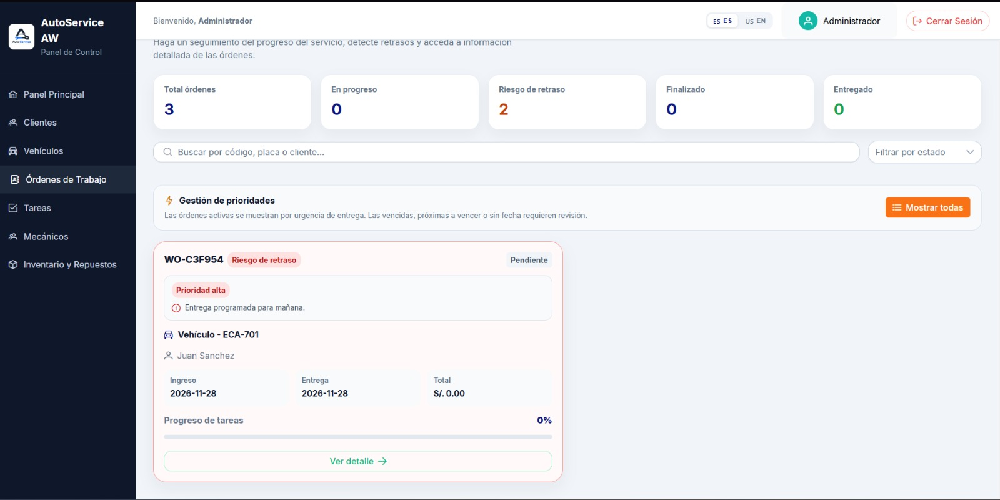

# Capítulo VIII: Experiment-Driven Development

## 8.1. Experiment Planning

La planificación de experimentos permite al equipo de AutoService investigar las necesidades que aún no se comprenden por completo y contrastar las creencias que sustentan la propuesta de valor. Para ello, se toman como punto de partida las entrevistas, la evaluación de usabilidad y los flujos de las aplicaciones web y móvil.

### 8.1.1. As-Is Summary

AutoService integra la gestión de clientes, vehículos, personal, inventario, órdenes y tareas de un taller automotriz. Las aplicaciones web y móvil se conectan al mismo backend; además, el propietario de un vehículo puede consultar el estado de su servicio mediante un código de seguimiento.

Los técnicos y administradores entrevistados destacaron la utilidad de centralizar las operaciones del taller. Entre sus sugerencias se encuentran el acceso rápido a órdenes, la consulta de repuestos, la visibilidad clara del trabajo asignado al mecánico y una experiencia accesible para personas con menor familiaridad digital. También se identificó la necesidad de comprender cómo se maneja un volumen mayor de órdenes, vehículos y tareas pendientes.

La evaluación heurística documentó dificultades relacionadas con formularios, mensajes e idioma. Además, la auditoría externa señaló problemas en la navegación de los planes de la Landing Page y la accesibilidad del acceso web. Estos antecedentes orientan la definición de preguntas de investigación, considerando el alcance de las versiones As-Is evaluadas.

Aunque las entrevistas aportan información sobre el trabajo del taller, no permiten medir de forma directa cómo interpretan los propietarios de vehículos la información del seguimiento ni cómo responden los usuarios del taller ante mejoras específicas en la web y en Android. Por ello, el diseño experimental abarca tanto a propietarios de vehículos como a responsables de taller y mecánicos.

### 8.1.2. Raw Material: Assumptions, Knowledge Gaps, Ideas, Claims

El material inicial reúne percepciones de los participantes, observaciones de la evaluación de usabilidad y cuestiones que el equipo necesita investigar. Cada elemento identifica una incertidumbre relevante para la transparencia del servicio o la operación del taller.

| ID | Tipo | Material inicial | Fuente | Incertidumbre |
|---|---|---|---|---|
| RM-01 | Suposición | Consultar el avance y la fecha estimada puede aumentar la confianza del propietario en el servicio. | Propuesta de seguimiento e hipótesis Lean UX de AutoService. | Qué información necesita el propietario para confiar en el estado comunicado. |
| RM-02 | Afirmación | La organización de tareas y el control de inventario pueden facilitar el trabajo del taller. | Comentarios de técnicos independientes entrevistados. | Qué tareas logran completar los usuarios y dónde encuentran dificultades. |
| RM-03 | Idea | Facilitar la consulta rápida de órdenes, repuestos y tareas asignadas. | Sugerencias de los técnicos entrevistados. | Cuánto esfuerzo requiere localizar la información durante el trabajo diario. |
| RM-04 | Brecha de conocimiento | No se conoce cuánto tardan los responsables del taller en registrar una orden completa en la aplicación web. | Flujo As-Is de registro de órdenes en la aplicación web. | Tiempo, errores y ayuda necesarios para completar la operación. |
| RM-05 | Brecha de conocimiento | No se conoce si el propietario entiende por qué cambió la fecha estimada. | Flujo de seguimiento y registro de cambios de fecha. | Comprensión de la nueva fecha vigente y del motivo del retraso. |
| RM-06 | Suposición | Consultar las existencias frente a la cantidad requerida para una tarea ayuda a identificar materiales insuficientes. | Flujo de inventario y tareas del taller en Android. | Si el usuario reconoce la suficiencia o insuficiencia de stock para una tarea. |
| RM-07 | Hallazgo de evaluación | El campo de contraseña no presentó un nombre accesible adecuado y el idioma declarado no cambió al seleccionar español. | Auditoría de accesibilidad sobre el acceso web (antecedente histórico). | Cómo impactan las etiquetas y el idioma en el acceso web. |
| RM-08 | Hallazgo de evaluación | Se identificaron problemas de validación poco específica en formularios operativos de la aplicación web. | Evaluación heurística de formularios web. | Si los usuarios identifican los campos obligatorios y corrigen los errores antes de confirmar el registro. |
| RM-10 | Brecha de conocimiento | No se conoce cómo anticipa el taller la falta de un repuesto necesario antes de iniciar una tarea de reparación. | Necesidad de consultar existencias mencionada en las entrevistas. | Si la comparación entre stock disponible y requerido permite anticipar faltantes. |
| RM-11 | Brecha de conocimiento | No se conoce cómo localizan los responsables las órdenes que requieren atención prioritaria cuando aumenta la carga de trabajo. | Comentario de un entrevistado sobre el manejo de numerosas órdenes y vehículos. | Qué criterios visibles permiten identificar las órdenes urgentes sin ayuda. |
| RM-12 | Suposición | Mostrar el avance de la reparación puede ayudar al propietario a conocer la situación del vehículo sin consultar continuamente al taller. | Propuesta de seguimiento y comentarios de entrevistados sobre la consulta del estado. | Si el propietario entiende el avance y qué información contribuye a su confianza. |
| RM-13 | Brecha de conocimiento | No se conoce con qué facilidad un mecánico identifica su siguiente tarea relevante y actualiza su progreso desde Android. | Flujo As-Is del módulo Mechanic y coordinación administrador-mecánico. | Si destacar prioridad, estado y acción directa reduce errores al localizar y actualizar tareas asignadas. |

### 8.1.3. Experiment-Ready Questions

Las preguntas identifican al usuario involucrado, la tarea y la información que se busca obtener mediante la técnica 5W+1H. Se distingue entre preguntas basadas en una creencia (*Belief-led*) y preguntas exploratorias (*Exploratory*).

| ID | Tipo | Pregunta | Motivación | Material |
|---|---|---|---|---|
| Q-01 | Basada en una creencia (*Belief-led*) | ¿Los propietarios de vehículos comprenden la fecha actualizada de entrega y el motivo del retraso al consultar el seguimiento sin ayuda? | Mejorar la comunicación entre el taller y el propietario del vehículo, reduciendo dudas sobre el avance. | RM-01, RM-05, RM-12 |
| Q-02 | Exploratoria (*Exploratory*) | ¿Las indicaciones de obligatoriedad y validaciones claras facilitan que un responsable del taller registre correctamente una orden de trabajo en la aplicación web? | Reducir errores en el registro de órdenes y evitar información incompleta que afecte la planificación del servicio. | RM-02, RM-04 |
| Q-03 | Exploratoria (*Exploratory*) | ¿Los usuarios del taller pueden identificar en Android si los repuestos disponibles alcanzan para realizar una tarea de reparación? | Anticipar faltantes y evitar iniciar tareas sin los materiales necesarios. | RM-03, RM-06, RM-10 |
| Q-04 | Basada en una creencia (*Belief-led*) | ¿La información detallada sobre el seguimiento de una reparación mejora la utilidad percibida para que el propietario confíe en el servicio? | Conocer qué nivel de detalle informativo necesita el propietario para sentirse informado y confiar en el taller. | RM-01, RM-12 |
| Q-05 | Exploratoria (*Exploratory*) | ¿Los usuarios identifican y corrigen con mayor facilidad los errores de entrada al completar un formulario operativo en la aplicación web? | Evitar interrupciones por errores de validación poco claros y mejorar la finalización de operaciones administrativas. | RM-08 |
| Q-06 | Exploratoria (*Exploratory*) | ¿Los responsables del taller pueden identificar qué órdenes requieren atención prioritaria cuando existen varios servicios activos? | Mejorar la organización del trabajo diario y facilitar la identificación de servicios urgentes. | RM-02, RM-03, RM-11 |
| Q-08 | Exploratoria (*Exploratory*) | ¿Una presentación más clara de las tareas asignadas en Android permite que un mecánico identifique su siguiente actividad y actualice su progreso correctamente? | Mejorar la coordinación entre administrador y mecánico manteniendo actualizada la información de reparación. | RM-02, RM-03, RM-13 |

### 8.1.4. Question Backlog

Las preguntas se ordenan según cuatro criterios valorados de 1 a 5: confianza en la relevancia de la pregunta, riesgo de mantener la incertidumbre, impacto para el producto e interés de investigación. La puntuación total es la suma de los cuatro valores; ante un empate, la regla de desempate da prioridad a la pregunta con **mayor nivel de Riesgo**.

La priorización de las preguntas se calcula mediante la suma de confianza, riesgo, impacto e interés. Las puntuaciones establecen la línea base del análisis y se revisan posteriormente en `8.4.2` según la evidencia funcional y los criterios de decisión del producto.

| Prioridad | Pregunta | Confianza | Riesgo | Impacto | Interés | Total | Experiment Card |
|---:|---|---:|---:|---:|---:|---:|---|
| 1 | Q-01: comprensión de fechas y retrasos | 4 | 5 | 5 | 5 | 19 | `EC-01` |
| 2 | Q-02: registro de órdenes en aplicación web | 4 | 4 | 5 | 5 | 18 | `EC-02` |
| 3 | Q-03: disponibilidad de repuestos frente a tarea | 4 | 4 | 4 | 4 | 16 | `EC-04` |
| 4 | Q-05: comprensión y corrección en formularios web | 4 | 4 | 4 | 3 | 15 | `EC-06` |
| 5 | Q-08: identificación y actualización de tareas del mecánico | 3 | 4 | 4 | 3 | 14 | `EC-08` |
| 6 | Q-06: localización y prioridad de órdenes | 3 | 3 | 4 | 4 | 14 | `EC-07` |
| 7 | Q-04: confianza percibida en el seguimiento | 3 | 3 | 4 | 3 | 13 | `EC-05` |

### 8.1.5. Experiment Cards

Se definieron **siete Experiment Cards** (`EC-01`, `EC-02`, `EC-04`, `EC-05`, `EC-06`, `EC-07` y `EC-08`), concentradas en **cinco incrementos funcionales To-Be**:

1. **Seguimiento más claro para el propietario (`EC-01` + `EC-05`):** comparten una única mejora técnica en Customer Trust/seguimiento, pero miden preguntas y métricas distintas (comprensión objetiva frente a utilidad percibida para confiar).
2. **Flujo único de registro y recuperación de errores en formularios web (`EC-02` + `EC-06`):** comparten una única mejora técnica en el formulario web de órdenes en Vue, pero evalúan por separado la finalización del registro y la corrección autónoma de errores.
3. **Suficiencia de repuestos en inventario Android (`EC-04`):** incremento técnico único en Android para comparar existencias disponibles frente a requeridas.
4. **Priorización visible de órdenes (`EC-07`):** incremento técnico implementado en Frontend Web, que clasifica, ordena y filtra órdenes según su estado y fecha estimada de entrega, utilizando los datos existentes de la API.
5. **Localización y actualización de tareas del mecánico (`EC-08`):** incremento técnico en el módulo Mechanic de Android.

La comparación As-Is/To-Be utiliza escenarios y datos de prueba equivalentes. Los cambios funcionales comparten componentes de aplicación cuando responden a un mismo flujo, mientras cada tarjeta mantiene su hipótesis y métricas específicas.

---

**EC-01 — Delivery Date Comprehension**

| Side | Element | Description |
|---|---|---|
| **Front Side** | **Question** | ¿Los propietarios de vehículos comprenden la fecha actualizada de entrega y el motivo del retraso sin necesitar ayuda? |
| **Front Side** | **Why** | Cuando cambia la fecha estimada de entrega, la falta de claridad en la pantalla de seguimiento genera dudas constantes y obliga al propietario a contactar al taller. |
| **Front Side** | **What** | Actualizar la vista de seguimiento de AutoService para destacar la fecha estimada vigente, el motivo del retraso y el estado actual del servicio (implementación compartida con `EC-05`). |
| **Front Side** | **Hypothesis** | Creemos que si destacamos la fecha estimada vigente y el motivo del retraso en la vista de seguimiento, al menos el 66,7 % de los propietarios identificará ambos datos sin ayuda (`M-01`) y las solicitudes de asistencia (`M-04`) bajarán en al menos 33,3 puntos porcentuales frente a la presentación anterior. |
| **Back Side** | **Measures** | `M-01` (Comprensión autónoma del retraso) como métrica primaria y `M-04` (Solicitudes de asistencia) como métrica secundaria. |
| **Back Side** | **Conditions** | **Control Condition (A):** captura de la pantalla de seguimiento As-Is con fecha vigente y motivo. **Experimental Condition (B):** vista funcional To-Be de seguimiento evaluada con casos ficticios equivalentes. |
| **Back Side** | **Scale** | 3 propietarios de vehículos evaluados con dos casos equivalentes en sesiones moderadas. |

---

**EC-02 — Work Order Registration**

| Side | Element | Description |
|---|---|---|
| **Front Side** | **Question** | ¿Las indicaciones de obligatoriedad y validaciones claras facilitan que un responsable del taller registre correctamente una orden de trabajo en la aplicación web? |
| **Front Side** | **Why** | Los registros incompletos o con errores de entrada retrasan la planificación del taller y generan reprocesos durante la atención del vehículo. |
| **Front Side** | **What** | Mejorar el formulario web de creación de órdenes en Vue mediante marcación visible de campos obligatorios, validaciones específicas y mensajes de corrección (implementación compartida con `EC-06`). |
| **Front Side** | **Hypothesis** | Creemos que si incorporamos campos obligatorios reconocibles y validaciones específicas en el formulario web de órdenes, al menos el 66,7 % de los responsables completará el registro sin ayuda (`M-02`), la mediana de tiempo (`M-03`) se reducirá en un 25 % y las solicitudes de asistencia (`M-04`) disminuirán en al menos 33,3 puntos porcentuales frente al flujo base. |
| **Back Side** | **Measures** | `M-02` (Finalización autónoma del registro) como métrica primaria; `M-03` (Mediana de tiempo de registro en segundos) y `M-04` (Solicitudes de asistencia) como métricas secundarias. |
| **Back Side** | **Conditions** | **Control Condition (A):** captura/flujo del formulario As-Is sin indicaciones adicionales. **Experimental Condition (B):** formulario web To-Be funcional probado con datos ficticios de cliente, vehículo y servicio. |
| **Back Side** | **Scale** | 3 responsables de taller evaluados durante el registro completo de órdenes en la aplicación web. |

---

**EC-04 — Available Spare Parts Identification**

| Side | Element | Description |
|---|---|---|
| **Front Side** | **Question** | ¿Los usuarios del taller pueden identificar en Android si los repuestos disponibles alcanzan para realizar una tarea de reparación? |
| **Front Side** | **Why** | Mostrar solo el stock actual sin compararlo con la cantidad requerida impide anticipar faltantes antes de iniciar una reparación. |
| **Front Side** | **What** | Actualizar la consulta de inventario en Android para mostrar las existencias disponibles junto con la cantidad requerida para una tarea y un indicador de stock suficiente o insuficiente, usando datos de demostración declarados. |
| **Front Side** | **Hypothesis** | Creemos que si presentamos la cantidad disponible junto con la requerida y un indicador claro de suficiencia en Android, al menos el 66,7 % de los usuarios identificará correctamente cuándo el stock alcanza o falta (`M-06`) y las solicitudes de asistencia (`M-04`) bajarán en al menos 33,3 puntos porcentuales frente a la vista As-Is. |
| **Back Side** | **Measures** | `M-06` (Interpretación autónoma de disponibilidad) como métrica primaria y `M-04` (Solicitudes de asistencia) como métrica secundaria. |
| **Back Side** | **Conditions** | **Control Condition (A):** captura As-Is con cantidades aisladas de inventario. **Experimental Condition (B):** vista To-Be funcional en Android evaluando un caso con stock suficiente y otro con stock insuficiente. |
| **Back Side** | **Scale** | 3 responsables de taller evaluando ambos casos de inventario en sesiones moderadas. |

---

**EC-05 — Perceived Trust in Service Tracking**

| Side | Element | Description |
|---|---|---|
| **Front Side** | **Question** | ¿La información detallada sobre el seguimiento de una reparación mejora la utilidad percibida para confiar en el servicio del taller? |
| **Front Side** | **Why** | Un seguimiento que solo muestra el estado general no explica cambios de fecha ni demoras, lo que reduce la transparencia percibida por el cliente. |
| **Front Side** | **What** | Reutilizar la mejora implementada para `EC-01` (estado actual, fecha estimada vigente y motivo del retraso) evaluando la percepción de confianza del propietario. |
| **Front Side** | **Hypothesis** | Creemos que si ofrecemos el seguimiento detallado con estado, fecha vigente y motivo de retraso, al menos el 66,7 % de los propietarios valorará su utilidad para confiar en el servicio con 4 o 5 sobre 5 (`M-07`), superando en al menos 33,3 puntos porcentuales al seguimiento resumido As-Is. |
| **Back Side** | **Measures** | `M-07` (Porcentaje de valoraciones de 4 o 5 sobre 5 en utilidad para confiar) y comentarios cualitativos sobre información útil o faltante. |
| **Back Side** | **Conditions** | **Control Condition (A):** captura de seguimiento resumido mostrando únicamente el estado general. **Experimental Condition (B):** vista funcional To-Be con estado, fecha vigente y motivo; misma pregunta en escala de 1 a 5. |
| **Back Side** | **Scale** | 3 propietarios de vehículos evaluados bajo ambas presentaciones. |

---

**EC-06 — Form Comprehension and Error Correction**

| Side | Element | Description |
|---|---|---|
| **Front Side** | **Question** | ¿Los usuarios identifican y corrigen con mayor facilidad los errores de validación al completar un formulario operativo del taller en la web? |
| **Front Side** | **Why** | Los mensajes genéricos bloquean el registro de información porque no indican qué campo tiene un dato inválido ni cómo resolverlo. En este ciclo el experimento se enfoca en formularios operativos web, separándose de la revisión histórica del acceso. |
| **Front Side** | **What** | Utilizar las validaciones y mensajes específicos por campo del formulario web mejorado en `EC-02` para evaluar la recuperación autónoma ante datos inválidos. |
| **Front Side** | **Hypothesis** | Creemos que si mostramos mensajes específicos por campo con indicaciones de corrección en los formularios operativos web, al menos el 66,7 % de los usuarios corregirá los errores sin ayuda (`M-08`) y las solicitudes de asistencia (`M-04`) se reducirán en al menos 33,3 puntos porcentuales frente al flujo As-Is. |
| **Back Side** | **Measures** | `M-08` (Corrección autónoma en formularios web) como métrica primaria y `M-04` (Solicitudes de asistencia) como métrica secundaria. |
| **Back Side** | **Conditions** | **Control Condition (A):** captura/flujo As-Is con mensajes de error poco explicativos. **Experimental Condition (B):** formulario web To-Be funcional con validaciones específicas y el mismo conjunto de errores inducidos. |
| **Back Side** | **Scale** | 3 responsables de taller evaluados con casos equivalentes de error en el formulario. |

---

**EC-07 — Order Localization and Prioritization**

| Side | Element | Description |
|---|---|---|
| **Front Side** | **Question** | ¿Los responsables del taller pueden identificar qué órdenes requieren atención prioritaria cuando existen varios servicios activos? |
| **Front Side** | **Why** | Cuando un taller maneja varias órdenes simultáneamente, resulta difícil reconocer qué servicios requieren atención inmediata si el listado no presenta un criterio explícito de prioridad. |
| **Front Side** | **What** | Incorporar en el Frontend Web de AutoService una clasificación automática de órdenes según su estado y fecha estimada de entrega, mostrando el nivel de prioridad, su motivo, un ordenamiento por urgencia y un filtro de atención inmediata. La solución utiliza los datos existentes de la RESTful API, sin requerir modificaciones al Backend. |
| **Front Side** | **Hypothesis** | Creemos que si mostramos un criterio explícito de prioridad y permitimos filtrar las órdenes de atención inmediata, al menos el 66,7 % de los responsables localizará la orden prioritaria y explicará el criterio sin ayuda (`M-09`), reduciendo las solicitudes de asistencia (`M-04`) en al menos 33,3 puntos porcentuales frente al listado As-Is. |
| **Back Side** | **Measures** | `M-09` (Localización y prioridad de órdenes) como métrica primaria y `M-04` (Solicitudes de asistencia) como métrica secundaria. |
| **Back Side** | **Conditions** | **Control Condition (A):** captura del listado Web As-Is, sin clasificación ni filtro explícito de prioridad. **Experimental Condition (B):** listado Web To-Be con prioridades visibles, ordenamiento y filtro de atención inmediata. Ambas condiciones emplean las mismas órdenes ficticias para permitir la comparación. |
| **Back Side** | **Scale** | Tres responsables de taller, con casos equivalentes del listado As-Is y To-Be. |

**Reglas implementadas para la clasificación de prioridades**

| Prioridad | Criterio |
|---|---|
| **HIGH — Alta** | Orden activa vencida, con entrega estimada para hoy o mañana. |
| **REVIEW — Revisión** | Orden activa sin fecha estimada válida; requiere revisión de planificación. |
| **MEDIUM — Media** | Orden activa con entrega estimada dentro de 2 a 3 días. |
| **LOW — Baja** | Orden activa con entrega estimada posterior a 3 días. |
| **NONE — Sin prioridad operativa** | Orden finalizada, entregada o cancelada. |

Las órdenes se presentan considerando su urgencia y proximidad de entrega. El filtro **Ver atención inmediata** permite mostrar exclusivamente aquellas clasificadas como HIGH o REVIEW.

La funcionalidad se implementó en el Frontend Web utilizando los campos de estado y fecha estimada proporcionados por la API existente. Su implementación se integró en la rama `main` del repositorio Web mediante el Pull Request #29.

La comparación funcional se apoya en órdenes ficticias y registra la clasificación y el comportamiento del filtro de atención inmediata. Las medidas `M-09` y `M-04` se definen separadamente en el diseño experimental.

---

**EC-08 — Mechanic Task Identification and Update**

| Side | Element | Description |
|---|---|---|
| **Front Side** | **Question** | ¿Una presentación más clara de las tareas asignadas en Android permite que un mecánico identifique su siguiente actividad y actualice su progreso correctamente? |
| **Front Side** | **Why** | Si la vista del mecánico no resalta prioridad, estado y acción directa de actualización, aumenta el riesgo de elegir la tarea equivocada o dejar el avance desactualizado frente al administrador. |
| **Front Side** | **What** | Mejorar la pantalla de tareas asignadas del módulo Mechanic en Android, reutilizando la arquitectura y navegación existentes para destacar estado, prioridad y acción directa de actualización. |
| **Front Side** | **Hypothesis** | Creemos que si destacamos la siguiente tarea prioritaria junto con su estado y una acción clara de actualización en Android Mechanic, al menos el 66,7 % de los participantes identificará y actualizará su tarea correctamente sin ayuda (`M-10`), reduciendo la tasa de errores (`M-11`) en un 30 % y la asistencia (`M-04`) en al menos 33,3 puntos porcentuales frente a la vista As-Is. |
| **Back Side** | **Measures** | `M-10` (Identificación y actualización correcta de tareas) como métrica primaria; `M-11` (Tasa de errores en actualización de tareas) y `M-04` (Solicitudes de asistencia) como métricas secundarias. |
| **Back Side** | **Conditions** | **Control Condition (A):** captura de la pantalla As-Is de tareas asignadas en el módulo Mechanic. **Experimental Condition (B):** flujo funcional To-Be en Android Mechanic con un escenario realista de múltiples tareas en distintos estados. |
| **Back Side** | **Scale** | 3 participantes con perfil técnico/mecánico evaluados en sesiones moderadas. |

---

## 8.2. Experiment Design

El diseño experimental define las hipótesis, las métricas, las condiciones de comparación, la escala y los procedimientos de observación para evaluar las mejoras To-Be de AutoService. Su estructura facilita la trazabilidad entre las preguntas de investigación y los resultados analizados en `8.4`.

### 8.2.1. Hypotheses

Cada experimento se formula con su **Hypothesis Statement**, su **Alternative Hypothesis** ($H_n$) y su **Null Hypothesis** ($H_{0\text{-}n}$). Los porcentajes indican las metas esperadas para cada métrica (`M-XX`) y sirven como criterios de desempeño descriptivo. En un piloto exploratorio con $n = 3$, el umbral de 66,7 % equivale a dos respuestas de tres; estos criterios describen desempeño observado y no establecen significación estadística confirmatoria.

| Experimento | Hypothesis Statement | Alternative Hypothesis ($H_n$) | Null Hypothesis ($H_{0\text{-}n}$) |
|---|---|---|---|
| **EC-01** | Creemos que la respuesta es que destacar la fecha estimada vigente y el motivo del retraso en el seguimiento To-Be facilitará la comprensión del propietario, cuya evidencia se reflejará en al menos 66,7 % de identificación autónoma (`M-01`) y una reducción de al menos 33,3 p.p. en solicitudes de asistencia (`M-04`), bajo las circunstancias de consultas simuladas con 3 propietarios en AutoService. | **H1:** Destacar la fecha vigente y el motivo del retraso en el seguimiento To-Be permite alcanzar al menos 66,7 % de comprensión autónoma (`M-01`) y reduce las solicitudes de asistencia (`M-04`) en al menos 33,3 p.p. frente a la presentación As-Is (criterio exploratorio, sin inferencia estadística). | **H0-1:** La vista de seguimiento To-Be no produce mejora en la identificación autónoma (`M-01`) ni reduce la asistencia (`M-04`) frente a la presentación As-Is. Cualquier diferencia observada se debe al azar o a factores externos. |
| **EC-02** | Creemos que la respuesta es que incorporar campos obligatorios visibles y validaciones claras en el formulario web agilizará el registro, cuya evidencia se reflejará en al menos 66,7 % de finalización autónoma (`M-02`) y una reducción del 25 % en la mediana de tiempo (`M-03`), bajo las circunstancias del piloto con 3 responsables de taller en la aplicación web. | **H2:** El formulario web To-Be logra al menos 66,7 % de finalización autónoma (`M-02`), reduce en al menos 25 % la mediana de tiempo de registro (`M-03`) y reduce en al menos 33,3 p.p. la asistencia (`M-04`) frente al flujo As-Is (criterio exploratorio, sin inferencia estadística). | **H0-2:** El formulario web To-Be no genera mejora en la finalización autónoma (`M-02`) ni reduce el tiempo (`M-03`) o la asistencia (`M-04`) frente al flujo As-Is. Cualquier variación observada se debe al azar o a factores externos. |
| **EC-04** | Creemos que la respuesta es que presentar en Android la cantidad disponible, la requerida y un indicador explícito de suficiencia evitará errores de interpretación, cuya evidencia se reflejará en al menos 66,7 % de respuestas autónomas correctas en casos suficientes e insuficientes (`M-06`), bajo las circunstancias de prueba con 3 responsables de taller. | **H4:** La consulta de inventario To-Be en Android alcanza al menos 66,7 % de interpretación autónoma correcta (`M-06`) y reduce la asistencia (`M-04`) en al menos 33,3 p.p. frente a la vista As-Is (criterio exploratorio, sin inferencia estadística). | **H0-4:** El indicador de suficiencia en Android no produce mejora en la interpretación del stock (`M-06`) ni reduce la asistencia (`M-04`) frente a la vista As-Is. Cualquier variación observada es producto del azar o factores externos. |
| **EC-05** | Creemos que la respuesta es que mostrar un seguimiento detallado con estado, fecha vigente y motivo aumentará la confianza percibida, cuya evidencia se reflejará en al menos 66,7 % de valoraciones de 4 o 5 sobre 5 (`M-07`) y un alza mínima de 33,3 p.p. frente al seguimiento resumido, bajo las circunstancias de evaluación con 3 propietarios. | **H5:** El seguimiento detallado To-Be logra al menos 66,7 % de valoraciones de 4 o 5 sobre 5 (`M-07`), incrementando en al menos 33,3 p.p. la proporción favorable frente al seguimiento resumido As-Is (criterio exploratorio, sin inferencia estadística). | **H0-5:** El seguimiento detallado To-Be no aumenta la proporción de valoraciones favorables (`M-07`) respecto al seguimiento resumido As-Is. Cualquier diferencia observada se debe al azar o a factores externos. |
| **EC-06** | Creemos que la respuesta es que mostrar mensajes específicos y guías de corrección en formularios operativos web facilitará la recuperación ante errores, cuya evidencia se reflejará en al menos 66,7 % de corrección autónoma (`M-08`), bajo las circunstancias de errores inducidos evaluados con 3 responsables. | **H6:** Los mensajes específicos en formularios operativos web To-Be permiten alcanzar al menos 66,7 % de corrección autónoma (`M-08`) y reducen la asistencia (`M-04`) en al menos 33,3 p.p. frente al flujo As-Is (criterio exploratorio, sin inferencia estadística). | **H0-6:** Los mensajes de validación del formulario web To-Be no mejoran la corrección autónoma (`M-08`) ni reducen la asistencia (`M-04`) respecto al flujo As-Is. Cualquier variación observada se atribuye al azar o a factores externos. |
| **EC-07** | Creemos que la respuesta es que exponer un criterio explícito de prioridad en el listado web de órdenes facilitará ubicar servicios urgentes, cuya evidencia se reflejará en al menos 66,7 % de localización y reconocimiento del criterio sin ayuda (`M-09`), bajo las circunstancias de múltiples órdenes activas con 3 responsables. | **H7:** El listado web To-Be con prioridad calculada en el Frontend Web a partir de los datos existentes de la API logra al menos 66,7 % de localización y comprensión autónoma (`M-09`) y reduce la asistencia (`M-04`) en al menos 33,3 p.p. frente al listado As-Is (criterio exploratorio, sin inferencia estadística). | **H0-7:** Exponer el criterio de prioridad en el listado web To-Be no produce mejora en la localización y priorización autónoma (`M-09`) frente al listado As-Is. Cualquier variación observada se debe al azar o a factores externos. |
| **EC-08** | Creemos que la respuesta es que destacar prioridad, estado y acción de actualización en Android Mechanic facilitará la ejecución del mecánico, cuya evidencia se reflejará en al menos 66,7 % de actualización autónoma correcta (`M-10`) y una reducción del 30 % en la tasa de errores (`M-11`), bajo las circunstancias de un escenario realista de tareas con 3 participantes. | **H8:** La vista de tareas To-Be en Android Mechanic logra al menos 66,7 % de identificación y actualización autónoma (`M-10`), reduce la tasa de errores (`M-11`) en al menos 30 % y reduce la asistencia (`M-04`) en al menos 33,3 p.p. frente a la vista As-Is (criterio exploratorio, sin inferencia estadística). | **H0-8:** La vista To-Be en Android Mechanic no genera mejora en la identificación y actualización autónoma (`M-10`) ni reduce la tasa de errores (`M-11`) o la asistencia (`M-04`) frente a la vista As-Is. Cualquier diferencia observada se atribuye al azar o a factores externos. |

### 8.2.2. Domain Business Metrics

Todas las medidas utilizadas en las Experiment Cards están formalmente catalogadas en esta sección. No se emplean métricas ad-hoc o informales fuera de este catálogo. Las metas deseadas expresan **umbrales objetivo de hipótesis** y no resultados observados.

| Código | Nombre de la Métrica | Fórmula de Cálculo | Técnica de Recolección | Meta Deseada |
|---|---|---|---|---|
| **M-01** | Comprensión autónoma del retraso | $(\text{Participantes que identifican fecha vigente y motivo sin ayuda} / \text{Participantes evaluados}) \times 100$ | Ficha de observación moderada en sesiones `EC-01` (As-Is vs. To-Be). | $\ge 66{,}7\%$ en To-Be (incremento $\ge 33{,}3\text{ p.p.}$ vs. As-Is). |
| **M-02** | Finalización autónoma del registro | $(\text{Participantes que completan la orden web correctamente sin ayuda} / \text{Participantes evaluados}) \times 100$ | Ficha de observación moderada y verificación de confirmación en `EC-02`. | $\ge 66{,}7\%$ en To-Be respecto a As-Is. |
| **M-03** | Tiempo de registro de orden | $\text{Mediana de segundos desde el inicio del formulario hasta la confirmación de creación}$ (tareas completadas) | Cronómetro registrado en ficha de observación durante `EC-02`. | Reducción $\ge 25\%$ en mediana de tiempo To-Be respecto a As-Is. |
| **M-04** | Solicitudes de asistencia | $(\text{Participantes que solicitan ayuda del moderador} / \text{Participantes evaluados}) \times 100$ | Conteo de intervenciones del moderador en la ficha de observación de cada card. | Reducción $\ge 33{,}3\text{ p.p.}$ en To-Be respecto a As-Is. |
| **M-06** | Interpretación autónoma de disponibilidad | $(\text{Participantes que identifican correctamente si el stock es suficiente o insuficiente sin ayuda} / \text{Participantes evaluados}) \times 100$ | Ficha de observación moderada con casos de stock suficiente e insuficiente en `EC-04`. | $\ge 66{,}7\%$ en To-Be respecto a As-Is. |
| **M-07** | Valoración de utilidad para confiar | $(\text{Participantes que valoran con 4 o 5 en escala de 1 a 5} / \text{Participantes evaluados}) \times 100$ | Cuestionario breve posterior a cada condición en `EC-05`. | $\ge 66{,}7\%$ de valoraciones $\ge 4$ (alza $\ge 33{,}3\text{ p.p.}$ vs. As-Is). |
| **M-08** | Corrección autónoma en formularios web | $(\text{Participantes que identifican y corrigen un dato inválido en el formulario operativo sin ayuda} / \text{Participantes evaluados}) \times 100$ | Ficha de observación moderada sobre errores inducidos en `EC-06`. | $\ge 66{,}7\%$ en To-Be respecto a As-Is. |
| **M-09** | Localización y prioridad de órdenes | $(\text{Participantes que localizan la orden prioritaria y explican el criterio aplicado sin ayuda} / \text{Participantes evaluados}) \times 100$ | Ficha de observación moderada sobre listado con múltiples órdenes en `EC-07`. | $\ge 66{,}7\%$ en To-Be respecto a As-Is. |
| **M-10** | Identificación y actualización correcta de tareas | $(\text{Participantes que identifican su tarea prioritaria y actualizan su estado al esperado sin ayuda} / \text{Participantes evaluados}) \times 100$ | Ficha de observación moderada y verificación de estado en Android Mechanic (`EC-08`). | $\ge 66{,}7\%$ en To-Be respecto a As-Is. |
| **M-11** | Tasa de errores en actualización de tareas | $(\text{Total de acciones erróneas o selecciones de tarea incorrecta} / \text{Total de intentos de tarea evaluados}) \times 100$ | Conteo estructurado de errores en la ficha de observación de `EC-08`. | Reducción $\ge 30\%$ en tasa de errores To-Be respecto a As-Is. |

La comprensión del retraso (`M-01`) y la utilidad percibida (`M-07`) se vinculan con la transparencia hacia el cliente; la finalización (`M-02`), el tiempo (`M-03`), la corrección de errores (`M-08`), la suficiencia de inventario (`M-06`), la priorización (`M-09`) y la ejecución del mecánico (`M-10`, `M-11`) miden eficiencia operativa. Ninguna de estas medidas equivale por sí sola a ingresos o retención financiera directa.

### 8.2.3. Measures

Para garantizar consistencia entre los responsables durante una eventual recolección de datos:

- **Seguimiento (`EC-01` y `EC-05`):** el moderador solicitará al propietario indicar la fecha vigente y explicar el motivo del retraso (`M-01`). Se considerará correcta solo si ambos datos coinciden con el caso presentado y no medió asistencia (`M-04`). A continuación, se aplicará la pregunta de percepción (`EC-05`, `M-07`): *«¿Qué tan útil es esta información para confiar en el servicio del taller?»* en escala de 1 (nada útil) a 5 (muy útil), registrando comentarios cualitativos.
- **Registro y corrección de errores en formularios web (`EC-02` y `EC-06`):** en `EC-02` se comprobará que el responsable complete la orden hasta la confirmación de creación (`M-02`), cronometrando la duración (`M-03`); las tareas incompletas se excluyen de la mediana de tiempos y se reportan por separado. En `EC-06` se presentará un escenario con datos inválidos u omitidos y se verificará si el participante comprende el mensaje de error y lo corrige sin asistencia (`M-08`, `M-04`).
- **Disponibilidad de repuestos (`EC-04`):** el moderador presentará dos casos en Android (uno con stock suficiente y otro con stock insuficiente respecto a la cantidad requerida para una tarea) y registrará si el participante identifica correctamente ambos escenarios sin ayuda (`M-06`, `M-04`).
- **Localización y prioridad de órdenes (`EC-07`):** ante un conjunto equivalente de órdenes ficticias activas, se registrará si el participante localiza la orden que requiere atención prioritaria y reconoce el criterio aplicado sin ayuda (`M-09`, `M-04`).
- **Tareas del mecánico (`EC-08`):** ante un escenario realista de tareas asignadas en Android Mechanic, se verificará si el participante identifica la siguiente tarea relevante y actualiza su estado al valor solicitado sin ayuda (`M-10`), registrando el número de errores cometidos (`M-11`) y solicitudes de asistencia (`M-04`).

### 8.2.4. Conditions

En cada experimento activo, la condición de control se presenta mediante **capturas o registros equivalentes del estado As-Is** (sin mantener dos aplicaciones paralelas en ejecución), mientras que la condición experimental corresponde al **incremento To-Be funcional**. Se alternará el orden de exposición o se usarán conjuntos equivalentes de datos ficticios declarados para mitigar aprendizaje entre tareas.

| Experimento | Condición de Control / Referencia (As-Is) | Condición Experimental (To-Be) | Preparación y control |
|---|---|---|---|
| **EC-01** | Captura de pantalla de seguimiento As-Is con fecha vigente y motivo en formato base. | Pantalla funcional To-Be de seguimiento destacando fecha vigente, motivo y estado. | Dos casos ficticios equivalentes; orden alternado; mismos criterios de respuesta. |
| **EC-02** | Captura/flujo As-Is del formulario web de órdenes sin indicaciones de obligatoriedad ni mensajes guiados. | Formulario web To-Be funcional con campos obligatorios visibles y validaciones claras. | Datos ficticios equivalentes de cliente, vehículo y servicio en aplicación web. |
| **EC-04** | Captura As-Is de inventario mostrando solo existencias actuales. | Vista Android To-Be funcional mostrando stock disponible, cantidad requerida e indicador de suficiencia. | Un caso de stock suficiente y un caso insuficiente con datos de demostración declarados. |
| **EC-05** | Captura de seguimiento resumido mostrando únicamente estado general. | Vista funcional To-Be (misma implementación de `EC-01`) con estado, fecha vigente y motivo. | Misma pregunta y escala 1–5 en ambas condiciones; se documenta que cambia el nivel de detalle. |
| **EC-06** | Captura/flujo As-Is con mensajes de error genéricos en formulario web. | Formulario web To-Be (misma implementación de `EC-02`) con mensajes específicos por campo. | Mismo conjunto de errores inducidos, mismo idioma e instrucciones equivalentes. |
| **EC-07** | Captura As-Is del listado básico de órdenes sin indicador ni ordenamiento de prioridad. | Listado web To-Be con prioridades calculadas en Vue, ordenamiento por urgencia y filtro de atención inmediata, utilizando los datos existentes de la API. | Las mismas tres órdenes ficticias en ambas condiciones, conservando sus estados y fechas estimadas para comparar la presentación As-Is y To-Be. |
| **EC-08** | Captura As-Is de la vista de tareas del módulo Mechanic en Android. | Flujo funcional To-Be en Android Mechanic destacando prioridad, estado y acción directa de actualización. | Escenario realista con múltiples tareas asignadas en estados distintos y cuenta de prueba. |

**Comparabilidad metodológica.** Las capturas As-Is permiten documentar diferencias de presentación, pero no medir directamente duración de tareas, corrección de errores ni cambios persistentes de estado. Las métricas `M-03`, `M-08`, `M-10` y `M-11` requieren una interacción As-Is ejecutable o registros previos equivalentes, con el mismo procedimiento y condiciones. Si solo se dispone de capturas, dichas métricas deben permanecer sin medición comparativa y no deben calcularse a partir de impresiones visuales.

Las sesiones requieren el consentimiento informado de los participantes y utilizan cuentas y registros de prueba sin datos personales reales de clientes.

### 8.2.5. Scale Calculations and Decisions

La definición de escala distingue dos niveles metodológicos:

1. **Parámetros de referencia para un estudio confirmatorio:** conforme a la metodología XDPD, una validación estadística concluyente requeriría definir un nivel de significación ($\alpha = 5\%$), un poder estadístico ($1 - \beta = 80\% \text{ a } 95\%$) y un Efecto Mínimo Detectable (MDE) compatible con el diseño pareado para calcular el tamaño muestral formal.
2. **Escala del piloto exploratorio:** los siete experimentos se estructuran con **$n = 3$ participantes por experimento** (cada respuesta representa $33{,}3\%$ del grupo).

Para evitar contaminación entre experimentos que comparten interfaz o dominio, se procurará asignar participantes distintos según segmento (propietarios para seguimiento `EC-01`/`EC-05`; responsables de taller para web `EC-02`/`EC-06`/`EC-07` e inventario `EC-04`; usuarios en rol mecánico/técnico para `EC-08`). Los resultados de un piloto de $n = 3$ permiten detectar dificultades y orientar decisiones de producto mediante evidencia exploratoria; su alcance es descriptivo y no confirmatorio.

### 8.2.6. Methods Selection

Se selecciona una **prueba moderada de tareas con observación directa y cuestionario breve posterior**. Durante cada sesión:

- El moderador explica el objetivo de la actividad, solicita autorización para registrar observaciones/capturas y aclara que el participante puede detener la sesión en cualquier momento.
- El participante revisa la referencia As-Is (mediante captura/caso base equivalente) y ejecuta la tarea solicitada en la aplicación To-Be funcional.
- El moderador no interviene salvo cuando el participante solicita ayuda explícita (lo cual queda registrado en `M-04`).
- Cada responsable de experimento registra los datos de sus tarjetas en una ficha estandarizada para evitar resúmenes informales y asegurar trazabilidad hacia `8.4.1`.

### 8.2.7. Data Analytics: Goals, KPIs and Metrics Selection

| Experimento | Objetivo analítico | Indicadores (`M-XX`) | Criterio de lectura exploratoria |
|---|---|---|---|
| **EC-01** | Evaluar comprensión autónoma de fecha vigente y motivo de retraso. | `M-01`, `M-04` | Comparar % de acierto autónomo y dudas observadas entre As-Is y To-Be. |
| **EC-02** | Evaluar finalización y eficiencia en el registro web de órdenes. | `M-02`, `M-03`, `M-04` | Comparar % de finalización sin ayuda, mediana de tiempo (solo completadas) y solicitudes de asistencia. |
| **EC-04** | Evaluar identificación de stock suficiente o insuficiente para una tarea. | `M-06`, `M-04` | Comparar % de respuestas correctas por caso (suficiente/insuficiente) y ayuda requerida. |
| **EC-05** | Explorar percepción de utilidad del seguimiento detallado para confiar. | `M-07` y comentarios | Comparar % de valoraciones $\ge 4$ sobre 5 y analizar motivos declarados. |
| **EC-06** | Evaluar comprensión y corrección autónoma de errores en formularios web. | `M-08`, `M-04` | Comparar % de corrección autónoma ante datos inválidos y asistencia solicitada. |
| **EC-07** | Evaluar localización de orden prioritaria y comprensión del criterio. | `M-09`, `M-04` | Comparar % de localización correcta y reconocimiento del criterio frente a As-Is. |
| **EC-08** | Evaluar identificación de siguiente tarea y actualización correcta en Android Mechanic. | `M-10`, `M-11`, `M-04` | Comparar % de tareas identificadas y actualizadas correctamente, tasa de errores y asistencia. |

### 8.2.8. Web and Mobile Tracking Plan

La recolección se ha diseñado mediante fichas estructuradas de observación (sin incorporar herramientas externas de analítica automatizada en esta etapa). Cada registro se identifica con un código anónimo (`P-01`, `P-02`, ...) y documenta plataforma, condición, resultado cuantitativo por métrica y observaciones cualitativas.

| Experimento | Actividad observada | Plataforma | Datos registrados | Métricas vinculadas |
|---|---|---|---|---|
| **EC-01** | Consultar fecha estimada vigente y motivo del retraso. | Web (seguimiento público) | ID participante, orden de condición, acierto fecha, acierto motivo, asistencia y dudas. | `M-01`, `M-04` |
| **EC-02** | Registrar una orden de trabajo completa. | Aplicación Web (Vue) | ID participante, condición, finalización correcta, tiempo (s), campos con dificultad y asistencia. | `M-02`, `M-03`, `M-04` |
| **EC-04** | Verificar suficiencia de repuestos para una tarea de reparación. | Aplicación Móvil (Android) | ID participante, condición, caso (suficiente/insuficiente), respuesta correcta y asistencia. | `M-06`, `M-04` |
| **EC-05** | Valorar la utilidad del seguimiento para confiar en el taller. | Web (seguimiento público) | ID participante, condición, puntaje 1–5 y explicación cualitativa. | `M-07` |
| **EC-06** | Identificar y corregir errores inducidos en formulario web. | Aplicación Web (Vue) | ID participante, condición, corrección autónoma, mensajes revisados y asistencia. | `M-08`, `M-04` |
| **EC-07** | Localizar la orden prioritaria entre varios servicios activos. | Web + RESTful API | ID participante, condición, orden seleccionada, comprensión del criterio y asistencia. | `M-09`, `M-04` |
| **EC-08** | Identificar la siguiente tarea asignada y actualizar su estado. | Aplicación Móvil (Android Mechanic) | ID participante, condición, tarea elegida, estado final, conteo de errores y asistencia. | `M-10`, `M-11`, `M-04` |

## 8.3. Experimentation

La experimentación se organiza en siete tarjetas, cinco incrementos funcionales y sus historias de usuario vinculadas. Los criterios de aceptación emplean formato Gherkin y expresan comportamientos verificables del sistema.

### 8.3.1. To-Be User Stories

| ID | Card / Pregunta | Historia de usuario To-Be | Criterio de aceptación (Gherkin) |
|---|---|---|---|
| **EXP-US-01** | `EC-01` / `Q-01` | Como **Propietario de vehículo**, quiero consultar de forma destacada la fecha estimada vigente y el motivo de un retraso en el seguimiento para comprender cuándo se espera la entrega de mi vehículo sin solicitar ayuda. | **Given** que una orden de trabajo cuenta con fecha estimada y un motivo de retraso registrado, **When** el propietario consulta el código de seguimiento, **Then** el sistema presenta la fecha estimada vigente, el estado actual y el motivo del retraso de forma comprensible y diferenciada. |
| **EXP-US-02** | `EC-02` / `Q-02` | Como **Administrador del taller**, quiero registrar una orden de trabajo en la aplicación web con campos obligatorios identificados y validaciones claras para completar el servicio sin omitir información clave. | **Given** que el administrador inicia el registro de una nueva orden de trabajo, **When** ingresa o envía los datos del servicio, **Then** el sistema identifica los campos obligatorios requeridos y confirma el registro únicamente cuando la información cumple las reglas de validación. |
| **EXP-US-03** | `EC-04` / `Q-03` | Como **Administrador del taller**, quiero visualizar en Android si la cantidad disponible de un repuesto alcanza frente a la cantidad requerida para una tarea para anticipar faltantes antes de iniciar la reparación. | **Given** que una tarea de reparación requiere una cantidad específica de un repuesto registrado en inventario, **When** el usuario consulta la disponibilidad del repuesto para dicha tarea, **Then** el sistema compara la cantidad disponible con la requerida e indica explícitamente si el stock es suficiente o insuficiente. |
| **EXP-US-04** | `EC-06` / `Q-05` | Como **Administrador del taller**, quiero recibir mensajes específicos ante datos inválidos en los formularios operativos web para corregir los errores de entrada de forma autónoma y continuar la operación. | **Given** que el usuario ingresa un dato inválido u omite un campo obligatorio en un formulario operativo, **When** el sistema evalúa las reglas de validación del formulario, **Then** informa de manera específica qué dato requiere atención y qué corrección debe aplicarse para habilitar el envío. |
| **EXP-US-06** | `EC-05` / `Q-04` | Como **Propietario de vehículo**, quiero consultar información detallada sobre el estado, la fecha estimada y el motivo de posibles cambios en el seguimiento para valorar la confiabilidad del servicio del taller. | **Given** que existe una orden de trabajo con seguimiento activo, **When** el propietario consulta el detalle del servicio, **Then** el sistema proporciona estado actual, fecha estimada vigente y justificación de cambios registrados como soporte informativo del servicio. |
| **EXP-US-07** | `EC-07` / `Q-06` | Como **Administrador del taller**, quiero consultar las órdenes activas con un criterio explícito de prioridad para localizar de forma inmediata los servicios que requieren atención urgente. | **Given** que existen múltiples órdenes de trabajo activas con distintas fechas comprometidas, estados y tareas pendientes, **When** el administrador consulta el listado de órdenes, **Then** la interfaz Web clasifica las órdenes utilizando su estado y fecha estimada, muestra el motivo de la prioridad, ordena los servicios por urgencia y permite filtrar las órdenes que requieren atención inmediata. |
| **EXP-US-08** | `EC-08` / `Q-08` | Como **Mecánico**, quiero visualizar con claridad mis tareas asignadas priorizadas y ejecutar la actualización de su estado en Android para identificar mi siguiente actividad y mantener actualizado el progreso de la reparación. | **Given** que el mecánico tiene tareas asignadas en diferentes estados dentro de órdenes activas, **When** consulta su lista de tareas asignadas y selecciona actualizar el progreso de una actividad, **Then** el sistema destaca la prioridad y el estado vigente de cada tarea y registra la transición de estado solicitada manteniendo la trazabilidad de la orden. |

### 8.3.2. To-Be Product Backlog

| Prioridad | Historia | Card vinculada | Incremento funcional To-Be | Valor esperado | Referencia de implementación |
|---:|---|---|---|---|---|
| 1 | `EXP-US-01` | `EC-01` | Seguimiento To-Be (compartido con `EC-05`) | Mejorar la comprensión de fecha vigente y retraso. | `8.3.3.3` |
| 2 | `EXP-US-02` | `EC-02` | Formulario web de órdenes (compartido con `EC-06`) | Reducir errores y tiempo en creación de órdenes web. | `8.3.3.3` |
| 3 | `EXP-US-03` | `EC-04` | Consulta de suficiencia en inventario Android | Anticipar faltantes frente a tareas de reparación. | `8.3.3.4` y PR Mobile #23 |
| 4 | `EXP-US-04` | `EC-06` | Formulario web de órdenes (compartido con `EC-02`) | Facilitar recuperación autónoma ante errores de entrada. | `8.3.3.3` |
| 5 | `EXP-US-08` | `EC-08` | Vista y actualización de tareas en Android Mechanic | Mejorar identificación y registro de avance del mecánico. | `8.3.3.4` |
| 6 | `EXP-US-07` | `EC-07` | Clasificación de prioridades, ordenamiento y filtro de atención inmediata en Frontend Web | Facilitar la identificación de órdenes urgentes para organizar el trabajo del taller. | `8.3.3.3` y PR Web #29 |
| 7 | `EXP-US-06` | `EC-05` | Seguimiento To-Be (compartido con `EC-01`) | Evaluar utilidad percibida del detalle para confiar. | `8.3.3.3` |

#### To-Be Impact Mapping — Trazabilidad de outcomes y backlog

El mapa de impacto vincula **resultados de negocio esperados** con actores, comportamientos a favorecer, historias y experimentos. Los resultados son objetivos de diseño y **no beneficios cuantificados ni observados**.

| Business outcome esperado | Actor | Impacto o comportamiento buscado | Historia(s) To-Be | Experiment Card(s) |
|---|---|---|---|---|
| Mayor transparencia sobre el servicio | Propietario del vehículo | Comprender el estado, la fecha vigente y las razones del retraso | `EXP-US-01`, `EXP-US-06` | `EC-01`, `EC-05` |
| Menor reproceso administrativo | Administrador de taller | Completar órdenes y corregir datos inválidos con instrucciones claras | `EXP-US-02`, `EXP-US-04` | `EC-02`, `EC-06` |
| Mejor planificación de repuestos | Responsable de taller | Identificar si el stock cubre la necesidad de una tarea | `EXP-US-03` | `EC-04` |
| Mejor organización de servicios activos | Administrador de taller | Identificar órdenes urgentes y pendientes de revisión | `EXP-US-07` | `EC-07` |
| Mayor visibilidad de la ejecución mecánica | Mecánico | Ubicar su tarea relevante y actualizar correctamente el progreso | `EXP-US-08` | `EC-08` |

Los resultados esperados se relacionan con las métricas de `8.2` y con los criterios de evaluación expuestos en `8.4`.

### 8.3.3. Pipeline-supported, Experiment-Driven To-Be Software Platform Lifecycle

El ciclo To-Be de AutoService comprende los incrementos funcionales asociados con las siete Experiment Cards. Las mejoras abarcan el seguimiento público de reparaciones, el registro de órdenes, la gestión de inventario, la priorización de servicios y las tareas del mecánico.

Cada incremento se documenta con su alcance funcional y las evidencias disponibles. Se distingue entre la implementación técnica de una funcionalidad y la validación experimental de su hipótesis, que requiere observaciones de participantes y mediciones de las métricas definidas en 8.2.

#### 8.3.3.1. To-Be Sprint Backlogs

El Sprint Backlog contempla cinco incrementos funcionales agrupados a partir de las siete tarjetas activas.

| Incremento | Experiment Cards | Producto | Apartado técnico |
|---|---|---|---|
| Seguimiento detallado de reparaciones | `EC-01`, `EC-05` | Seguimiento público | `8.3.3.3` |
| Registro de órdenes y corrección de errores | `EC-02`, `EC-06` | Frontend Web | `8.3.3.3` |
| Suficiencia de repuestos | `EC-04` | Android | `8.3.3.4` |
| Priorización de órdenes de trabajo | `EC-07` | Frontend Web | `8.3.3.3` |
| Identificación y actualización de tareas | `EC-08` | Android Mechanic | `8.3.3.4` |

Los incrementos se desarrollan en los apartados correspondientes a cada plataforma, con trazabilidad hacia el backlog y las tarjetas de experimento.

**Desglose del Sprint Backlog correspondiente a EC-04**

El incremento Android de `EC-04`, relacionado con `Q-03` y `EXP-US-03`, permite consultar si las existencias de un repuesto alcanzan para una tarea de reparación.

El desglose de tareas identifica las modificaciones funcionales y las evidencias de integración del incremento.

| Tarea | Responsable | Estado | Evidencia |
|---|---|---|---|
| Registrar el inventario anterior al cambio | Mario Fernández | Completada | Captura As-Is |
| Implementar el cálculo de suficiencia y cantidad faltante | Mario Fernández | Integrada | `StockAvailability.kt`; PR #23 |
| Consultar órdenes y tareas para la comparación | Mario Fernández | Integrada | `ManagementViewModel.kt`; PR #23 |
| Incorporar el panel y el selector de tareas en Inventario | Mario Fernández | Integrada | Capturas To-Be; PR #23 |
| Incorporar textos en inglés y español | Mario Fernández | Integrada | Recursos `stock_availability_strings.xml` |
| Verificar un caso suficiente con datos del Backend | Mario Fernández | Completada | Captura de Cambio de bujías |
| Verificar ambos resultados con datos locales controlados | Mario Fernández | Completada | Captura de vista previa interactiva |

La implementación de EC-04 se integró a `develop` mediante el [Pull Request #23](https://github.com/upc-shift-tech-solutions-team-1/autoservice-mobile/pull/23).

**Desglose del Sprint Backlog correspondiente a EC-07**

El incremento Web de `EC-07`, relacionado con `Q-06` y `EXP-US-07`, introduce clasificación de prioridades, ordenamiento por urgencia y un filtro de atención inmediata en las órdenes de trabajo.

| Tarea | Responsable | Estado | Evidencia |
|---|---|---|---|
| Registrar el listado de órdenes antes del cambio | Juan Sánchez | Completada | Captura As-Is |
| Implementar la clasificación por estado y fecha estimada | Juan Sánchez | Integrada | `work-order-list.vue`; PR Web #29 |
| Presentar prioridad y motivo en cada orden | Juan Sánchez | Integrada | `WorkOrderCard.vue`; PR Web #29 |
| Incorporar ordenamiento y filtro de atención inmediata | Juan Sánchez | Integrada | Capturas To-Be; PR Web #29 |
| Comprobar la presentación con órdenes ficticias equivalentes | Juan Sánchez | Completada | Capturas To-Be con `ECA-701`, `ECA-702` y `ECA-703` |
| Verificar la compilación de producción | Juan Sánchez | Completada | Ejecución satisfactoria de `npm run build` |

La implementación se integró en la rama `main` del repositorio Frontend Web mediante el Pull Request #29. No requirió modificaciones al Backend.

#### 8.3.3.2. Implemented To-Be Landing Page Evidence

La Landing Page presenta la propuesta de valor de AutoService y constituye el punto de contacto público para conocer el producto y sus funcionalidades principales. La experiencia de navegación, la comunicación de los planes y la accesibilidad del recorrido de ingreso forman parte del análisis de experiencia de usuario desarrollado en el Capítulo VI.

#### 8.3.3.3. Implemented To-Be Frontend-Web Application Evidence

##### EC-07 — Implementación de priorización de órdenes de trabajo

**Objetivo del incremento**

Facilitar que el administrador de un taller identifique las órdenes que necesitan atención prioritaria cuando existen varios servicios activos.

La mejora consiste en incorporar criterios visibles de prioridad, ordenamiento por urgencia y un filtro de atención inmediata en el listado Web de órdenes de trabajo.

**Situación As-Is**

Antes del incremento, el listado de órdenes permitía consultar los servicios registrados y sus estados, pero no contaba con una clasificación explícita de prioridades ni con un filtro específico para aislar las órdenes de atención inmediata.

Esto obligaba al administrador a revisar individualmente las fechas estimadas de entrega y los estados de las órdenes para decidir cuáles requerían atención primero.

Para establecer la referencia As-Is se utilizó una versión anterior del Frontend Web, conservando órdenes ficticias equivalentes a las empleadas en la demostración To-Be.

*Figura 8.1. Estado As-Is del listado Web de órdenes de trabajo, antes de incorporar la clasificación explícita de prioridades.*

**Situación To-Be**

Se implementó una clasificación automática de las órdenes utilizando la información existente de su estado y fecha estimada de entrega.

La mejora se desarrolló en el Frontend Web con Vue, sin modificar los endpoints del Backend ni la estructura de persistencia.

Las reglas aplicadas fueron las siguientes:

| Clasificación | Condición | Interpretación operativa |
|---|---|---|
| HIGH — Alta | Orden activa vencida o con entrega estimada para hoy o mañana | Requiere atención urgente |
| REVIEW — Revisión | Orden activa sin fecha estimada válida | Requiere revisión de planificación |
| MEDIUM — Media | Orden activa con entrega estimada dentro de 2 a 3 días | Requiere seguimiento próximo |
| LOW — Baja | Orden activa con entrega estimada posterior a 3 días | Puede atenderse según planificación |
| NONE — Sin prioridad operativa | Orden finalizada, entregada o cancelada | No requiere priorización activa |

La interfaz presenta un indicador de prioridad y su motivo en cada orden. Asimismo, organiza los servicios por urgencia para facilitar su revisión.

**Evidencia del listado To-Be**

Para demostrar las diferencias entre las clasificaciones se utilizaron órdenes ficticias identificadas como `ECA-701`, `ECA-702` y `ECA-703`, con distintas fechas estimadas de entrega.

Estos registros son datos de demostración y no corresponden a vehículos de clientes reales.

*Figura 8.2. Listado Web To-Be con clasificación visible de prioridades y organización de las órdenes según su urgencia.*

**Filtro de atención inmediata**

Además de mostrar las prioridades, se incorporó el filtro **Ver atención inmediata**, que permite aislar las órdenes clasificadas como HIGH o REVIEW.

De esta manera, el administrador puede concentrar su atención en los servicios urgentes o que necesitan revisión de planificación, sin recorrer todo el listado.

*Figura 8.3. Aplicación del filtro de atención inmediata en el listado Web To-Be, mostrando únicamente las órdenes que cumplen los criterios de urgencia o revisión.*

**Implementación técnica**

La funcionalidad se desarrolló en los siguientes componentes del Frontend Web:

- `src/domains/workshop-operations/presentation/work-order-list.vue`: clasificación de órdenes, ordenamiento por urgencia y control del filtro de atención inmediata.
- `src/domains/workshop-operations/presentation/components/work-orders/WorkOrderCard.vue`: presentación visual del nivel de prioridad y del motivo correspondiente.

La solución reutiliza los campos de estado y fecha estimada proporcionados por la API existente.

Se conservaron las funcionalidades previas del listado, incluyendo la búsqueda, los filtros por estado y la información existente sobre riesgo de retraso. El nuevo criterio de prioridad corresponde a una mejora adicional de apoyo a la gestión operativa.

**Integración del incremento**

La implementación se incorporó al repositorio del Frontend Web mediante el Pull Request **#29**, fusionado en la rama `main`.

La compilación de producción del Frontend Web finalizó satisfactoriamente (`npm run build`) en la verificación técnica documentada del incremento.

**Alcance de la evidencia**

Las capturas As-Is y To-Be permiten documentar el cambio visual y funcional, mientras que la integración del código y la compilación satisfactoria respaldan la entrega técnica.

Las métricas `M-09` y `M-04` definen la evaluación de localización autónoma y solicitudes de asistencia, respectivamente. El análisis técnico del incremento se desarrolla en `8.4.1`.

##### EC-02 y EC-06 — Formulario Web de órdenes

##### EC-01 y EC-05 — Seguimiento público del propietario

#### 8.3.3.4. Implemented To-Be Native-Mobile Application Evidence

**EC-04 — Disponibilidad de repuestos para una tarea**

Se implementó en Android la consulta de suficiencia de repuestos asociados a una tarea de reparación. El incremento corresponde a `EXP-US-03` y permite comparar cantidades requeridas con las existencias consultadas en inventario.

**Estado anterior As-Is**

El inventario mostraba existencias, stock mínimo y datos comerciales del producto. Sin embargo, no comparaba esas cantidades con los repuestos requeridos para una tarea específica.

*Referencia As-Is conservada antes de modificar la pantalla.*

**Panel To-Be integrado en Inventario**

Se añadió un panel con selector de tareas obtenidas de las órdenes del Backend. La consulta mantiene el listado de productos existente y no modifica las cantidades almacenadas.

*Pantalla To-Be con el acceso a la consulta por tarea.*

Para cada repuesto, el panel muestra la cantidad requerida, la disponible y el resultado de la comparación. Cuando el stock es insuficiente, informa cuántas unidades faltan. Si un repuesto aparece varias veces en una tarea, suma sus cantidades requeridas.

La comparación considera suficiente una cantidad disponible mayor o igual que la requerida. Cuando no puede verificar las existencias o encuentra cantidades inválidas, muestra una indicación diferenciada en lugar de afirmar que el stock es suficiente.

**Verificación con datos del Backend**

En el emulador se seleccionó la tarea Cambio de bujías. La tarea requería 1 unidad y el inventario consultado mostraba 19 unidades disponibles. El panel presentó correctamente stock suficiente.

*Caso observado en la aplicación conectada al Backend: 19 disponibles frente a 1 requerido.*

**Verificación local de suficiencia e insuficiencia**

Para comprobar ambos resultados sin alterar los registros compartidos, se utilizó una vista previa interactiva temporal de Jetpack Compose. Los datos fueron ficticios y estuvieron identificados como demostración local sin Backend.

| Repuesto de demostración | Disponible | Requerido | Resultado observado |
|---|---:|---:|---|
| Bujías | 6 | 4 | Stock suficiente |
| Filtro de aceite | 1 | 2 | Stock insuficiente; falta 1 |

*Comprobación del mismo componente y cálculo mediante datos locales controlados. No representa una ejecución del caso insuficiente contra el Backend. El archivo temporal de la vista previa se retiró antes de entregar el incremento.*

**Alcance y trazabilidad**

La consulta no reserva ni consume existencias. Su resultado corresponde a los datos consultados y no garantiza disponibilidad futura; por ello, la interfaz recomienda actualizar el inventario antes de tomar una decisión operativa.

El cambio está integrado en `develop` y puede revisarse en el [PR #23](https://github.com/upc-shift-tech-solutions-team-1/autoservice-mobile/pull/23).

Las capturas registran el estado funcional del incremento en Android y las condiciones utilizadas para verificar el indicador de suficiencia. Las métricas `M-06` y `M-04` forman parte del análisis de interacción definido en `8.2`.

##### EC-08 — Tareas del mecánico

#### 8.3.3.5. Implemented To-Be RESTful API and/or Serverless Backend Evidence

**Arquitectura e integración del Backend**

El Backend de AutoService está desarrollado con C# y ASP.NET Core, siguiendo una arquitectura organizada por Bounded Contexts y exponiendo servicios mediante una RESTful API.

Esta arquitectura permite que las aplicaciones Web y Native Mobile consulten información de clientes, vehículos, órdenes de trabajo, tareas, inventario y usuarios a través de los servicios correspondientes.

Durante el incremento To-Be se mantuvo la integración entre el Frontend Web y el Backend para la gestión de órdenes de trabajo.

**Integración con EC-07 — Priorización de órdenes**

El incremento `EC-07` reutiliza los datos de las órdenes obtenidos mediante la RESTful API, principalmente el estado de la orden y la fecha estimada de entrega.

El cálculo de prioridades se implementó en el Frontend Web utilizando los datos proporcionados por el Backend existente. Por tanto, este incremento no requirió desarrollar nuevos endpoints, modificar entidades de dominio ni alterar la estructura de persistencia.

El procesamiento funcional sigue la siguiente secuencia:

1. El Frontend Web consulta las órdenes de trabajo mediante los servicios existentes.
2. La aplicación recibe los datos asociados a cada orden, incluyendo su estado y fecha estimada.
3. El Frontend Web determina la prioridad correspondiente según las reglas de clasificación implementadas.
4. La interfaz presenta el nivel de prioridad, su justificación y el ordenamiento por urgencia.
5. El usuario puede activar el filtro de atención inmediata para consultar las órdenes clasificadas como HIGH o REVIEW.

Esta decisión permitió incorporar la mejora sin introducir modificaciones innecesarias en la RESTful API.

**Reglas de negocio utilizadas por el incremento**

| Información del Backend | Uso en EC-07 |
|---|---|
| Estado de la orden | Identificar si corresponde aplicar una prioridad operativa. |
| Fecha estimada de entrega | Determinar la proximidad de la fecha comprometida. |
| Datos identificadores de la orden | Distinguir los servicios presentados en el listado. |
| Información del servicio | Conservar el contexto operativo de cada orden durante su consulta. |

La clasificación de prioridades se mantiene como lógica de presentación y organización en el Frontend Web. No representa un cambio de estado de la orden ni modifica automáticamente la planificación registrada en el Backend.

**Verificación técnica del Backend**

Las verificaciones generales del Backend se encuentran documentadas en el Capítulo VI, que registra una ejecución de 98 pruebas automatizadas aprobadas y 0 fallidas, así como evidencias de análisis estático mediante SonarQube Cloud.

Estos resultados respaldan las verificaciones correspondientes a la versión y ejecución documentadas. No constituyen pruebas adicionales ejecutadas específicamente para EC-07.

En relación con el incremento EC-07, la evidencia técnica disponible corresponde a la integración con la API existente, las capturas As-Is/To-Be y la compilación satisfactoria del Frontend Web.

**Resultado del incremento**

La priorización de órdenes se incorporó a AutoService sin modificar el contrato de la RESTful API ni la persistencia del Backend.

Esta decisión favorece la reutilización de los servicios existentes y mantiene separadas las responsabilidades de obtención de información y presentación de prioridades operativas.

La documentación de las medidas de seguridad, pruebas automatizadas y calidad del Backend se desarrolla en el Capítulo VI.

La integración mediante la RESTful API permite utilizar los atributos existentes de las órdenes sin alterar el contrato de los servicios. La validación técnica general de compilación, pruebas y calidad del Backend está desarrollada en los capítulos VI y VII.

#### 8.3.3.6. Team Collaboration Insights

**Organización de las contribuciones**

Durante el desarrollo del incremento To-Be, los integrantes del equipo trabajaron sobre funcionalidades correspondientes a distintos productos de AutoService.

El uso de repositorios Git y Pull Requests permitió registrar modificaciones, conservar el historial de integración y organizar las contribuciones sin modificar directamente las ramas principales durante el desarrollo.

**Contribución técnica y documental de EC-07**

La contribución correspondiente a `EC-07` comprendió la implementación de la priorización de órdenes de trabajo en Frontend Web y su documentación experimental.

| Actividad | Repositorio | Evidencia |
|---|---|---|
| Implementación de clasificación y ordenamiento de prioridades | Frontend Web | Pull Request #29 |
| Implementación del filtro de atención inmediata | Frontend Web | Pull Request #29 |
| Incorporación de evidencias As-Is y To-Be | Report | Documentación EC-07 del Capítulo VIII |
| Reorganización de evidencias y resultados de Testing | Report | Pull Request #23 |
| Documentación del análisis técnico de EC-07 | Report | Pull Request #27 |
| Documentación de aprendizajes y decisiones de EC-07 | Report | Pull Request #27 |

**Integración con las contribuciones del equipo**

La documentación de `EC-07` se integró con la evidencia de `EC-04`, correspondiente a la evaluación de suficiencia de repuestos en Android.

Durante esta integración se resolvió un conflicto de contenido en `chapter-8.md`, producido porque ambas contribuciones añadían información dentro de la sección `8.3.3`.

La resolución conservó los aportes de ambos incrementos y permitió mantener una organización diferenciada:

- `8.3.3.3`: evidencias de implementación Frontend Web correspondientes a EC-07.
- `8.3.3.4`: evidencias de implementación Native Mobile correspondientes a EC-04.
- `8.3.3.5`: descripción de la integración del Backend y su relación con el incremento.
- `8.3.3.6`: trazabilidad de contribuciones y colaboración técnica.

**Control de versiones y trazabilidad**

La integración de los incrementos se gestionó mediante ramas de trabajo independientes, commits descriptivos y Pull Requests.

En el repositorio Report se utilizó `develop` como rama de integración documental. En el Frontend Web, la funcionalidad EC-07 se integró en `main` mediante el PR #29.

El historial de Git permite identificar las modificaciones introducidas, los archivos afectados y los commits asociados a cada contribución.

**Alcance de la colaboración documentada**

Las evidencias presentadas permiten verificar el uso de control de versiones, la integración de contribuciones y la resolución de conflictos de documentación.

La consolidación final de las contribuciones de los demás integrantes corresponde al cierre conjunto del To-Be Sprint.

**Indicadores de colaboración por completar**

La trazabilidad de los cambios permite identificar la secuencia de integración, los componentes afectados y la resolución de conflictos. Los Pull Requests documentados constituyen el registro de colaboración técnica del incremento.

### 8.3.4. To-Be Validation Interviews

#### 8.3.4.1. Diseño de Entrevistas

#### 8.3.4.2. Registro de Entrevistas

## 8.4. Experiment Aftermath & Analysis

### 8.4.1. Analysis and Interpretation of Results

La evaluación del incremento distingue la comprobación funcional de cada componente de las medidas de desempeño asociadas a las hipótesis. Las capturas comparativas, los registros de integración y las comprobaciones de funcionamiento permiten interpretar el alcance técnico de las mejoras To-Be.

| Experiment Card | Incremento funcional | Referencia de implementación | Indicadores definidos |
|---|---|---|---|
| `EC-01` | Seguimiento público | `8.3.3.3` | `M-01`, `M-04` |
| `EC-02` | Registro de órdenes Web | `8.3.3.3` | `M-02`, `M-03`, `M-04` |
| `EC-04` | Suficiencia de inventario Android | `8.3.3.4` | `M-06`, `M-04` |
| `EC-05` | Confianza percibida en seguimiento | `8.3.3.3` | `M-07` |
| `EC-06` | Corrección de errores Web | `8.3.3.3` | `M-08`, `M-04` |
| `EC-07` | Priorización de órdenes Web | `8.3.3.3` | `M-09`, `M-04` |
| `EC-08` | Actualización de tareas Android | `8.3.3.4` | `M-10`, `M-11`, `M-04` |

#### EC-07 — Análisis de la priorización de órdenes de trabajo

**Objetivo del experimento**

Evaluar si la incorporación de prioridades visibles, ordenamiento por urgencia y un filtro de atención inmediata facilita la identificación de órdenes prioritarias en AutoService.

**Resultados de la demostración técnica**

Para comprobar el funcionamiento del incremento To-Be se utilizaron tres órdenes ficticias con distintas fechas estimadas. **Para interpretar las prioridades de este ejemplo se toma el 28/11/2026 como fecha de referencia**; la prioridad de una orden activa puede cambiar al transcurrir los días.

| Orden | Fecha estimada | Prioridad |
|---|---|---|
| `ECA-701` | 28/11/2026 | HIGH — Alta |
| `ECA-702` | 30/11/2026 | MEDIUM — Media |
| `ECA-703` | 04/12/2026 | LOW — Baja |

La aplicación Web clasificó las órdenes mediante las reglas implementadas en el Frontend, utilizando el estado y la fecha estimada de entrega proporcionados por la API existente.

La demostración permitió comprobar la visualización de las prioridades HIGH, MEDIUM y LOW, así como el funcionamiento del filtro **Ver atención inmediata**, que presenta únicamente las órdenes clasificadas como HIGH o REVIEW.

**Análisis funcional**

La comparación As-Is/To-Be documenta la clasificación HIGH, MEDIUM y LOW, la explicación de la prioridad y la posibilidad de visualizar únicamente los servicios que requieren atención inmediata o revisión.

El resultado técnico corresponde a una mejora de organización y presentación de información ya registrada en el sistema. Las métricas `M-09` y `M-04` establecen el criterio para valorar la localización autónoma y las solicitudes de asistencia, respectivamente; su interpretación pertenece a la evaluación de comportamiento del usuario y no al cálculo de prioridad de la interfaz.

#### EC-04 — Interpretación de la suficiencia de repuestos

La verificación funcional comprende un caso conectado al Backend con 19 unidades disponibles y 1 requerida, identificado como suficiente, y una comprobación local controlada de dos condiciones: 6 frente a 4 unidades (suficiente) y 1 frente a 2 (insuficiente). Los resultados muestran el cálculo y la presentación del indicador en los escenarios documentados. Las métricas `M-06` y `M-04` evalúan, por separado, su interpretación durante el uso.

#### EC-01 — Delivery Date Comprehension

#### EC-02 — Work Order Registration

#### EC-05 — Perceived Trust in Service Tracking

#### EC-06 — Form Comprehension and Error Correction

#### EC-08 — Mechanic Task Identification and Update

### 8.4.2. Re-scored and Re-prioritized Question Backlog

La revisión del Question Backlog considera el valor de negocio, la incertidumbre asociada a cada pregunta y la evidencia funcional disponible. Los criterios de confianza, riesgo, impacto e interés mantienen la escala de 1 a 5 definida en `8.1.4`.

La integración comprobable de los incrementos `EC-04` y `EC-07` reduce la incertidumbre técnica sobre la viabilidad de las soluciones, mientras que los indicadores de experiencia de usuario conservan su interpretación independiente. Por esta razón, la reevaluación documental mantiene los puntajes de relevancia y las prioridades iniciales, sin convertir las verificaciones funcionales en resultados de comportamiento de participantes.

| Prioridad revisada | Pregunta | Confianza | Riesgo | Impacto | Interés | Total | Observación de la revisión |
|---:|---|---:|---:|---:|---:|---:|---|
| 1 | `Q-01` — Seguimiento de retrasos (`EC-01`) | 4 | 5 | 5 | 5 | 19 | Comprensión de la fecha y el motivo del cambio |
| 2 | `Q-02` — Registro de órdenes (`EC-02`) | 4 | 4 | 5 | 5 | 18 | Finalización correcta y tiempo de registro |
| 3 | `Q-03` — Disponibilidad de repuestos (`EC-04`) | 4 | 4 | 4 | 4 | 16 | Integración y cálculo funcional documentados |
| 4 | `Q-05` — Corrección de formularios (`EC-06`) | 4 | 4 | 4 | 3 | 15 | Corrección autónoma de datos inválidos |
| 5 | `Q-08` — Tareas del mecánico (`EC-08`) | 3 | 4 | 4 | 3 | 14 | Identificación y actualización de actividades |
| 6 | `Q-06` — Órdenes prioritarias (`EC-07`) | 3 | 3 | 4 | 4 | 14 | Clasificación, filtro e integración Web documentados |
| 7 | `Q-04` — Confianza en seguimiento (`EC-05`) | 3 | 3 | 4 | 3 | 13 | Utilidad percibida del detalle de seguimiento |

El orden conserva como criterio de desempate el mayor riesgo. La priorización distingue entre resultados técnicos verificables y métricas de interacción, evitando otorgar mayor confianza experimental únicamente por la existencia de una implementación.

## 8.5. Continuous Learning

### 8.5.1. Shareback Session Artifacts: Learning Workflow

El *Learning Workflow* relaciona las evidencias del incremento con su interpretación, las decisiones de producto y los elementos del backlog. Este procedimiento permite conservar la trazabilidad desde una observación técnica o de usuario hasta una acción de mejora.

| Etapa | Información de entrada | Resultado documental |
|---|---|---|
| 1. Reunir evidencia | Versiones As-Is/To-Be, PR, capturas y mediciones disponibles | Evidencias identificadas por Experiment Card |
| 2. Interpretar | Métricas del apartado `8.2`, diferencias y limitaciones | Hallazgo con alcance y nivel de confianza explícitos |
| 3. Compartir aprendizajes | Resultados por responsable | Síntesis para sesión Shareback y observaciones del equipo |
| 4. Decidir | Hallazgos y prioridades de producto | Mantener, ajustar, descartar o investigar nuevamente |
| 5. Retroalimentar | Decisiones aprobadas | Actualización de User Stories, Product Backlog y Question Backlog (`8.4.2`) |

En el incremento se relacionan los registros de control de versiones, las capturas As-Is/To-Be y las comprobaciones funcionales de EC-04 y EC-07 con los criterios de producto. Esta relación constituye la base documental para compartir hallazgos y mantener actualizada la priorización.

#### EC-07 — Aprendizajes y decisiones de mejora

**Aprendizajes obtenidos**

La implementación de `EC-07` permitió identificar oportunidades para mejorar la organización operativa de las órdenes de trabajo mediante información ya disponible en AutoService.

Los principales aprendizajes técnicos fueron:

- Los datos de estado y fecha estimada permiten calcular prioridades directamente en el Frontend Web.
- La clasificación HIGH, REVIEW, MEDIUM y LOW distingue diferentes necesidades de atención.
- El indicador REVIEW permite detectar órdenes activas sin una fecha estimada válida.
- El filtro de atención inmediata permite consultar únicamente órdenes urgentes o que requieren revisión.
- La implementación técnica de una mejora no demuestra por sí sola su efectividad sobre la experiencia del usuario.

**Decisión de producto**

Se decidió conservar la funcionalidad implementada en el Frontend Web, manteniendo las opciones previas de búsqueda, filtrado por estado y consulta de órdenes.

La solución no requirió modificar la RESTful API ni la persistencia de datos.

**Aplicación del aprendizaje**

La clasificación calculada en el Frontend Web se mantiene como una ayuda visual y no altera automáticamente el estado o la planificación de una orden en el Backend. La distinción entre prioridad por fecha y criticidad mecánica orienta las decisiones de diseño, especialmente cuando una reparación implica riesgos de seguridad que no pueden deducirse únicamente de la fecha estimada.

**Conclusión**

La implementación de EC-07 incorpora clasificación, ordenamiento y filtro de atención inmediata sobre los datos existentes de la RESTful API. Las evidencias As-Is/To-Be sustentan el análisis funcional del incremento y la decisión de conservar esta organización del listado.

## 8.6. To-Be Software Platform Pre-launch

El pre-lanzamiento de AutoService articula la presentación del producto, sus principales flujos operativos y la evaluación de los impactos potenciales asociados a la plataforma Web y Android.

### 8.6.1. About-the-Product Intro Video

### 8.6.2. Resumen usando GEES Framework

El análisis de impactos de AutoService considera los efectos operativos, económicos, ambientales, sociales y de responsabilidad profesional asociados al uso de la plataforma. Esta evaluación relaciona la propuesta de valor con las oportunidades y riesgos de su adopción en talleres automotrices.

La propuesta central de AutoService es organizar el servicio automotriz mediante información compartida sobre órdenes, personal, tareas, inventario y seguimiento del cliente. En el ámbito operativo, los incrementos EC-04 y EC-07 aportan mecanismos verificables de presentación de información: comparación de stock disponible contra requerido y priorización visible de órdenes. La magnitud de los beneficios en tiempo, errores, satisfacción o confianza no puede estimarse a partir de esas capturas sin datos de evaluación.

Los impactos esperados y riesgos potenciales incluyen la mejora de trazabilidad para los talleres, la necesidad de accesibilidad para usuarios con distinta experiencia digital, la protección de datos de clientes y la obligación de no presentar como certeza una fecha o cantidad de stock que pueda cambiar. En términos económicos y ambientales, una planificación más informada podría evitar reprocesos y consumo innecesario de materiales, aunque no se cuenta con indicadores de ahorro o reducción de residuos que permitan afirmar ese efecto.

### Matriz de Evaluación Ética y de Impacto

La matriz organiza siete dimensiones de responsabilidad ética y profesional aplicadas a los riesgos y efectos potenciales de AutoService. Las medidas consignadas constituyen estrategias de mitigación y criterios de diseño.

| Dimensión del Anexo F | Riesgos e impactos potenciales | Afectados y alcance | Estrategias de mitigación y decisiones de diseño propuestas |
|---|---|---|---|
| Salud pública y seguridad | Una prioridad calculada por fecha puede dejar en segundo plano reparaciones con implicancias de seguridad, aunque su vencimiento sea posterior. | Mecánicos, responsables del taller y propietarios; impacto potencial alto si se confunde urgencia de entrega con criticidad mecánica. | Mantener la clasificación como apoyo informativo y contemplar una prioridad de seguridad revisada por el responsable; no automatizar decisiones críticas basadas solo en fechas. |
| Inclusión y accesibilidad | Etiquetas poco claras, contrastes insuficientes o dependencia exclusiva del color pueden dificultar el uso. | Trabajadores con menor familiaridad digital o necesidades de accesibilidad; impacto moderado. | Acompañar los colores con texto explícito, validar navegación por teclado y lectores de pantalla, y utilizar mensajes comprensibles. |
| Impacto social y cultural | La centralización de registros puede mejorar coordinación, pero desplazar prácticas informales sin capacitación. | Personal de talleres pequeños y clientes; impacto variable según adopción. | Incorporar capacitación, mensajes claros y opciones de consulta apropiadas para distintos perfiles de usuario. |
| Impacto económico | La organización de servicios puede disminuir reprocesos; el costo de infraestructura, mantenimiento y capacitación puede ser una barrera. | Talleres, administradores y propietarios; magnitud no cuantificada. | Medir tiempos y errores antes de afirmar ahorros, documentar costos operativos y priorizar mejoras de mayor valor para talleres pequeños. |
| Impacto ambiental (antrópico) | Una mejor planificación de repuestos podría evitar compras o descartes innecesarios; servicios digitales también consumen recursos computacionales. | Talleres y entorno ambiental; efecto neto no medido. | Evitar consultas innecesarias, mejorar actualización de inventario y definir indicadores verificables de residuos o consumo si se afirma un beneficio ambiental. |
| Enfoque global | El tratamiento de datos de clientes y vehículos puede implicar riesgos de privacidad y transferencia de información según el despliegue. | Clientes y operadores del taller; impacto potencial relevante. | Definir controles de acceso, retención y protección de datos, y verificar obligaciones legales aplicables antes de ampliar la operación. |
| Revelación de peligros y responsabilidad profesional | Datos desactualizados sobre stock, fechas o estados podrían inducir decisiones operativas incorrectas. | Responsables de taller, mecánicos y clientes; impacto variable según el servicio. | Mostrar fecha de actualización, distinguir información estimada de confirmada y documentar un procedimiento de comunicación y corrección de incidencias relevantes. |

La matriz expresa un análisis preventivo de decisiones responsables y medidas de mitigación según los riesgos potenciales del producto.
