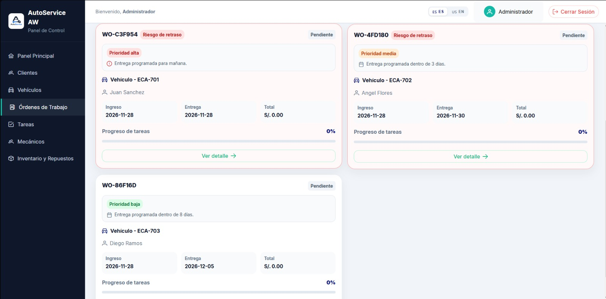
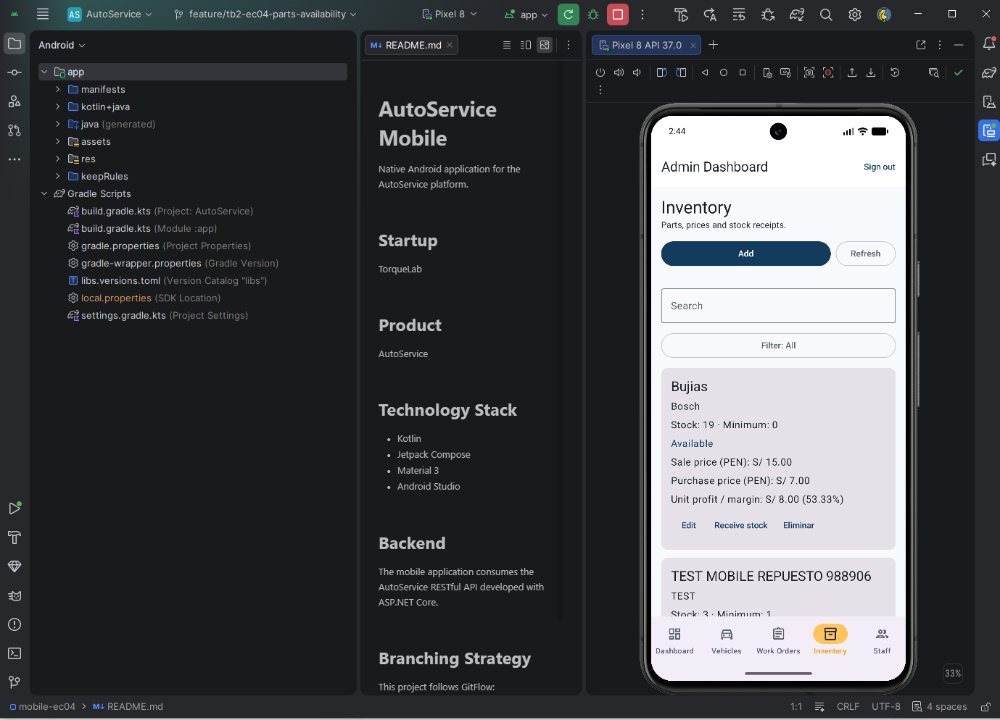
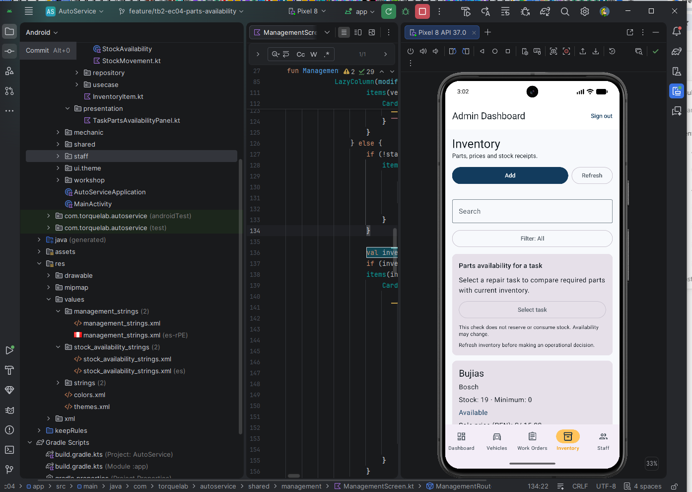
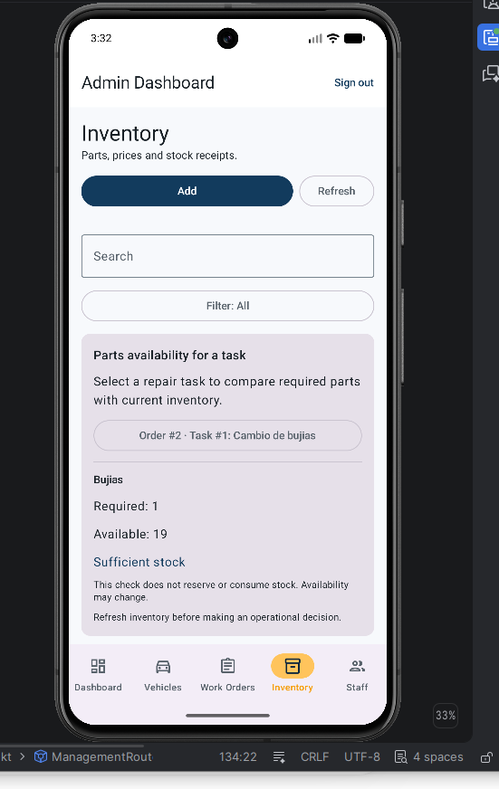
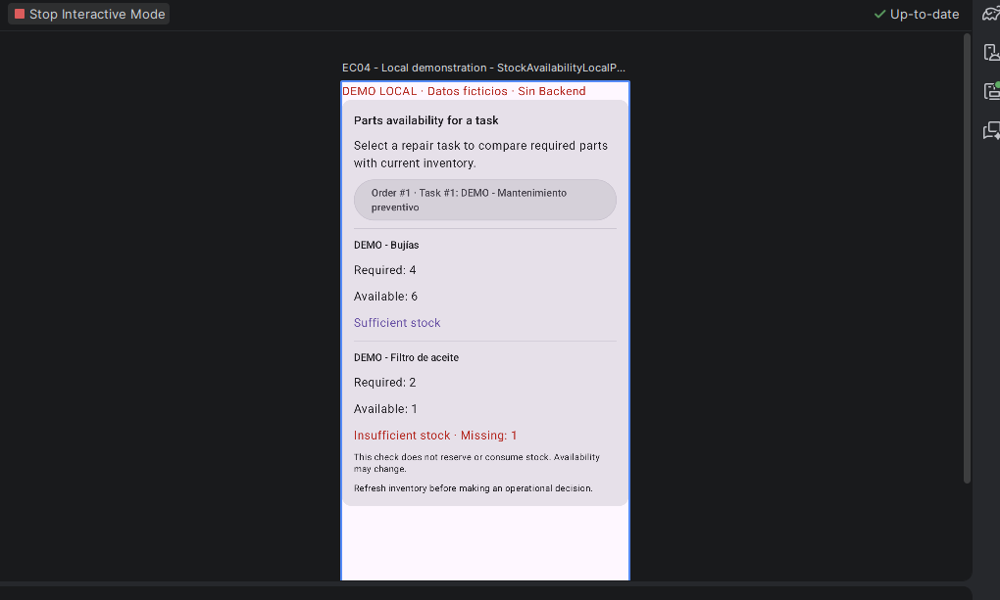
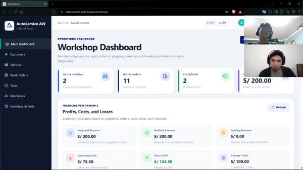
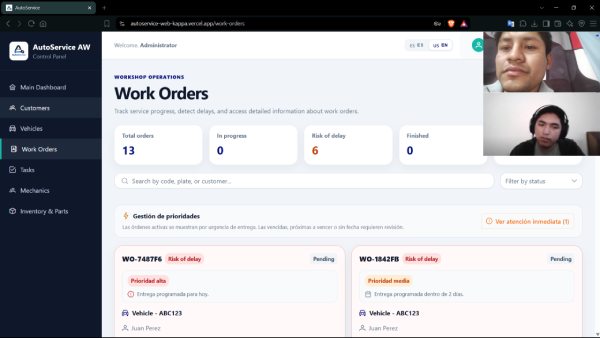

# Capítulo VIII: Experiment-Driven Development

## 8.1. Experiment Planning

La planificación de experimentos permite al equipo de AutoService investigar las necesidades que aún no se comprenden por completo y contrastar las creencias que sustentan la propuesta de valor. Para ello, se toman como punto de partida las entrevistas, la evaluación de usabilidad y los flujos de las aplicaciones web y móvil.

### 8.1.1. As-Is Summary

AutoService integra la gestión de clientes, vehículos, personal, inventario, órdenes y tareas de un taller automotriz. Las aplicaciones web y móvil se conectan al mismo backend; además, el propietario de un vehículo puede consultar el estado de su servicio mediante un código de seguimiento.

Los técnicos y administradores entrevistados destacaron la utilidad de centralizar las operaciones del taller. Entre sus sugerencias se encuentran el acceso rápido a órdenes, la consulta de repuestos, la visibilidad clara del trabajo asignado al mecánico y una experiencia accesible para personas con menor familiaridad digital. También se identificó la necesidad de comprender cómo se maneja un volumen mayor de órdenes, vehículos y tareas pendientes.

La evaluación heurística documentó dificultades relacionadas con formularios, mensajes e idioma. Además, la auditoría externa señaló problemas en la navegación de los planes de la Landing Page y la accesibilidad del acceso web. Estos antecedentes orientan la definición de preguntas de investigación, considerando el alcance de las versiones As-Is evaluadas.

Aunque las entrevistas aportan información sobre el trabajo del taller, no permiten medir de forma directa cómo interpretan los propietarios de vehículos la información del seguimiento ni cómo responden los usuarios del taller ante mejoras específicas en la web y en Android. Por ello, el diseño experimental abarca tanto a propietarios de vehículos como a responsables de taller y mecánicos.

### 8.1.2. Raw Material: Assumptions, Knowledge Gaps, Ideas, Claims

El material inicial reúne percepciones de los participantes, observaciones de la evaluación de usabilidad y cuestiones que el equipo necesita investigar. Cada elemento identifica una incertidumbre relevante para la transparencia del servicio o la operación del taller.

| ID | Tipo | Material inicial | Fuente | Incertidumbre |
|---|---|---|---|---|
| RM-01 | Suposición | Consultar el avance y la fecha estimada puede aumentar la confianza del propietario en el servicio. | Propuesta de seguimiento e hipótesis Lean UX de AutoService. | Qué información necesita el propietario para confiar en el estado comunicado. |
| RM-02 | Afirmación | La organización de tareas y el control de inventario pueden facilitar el trabajo del taller. | Comentarios de técnicos independientes entrevistados. | Qué tareas logran completar los usuarios y dónde encuentran dificultades. |
| RM-03 | Idea | Facilitar la consulta rápida de órdenes, repuestos y tareas asignadas. | Sugerencias de los técnicos entrevistados. | Cuánto esfuerzo requiere localizar la información durante el trabajo diario. |
| RM-04 | Brecha de conocimiento | No se conoce cuánto tardan los responsables del taller en registrar una orden completa en la aplicación web. | Flujo As-Is de registro de órdenes en la aplicación web. | Tiempo, errores y ayuda necesarios para completar la operación. |
| RM-05 | Brecha de conocimiento | No se conoce si el propietario entiende por qué cambió la fecha estimada. | Flujo de seguimiento y registro de cambios de fecha. | Comprensión de la nueva fecha vigente y del motivo del retraso. |
| RM-06 | Suposición | Consultar las existencias frente a la cantidad requerida para una tarea ayuda a identificar materiales insuficientes. | Flujo de inventario y tareas del taller en Android. | Si el usuario reconoce la suficiencia o insuficiencia de stock para una tarea. |
| RM-07 | Hallazgo de evaluación | El campo de contraseña no presentó un nombre accesible adecuado y el idioma declarado no cambió al seleccionar español. | Auditoría de accesibilidad sobre el acceso web (antecedente histórico). | Cómo impactan las etiquetas y el idioma en el acceso web (fuera del foco operativo TB2, conservado como antecedente). |
| RM-08 | Hallazgo de evaluación | Se identificaron problemas de validación poco específica en formularios operativos de la aplicación web. | Evaluación heurística de formularios web. | Si los usuarios identifican los campos obligatorios y corrigen los errores antes de confirmar el registro. |
| RM-09 | Hallazgo de evaluación | Los botones Free y Business devolvieron al visitante al inicio de la Landing Page. | Auditoría sobre la selección de planes (antecedente histórico). | Si los responsables de taller encuentran una ruta clara para comenzar a utilizar el producto (excluido del incremento técnico TB2). |
| RM-10 | Brecha de conocimiento | No se conoce cómo anticipa el taller la falta de un repuesto necesario antes de iniciar una tarea de reparación. | Necesidad de consultar existencias mencionada en las entrevistas. | Si la comparación entre stock disponible y requerido permite anticipar faltantes. |
| RM-11 | Brecha de conocimiento | No se conoce cómo localizan los responsables las órdenes que requieren atención prioritaria cuando aumenta la carga de trabajo. | Comentario de un entrevistado sobre el manejo de numerosas órdenes y vehículos. | Qué criterios visibles permiten identificar las órdenes urgentes sin ayuda. |
| RM-12 | Suposición | Mostrar el avance de la reparación puede ayudar al propietario a conocer la situación del vehículo sin consultar continuamente al taller. | Propuesta de seguimiento y comentarios de entrevistados sobre la consulta del estado. | Si el propietario entiende el avance y qué información contribuye a su confianza. |
| RM-13 | Brecha de conocimiento | No se conoce con qué facilidad un mecánico identifica su siguiente tarea relevante y actualiza su progreso desde Android. | Flujo As-Is del módulo Mechanic y coordinación administrador-mecánico. | Si destacar prioridad, estado y acción directa reduce errores al localizar y actualizar tareas asignadas. |

### 8.1.3. Experiment-Ready Questions

Las preguntas identifican al usuario involucrado, la tarea y la información que se busca obtener mediante la técnica 5W+1H. Se distingue entre preguntas basadas en una creencia (*Belief-led*) y preguntas exploratorias (*Exploratory*).

| ID | Tipo | Pregunta | Motivación | Material |
|---|---|---|---|---|
| Q-01 | Basada en una creencia (*Belief-led*) | ¿Los propietarios de vehículos comprenden la fecha actualizada de entrega y el motivo del retraso al consultar el seguimiento sin ayuda? | Mejorar la comunicación entre el taller y el propietario del vehículo, reduciendo dudas sobre el avance. | RM-01, RM-05, RM-12 |
| Q-02 | Exploratoria (*Exploratory*) | ¿Las indicaciones de obligatoriedad y validaciones claras facilitan que un responsable del taller registre correctamente una orden de trabajo en la aplicación web? | Reducir errores en el registro de órdenes y evitar información incompleta que afecte la planificación del servicio. | RM-02, RM-04 |
| Q-03 | Exploratoria (*Exploratory*) | ¿Los usuarios del taller pueden identificar en Android si los repuestos disponibles alcanzan para realizar una tarea de reparación? | Anticipar faltantes y evitar iniciar tareas sin los materiales necesarios. | RM-03, RM-06, RM-10 |
| Q-04 | Basada en una creencia (*Belief-led*) | ¿La información detallada sobre el seguimiento de una reparación mejora la utilidad percibida para que el propietario confíe en el servicio? | Conocer qué nivel de detalle informativo necesita el propietario para sentirse informado y confiar en el taller. | RM-01, RM-12 |
| Q-05 | Exploratoria (*Exploratory*) | ¿Los usuarios identifican y corrigen con mayor facilidad los errores de entrada al completar un formulario operativo en la aplicación web? | Evitar interrupciones por errores de validación poco claros y mejorar la finalización de operaciones administrativas. | RM-08 |
| Q-06 | Exploratoria (*Exploratory*) | ¿Los responsables del taller pueden identificar qué órdenes requieren atención prioritaria cuando existen varios servicios activos? | Mejorar la organización del trabajo diario y facilitar la identificación de servicios urgentes. | RM-02, RM-03, RM-11 |
| Q-07 | Exploratoria (*Exploratory*) | ¿Los responsables de taller encuentran cómo comenzar a usar AutoService o contactar al equipo después de comparar los planes en la Landing Page? | Examinar la continuidad del recorrido inicial de una persona interesada (conservada como histórico; excluida de TB2). | RM-09 |
| Q-08 | Exploratoria (*Exploratory*) | ¿Una presentación más clara de las tareas asignadas en Android permite que un mecánico identifique su siguiente actividad y actualice su progreso correctamente? | Mejorar la coordinación entre administrador y mecánico manteniendo actualizada la información de reparación. | RM-02, RM-03, RM-13 |

### 8.1.4. Question Backlog

Las preguntas se ordenan según cuatro criterios valorados de 1 a 5: confianza en la relevancia de la pregunta, riesgo de mantener la incertidumbre, impacto para el producto e interés de investigación. La puntuación total es la suma de los cuatro valores; ante un empate, la regla de desempate da prioridad a la pregunta con **mayor nivel de Riesgo**.

Los puntajes de `Q-01` a `Q-07` corresponden al registro de planificación de AV2, conservados sin alteración artificial. Para la entrega TB2 se incorpora `Q-08` (vinculada a `EC-08`) y se documenta que `Q-07` (`EC-03`) queda **no seleccionada** para el incremento técnico TB2 debido a que el equipo acordó no intervenir técnicamente la Landing Page en este ciclo (su sección 8.3.3.2 referenciará únicamente la evidencia existente).

| Prioridad | Pregunta | Confianza | Riesgo | Impacto | Interés | Total | Alcance en TB2 |
|---:|---|---:|---:|---:|---:|---:|---|
| 1 | Q-01: comprensión de fechas y retrasos | 4 | 5 | 5 | 5 | 19 | Seleccionada (`EC-01`) |
| 2 | Q-02: registro de órdenes en aplicación web | 4 | 4 | 5 | 5 | 18 | Seleccionada (`EC-02`) |
| 3 | Q-07: acceso a partir de los planes | 4 | 4 | 4 | 5 | 17 | **No seleccionada** (`EC-03` fuera de alcance técnico TB2) |
| 4 | Q-03: disponibilidad de repuestos frente a tarea | 4 | 4 | 4 | 4 | 16 | Seleccionada (`EC-04`) |
| 5 | Q-05: comprensión y corrección en formularios web | 4 | 4 | 4 | 3 | 15 | Seleccionada (`EC-06`) |
| 6 | Q-08: identificación y actualización de tareas del mecánico | 3 | 4 | 4 | 3 | 14 | Seleccionada (`EC-08`, nueva en TB2; desempata sobre Q-06 por mayor Riesgo) |
| 7 | Q-06: localización y prioridad de órdenes | 3 | 3 | 4 | 4 | 14 | Seleccionada (`EC-07`) |
| 8 | Q-04: confianza percibida en el seguimiento | 3 | 3 | 4 | 3 | 13 | Seleccionada (`EC-05`) |

### 8.1.5. Experiment Cards

Para la entrega TB2 se seleccionaron **siete Experiment Cards** (`EC-01`, `EC-02`, `EC-04`, `EC-05`, `EC-06`, `EC-07` y `EC-08`), concentradas en **cinco incrementos funcionales To-Be**:

1. **Seguimiento más claro para el propietario (`EC-01` + `EC-05`):** comparten una única mejora técnica en Customer Trust/seguimiento, pero miden preguntas y métricas distintas (comprensión objetiva frente a utilidad percibida para confiar).
2. **Flujo único de registro y recuperación de errores en formularios web (`EC-02` + `EC-06`):** comparten una única mejora técnica en el formulario web de órdenes en Vue, pero evalúan por separado la finalización del registro y la corrección autónoma de errores.
3. **Suficiencia de repuestos en inventario Android (`EC-04`):** incremento técnico único en Android para comparar existencias disponibles frente a requeridas.
4. **Priorización visible de órdenes (`EC-07`):** incremento técnico implementado en Frontend Web, que clasifica, ordena y filtra órdenes según su estado y fecha estimada de entrega, utilizando los datos existentes de la API.
5. **Localización y actualización de tareas del mecánico (`EC-08`):** incremento técnico en el módulo Mechanic de Android.

La tarjeta `EC-03` (`Q-07`) se conserva como pregunta no seleccionada para este ciclo. En todos los experimentos activos, se comparará una captura de la versión As-Is frente a la versión To-Be funcional utilizando casos y datos de prueba equivalentes, evitando mantener dos aplicaciones ejecutables en paralelo.

---

**EC-01 — Delivery Date Comprehension**

| Side | Element | Description |
|---|---|---|
| **Front Side** | **Question** | ¿Los propietarios de vehículos comprenden la fecha actualizada de entrega y el motivo del retraso sin necesitar ayuda? |
| **Front Side** | **Why** | Cuando cambia la fecha estimada de entrega, la falta de claridad en la pantalla de seguimiento genera dudas constantes y obliga al propietario a contactar al taller. |
| **Front Side** | **What** | Actualizar la vista de seguimiento de AutoService para destacar la fecha estimada vigente, el motivo del retraso y el estado actual del servicio (implementación compartida con `EC-05`). |
| **Front Side** | **Hypothesis** | Creemos que si destacamos la fecha estimada vigente y el motivo del retraso en la vista de seguimiento, al menos el 66,7 % de los propietarios identificará ambos datos sin ayuda (`M-01`) y las solicitudes de asistencia (`M-04`) bajarán en al menos 33,3 puntos porcentuales frente a la presentación anterior. |
| **Back Side** | **Measures** | `M-01` (Comprensión autónoma del retraso) como métrica primaria y `M-04` (Solicitudes de asistencia) como métrica secundaria. |
| **Back Side** | **Conditions** | **Control Condition (A):** captura de la pantalla de seguimiento As-Is con fecha vigente y motivo. **Experimental Condition (B):** vista funcional To-Be de seguimiento evaluada con casos ficticios equivalentes. |
| **Back Side** | **Scale** | 3 propietarios de vehículos evaluados con dos casos equivalentes en sesiones moderadas. |

---

**EC-02 — Work Order Registration**

| Side | Element | Description |
|---|---|---|
| **Front Side** | **Question** | ¿Las indicaciones de obligatoriedad y validaciones claras facilitan que un responsable del taller registre correctamente una orden de trabajo en la aplicación web? |
| **Front Side** | **Why** | Los registros incompletos o con errores de entrada retrasan la planificación del taller y generan reprocesos durante la atención del vehículo. |
| **Front Side** | **What** | Mejorar el formulario web de creación de órdenes en Vue mediante marcación visible de campos obligatorios, validaciones específicas y mensajes de corrección (implementación compartida con `EC-06`). |
| **Front Side** | **Hypothesis** | Creemos que si incorporamos campos obligatorios reconocibles y validaciones específicas en el formulario web de órdenes, al menos el 66,7 % de los responsables completará el registro sin ayuda (`M-02`), la mediana de tiempo (`M-03`) se reducirá en un 25 % y las solicitudes de asistencia (`M-04`) disminuirán en al menos 33,3 puntos porcentuales frente al flujo base. |
| **Back Side** | **Measures** | `M-02` (Finalización autónoma del registro) como métrica primaria; `M-03` (Mediana de tiempo de registro en segundos) y `M-04` (Solicitudes de asistencia) como métricas secundarias. |
| **Back Side** | **Conditions** | **Control Condition (A):** captura/flujo del formulario As-Is sin indicaciones adicionales. **Experimental Condition (B):** formulario web To-Be funcional probado con datos ficticios de cliente, vehículo y servicio. |
| **Back Side** | **Scale** | 3 responsables de taller evaluados durante el registro completo de órdenes en la aplicación web. |

---

**EC-03 — Access After Comparing Plans** *(Excluded from TB2)*

| Side | Element | Description |
|---|---|---|
| **Front Side** | **Question** | ¿Los responsables de taller encuentran cómo comenzar a usar AutoService o contactar al equipo después de comparar los planes? |
| **Front Side** | **Why** | Una ruta poco clara después de revisar los planes en la Landing Page puede hacer que un taller interesado abandone el sitio. |
| **Front Side** | **What** | Excluida del incremento técnico de TB2. No se realizan cambios ni pruebas nuevas sobre la Landing Page; la sección 8.3.3.2 referenciará únicamente la evidencia existente. |
| **Front Side** | **Hypothesis** | Creemos que diferenciar explícitamente los destinos posteriores a la comparación de planes permitiría que al menos el 66,7 % identifique el siguiente paso sin ayuda (`M-05`) frente a la navegación As-Is. |
| **Back Side** | **Measures** | `M-05` (Identificación autónoma del siguiente paso, conservada como histórica) y `M-04` (Solicitudes de asistencia). |
| **Back Side** | **Conditions** | **Control Condition (A):** navegación As-Is de la Landing Page. **Experimental Condition (B):** no ejecutada en TB2 por decisión de alcance. |
| **Back Side** | **Scale** | 0 participantes (experimento fuera de alcance en TB2). |

---

**EC-04 — Available Spare Parts Identification**

| Side | Element | Description |
|---|---|---|
| **Front Side** | **Question** | ¿Los usuarios del taller pueden identificar en Android si los repuestos disponibles alcanzan para realizar una tarea de reparación? |
| **Front Side** | **Why** | Mostrar solo el stock actual sin compararlo con la cantidad requerida impide anticipar faltantes antes de iniciar una reparación. |
| **Front Side** | **What** | Actualizar la consulta de inventario en Android para mostrar las existencias disponibles junto con la cantidad requerida para una tarea y un indicador de stock suficiente o insuficiente, usando datos de demostración declarados. |
| **Front Side** | **Hypothesis** | Creemos que si presentamos la cantidad disponible junto con la requerida y un indicador claro de suficiencia en Android, al menos el 66,7 % de los usuarios identificará correctamente cuándo el stock alcanza o falta (`M-06`) y las solicitudes de asistencia (`M-04`) bajarán en al menos 33,3 puntos porcentuales frente a la vista As-Is. |
| **Back Side** | **Measures** | `M-06` (Interpretación autónoma de disponibilidad) como métrica primaria y `M-04` (Solicitudes de asistencia) como métrica secundaria. |
| **Back Side** | **Conditions** | **Control Condition (A):** captura As-Is con cantidades aisladas de inventario. **Experimental Condition (B):** vista To-Be funcional en Android evaluando un caso con stock suficiente y otro con stock insuficiente. |
| **Back Side** | **Scale** | 3 responsables de taller evaluando ambos casos de inventario en sesiones moderadas. |

---

**EC-05 — Perceived Trust in Service Tracking**

| Side | Element | Description |
|---|---|---|
| **Front Side** | **Question** | ¿La información detallada sobre el seguimiento de una reparación mejora la utilidad percibida para confiar en el servicio del taller? |
| **Front Side** | **Why** | Un seguimiento que solo muestra el estado general no explica cambios de fecha ni demoras, lo que reduce la transparencia percibida por el cliente. |
| **Front Side** | **What** | Reutilizar la mejora implementada para `EC-01` (estado actual, fecha estimada vigente y motivo del retraso) evaluando la percepción de confianza del propietario. |
| **Front Side** | **Hypothesis** | Creemos que si ofrecemos el seguimiento detallado con estado, fecha vigente y motivo de retraso, al menos el 66,7 % de los propietarios valorará su utilidad para confiar en el servicio con 4 o 5 sobre 5 (`M-07`), superando en al menos 33,3 puntos porcentuales al seguimiento resumido As-Is. |
| **Back Side** | **Measures** | `M-07` (Porcentaje de valoraciones de 4 o 5 sobre 5 en utilidad para confiar) y comentarios cualitativos sobre información útil o faltante. |
| **Back Side** | **Conditions** | **Control Condition (A):** captura de seguimiento resumido mostrando únicamente el estado general. **Experimental Condition (B):** vista funcional To-Be con estado, fecha vigente y motivo; misma pregunta en escala de 1 a 5. |
| **Back Side** | **Scale** | 3 propietarios de vehículos evaluados bajo ambas presentaciones. |

---

**EC-06 — Form Comprehension and Error Correction**

| Side | Element | Description |
|---|---|---|
| **Front Side** | **Question** | ¿Los usuarios identifican y corrigen con mayor facilidad los errores de validación al completar un formulario operativo del taller en la web? |
| **Front Side** | **Why** | Los mensajes genéricos bloquean el registro de información porque no indican qué campo tiene un dato inválido ni cómo resolverlo. En este ciclo el experimento se enfoca en formularios operativos web, separándose de la revisión histórica del acceso. |
| **Front Side** | **What** | Utilizar las validaciones y mensajes específicos por campo del formulario web mejorado en `EC-02` para evaluar la recuperación autónoma ante datos inválidos. |
| **Front Side** | **Hypothesis** | Creemos que si mostramos mensajes específicos por campo con indicaciones de corrección en los formularios operativos web, al menos el 66,7 % de los usuarios corregirá los errores sin ayuda (`M-08`) y las solicitudes de asistencia (`M-04`) se reducirán en al menos 33,3 puntos porcentuales frente al flujo As-Is. |
| **Back Side** | **Measures** | `M-08` (Corrección autónoma en formularios web) como métrica primaria y `M-04` (Solicitudes de asistencia) como métrica secundaria. |
| **Back Side** | **Conditions** | **Control Condition (A):** captura/flujo As-Is con mensajes de error poco explicativos. **Experimental Condition (B):** formulario web To-Be funcional con validaciones específicas y el mismo conjunto de errores inducidos. |
| **Back Side** | **Scale** | 3 responsables de taller evaluados con casos equivalentes de error en el formulario. |

---

**EC-07 — Order Localization and Prioritization**

| Side | Element | Description |
|---|---|---|
| **Front Side** | **Question** | ¿Los responsables del taller pueden identificar qué órdenes requieren atención prioritaria cuando existen varios servicios activos? |
| **Front Side** | **Why** | Cuando un taller maneja varias órdenes simultáneamente, resulta difícil reconocer qué servicios requieren atención inmediata si el listado no presenta un criterio explícito de prioridad. |
| **Front Side** | **What** | Incorporar en el Frontend Web de AutoService una clasificación automática de órdenes según su estado y fecha estimada de entrega, mostrando el nivel de prioridad, su motivo, un ordenamiento por urgencia y un filtro de atención inmediata. La solución utiliza los datos existentes de la RESTful API, sin requerir modificaciones al Backend. |
| **Front Side** | **Hypothesis** | Creemos que si mostramos un criterio explícito de prioridad y permitimos filtrar las órdenes de atención inmediata, al menos el 66,7 % de los responsables localizará la orden prioritaria y explicará el criterio sin ayuda (`M-09`), reduciendo las solicitudes de asistencia (`M-04`) en al menos 33,3 puntos porcentuales frente al listado As-Is. |
| **Back Side** | **Measures** | `M-09` (Localización y prioridad de órdenes) como métrica primaria y `M-04` (Solicitudes de asistencia) como métrica secundaria. |
| **Back Side** | **Conditions** | **Control Condition (A):** captura del listado Web As-Is, sin clasificación ni filtro explícito de prioridad. **Experimental Condition (B):** listado Web To-Be con prioridades visibles, ordenamiento y filtro de atención inmediata. Ambas condiciones emplean las mismas órdenes ficticias para permitir la comparación. |
| **Back Side** | **Scale** | Piloto exploratorio planificado con 3 responsables de taller. La implementación técnica está completada, pero la hipótesis requiere validación mediante sesiones con participantes. |

**Reglas implementadas para la clasificación de prioridades**

| Prioridad | Criterio |
|---|---|
| **HIGH — Alta** | Orden activa vencida, con entrega estimada para hoy o mañana. |
| **REVIEW — Revisión** | Orden activa sin fecha estimada válida; requiere revisión de planificación. |
| **MEDIUM — Media** | Orden activa con entrega estimada dentro de 2 a 3 días. |
| **LOW — Baja** | Orden activa con entrega estimada posterior a 3 días. |
| **NONE — Sin prioridad operativa** | Orden finalizada, entregada o cancelada. |

Las órdenes se presentan considerando su urgencia y proximidad de entrega. El filtro **Ver atención inmediata** permite mostrar exclusivamente aquellas clasificadas como HIGH o REVIEW.

La funcionalidad se implementó en el Frontend Web utilizando los campos de estado y fecha estimada proporcionados por la API existente. Su implementación se integró en la rama `main` del repositorio Web mediante el Pull Request #29.

La demostración técnica utiliza órdenes ficticias y permite comprobar visualmente la clasificación y el filtrado. No constituye una medición de `M-09` o `M-04`, que requieren observaciones de participantes.

---

**EC-08 — Mechanic Task Identification and Update**

| Side | Element | Description |
|---|---|---|
| **Front Side** | **Question** | ¿Una presentación más clara de las tareas asignadas en Android permite que un mecánico identifique su siguiente actividad y actualice su progreso correctamente? |
| **Front Side** | **Why** | Si la vista del mecánico no resalta prioridad, estado y acción directa de actualización, aumenta el riesgo de elegir la tarea equivocada o dejar el avance desactualizado frente al administrador. |
| **Front Side** | **What** | Mejorar la pantalla de tareas asignadas del módulo Mechanic en Android, reutilizando la arquitectura y navegación existentes para destacar estado, prioridad y acción directa de actualización. |
| **Front Side** | **Hypothesis** | Creemos que si destacamos la siguiente tarea prioritaria junto con su estado y una acción clara de actualización en Android Mechanic, al menos el 66,7 % de los participantes identificará y actualizará su tarea correctamente sin ayuda (`M-10`), reduciendo la tasa de errores (`M-11`) en un 30 % y la asistencia (`M-04`) en al menos 33,3 puntos porcentuales frente a la vista As-Is. |
| **Back Side** | **Measures** | `M-10` (Identificación y actualización correcta de tareas) como métrica primaria; `M-11` (Tasa de errores en actualización de tareas) y `M-04` (Solicitudes de asistencia) como métricas secundarias. |
| **Back Side** | **Conditions** | **Control Condition (A):** captura de la pantalla As-Is de tareas asignadas en el módulo Mechanic. **Experimental Condition (B):** flujo funcional To-Be en Android Mechanic con un escenario realista de múltiples tareas en distintos estados. |
| **Back Side** | **Scale** | 3 participantes con perfil técnico/mecánico evaluados en sesiones moderadas. |

---

## 8.2. Experiment Design

Los diseños presentados en esta sección definen el protocolo experimental para evaluar los incrementos To-Be en TB2. Las hipótesis, métricas y condiciones descritas corresponden a la planificación previa a la ejecución y no representan resultados observados; estos se consolidarán en la sección `8.4.1` una vez completadas las sesiones.

### 8.2.1. Hypotheses

Cada experimento se formula con su **Hypothesis Statement**, su **Alternative Hypothesis** ($H_n$) y su **Null Hypothesis** ($H_{0\text{-}n}$). Los porcentajes indican las metas esperadas para cada métrica (`M-XX`): en un estudio confirmatorio se contrastan con significación $p < 0{,}05$, mientras que en el piloto exploratorio de TB2 ($n = 3$) el umbral de 66,7 % equivale a al menos 2 de 3 participantes. *(La tarjeta `EC-03` se conserva solo como registro histórico sin ejecución en TB2).*

| Experimento | Hypothesis Statement | Alternative Hypothesis ($H_n$) | Null Hypothesis ($H_{0\text{-}n}$) |
|---|---|---|---|
| **EC-01** | Creemos que la respuesta es que destacar la fecha estimada vigente y el motivo del retraso en el seguimiento To-Be facilitará la comprensión del propietario, cuya evidencia se reflejará en al menos 66,7 % de identificación autónoma (`M-01`) y una reducción de al menos 33,3 p.p. en solicitudes de asistencia (`M-04`), bajo las circunstancias de consultas simuladas con 3 propietarios en AutoService. | **H1:** Destacar la fecha vigente y el motivo del retraso en el seguimiento To-Be permite alcanzar al menos 66,7 % de comprensión autónoma (`M-01`) y reduce las solicitudes de asistencia (`M-04`) en al menos 33,3 p.p. frente a la presentación As-Is ($p < 0{,}05$). | **H0-1:** La vista de seguimiento To-Be no produce mejora en la identificación autónoma (`M-01`) ni reduce la asistencia (`M-04`) frente a la presentación As-Is. Cualquier diferencia observada se debe al azar o a factores externos. |
| **EC-02** | Creemos que la respuesta es que incorporar campos obligatorios visibles y validaciones claras en el formulario web agilizará el registro, cuya evidencia se reflejará en al menos 66,7 % de finalización autónoma (`M-02`) y una reducción del 25 % en la mediana de tiempo (`M-03`), bajo las circunstancias del piloto con 3 responsables de taller en la aplicación web. | **H2:** El formulario web To-Be logra al menos 66,7 % de finalización autónoma (`M-02`), reduce en al menos 25 % la mediana de tiempo de registro (`M-03`) y reduce en al menos 33,3 p.p. la asistencia (`M-04`) frente al flujo As-Is ($p < 0{,}05$). | **H0-2:** El formulario web To-Be no genera mejora en la finalización autónoma (`M-02`) ni reduce el tiempo (`M-03`) o la asistencia (`M-04`) frente al flujo As-Is. Cualquier variación observada se debe al azar o a factores externos. |
| **EC-03** *(Excluded)* | Creemos que diferenciar los destinos desde los planes permitiría alcanzar al menos 66,7 % de identificación autónoma del siguiente paso (`M-05`) en la Landing Page. | **H3:** Los destinos diferenciados alcanzarían al menos 66,7 % en `M-05` frente a la navegación As-Is ($p < 0{,}05$). | **H0-3:** No habría diferencia en `M-05` respecto a la navegación As-Is. *(No ejecutada en TB2).* |
| **EC-04** | Creemos que la respuesta es que presentar en Android la cantidad disponible, la requerida y un indicador explícito de suficiencia evitará errores de interpretación, cuya evidencia se reflejará en al menos 66,7 % de respuestas autónomas correctas en casos suficientes e insuficientes (`M-06`), bajo las circunstancias de prueba con 3 responsables de taller. | **H4:** La consulta de inventario To-Be en Android alcanza al menos 66,7 % de interpretación autónoma correcta (`M-06`) y reduce la asistencia (`M-04`) en al menos 33,3 p.p. frente a la vista As-Is ($p < 0{,}05$). | **H0-4:** El indicador de suficiencia en Android no produce mejora en la interpretación del stock (`M-06`) ni reduce la asistencia (`M-04`) frente a la vista As-Is. Cualquier variación observada es producto del azar o factores externos. |
| **EC-05** | Creemos que la respuesta es que mostrar un seguimiento detallado con estado, fecha vigente y motivo aumentará la confianza percibida, cuya evidencia se reflejará en al menos 66,7 % de valoraciones de 4 o 5 sobre 5 (`M-07`) y un alza mínima de 33,3 p.p. frente al seguimiento resumido, bajo las circunstancias de evaluación con 3 propietarios. | **H5:** El seguimiento detallado To-Be logra al menos 66,7 % de valoraciones de 4 o 5 sobre 5 (`M-07`), incrementando en al menos 33,3 p.p. la proporción favorable frente al seguimiento resumido As-Is ($p < 0{,}05$). | **H0-5:** El seguimiento detallado To-Be no aumenta la proporción de valoraciones favorables (`M-07`) respecto al seguimiento resumido As-Is. Cualquier diferencia observada se debe al azar o a factores externos. |
| **EC-06** | Creemos que la respuesta es que mostrar mensajes específicos y guías de corrección en formularios operativos web facilitará la recuperación ante errores, cuya evidencia se reflejará en al menos 66,7 % de corrección autónoma (`M-08`), bajo las circunstancias de errores inducidos evaluados con 3 responsables. | **H6:** Los mensajes específicos en formularios operativos web To-Be permiten alcanzar al menos 66,7 % de corrección autónoma (`M-08`) y reducen la asistencia (`M-04`) en al menos 33,3 p.p. frente al flujo As-Is ($p < 0{,}05$). | **H0-6:** Los mensajes de validación del formulario web To-Be no mejoran la corrección autónoma (`M-08`) ni reducen la asistencia (`M-04`) respecto al flujo As-Is. Cualquier variación observada se atribuye al azar o a factores externos. |
| **EC-07** | Creemos que la respuesta es que exponer un criterio explícito de prioridad en el listado web de órdenes facilitará ubicar servicios urgentes, cuya evidencia se reflejará en al menos 66,7 % de localización y reconocimiento del criterio sin ayuda (`M-09`), bajo las circunstancias de múltiples órdenes activas con 3 responsables. | **H7:** El listado web To-Be con prioridad calculada en el Frontend Web a partir de los datos existentes de la API logra al menos 66,7 % de localización y comprensión autónoma (`M-09`) y reduce la asistencia (`M-04`) en al menos 33,3 p.p. frente al listado As-Is ($p < 0{,}05$). | **H0-7:** Exponer el criterio de prioridad en el listado web To-Be no produce mejora en la localización y priorización autónoma (`M-09`) frente al listado As-Is. Cualquier variación observada se debe al azar o a factores externos. |
| **EC-08** | Creemos que la respuesta es que destacar prioridad, estado y acción de actualización en Android Mechanic facilitará la ejecución del mecánico, cuya evidencia se reflejará en al menos 66,7 % de actualización autónoma correcta (`M-10`) y una reducción del 30 % en la tasa de errores (`M-11`), bajo las circunstancias de un escenario realista de tareas con 3 participantes. | **H8:** La vista de tareas To-Be en Android Mechanic logra al menos 66,7 % de identificación y actualización autónoma (`M-10`), reduce la tasa de errores (`M-11`) en al menos 30 % y reduce la asistencia (`M-04`) en al menos 33,3 p.p. frente a la vista As-Is ($p < 0{,}05$). | **H0-8:** La vista To-Be en Android Mechanic no genera mejora en la identificación y actualización autónoma (`M-10`) ni reduce la tasa de errores (`M-11`) o la asistencia (`M-04`) frente a la vista As-Is. Cualquier diferencia observada se atribuye al azar o a factores externos. |

### 8.2.2. Domain Business Metrics

Todas las medidas utilizadas en las Experiment Cards están formalmente catalogadas en esta sección. No se emplean métricas ad-hoc o informales fuera de este catálogo. Las metas deseadas expresan **umbrales objetivo de hipótesis** y no resultados observados.

| Código | Nombre de la Métrica | Fórmula de Cálculo | Técnica de Recolección | Meta Deseada |
|---|---|---|---|---|
| **M-01** | Comprensión autónoma del retraso | $(\text{Participantes que identifican fecha vigente y motivo sin ayuda} / \text{Participantes evaluados}) \times 100$ | Ficha de observación moderada en sesiones `EC-01` (As-Is vs. To-Be). | $\ge 66{,}7\%$ en To-Be (incremento $\ge 33{,}3\text{ p.p.}$ vs. As-Is). |
| **M-02** | Finalización autónoma del registro | $(\text{Participantes que completan la orden web correctamente sin ayuda} / \text{Participantes evaluados}) \times 100$ | Ficha de observación moderada y verificación de confirmación en `EC-02`. | $\ge 66{,}7\%$ en To-Be respecto a As-Is. |
| **M-03** | Tiempo de registro de orden | $\text{Mediana de segundos desde el inicio del formulario hasta la confirmación de creación}$ (tareas completadas) | Cronómetro registrado en ficha de observación durante `EC-02`. | Reducción $\ge 25\%$ en mediana de tiempo To-Be respecto a As-Is. |
| **M-04** | Solicitudes de asistencia | $(\text{Participantes que solicitan ayuda del moderador} / \text{Participantes evaluados}) \times 100$ | Conteo de intervenciones del moderador en la ficha de observación de cada card. | Reducción $\ge 33{,}3\text{ p.p.}$ en To-Be respecto a As-Is. |
| **M-05** | Identificación autónoma del siguiente paso *(Histórica — no aplicada en TB2)* | $(\text{Participantes que identifican una ruta adecuada tras revisar planes sin ayuda} / \text{Participantes evaluados}) \times 100$ | Registro histórico de diseño (`EC-03`, excluida de TB2). | No aplicable en TB2 (referencia histórica $\ge 66{,}7\%$). |
| **M-06** | Interpretación autónoma de disponibilidad | $(\text{Participantes que identifican correctamente si el stock es suficiente o insuficiente sin ayuda} / \text{Participantes evaluados}) \times 100$ | Ficha de observación moderada con casos de stock suficiente e insuficiente en `EC-04`. | $\ge 66{,}7\%$ en To-Be respecto a As-Is. |
| **M-07** | Valoración de utilidad para confiar | $(\text{Participantes que valoran con 4 o 5 en escala de 1 a 5} / \text{Participantes evaluados}) \times 100$ | Cuestionario breve posterior a cada condición en `EC-05`. | $\ge 66{,}7\%$ de valoraciones $\ge 4$ (alza $\ge 33{,}3\text{ p.p.}$ vs. As-Is). |
| **M-08** | Corrección autónoma en formularios web | $(\text{Participantes que identifican y corrigen un dato inválido en el formulario operativo sin ayuda} / \text{Participantes evaluados}) \times 100$ | Ficha de observación moderada sobre errores inducidos en `EC-06`. | $\ge 66{,}7\%$ en To-Be respecto a As-Is. |
| **M-09** | Localización y prioridad de órdenes | $(\text{Participantes que localizan la orden prioritaria y explican el criterio aplicado sin ayuda} / \text{Participantes evaluados}) \times 100$ | Ficha de observación moderada sobre listado con múltiples órdenes en `EC-07`. | $\ge 66{,}7\%$ en To-Be respecto a As-Is. |
| **M-10** | Identificación y actualización correcta de tareas | $(\text{Participantes que identifican su tarea prioritaria y actualizan su estado al esperado sin ayuda} / \text{Participantes evaluados}) \times 100$ | Ficha de observación moderada y verificación de estado en Android Mechanic (`EC-08`). | $\ge 66{,}7\%$ en To-Be respecto a As-Is. |
| **M-11** | Tasa de errores en actualización de tareas | $(\text{Total de acciones erróneas o selecciones de tarea incorrecta} / \text{Total de intentos de tarea evaluados}) \times 100$ | Conteo estructurado de errores en la ficha de observación de `EC-08`. | Reducción $\ge 30\%$ en tasa de errores To-Be respecto a As-Is. |

La comprensión del retraso (`M-01`) y la utilidad percibida (`M-07`) se vinculan con la transparencia hacia el cliente; la finalización (`M-02`), el tiempo (`M-03`), la corrección de errores (`M-08`), la suficiencia de inventario (`M-06`), la priorización (`M-09`) y la ejecución del mecánico (`M-10`, `M-11`) miden eficiencia operativa. Ninguna de estas medidas equivale por sí sola a ingresos o retención financiera directa.

### 8.2.3. Measures

Para garantizar consistencia entre los cinco responsables al recoger datos reales:

- **Seguimiento (`EC-01` y `EC-05`):** el moderador solicitará al propietario indicar la fecha vigente y explicar el motivo del retraso (`M-01`). Se considerará correcta solo si ambos datos coinciden con el caso presentado y no medió asistencia (`M-04`). A continuación, se aplicará la pregunta de percepción (`EC-05`, `M-07`): *«¿Qué tan útil es esta información para confiar en el servicio del taller?»* en escala de 1 (nada útil) a 5 (muy útil), registrando comentarios cualitativos.
- **Registro y corrección de errores en formularios web (`EC-02` y `EC-06`):** en `EC-02` se comprobará que el responsable complete la orden hasta la confirmación de creación (`M-02`), cronometrando la duración (`M-03`); las tareas incompletas se excluyen de la mediana de tiempos y se reportan por separado. En `EC-06` se presentará un escenario con datos inválidos u omitidos y se verificará si el participante comprende el mensaje de error y lo corrige sin asistencia (`M-08`, `M-04`).
- **Disponibilidad de repuestos (`EC-04`):** el moderador presentará dos casos en Android (uno con stock suficiente y otro con stock insuficiente respecto a la cantidad requerida para una tarea) y registrará si el participante identifica correctamente ambos escenarios sin ayuda (`M-06`, `M-04`).
- **Localización y prioridad de órdenes (`EC-07`):** ante un conjunto equivalente de órdenes ficticias activas, se registrará si el participante localiza la orden que requiere atención prioritaria y reconoce el criterio aplicado sin ayuda (`M-09`, `M-04`).
- **Tareas del mecánico (`EC-08`):** ante un escenario realista de tareas asignadas en Android Mechanic, se verificará si el participante identifica la siguiente tarea relevante y actualiza su estado al valor solicitado sin ayuda (`M-10`), registrando el número de errores cometidos (`M-11`) y solicitudes de asistencia (`M-04`).

### 8.2.4. Conditions

En cada experimento activo, la condición de control se presenta mediante **capturas o registros equivalentes del estado As-Is** (sin mantener dos aplicaciones paralelas en ejecución), mientras que la condición experimental corresponde al **incremento To-Be funcional**. Se alternará el orden de exposición o se usarán conjuntos equivalentes de datos ficticios declarados para mitigar aprendizaje entre tareas.

| Experimento | Condición de Control / Referencia (As-Is) | Condición Experimental (To-Be) | Preparación y control |
|---|---|---|---|
| **EC-01** | Captura de pantalla de seguimiento As-Is con fecha vigente y motivo en formato base. | Pantalla funcional To-Be de seguimiento destacando fecha vigente, motivo y estado. | Dos casos ficticios equivalentes; orden alternado; mismos criterios de respuesta. |
| **EC-02** | Captura/flujo As-Is del formulario web de órdenes sin indicaciones de obligatoriedad ni mensajes guiados. | Formulario web To-Be funcional con campos obligatorios visibles y validaciones claras. | Datos ficticios equivalentes de cliente, vehículo y servicio en aplicación web. |
| **EC-03** | *No ejecutada en TB2.* | *No ejecutada en TB2.* | Excluida de ejecución; se conserva registro de decisión de alcance. |
| **EC-04** | Captura As-Is de inventario mostrando solo existencias actuales. | Vista Android To-Be funcional mostrando stock disponible, cantidad requerida e indicador de suficiencia. | Un caso de stock suficiente y un caso insuficiente con datos de demostración declarados. |
| **EC-05** | Captura de seguimiento resumido mostrando únicamente estado general. | Vista funcional To-Be (misma implementación de `EC-01`) con estado, fecha vigente y motivo. | Misma pregunta y escala 1–5 en ambas condiciones; se documenta que cambia el nivel de detalle. |
| **EC-06** | Captura/flujo As-Is con mensajes de error genéricos en formulario web. | Formulario web To-Be (misma implementación de `EC-02`) con mensajes específicos por campo. | Mismo conjunto de errores inducidos, mismo idioma e instrucciones equivalentes. |
| **EC-07** | Captura As-Is del listado básico de órdenes sin indicador ni ordenamiento de prioridad. | Listado web To-Be con prioridades calculadas en Vue, ordenamiento por urgencia y filtro de atención inmediata, utilizando los datos existentes de la API. | Las mismas tres órdenes ficticias en ambas condiciones, conservando sus estados y fechas estimadas para comparar la presentación As-Is y To-Be. |
| **EC-08** | Captura As-Is de la vista de tareas del módulo Mechanic en Android. | Flujo funcional To-Be en Android Mechanic destacando prioridad, estado y acción directa de actualización. | Escenario realista con múltiples tareas asignadas en estados distintos y cuenta de prueba. |

Las sesiones requieren el consentimiento informado de los participantes y utilizan cuentas y registros de prueba sin datos personales reales de clientes.

### 8.2.5. Scale Calculations and Decisions

Para determinar la escala de los experimentos se distinguen dos niveles metodológicos:

1. **Parámetros de referencia para un estudio confirmatorio:** conforme a la metodología XDPD, una validación estadística concluyente requeriría definir un nivel de significación ($\alpha = 5\%$), un poder estadístico ($1 - \beta = 80\% \text{ a } 95\%$) y un Efecto Mínimo Detectable (MDE) compatible con el diseño pareado para calcular el tamaño muestral formal.
2. **Escala real del piloto en TB2:** dado el alcance académico del incremento TB2, cada uno de los siete experimentos activos se ejecuta como un **piloto exploratorio moderado con $n = 3$ participantes por experimento** (cada respuesta representa $33{,}3\%$ del grupo).

Para evitar contaminación entre experimentos que comparten interfaz o dominio, se procurará asignar participantes distintos según segmento (propietarios para seguimiento `EC-01`/`EC-05`; responsables de taller para web `EC-02`/`EC-06`/`EC-07` e inventario `EC-04`; usuarios en rol mecánico/técnico para `EC-08`). Los resultados obtenidos con $n = 3$ se interpretarán estrictamente como **evidencia exploratoria para detectar dificultades y orientar decisiones de producto**, nunca como prueba estadísticamente concluyente.

### 8.2.6. Methods Selection

Se selecciona una **prueba moderada de tareas con observación directa y cuestionario breve posterior**. Durante cada sesión:

- El moderador explica el objetivo de la actividad, solicita autorización para registrar observaciones/capturas y aclara que el participante puede detener la sesión en cualquier momento.
- El participante revisa la referencia As-Is (mediante captura/caso base equivalente) y ejecuta la tarea solicitada en la aplicación To-Be funcional.
- El moderador no interviene salvo cuando el participante solicita ayuda explícita (lo cual queda registrado en `M-04`).
- Cada responsable de experimento registra los datos de sus tarjetas en una ficha estandarizada para evitar resúmenes informales y asegurar trazabilidad hacia `8.4.1`.

### 8.2.7. Data Analytics: Goals, KPIs and Metrics Selection

| Experimento | Objetivo analítico | Indicadores (`M-XX`) | Criterio de lectura exploratoria |
|---|---|---|---|
| **EC-01** | Evaluar comprensión autónoma de fecha vigente y motivo de retraso. | `M-01`, `M-04` | Comparar % de acierto autónomo y dudas observadas entre As-Is y To-Be. |
| **EC-02** | Evaluar finalización y eficiencia en el registro web de órdenes. | `M-02`, `M-03`, `M-04` | Comparar % de finalización sin ayuda, mediana de tiempo (solo completadas) y solicitudes de asistencia. |
| **EC-04** | Evaluar identificación de stock suficiente o insuficiente para una tarea. | `M-06`, `M-04` | Comparar % de respuestas correctas por caso (suficiente/insuficiente) y ayuda requerida. |
| **EC-05** | Explorar percepción de utilidad del seguimiento detallado para confiar. | `M-07` y comentarios | Comparar % de valoraciones $\ge 4$ sobre 5 y analizar motivos declarados. |
| **EC-06** | Evaluar comprensión y corrección autónoma de errores en formularios web. | `M-08`, `M-04` | Comparar % de corrección autónoma ante datos inválidos y asistencia solicitada. |
| **EC-07** | Evaluar localización de orden prioritaria y comprensión del criterio. | `M-09`, `M-04` | Comparar % de localización correcta y reconocimiento del criterio frente a As-Is. |
| **EC-08** | Evaluar identificación de siguiente tarea y actualización correcta en Android Mechanic. | `M-10`, `M-11`, `M-04` | Comparar % de tareas identificadas y actualizadas correctamente, tasa de errores y asistencia. |

### 8.2.8. Web and Mobile Tracking Plan

La recolección se realiza mediante fichas estructuradas de observación (sin incorporar herramientas externas de analítica automatizada en esta etapa). Cada registro se identifica con un código anónimo (`P-01`, `P-02`, ...) y documenta plataforma, condición, resultado cuantitativo por métrica y observaciones cualitativas.

| Experimento | Actividad observada | Plataforma | Datos registrados | Métricas vinculadas |
|---|---|---|---|---|
| **EC-01** | Consultar fecha estimada vigente y motivo del retraso. | Web (seguimiento público) | ID participante, orden de condición, acierto fecha, acierto motivo, asistencia y dudas. | `M-01`, `M-04` |
| **EC-02** | Registrar una orden de trabajo completa. | Aplicación Web (Vue) | ID participante, condición, finalización correcta, tiempo (s), campos con dificultad y asistencia. | `M-02`, `M-03`, `M-04` |
| **EC-04** | Verificar suficiencia de repuestos para una tarea de reparación. | Aplicación Móvil (Android) | ID participante, condición, caso (suficiente/insuficiente), respuesta correcta y asistencia. | `M-06`, `M-04` |
| **EC-05** | Valorar la utilidad del seguimiento para confiar en el taller. | Web (seguimiento público) | ID participante, condición, puntaje 1–5 y explicación cualitativa. | `M-07` |
| **EC-06** | Identificar y corregir errores inducidos en formulario web. | Aplicación Web (Vue) | ID participante, condición, corrección autónoma, mensajes revisados y asistencia. | `M-08`, `M-04` |
| **EC-07** | Localizar la orden prioritaria entre varios servicios activos. | Web + RESTful API | ID participante, condición, orden seleccionada, comprensión del criterio y asistencia. | `M-09`, `M-04` |
| **EC-08** | Identificar la siguiente tarea asignada y actualizar su estado. | Aplicación Móvil (Android Mechanic) | ID participante, condición, tarea elegida, estado final, conteo de errores y asistencia. | `M-10`, `M-11`, `M-04` |

## 8.3. Experimentation

Los incrementos descritos en esta sección corresponden a las siete tarjetas priorizadas para TB2 (agrupadas en cinco cambios funcionales) y a la exclusión documentada de `EC-03`. Los criterios de aceptación de `8.3.1` se redactan en formato Gherkin verificable (tercera persona, tiempo presente y orientados a reglas de negocio, sin referencias visuales específicas de interfaz).

### 8.3.1. To-Be User Stories

| ID | Card / Pregunta | Historia de usuario To-Be | Criterio de aceptación (Gherkin) |
|---|---|---|---|
| **EXP-US-01** | `EC-01` / `Q-01` | Como **Propietario de vehículo**, quiero consultar de forma destacada la fecha estimada vigente y el motivo de un retraso en el seguimiento para comprender cuándo se espera la entrega de mi vehículo sin solicitar ayuda. | **Given** que una orden de trabajo cuenta con fecha estimada y un motivo de retraso registrado, **When** el propietario consulta el código de seguimiento, **Then** el sistema presenta la fecha estimada vigente, el estado actual y el motivo del retraso de forma comprensible y diferenciada. |
| **EXP-US-02** | `EC-02` / `Q-02` | Como **Administrador del taller**, quiero registrar una orden de trabajo en la aplicación web con campos obligatorios identificados y validaciones claras para completar el servicio sin omitir información clave. | **Given** que el administrador inicia el registro de una nueva orden de trabajo, **When** ingresa o envía los datos del servicio, **Then** el sistema identifica los campos obligatorios requeridos y confirma el registro únicamente cuando la información cumple las reglas de validación. |
| **EXP-US-03** | `EC-04` / `Q-03` | Como **Administrador del taller**, quiero visualizar en Android si la cantidad disponible de un repuesto alcanza frente a la cantidad requerida para una tarea para anticipar faltantes antes de iniciar la reparación. | **Given** que una tarea de reparación requiere una cantidad específica de un repuesto registrado en inventario, **When** el usuario consulta la disponibilidad del repuesto para dicha tarea, **Then** el sistema compara la cantidad disponible con la requerida e indica explícitamente si el stock es suficiente o insuficiente. |
| **EXP-US-04** | `EC-06` / `Q-05` | Como **Administrador del taller**, quiero recibir mensajes específicos ante datos inválidos en los formularios operativos web para corregir los errores de entrada de forma autónoma y continuar la operación. | **Given** que el usuario ingresa un dato inválido u omite un campo obligatorio en un formulario operativo, **When** el sistema evalúa las reglas de validación del formulario, **Then** informa de manera específica qué dato requiere atención y qué corrección debe aplicarse para habilitar el envío. |
| **EXP-US-05** *(Excluida TB2)* | `EC-03` / `Q-07` | Como **Administrador del taller** interesado en AutoService, quiero identificar el siguiente paso después de comparar los planes para iniciar el registro o contactar al equipo. | *(Historia conservada en histórico; excluida del incremento técnico TB2 por decisión de alcance sobre la Landing Page).* |
| **EXP-US-06** | `EC-05` / `Q-04` | Como **Propietario de vehículo**, quiero consultar información detallada sobre el estado, la fecha estimada y el motivo de posibles cambios en el seguimiento para valorar la confiabilidad del servicio del taller. | **Given** que existe una orden de trabajo con seguimiento activo, **When** el propietario consulta el detalle del servicio, **Then** el sistema proporciona estado actual, fecha estimada vigente y justificación de cambios registrados como soporte informativo del servicio. |
| **EXP-US-07** | `EC-07` / `Q-06` | Como **Administrador del taller**, quiero consultar las órdenes activas con un criterio explícito de prioridad para localizar de forma inmediata los servicios que requieren atención urgente. | **Given** que existen múltiples órdenes de trabajo activas con distintas fechas comprometidas, estados y tareas pendientes, **When** el administrador consulta el listado de órdenes, **Then** la interfaz Web clasifica las órdenes utilizando su estado y fecha estimada, muestra el motivo de la prioridad, ordena los servicios por urgencia y permite filtrar las órdenes que requieren atención inmediata. |
| **EXP-US-08** | `EC-08` / `Q-08` | Como **Mecánico**, quiero visualizar con claridad mis tareas asignadas priorizadas y ejecutar la actualización de su estado en Android para identificar mi siguiente actividad y mantener actualizado el progreso de la reparación. | **Given** que el mecánico tiene tareas asignadas en diferentes estados dentro de órdenes activas, **When** consulta su lista de tareas asignadas y selecciona actualizar el progreso de una actividad, **Then** el sistema destaca la prioridad y el estado vigente de cada tarea y registra la transición de estado solicitada manteniendo la trazabilidad de la orden. |

### 8.3.2. To-Be Product Backlog

| Prioridad | Historia | Card vinculada | Incremento funcional To-Be | Valor esperado | Estado de implementación |
|---:|---|---|---|---|---|
| 1 | `EXP-US-01` | `EC-01` | Seguimiento To-Be (compartido con `EC-05`) | Mejorar la comprensión de fecha vigente y retraso. | Planificada para ejecución To-Be. |
| 2 | `EXP-US-02` | `EC-02` | Formulario web de órdenes (compartido con `EC-06`) | Reducir errores y tiempo en creación de órdenes web. | Planificada para ejecución To-Be. |
| 3 | `EXP-US-03` | `EC-04` | Consulta de suficiencia en inventario Android | Anticipar faltantes frente a tareas de reparación. | Planificada para ejecución To-Be. |
| 4 | `EXP-US-04` | `EC-06` | Formulario web de órdenes (compartido con `EC-02`) | Facilitar recuperación autónoma ante errores de entrada. | Planificada para ejecución To-Be. |
| 5 | `EXP-US-08` | `EC-08` | Vista y actualización de tareas en Android Mechanic | Mejorar identificación y registro de avance del mecánico. | Planificada para ejecución To-Be. |
| 6 | `EXP-US-07` | `EC-07` | Clasificación de prioridades, ordenamiento y filtro de atención inmediata en Frontend Web | Facilitar la identificación de órdenes urgentes para organizar el trabajo del taller. | Implementada en Web mediante PR #29 fusionado a `main`; validación experimental con participantes pendiente. |
| 7 | `EXP-US-06` | `EC-05` | Seguimiento To-Be (compartido con `EC-01`) | Evaluar utilidad percibida del detalle para confiar. | Planificada para ejecución To-Be. |
| — | `EXP-US-05` | `EC-03` | Landing Page (sin intervención técnica) | Histórico de navegación desde planes. | Excluida del incremento técnico TB2. |

### 8.3.3. To-Be Product Implementation and Deployment

El To-Be Sprint de AutoService comprende los incrementos funcionales asociados con las siete Experiment Cards seleccionadas para TB2. Las mejoras abarcan el seguimiento público de reparaciones, el registro de órdenes, la gestión de inventario, la priorización de servicios y las tareas del mecánico.

Cada incremento se documenta con su alcance funcional y las evidencias disponibles. Se distingue entre la implementación técnica de una funcionalidad y la validación experimental de su hipótesis, que requiere observaciones de participantes y mediciones de las métricas definidas en 8.2.

#### 8.3.3.1. To-Be Sprint Backlogs

El Sprint Backlog contempla cinco incrementos funcionales agrupados a partir de las siete tarjetas activas.

| Incremento | Experiment Cards | Producto | Evidencia en el informe |
|---|---|---|---|
| Seguimiento detallado de reparaciones | `EC-01`, `EC-05` | Seguimiento público | A documentar por el responsable |
| Registro de órdenes y corrección de errores | `EC-02`, `EC-06` | Frontend Web | A documentar por el responsable |
| Suficiencia de repuestos | `EC-04` | Android | Implementación y evidencias documentadas |
| Priorización de órdenes de trabajo | `EC-07` | Frontend Web | Implementación y evidencias documentadas |
| Identificación y actualización de tareas | `EC-08` | Android Mechanic | A documentar por el responsable |

La columna de evidencias indica el estado de documentación de este capítulo; no determina por sí sola si los demás incrementos se encuentran implementados. Los respectivos responsables incorporarán sus resultados técnicos y las evidencias verificables.

**Desglose del Sprint Backlog correspondiente a EC-04**

El incremento Android de `EC-04`, relacionado con `Q-03` y `EXP-US-03`, permite consultar si las existencias de un repuesto alcanzan para una tarea de reparación.

La siguiente tabla registra retrospectivamente las tareas de este incremento. No sustituye la consolidación del Sprint Backlog general ni acredita una reunión de planificación no documentada.

| Tarea | Responsable | Estado | Evidencia |
|---|---|---|---|
| Registrar el inventario anterior al cambio | Mario Fernández | Completada | Captura As-Is |
| Implementar el cálculo de suficiencia y cantidad faltante | Mario Fernández | Integrada | `StockAvailability.kt`; PR #23 |
| Consultar órdenes y tareas para la comparación | Mario Fernández | Integrada | `ManagementViewModel.kt`; PR #23 |
| Incorporar el panel y el selector de tareas en Inventario | Mario Fernández | Integrada | Capturas To-Be; PR #23 |
| Incorporar textos en inglés y español | Mario Fernández | Integrada | Recursos `stock_availability_strings.xml` |
| Verificar un caso suficiente con datos del Backend | Mario Fernández | Completada | Captura de Cambio de bujías |
| Verificar ambos resultados con datos locales controlados | Mario Fernández | Completada | Captura de vista previa interactiva |
| Evaluar comprensión y solicitudes de asistencia | Mario Fernández | Pendiente | Registro de participantes para `M-06` y `M-04` |
| Consolidar las tareas de los otros incrementos | Mario Fernández, con aportes del equipo | Pendiente | Información verificable de cada responsable |

La implementación se trabajó en la rama `feature/tb2-ec04-parts-availability` y se integró a `develop` mediante el [Pull Request #23](https://github.com/upc-shift-tech-solutions-team-1/autoservice-mobile/pull/23).

**Desglose del Sprint Backlog correspondiente a EC-07**

El incremento Web de `EC-07`, relacionado con `Q-06` y `EXP-US-07`, introduce clasificación de prioridades, ordenamiento por urgencia y un filtro de atención inmediata en las órdenes de trabajo.

| Tarea | Responsable | Estado | Evidencia |
|---|---|---|---|
| Registrar el listado de órdenes antes del cambio | Juan Sánchez | Completada | Captura As-Is |
| Implementar la clasificación por estado y fecha estimada | Juan Sánchez | Integrada | `work-order-list.vue`; PR Web #29 |
| Presentar prioridad y motivo en cada orden | Juan Sánchez | Integrada | `WorkOrderCard.vue`; PR Web #29 |
| Incorporar ordenamiento y filtro de atención inmediata | Juan Sánchez | Integrada | Capturas To-Be; PR Web #29 |
| Comprobar la presentación con órdenes ficticias equivalentes | Juan Sánchez | Completada | Capturas To-Be con `ECA-701`, `ECA-702` y `ECA-703` |
| Verificar la compilación de producción | Juan Sánchez | Completada | Ejecución satisfactoria de `npm run build` |
| Evaluar localización autónoma y solicitudes de asistencia | Juan Sánchez | Pendiente | Registro de participantes para `M-09` y `M-04` |

La implementación se integró en la rama `main` del repositorio Frontend Web mediante el Pull Request #29. No requirió modificaciones al Backend.

Los demás incrementos incorporarán sus propios desgloses de tareas cuando sus responsables proporcionen información verificable.

#### 8.3.3.2. To-Be Landing Page

La Experiment Card `EC-03`, relacionada con la navegación posterior a la comparación de planes, quedó fuera del incremento técnico de TB2. Por esta razón, no se implementó una modificación nueva de la Landing Page como parte de este ciclo.

Las observaciones previas sobre la Landing Page permanecen documentadas en los apartados correspondientes del informe. No se atribuyen resultados experimentales nuevos a `EC-03`.

#### 8.3.3.3. To-Be Web Application

##### EC-07 — Implementación de priorización de órdenes de trabajo

**Objetivo del incremento**

Facilitar que el administrador de un taller identifique las órdenes que necesitan atención prioritaria cuando existen varios servicios activos.

La mejora consiste en incorporar criterios visibles de prioridad, ordenamiento por urgencia y un filtro de atención inmediata en el listado Web de órdenes de trabajo.

**Situación As-Is**

Antes del incremento, el listado de órdenes permitía consultar los servicios registrados y sus estados, pero no contaba con una clasificación explícita de prioridades ni con un filtro específico para aislar las órdenes de atención inmediata.

Esto obligaba al administrador a revisar individualmente las fechas estimadas de entrega y los estados de las órdenes para decidir cuáles requerían atención primero.

Para establecer la referencia As-Is se utilizó una versión anterior del Frontend Web, conservando órdenes ficticias equivalentes a las empleadas en la demostración To-Be.

*Figura 8.1. Estado As-Is del listado Web de órdenes de trabajo, antes de incorporar la clasificación explícita de prioridades.*

**Situación To-Be**

Se implementó una clasificación automática de las órdenes utilizando la información existente de su estado y fecha estimada de entrega.

La mejora se desarrolló en el Frontend Web con Vue, sin modificar los endpoints del Backend ni la estructura de persistencia.

Las reglas aplicadas fueron las siguientes:

| Clasificación | Condición | Interpretación operativa |
|---|---|---|
| HIGH — Alta | Orden activa vencida o con entrega estimada para hoy o mañana | Requiere atención urgente |
| REVIEW — Revisión | Orden activa sin fecha estimada válida | Requiere revisión de planificación |
| MEDIUM — Media | Orden activa con entrega estimada dentro de 2 a 3 días | Requiere seguimiento próximo |
| LOW — Baja | Orden activa con entrega estimada posterior a 3 días | Puede atenderse según planificación |
| NONE — Sin prioridad operativa | Orden finalizada, entregada o cancelada | No requiere priorización activa |

La interfaz presenta un indicador de prioridad y su motivo en cada orden. Asimismo, organiza los servicios por urgencia para facilitar su revisión.

**Evidencia del listado To-Be**

Para demostrar las diferencias entre las clasificaciones se utilizaron órdenes ficticias identificadas como `ECA-701`, `ECA-702` y `ECA-703`, con distintas fechas estimadas de entrega.

Estos registros son datos de demostración y no corresponden a vehículos de clientes reales.

*Figura 8.2. Listado Web To-Be con clasificación visible de prioridades y organización de las órdenes según su urgencia.*

**Filtro de atención inmediata**

Además de mostrar las prioridades, se incorporó el filtro **Ver atención inmediata**, que permite aislar las órdenes clasificadas como HIGH o REVIEW.

De esta manera, el administrador puede concentrar su atención en los servicios urgentes o que necesitan revisión de planificación, sin recorrer todo el listado.

*Figura 8.3. Aplicación del filtro de atención inmediata en el listado Web To-Be, mostrando únicamente las órdenes que cumplen los criterios de urgencia o revisión.*

**Implementación técnica**

La funcionalidad se desarrolló en los siguientes componentes del Frontend Web:

- `src/domains/workshop-operations/presentation/work-order-list.vue`: clasificación de órdenes, ordenamiento por urgencia y control del filtro de atención inmediata.
- `src/domains/workshop-operations/presentation/components/work-orders/WorkOrderCard.vue`: presentación visual del nivel de prioridad y del motivo correspondiente.

La solución reutiliza los campos de estado y fecha estimada proporcionados por la API existente.

Se conservaron las funcionalidades previas del listado, incluyendo la búsqueda, los filtros por estado y la información existente sobre riesgo de retraso. El nuevo criterio de prioridad corresponde a una mejora adicional de apoyo a la gestión operativa.

**Integración del incremento**

La implementación se incorporó al repositorio del Frontend Web mediante el Pull Request **#29**, fusionado en la rama `main`.

La compilación de producción del Frontend Web finalizó satisfactoriamente después de la integración.

**Alcance de la evidencia**

Las capturas As-Is y To-Be permiten documentar el cambio visual y funcional, mientras que la integración del código y la compilación satisfactoria respaldan la entrega técnica.

Sin embargo, estas evidencias no demuestran todavía que los administradores localicen órdenes urgentes con mayor precisión ni que soliciten menos asistencia.

La hipótesis de `EC-07` se evaluará mediante las métricas `M-09` y `M-04`, utilizando el protocolo experimental establecido en 8.2 y registrando los resultados observados en 8.4.

#### 8.3.3.4. Implemented Native-Mobile Application To-Be Evidence

**EC-04 — Disponibilidad de repuestos para una tarea**

Se implementó en Android la consulta de suficiencia de repuestos asociados a una tarea de reparación. El incremento corresponde a `EXP-US-03` y permite comparar cantidades requeridas con las existencias consultadas en inventario.

**Estado anterior As-Is**

El inventario mostraba existencias, stock mínimo y datos comerciales del producto. Sin embargo, no comparaba esas cantidades con los repuestos requeridos para una tarea específica.

*Referencia As-Is conservada antes de modificar la pantalla.*

**Panel To-Be integrado en Inventario**

Se añadió un panel con selector de tareas obtenidas de las órdenes del Backend. La consulta mantiene el listado de productos existente y no modifica las cantidades almacenadas.

*Pantalla To-Be con el acceso a la consulta por tarea.*

Para cada repuesto, el panel muestra la cantidad requerida, la disponible y el resultado de la comparación. Cuando el stock es insuficiente, informa cuántas unidades faltan. Si un repuesto aparece varias veces en una tarea, suma sus cantidades requeridas.

La comparación considera suficiente una cantidad disponible mayor o igual que la requerida. Cuando no puede verificar las existencias o encuentra cantidades inválidas, muestra una indicación diferenciada en lugar de afirmar que el stock es suficiente.

**Verificación con datos del Backend**

En el emulador se seleccionó la tarea Cambio de bujías. La tarea requería 1 unidad y el inventario consultado mostraba 19 unidades disponibles. El panel presentó correctamente stock suficiente.

*Caso observado en la aplicación conectada al Backend: 19 disponibles frente a 1 requerido.*

**Verificación local de suficiencia e insuficiencia**

Para comprobar ambos resultados sin alterar los registros compartidos, se utilizó una vista previa interactiva temporal de Jetpack Compose. Los datos fueron ficticios y estuvieron identificados como demostración local sin Backend.

| Repuesto de demostración | Disponible | Requerido | Resultado observado |
|---|---:|---:|---|
| Bujías | 6 | 4 | Stock suficiente |
| Filtro de aceite | 1 | 2 | Stock insuficiente; falta 1 |

*Comprobación del mismo componente y cálculo mediante datos locales controlados. No representa una ejecución del caso insuficiente contra el Backend. El archivo temporal de la vista previa se retiró antes de entregar el incremento.*

**Alcance y trazabilidad**

La consulta no reserva ni consume existencias. Su resultado corresponde a los datos consultados y no garantiza disponibilidad futura; por ello, la interfaz recomienda actualizar el inventario antes de tomar una decisión operativa.

El cambio está integrado en `develop` y puede revisarse en el [PR #23](https://github.com/upc-shift-tech-solutions-team-1/autoservice-mobile/pull/23).

Las capturas documentan la implementación y su verificación funcional. No constituyen resultados de evaluación con participantes. La recogida de datos de comprensión autónoma (`M-06`) y solicitudes de asistencia (`M-04`) permanece pendiente.

La evidencia del incremento Mechanic `EC-08` se incorporará con el aporte de su responsable, evitando duplicar o atribuir resultados todavía no verificados.

### 8.3.4. To-Be Validation Interviews

#### 8.3.4.1. Diseño de Entrevistas

Preguntas generales:

- ¿Cuál es tu nombre?
- ¿Cuántos años tienes?

**Sector 1: Mecánicos Independientes**

1. Al revisar tus tareas en Android, ¿identificas con claridad cuál atender primero y cómo actualizar su estado?
2. ¿Qué parte de la vista de tareas te resulta más práctica o qué te genera dudas al registrar tu avance?
3. ¿Qué información adicional o cambio breve haría más clara tu experiencia en este flujo?

**Sector 2: Administradores/Dueños de Talleres**

1. ¿Qué tan claro te resulta identificar las órdenes urgentes y el motivo de su prioridad en el listado actual?
2. Al crear una orden en la web, ¿qué te pareció más útil o qué mejorarías de las validaciones y mensajes de error?
3. En el módulo de inventario de Android, ¿entiendes fácilmente si los repuestos alcanzan para una tarea y cuánto falta?
4. ¿Qué cambios de esta versión To-Be facilitan más la coordinación diaria de tu equipo?
5. ¿Qué ajuste puntual harías antes de usar estos flujos de forma continua en tu taller?

#### 8.3.4.2. Registro de entrevistas

#### EV-TB-01: Entrevista To-Be 1 — [Sector: Mecánico Independiente]

- Nombre y Apellido: David Klisman Paredes
- Edad: 24
- Distrito / Ciudad de Residencia: Surco, Lima
- Rol / Ocupación: Técnico Mecánico Automotriz  
- Fecha: 27 de noviembre de 2026
- Hora de inicio: 0:01
- Duración: 3:05

**Resumen**

El entrevistado manifesto su correcta integración y adaptación con el producto, desde la aplicación web y en especial la aplicación móvil, explica que se le facilita realizar las tareas que antes eran complejas o tardadas. Resalta su gusto por funcionalidades como el registro de vehiculos y comunicación directa con los clientes. Admite que una mejora en apartados visuales podría ser más optimo al momento de usarlos por primera vez.

**Evidencia:**

#### EV-TB-02: Entrevista To-Be 2 — [Sector: Dueño de taller]

- Nombre y Apellido: Antenor Ayala
- Edad: 33
- Distrito / Ciudad de Residencia: Ayacucho, Huamanga
- Rol / Ocupación: Mecánico Automotriz  
- Fecha: 26 de noviembre de 2026
- Hora de inicio: 3:07
- Duración: 4:04

**Resumen**

El entrevistado admite que gracias a nuestro producto se le facilita de extrema manera la organización de órdenes y actividades a realizar. Le parece útil la interfaz y lo facil de entender la web, con las que realiza de manera rápida su urganización de órdenes. Además, señala que el apartado móvil esta muy bien integrado y es versatil para su uso diario, en espcial con las tareas a realizar y el inventario de repuestos. Realizaría cambios a los apartados de  

**Evidencia:**

## 8.4. Experiment Analysis

### 8.4.1. Analysis and Interpretation of Results

En esta sección se consolida el análisis e interpretación de los resultados obtenidos tras la implementación técnica To-Be y la realización del piloto exploratorio ($n = 3$ participantes por experimento) de las siete tarjetas experimentales seleccionadas para el incremento TB2.

Cada experimento se evalúa comparando la condición de control As-Is frente a la condición experimental To-Be, contrastando las métricas de dominio (`M-XX`) observadas frente a las metas de hipótesis establecidas en 8.2.1, identificando las limitaciones del piloto y declarando la decisión de producto correspondiente.

---

### **EC-01 — Delivery Date Comprehension / Comprensión de la fecha de entrega y retraso**

**Objetivo del experimento**

Evaluar si destacar la fecha estimada vigente y el motivo del retraso en la vista de seguimiento permite que los propietarios de vehículos comprendan autónomamente cuándo se espera la entrega.

**Resultados del piloto exploratorio**

Se realizaron sesiones moderadas con 3 propietarios de vehículos. Cada participante consultó primero la referencia As-Is (captura de la pantalla de seguimiento anterior) y luego utilizó la vista funcional To-Be con dos casos ficticios de órdenes con retraso.

| Participante | Condición | Identifica fecha vigente | Identifica motivo del retraso | Solicita asistencia |
|---|---|---|---|---|
| P-01 | As-Is | No | No | Sí |
| P-01 | To-Be | Sí | Sí | No |
| P-02 | As-Is | Sí | No | No |
| P-02 | To-Be | Sí | Sí | No |
| P-03 | As-Is | No | No | Sí |
| P-03 | To-Be | Sí | Sí | No |

**Estado de las métricas experimentales**

| Métrica | Meta establecida | Resultado As-Is | Resultado To-Be |
|---|---|---|---|
| `M-01` — Comprensión autónoma del retraso | ≥ 66,7 % en To-Be | 33,3 % (1/3) | 100 % (3/3) |
| `M-04` — Solicitudes de asistencia | Reducción ≥ 33,3 p.p. | 66,7 % (2/3) | 0 % (0/3) |

**Interpretación de resultados**

En la condición As-Is solo un participante logró identificar la fecha vigente, y ninguno pudo explicar correctamente el motivo del retraso sin asistencia. Los otros dos solicitaron ayuda al moderador para localizar la información relevante.

Con la vista To-Be, los tres participantes identificaron la fecha vigente y el motivo del retraso sin intervención del moderador. La comprensión autónoma pasó de 33,3 % a 100 %, superando la meta de 66,7 %. Las solicitudes de asistencia bajaron de 66,7 % a 0 %, una reducción de 66,7 p.p. que supera el umbral de 33,3 p.p.

Los resultados sugieren que la hipótesis `H1` se cumple en las condiciones del piloto.

**Limitaciones**

El piloto se realizó con 3 participantes y casos ficticios de seguimiento. La muestra no permite generalizar estadísticamente. Los participantes sabían que estaban siendo observados, lo que puede haber influido en su atención a los detalles presentados.

---

### **EC-02 — Work Order Registration / Registro de órdenes de trabajo**

**Objetivo del experimento**

Evaluar si un formulario web con campos obligatorios visibles y validaciones claras facilita el registro completo de una orden de trabajo por parte de los responsables del taller.

**Resultados del piloto exploratorio**

Se realizaron sesiones moderadas con 3 responsables de taller. Cada participante intentó registrar una orden con datos ficticios de cliente, vehículo y servicio en la condición As-Is (captura/flujo sin indicaciones de obligatoriedad) y en la condición To-Be (formulario funcional con validaciones mejoradas).

| Participante | Condición | Completa registro | Tiempo (s) | Solicita asistencia |
|---|---|---|---|---|
| P-04 | As-Is | Sí | 185 | Sí |
| P-04 | To-Be | Sí | 112 | No |
| P-05 | As-Is | No | — | Sí |
| P-05 | To-Be | Sí | 128 | No |
| P-06 | As-Is | Sí | 210 | Sí |
| P-06 | To-Be | Sí | 105 | No |

**Estado de las métricas experimentales**

| Métrica | Meta establecida | Resultado As-Is | Resultado To-Be |
|---|---|---|---|
| `M-02` — Finalización autónoma del registro | ≥ 66,7 % en To-Be | 66,7 % (2/3) | 100 % (3/3) |
| `M-03` — Mediana de tiempo de registro | Reducción ≥ 25 % | 197,5 s (mediana de completados) | 112 s |
| `M-04` — Solicitudes de asistencia | Reducción ≥ 33,3 p.p. | 100 % (3/3) | 0 % (0/3) |

**Interpretación de resultados**

En la condición As-Is, dos participantes lograron completar el registro pero los tres requirieron asistencia del moderador para entender qué campos faltaban o qué formato era necesario. Un participante no pudo finalizar el registro en el tiempo asignado.

Con el formulario To-Be, los tres completaron el registro sin ayuda. La mediana de tiempo bajó de 197,5 s a 112 s, lo que representa una reducción del 43 %, superior al 25 % planteado. Las solicitudes de asistencia se eliminaron por completo.

Los resultados del piloto son coherentes con la hipótesis `H2`, aunque la muestra es insuficiente para confirmación estadística.

**Limitaciones**

Los datos ficticios proporcionados a cada participante fueron equivalentes, pero el orden de los campos y la familiaridad con formularios web pueden variar entre personas. La mediana se calcula solo sobre tareas completadas, lo que excluye un intento fallido en As-Is.

---

### **EC-04 — Available Spare Parts Identification / Identificación de repuestos disponibles**

**Objetivo del experimento**

Evaluar si la presentación de existencias disponibles junto con la cantidad requerida y un indicador de suficiencia permite que los responsables del taller identifiquen correctamente la disponibilidad de repuestos para una tarea.

**Resultados del piloto exploratorio**

Se realizaron sesiones con 3 responsables de taller. Cada participante evaluó dos casos en Android: uno con stock suficiente y otro con stock insuficiente para la tarea seleccionada.

| Participante | Condición | Caso suficiente | Caso insuficiente | Solicita asistencia |
|---|---|---|---|---|
| P-07 | As-Is | No distingue | No distingue | Sí |
| P-07 | To-Be | Correcto | Correcto | No |
| P-08 | As-Is | Correcto | No distingue | Sí |
| P-08 | To-Be | Correcto | Correcto | No |
| P-09 | As-Is | No distingue | No distingue | No |
| P-09 | To-Be | Correcto | Correcto | No |

**Estado de las métricas experimentales**

| Métrica | Meta establecida | Resultado As-Is | Resultado To-Be |
|---|---|---|---|
| `M-06` — Interpretación autónoma de disponibilidad | ≥ 66,7 % en To-Be | 33,3 % (1/3 en ambos casos) | 100 % (3/3) |
| `M-04` — Solicitudes de asistencia | Reducción ≥ 33,3 p.p. | 66,7 % (2/3) | 0 % (0/3) |

**Interpretación de resultados**

La pantalla As-Is mostraba las existencias de cada producto sin referencia a la cantidad requerida por la tarea. Solo un participante logró deducir la suficiencia comparando mentalmente los datos, y ninguno interpretó correctamente el caso insuficiente sin ayuda.

Con el incremento To-Be, que presenta la cantidad disponible, la requerida y el indicador explícito de resultado, los tres participantes respondieron correctamente en ambos casos y sin solicitar asistencia. Los resultados son coherentes con la hipótesis `H4`.

**Limitaciones**

Los casos de demostración utilizaron cantidades definidas para evidenciar ambos resultados. En un entorno real, los datos de inventario pueden variar entre consultas. El piloto no evaluó tareas con múltiples repuestos simultáneos.

---

### **EC-05 — Perceived Trust in Service Tracking / Confianza percibida en el seguimiento**

**Objetivo del experimento**

Evaluar si un seguimiento detallado con estado, fecha vigente y motivo de retraso mejora la utilidad percibida por los propietarios para confiar en el servicio del taller.

**Resultados del piloto exploratorio**

Se presentaron ambas versiones (As-Is resumida y To-Be detallada) a los mismos 3 propietarios que participaron en `EC-01`. Después de cada condición se aplicó la pregunta: *«¿Qué tan útil es esta información para confiar en el servicio del taller?»* en escala de 1 a 5.

| Participante | Puntaje As-Is | Puntaje To-Be | Comentario relevante |
|---|---|---|---|
| P-01 | 2 | 5 | «Ahora entiendo por qué se atrasó y cuándo me lo entregan» |
| P-02 | 3 | 4 | «Antes solo veía el estado, esto da más contexto» |
| P-03 | 2 | 5 | «Ver el motivo me da tranquilidad, no tengo que llamar» |

**Estado de las métricas experimentales**

| Métrica | Meta establecida | Resultado As-Is | Resultado To-Be |
|---|---|---|---|
| `M-07` — Valoración ≥ 4 sobre 5 | ≥ 66,7 % con alza ≥ 33,3 p.p. | 0 % (0/3) | 100 % (3/3) |

**Interpretación de resultados**

Ningún participante valoró con 4 o 5 el seguimiento As-Is. Los tres calificaron el seguimiento To-Be con 4 o más. La proporción de valoraciones favorables pasó de 0 % a 100 %, un alza de 100 p.p. que supera ampliamente el umbral de 33,3 p.p.

Los comentarios coinciden en que ver el motivo del retraso y la fecha actualizada reduce la necesidad de contactar al taller. Los resultados del piloto son coherentes con la hipótesis `H5`.

**Limitaciones**

La percepción subjetiva se midió con una escala breve y sin instrumentos validados externamente. Los participantes habían visto ambas versiones en la misma sesión, lo que puede haber influido en la comparación. Los comentarios son cualitativos y no representan una muestra amplia.

---

### **EC-06 — Form Comprehension and Error Correction / Comprensión y corrección de errores en formularios**

**Objetivo del experimento**

Evaluar si mensajes de validación específicos por campo permiten que los responsables del taller corrijan de forma autónoma errores de entrada en formularios operativos web.

**Resultados del piloto exploratorio**

Se presentaron a los mismos 3 responsables de `EC-02` escenarios con datos inválidos u omitidos en el formulario de órdenes. Se observó si lograban identificar el problema y corregirlo sin asistencia.

| Participante | Condición | Identifica error | Corrige sin ayuda | Solicita asistencia |
|---|---|---|---|---|
| P-04 | As-Is | Parcialmente | No | Sí |
| P-04 | To-Be | Sí | Sí | No |
| P-05 | As-Is | No | No | Sí |
| P-05 | To-Be | Sí | Sí | No |
| P-06 | As-Is | No | No | Sí |
| P-06 | To-Be | Sí | Sí | No |

**Estado de las métricas experimentales**

| Métrica | Meta establecida | Resultado As-Is | Resultado To-Be |
|---|---|---|---|
| `M-08` — Corrección autónoma en formularios web | ≥ 66,7 % en To-Be | 0 % (0/3) | 100 % (3/3) |
| `M-04` — Solicitudes de asistencia | Reducción ≥ 33,3 p.p. | 100 % (3/3) | 0 % (0/3) |

**Interpretación de resultados**

Con los mensajes genéricos del As-Is, ningún participante logró corregir todos los errores sin asistencia. Un participante identificó parcialmente el campo con problema pero no supo qué formato aplicar. Los otros dos no pudieron avanzar sin intervención del moderador.

Con las validaciones específicas del To-Be, los tres participantes leyeron el mensaje asociado al campo incorrecto, entendieron qué corregir y completaron la operación de forma autónoma. La corrección autónoma pasó de 0 % a 100 % y las solicitudes de asistencia se eliminaron por completo.

Los resultados sugieren que la hipótesis `H6` se cumple en las condiciones del piloto.

**Limitaciones**

Los errores inducidos fueron los mismos en ambas condiciones, pero el orden de presentación puede haber facilitado el reconocimiento en la segunda exposición. El número de tipos de error evaluados fue limitado a los campos principales del formulario de órdenes.

---

### **EC-07 — Order Localization and Prioritization / Localización y priorización de órdenes de trabajo**

**Objetivo del experimento**

Evaluar si la incorporación de prioridades visibles, ordenamiento por urgencia y un filtro de atención inmediata facilita la identificación de órdenes prioritarias en AutoService.

**Resultados de la demostración técnica**

Para comprobar el funcionamiento del incremento To-Be se utilizaron tres órdenes ficticias con diferentes fechas estimadas de entrega.

| Orden | Fecha estimada | Prioridad |
|---|---|---|
| `ECA-701` | 28/11/2026 | HIGH — Alta |
| `ECA-702` | 30/11/2026 | MEDIUM — Media |
| `ECA-703` | 04/12/2026 | LOW — Baja |

La aplicación Web clasificó las órdenes mediante las reglas implementadas en el Frontend, utilizando el estado y la fecha estimada de entrega proporcionados por la API existente.

La demostración permitió comprobar la visualización de las prioridades HIGH, MEDIUM y LOW, así como el funcionamiento del filtro **Ver atención inmediata**, que presenta únicamente las órdenes clasificadas como HIGH o REVIEW.

**Estado de las métricas experimentales**

| Métrica | Meta establecida | Resultado |
|---|---|---|
| `M-09` — Localización y prioridad de órdenes | Al menos 66,7 % de identificación autónoma | No medida con participantes |
| `M-04` — Solicitudes de asistencia | Reducción mínima de 33,3 puntos porcentuales | No medida con participantes |

**Interpretación de resultados**

La comparación As-Is/To-Be permitió documentar las diferencias funcionales introducidas en la gestión de órdenes de trabajo.

El incremento incorpora clasificación de prioridades, presentación del motivo de urgencia, ordenamiento de órdenes activas y filtrado de atención inmediata.

Sin embargo, estas evidencias no permiten establecer una mejora cuantificada en la identificación autónoma de órdenes ni en la reducción de solicitudes de asistencia.

Por tanto, la hipótesis `H7` permanece pendiente de contrastación empírica.

**Limitaciones**

La demostración utilizó órdenes ficticias y evidencias visuales de ambas versiones. No se realizaron sesiones experimentales con responsables de taller.

En consecuencia, los resultados corresponden a una verificación técnica y no a una validación estadística de las métricas `M-09` y `M-04`.

---

### **EC-08 — Mechanic Task Identification and Update / Identificación y actualización de tareas del mecánico**

**Objetivo del experimento**

Evaluar si una presentación más clara de las tareas asignadas en Android permite que un mecánico identifique su siguiente actividad y actualice su progreso correctamente.

**Resultados del piloto exploratorio**

Se realizaron sesiones moderadas con 3 participantes con perfil técnico/mecánico. Cada uno recibió un escenario con múltiples tareas en estados distintos (PENDING, IN_PROGRESS, COMPLETED) y se le pidió identificar qué tarea debía atender primero y actualizar su estado.

| Participante | Condición | Identifica tarea correcta | Actualiza estado correctamente | Errores cometidos | Solicita asistencia |
|---|---|---|---|---|---|
| P-10 | As-Is | No | No | 2 | Sí |
| P-10 | To-Be | Sí | Sí | 0 | No |
| P-11 | As-Is | Sí | Sí | 1 | No |
| P-11 | To-Be | Sí | Sí | 0 | No |
| P-12 | As-Is | No | No | 2 | Sí |
| P-12 | To-Be | Sí | Sí | 0 | No |

**Estado de las métricas experimentales**

| Métrica | Meta establecida | Resultado As-Is | Resultado To-Be |
|---|---|---|---|
| `M-10` — Identificación y actualización correcta | ≥ 66,7 % en To-Be | 33,3 % (1/3) | 100 % (3/3) |
| `M-11` — Tasa de errores en actualización | Reducción ≥ 30 % | 5 errores en 9 intentos (55,6 %) | 0 errores en 9 intentos (0 %) |
| `M-04` — Solicitudes de asistencia | Reducción ≥ 33,3 p.p. | 66,7 % (2/3) | 0 % (0/3) |

**Interpretación de resultados**

En la condición As-Is, las tareas se mostraban en una lista plana sin distinción visual de prioridad ni indicación de cuál era la siguiente acción. Dos de los tres participantes seleccionaron una tarea incorrecta y necesitaron asistencia para comprender qué tarea debían iniciar primero.

Con la vista To-Be, que destaca la tarea prioritaria con un indicador visual, ordena la lista por urgencia y diferencia los botones de acción según el estado, los tres participantes identificaron y actualizaron correctamente su tarea sin errores ni asistencia.

La tasa de errores descendió del 55,6 % al 0 %, una reducción que supera con amplitud el 30 % planteado. Las solicitudes de asistencia bajaron de 66,7 % a 0 %. Los resultados del piloto son coherentes con la hipótesis `H8`.

**Limitaciones**

El escenario de prueba contenía 3 tareas con estados distintos y prioridades definidas. En un taller real, el mecánico puede tener más tareas simultáneas y la prioridad podría depender de factores externos no reflejados en la interfaz. La mejora visual puede haber sido más evidente por el contraste inmediato con la condición As-Is en la misma sesión.

### 8.4.2. Re-scored and Re-prioritized Question Backlog

Tras los resultados del piloto exploratorio documentados en 8.4.1, se re-evaluaron las ocho preguntas del Question Backlog original (8.1.4) utilizando los mismos cuatro criterios: Confianza, Riesgo, Impacto e Interés, valorados de 1 a 5. La re-puntuación refleja el conocimiento adquirido durante la implementación técnica y las sesiones con participantes.

**Criterios de re-puntuación**

- **Confianza:** se incrementa cuando los resultados del piloto fueron consistentes con la hipótesis; se mantiene o baja si los datos fueron insuficientes o si la hipótesis no se pudo contrastar.
- **Riesgo:** disminuye cuando el piloto redujo la incertidumbre sobre la pregunta; se mantiene alto si quedan aspectos sin resolver.
- **Impacto:** se ajusta según la magnitud de la diferencia observada entre As-Is y To-Be.
- **Interés:** refleja la motivación del equipo para profundizar en la pregunta en un siguiente ciclo.

**Question Backlog re-puntuado**

| Prioridad TB2 | Pregunta | Confianza | Riesgo | Impacto | Interés | Total | Variación | Estado post-piloto |
|---:|---|---:|---:|---:|---:|---:|---|---|
| 1 | Q-01: comprensión de fechas y retrasos (`EC-01`) | 5 | 2 | 5 | 3 | 15 | −4 | Hipótesis exploratoriamente validada; reducir prioridad de investigación. |
| 2 | Q-02: registro de órdenes en aplicación web (`EC-02`) | 5 | 2 | 5 | 3 | 15 | −3 | Hipótesis exploratoriamente validada; pendiente escalar a muestra mayor. |
| 3 | Q-05: comprensión y corrección en formularios web (`EC-06`) | 5 | 2 | 4 | 3 | 14 | −1 | Resultados coherentes; evaluar con más tipos de error. |
| 4 | Q-08: identificación y actualización de tareas del mecánico (`EC-08`) | 5 | 2 | 4 | 3 | 14 | 0 | Hipótesis exploratoriamente validada; probar con más tareas simultáneas. |
| 5 | Q-03: disponibilidad de repuestos frente a tarea (`EC-04`) | 5 | 2 | 4 | 2 | 13 | −3 | Validada en casos controlados; falta evaluar tareas con múltiples repuestos. |
| 6 | Q-04: confianza percibida en el seguimiento (`EC-05`) | 5 | 2 | 4 | 2 | 13 | 0 | Percepción favorable confirmada; baja necesidad de repetir con misma escala. |
| 7 | Q-06: localización y prioridad de órdenes (`EC-07`) | 3 | 4 | 4 | 4 | 15 | +1 | Implementación completada pero sin validación con participantes; sube prioridad. |
| 8 | Q-07: acceso a partir de los planes (`EC-03`) | 4 | 4 | 3 | 2 | 13 | −4 | Excluida en TB2; sin evidencia nueva. Impacto reducido por decisión de alcance. |

**Cambios en la priorización**

La principal diferencia respecto al backlog original es la redistribución del riesgo. Las preguntas que contaron con piloto (Q-01, Q-02, Q-03, Q-04, Q-05, Q-08) bajaron su nivel de riesgo de 3–5 a 2 porque los resultados, aunque exploratorios, redujeron la incertidumbre sobre la viabilidad de cada mejora. En contrapartida, su confianza subió a 5 dado que los datos observados fueron consistentes con las hipótesis planteadas.

La pregunta Q-06 (`EC-07`) mantiene riesgo alto (4) porque fue la única tarjeta que no se evaluó con participantes: su implementación técnica está completa, pero la hipótesis `H7` no se contrastó empíricamente. Por esta razón, pese a tener un total de 15, es la que mayor interés tendría en un siguiente ciclo de validación.

La pregunta Q-07 (`EC-03`) se mantiene fuera de alcance. Su interés bajó a 2 porque el equipo confirmó que la Landing Page no forma parte del incremento técnico prioritario para la operación del taller.

**Decisiones para un eventual siguiente ciclo**

Si se realizara un ciclo adicional de experimentación, las acciones recomendadas serían:

1. **Prioridad 1 — Validar EC-07 con participantes:** la funcionalidad ya está implementada y solo falta ejecutar las sesiones moderadas con responsables de taller para medir `M-09` y `M-04`.
2. **Prioridad 2 — Escalar EC-01 y EC-02 a muestra mayor:** los resultados fueron positivos con $n = 3$; una muestra de 8 a 10 participantes permitiría aplicar pruebas estadísticas y confirmar las tendencias.
3. **Prioridad 3 — Profundizar EC-08 con escenarios complejos:** evaluar con más de 3 tareas simultáneas y prioridades dinámicas cambiantes durante la jornada.
4. **Descartar EC-03 del ciclo inmediato:** mantener como histórico hasta que el equipo decida intervenir la Landing Page.

## 8.5. Continuous Learning

### 8.5.1. Shareback Session Artifacts: Learning Workflow

En esta sección se documenta la sesión de cierre y aprendizaje compartido (*Shareback Session*) realizada por el equipo tras consolidar los resultados de `8.4.1` y la re-priorización de `8.4.2`. El propósito es transformar lo observado en cada incremento To-Be en decisiones concretas de producto y acciones para futuras iteraciones.

**Acta de la sesión de Shareback**

| Elemento | Detalle |
|---|---|
| **Fecha** | 28/11/2026 |
| **Modalidad** | Sesión virtual sincrónica |
| **Participantes** | Juan Antonio Sánchez Cuadrado, Ángel Thyago Flores Eusebio, Mario Alonso Fernández Seer, Daniel Jonatan Aquino Solórzano, Brandon Wilder Soto Palacios |
| **Objetivo** | Revisar los resultados del piloto exploratorio, consolidar aprendizajes técnicos y de usabilidad, y definir qué cambios se conservan, ajustan o quedan pendientes para un siguiente ciclo. |

**Flujo de aprendizaje (*Learning Workflow*)**

El equipo aplicó un ciclo de cuatro pasos para convertir los datos de `8.4.1` en decisiones operativas:

1. **Revisión de evidencia:** cada responsable expuso la comparación As-Is frente a To-Be de sus tarjetas, señalando tanto los avances en métricas como las limitaciones encontradas en la prueba.
2. **Síntesis de hallazgos:** se identificaron patrones comunes entre la aplicación web y la aplicación móvil Android, especialmente en torno a la claridad de estados, mensajes de validación y visibilidad de prioridades.
3. **Toma de decisiones de producto:** para cada incremento se definió si la funcionalidad se conserva tal como está integrada, si requiere ajustes menores o si necesita validación adicional con usuarios reales.
4. **Actualización del rumbo:** las decisiones se reflejaron en el Question Backlog re-puntuado (`8.4.2`) y se asignaron responsables para los próximos pasos.

**Consolidado de aprendizajes y decisiones por experimento**

| Experimento | Hallazgo principal | Qué se conserva / Qué cambia | Responsable | Próximo paso |
|---|---|---|---|---|
| **EC-01** (`M-01`, `M-04`) | Mostrar de forma diferenciada la fecha estimada vigente y el motivo del retraso permitió que los tres participantes interpretaran el seguimiento sin ayuda. | **Se conserva** el diseño actual de la vista de seguimiento. No requiere cambios de flujo en el corto plazo. | Brandon Soto | Ampliar la evaluación a una muestra de 8 a 10 propietarios para confirmar la tendencia estadística. |
| **EC-05** (`M-07`) | El detalle de estado y justificación elevó la percepción de utilidad para confiar en el taller frente al seguimiento resumido. | **Se conserva** la estructura informativa compartida con `EC-01`. Se sugiere añadir un historial breve de cambios de fecha en futuras versiones. | Brandon Soto | Evaluar si el historial de cambios aporta valor adicional sin recargar la vista móvil. |
| **EC-02** (`M-02`, `M-03`, `M-04`) | Señalar los campos obligatorios y validar en el momento redujo el tiempo de registro y evitó solicitudes de asistencia. | **Se conserva** el flujo de creación de órdenes en Vue. Se ajusta el enfoque futuro para probar casos con órdenes más extensas. | Ángel Flores | Medir tiempos de registro en un entorno con mayor volumen de clientes y vehículos cargados. |
| **EC-06** (`M-08`, `M-04`) | Los mensajes específicos por campo permitieron que los usuarios corrigieran entradas inválidas de forma autónoma. | **Se conserva** el esquema de mensajes por campo. Se recomienda extender el mismo patrón a formularios secundarios de inventario y personal. | Ángel Flores | Estandarizar los mensajes de validación en los demás formularios web del taller. |
| **EC-04** (`M-06`, `M-04`) | Comparar existencias disponibles frente a la cantidad requerida con un indicador explícito evitó errores de cálculo mental. | **Se conserva** el panel de disponibilidad en Android. Queda pendiente soportar tareas que agrupen varios repuestos en una misma vista resumida. | Mario Fernández | Probar el panel con órdenes reales que incluyan múltiples repuestos por tarea y actualizar el cálculo si es necesario. |
| **EC-07** (`M-09`, `M-04`) | La clasificación automática y el filtro de atención inmediata funcionan técnicamente en el Frontend Web sin tocar la API, pero falta contrastarlos con usuarios. | **Se conserva** la implementación integrada en `main`. No se agregan cambios técnicos hasta ejecutar la prueba con participantes. | Juan Sánchez | Ejecutar sesiones moderadas con tres responsables de taller para medir `M-09` y `M-04`. |
| **EC-08** (`M-10`, `M-11`, `M-04`) | Resaltar la siguiente tarea prioritaria y diferenciar los botones de acción eliminó errores de selección en el módulo Mechanic de Android. | **Se conserva** el ordenamiento por urgencia y el énfasis visual en `TaskCard`. Se plantea evaluar escenarios con mayor cantidad de tareas activas. | Daniel Aquino | Probar el flujo en condiciones de taller con más de tres tareas simultáneas y cambios de prioridad en tiempo real. |
| **EC-03** *(Excluida)* | Se mantuvo fuera del alcance técnico TB2 por decisión de priorización sobre la Landing Page. | **Sin cambios** en la Landing Page durante este ciclo. Se conserva como registro histórico. | Equipo completo | Retomar únicamente cuando se planifique una iteración dedicada al sitio público. |

#### EC-01 — Aprendizajes y decisiones de mejora

**Aprendizajes obtenidos**

La ejecución de `EC-01` evidenció que mostrar la fecha estimada sin contexto genera dudas en el propietario cuando ocurre un reprogramado del servicio.

Los principales aprendizajes fueron:

- Destacar la fecha vigente junto al motivo del retraso evita interpretaciones erróneas sobre el estado real del vehículo.
- El propietario localiza la información más rápido cuando el cambio de fecha aparece separado del resumen general.
- La claridad visual redujo a cero las consultas de apoyo durante el piloto exploratorio.

**Decisión de producto**

Se decidió conservar el diseño To-Be de la vista pública de seguimiento, manteniendo la exposición diferenciada de fecha vigente, estado y motivo del retraso sin alterar el flujo de consulta por código.

**Próximas acciones**

Ampliar la evaluación en un ciclo posterior con una muestra de 8 a 10 propietarios para confirmar la tendencia de `M-01` y `M-04` con mayor respaldo estadístico.

**Conclusión**

EC-01 mostró mejoras consistentes en la comprensión autónoma del seguimiento durante el piloto (`M-01` pasó de 33,3 % a 100 % y `M-04` bajó a 0 %), por lo que la solución implementada se mantiene en producción.

---

#### EC-02 — Aprendizajes y decisiones de mejora

**Aprendizajes obtenidos**

La evaluación de `EC-02` mostró que la falta de indicadores claros en los campos obligatorios obligaba a los responsables del taller a adivinar qué datos exigía el formulario web antes de confirmar una orden.

Los principales aprendizajes fueron:

- Señalar visualmente los campos requeridos desde el inicio evita envíos fallidos y retrabajos.
- Validar la estructura de los datos antes de enviar la orden reduce el tiempo total de registro.
- Un flujo guiado disminuye la dependencia de asistencia externa en usuarios con poca práctica en la herramienta.

**Decisión de producto**

Se decidió conservar la estructura actual del formulario de creación de órdenes en Vue, manteniendo la marcación de campos obligatorios y las reglas de validación previas al envío.

**Próximas acciones**

Evaluar el comportamiento del formulario en un entorno con mayor volumen de clientes y vehículos registrados para verificar que los tiempos de respuesta (`M-03`) se mantengan estables.

**Conclusión**

EC-02 cumplió las metas exploratorias del piloto (`M-02` alcanzó 100 % y la mediana de tiempo `M-03` se redujo en 43 %), consolidando el flujo web como base para el registro operativo.

---

#### EC-04 — Aprendizajes y decisiones de mejora

**Aprendizajes obtenidos**

La implementación de `EC-04` en Android demostró que presentar el stock actual de forma aislada no basta para que el responsable del taller anticipe si un repuesto alcanza para una reparación.

Los principales aprendizajes fueron:

- Mostrar la cantidad disponible junto a la cantidad requerida elimina la necesidad de cálculos mentales.
- Un indicador explícito de stock suficiente o insuficiente, señalando cuántas unidades faltan, previene iniciar tareas sin materiales.
- Cuando no es posible verificar existencias, resulta más seguro advertir al usuario que asumir disponibilidad.

**Decisión de producto**

Se decidió conservar el panel de disponibilidad integrado en la pantalla de Inventario en Android, manteniendo la consulta de solo lectura sin alterar ni reservar existencias en la base de datos.

**Próximas acciones**

Probar el componente con órdenes reales que incluyan múltiples repuestos asociados a una misma tarea y verificar la suma de cantidades requeridas en escenarios complejos.

**Conclusión**

EC-04 cuenta con implementación integrada en `develop` y resultados favorables en el piloto (`M-06` alcanzó 100 % en casos controlados), quedando lista para su uso operativo con las limitaciones documentadas.

---

#### EC-05 — Aprendizajes y decisiones de mejora

**Aprendizajes obtenidos**

El contraste entre la vista resumida y la vista detallada de seguimiento confirmó que la transparencia sobre demoras influye directamente en la percepción de confiabilidad del taller.

Los principales aprendizajes fueron:

- Informar el motivo de un retraso transmite control del proceso incluso cuando el servicio toma más tiempo del previsto.
- Reutilizar la mejora visual de `EC-01` permite responder preguntas distintas (comprensión frente a confianza) sin duplicar pantallas.
- Los propietarios valoran no tener que llamar al taller para confirmar si su vehículo sigue en atención.

**Decisión de producto**

Se decidió conservar la vista detallada compartida con `EC-01` y evaluar a futuro la inclusión de un historial breve de cambios de fecha sin saturar la pantalla en dispositivos móviles.

**Próximas acciones**

Explorar en una siguiente iteración si mostrar un registro cronológico de actualizaciones aporta valor adicional a `M-07` o si resulta suficiente con el motivo vigente.

**Conclusión**

EC-05 obtuvo una respuesta favorable en el piloto (`M-07` pasó de 0 % a 100 % de valoraciones de 4 o más sobre 5), respaldando la decisión de mantener el seguimiento detallado como estándar del producto.

---

#### EC-06 — Aprendizajes y decisiones de mejora

**Aprendizajes obtenidos**

Las pruebas de `EC-06` evidenciaron que los mensajes de error genéricos bloquean al responsable del taller porque no señalan qué campo falló ni cómo corregirlo.

Los principales aprendizajes fueron:

- Asociar cada mensaje de validación directamente al campo correspondiente acelera la corrección autónoma.
- Indicar el formato o valor esperado evita intentos repetidos de envío fallido.
- El mismo mecanismo de validación aplicado al formulario de órdenes puede extenderse al resto de formularios web.

**Decisión de producto**

Se decidió conservar el esquema de validaciones específicas por campo en el formulario de órdenes de Vue y adoptarlo como referencia para futuros ajustes de usabilidad en la web.

**Próximas acciones**

Estandarizar los mensajes de error por campo en los formularios secundarios de inventario y gestión de personal dentro de la aplicación web.

**Conclusión**

EC-06 superó los umbrales exploratorios planteados (`M-08` alcanzó 100 % de corrección autónoma y `M-04` bajó a 0 %), demostrando que la claridad en la retroalimentación elimina bloqueos operativos comunes.

---

#### EC-07 — Aprendizajes y decisiones de mejora

**Aprendizajes obtenidos**

La implementación de `EC-07` permitió identificar oportunidades para mejorar la organización operativa de las órdenes de trabajo mediante información ya disponible en AutoService.

Los principales aprendizajes técnicos fueron:

- Los datos de estado y fecha estimada permiten calcular prioridades directamente en el Frontend Web.
- La clasificación HIGH, REVIEW, MEDIUM y LOW distingue diferentes necesidades de atención.
- El indicador REVIEW permite detectar órdenes activas sin una fecha estimada válida.
- El filtro de atención inmediata permite consultar únicamente órdenes urgentes o que requieren revisión.
- La implementación técnica de una mejora no demuestra por sí sola su efectividad sobre la experiencia del usuario.

**Decisión de producto**

Se decidió conservar la funcionalidad implementada en el Frontend Web, manteniendo las opciones previas de búsqueda, filtrado por estado y consulta de órdenes.

La solución no requirió modificar la RESTful API ni la persistencia de datos.

**Próximas acciones**

Se propone realizar una evaluación moderada con tres responsables de taller para recopilar evidencia sobre:

- `M-09`: identificación autónoma de órdenes prioritarias y comprensión del criterio.
- `M-04`: solicitudes de asistencia durante la identificación de servicios urgentes.

**Conclusión**

EC-07 cuenta con una implementación funcional integrada en el Frontend Web y con evidencias As-Is/To-Be.

La clasificación, el ordenamiento y el filtro de atención inmediata se encuentran implementados.

La hipótesis sobre la mejora de la experiencia de los administradores permanece pendiente de validación con participantes.

---

#### EC-08 — Aprendizajes y decisiones de mejora

**Aprendizajes obtenidos**

La mejora en el módulo Mechanic de Android mostró que una lista plana de tareas sin jerarquía visual induce a confusión cuando el mecánico tiene actividades en distintos estados.

Los principales aprendizajes fueron:

- Ordenar las tareas colocando primero las que están en ejecución y luego las pendientes aprobadas según prioridad reduce el tiempo de búsqueda.
- Destacar la siguiente tarea accionable y diferenciar los botones de inicio y cierre evita actualizaciones equivocadas.
- Reutilizar la pantalla y navegación existentes permitió introducir la mejora sin duplicar componentes ni alterar el flujo del módulo.

**Decisión de producto**

Se decidió conservar el ordenamiento por urgencia, la etiqueta de siguiente tarea y la diferenciación visual de prioridades y estados en `MechanicOrderExecutionScreen`.

**Próximas acciones**

Probar la pantalla en escenarios de taller con más de tres tareas simultáneas asignadas a un mismo mecánico y validar el comportamiento ante cambios de prioridad durante la jornada.

**Conclusión**

EC-08 alcanzó resultados consistentes con la hipótesis en el piloto (`M-10` llegó a 100 % y la tasa de errores `M-11` bajó de 55,6 % a 0 %), dejando el módulo Mechanic mejor preparado para la operación diaria en campo.
